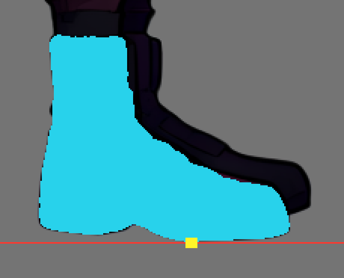

# Slasher near-hand / single-boot final replay

CPU-only source rebuild and deterministic cut-layer verification. No Godot, GPU, ComfyUI, or runtime combat was run.

Source `art_src/characters/slasher/base_rgba.png` SHA-256 `ba9af5139d225d492019c24c261bcd1ba9387d1bca7d10e7fd0fa3f5f1931bf3`; spec `tools/comfyui/specs/slasher_side.json` SHA-256 `783d59b812c2a7dfb8e8623ad12864047dab9179d7d03652200253697d503461`.

Both private isolated runs replayed `near_hand_repair/rebuild.py --work <run>/work` followed by `cut_layers.py` with the same official spec. All output hashes matched between runs.

| Override | Positive / negative SAM points | Mask components before → after existing 30px rule | Opaque owned pixels |
|---|---:|---|---:|
| hand | 4 / 4 | [6819] → [6819] | 6819 |
| foot | 4 / 4 | [12365, 5, 1] → [12365] | 12365 |

Formal runtime diffuse PNG set matches and all 12 PNGs are pixel-identical to isolated output. `character.json` semantic equality: **True**; `slasher.json` semantic equality: **True**.

The two rebuilt full-canvas overrides also match the formal registered overrides pixel-for-pixel: `{'hand': {'formal_sha256': '18d024d38da8f329226bc09339cbed7758b9cef6a683a1a886931d2c2419270b', 'replay_sha256': '18d024d38da8f329226bc09339cbed7758b9cef6a683a1a886931d2c2419270b', 'pixel_exact': True}, 'foot': {'formal_sha256': '702d37fd217b851a5aae959b657471eafd1bd847d3b236a90a73576e45943c36', 'replay_sha256': '702d37fd217b851a5aae959b657471eafd1bd847d3b236a90a73576e45943c36', 'pixel_exact': True}}`.

Spec wrist/palm is `[333.0, 570.0]`, fingertip `[346.0, 690.0]`. Using the production cut affine, hand nearest alpha≥20 is {'nearest_alpha20_pixel': [9, 36], 'distance_texture_px': 0.5323991408220777, 'within_1px': True, 'within_3px': True}; arm-lower nearest alpha≥20 is {'nearest_alpha20_pixel': [48, 162], 'distance_texture_px': 0.34198172883882616, 'within_1px': True, 'within_3px': True}. Distances are measurements, not an added acceptance threshold.

Near boot source alpha contains 12365 nonzero pixels after the reviewed binary mask and existing component rule. At spec ground_y=1192, 4 owned opaque pixels span x=[406, 409]; the reviewed positive sole point `[327, 1180]` has source alpha 255. This source check does not certify posed runtime foot contact.

Negative controls passed: an incorrect source hash is rejected; an all-opaque false-alpha image is rejected; changing one RGB channel in an owned source pixel is rejected. The actual rebuild preserved source RGB and source alpha on the owned mask exactly.

Not covered: runtime animation/combat, full armor removal or underlayer coverage, native Forward+ lighting, and visual acceptance of both feet/facings. Root's planned affected suites and screenshots remain separate acceptance evidence.

See `repro.json` for exact commands, exit codes, logs, hashes, dimensions, alpha counts, and per-file comparisons.
