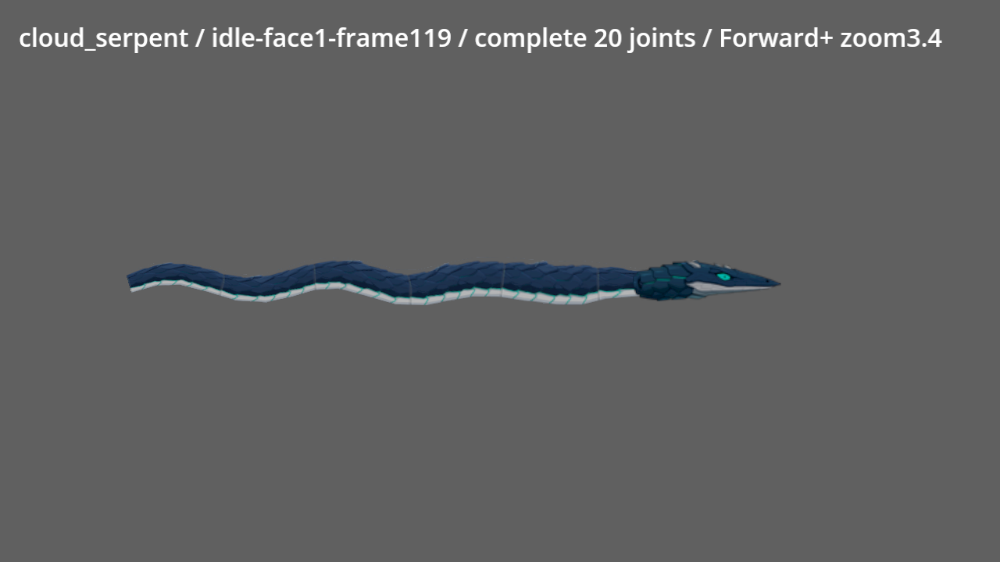
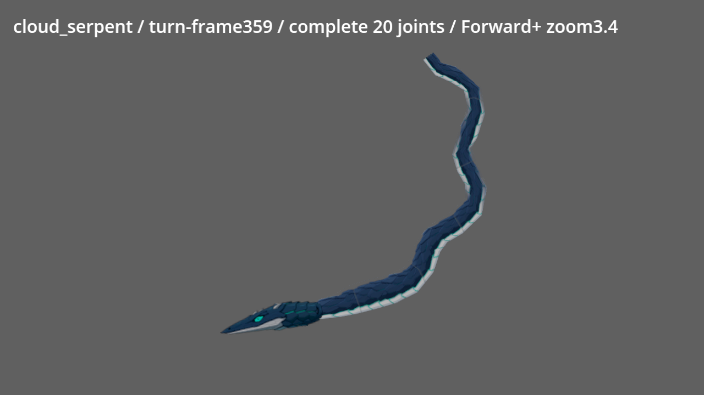
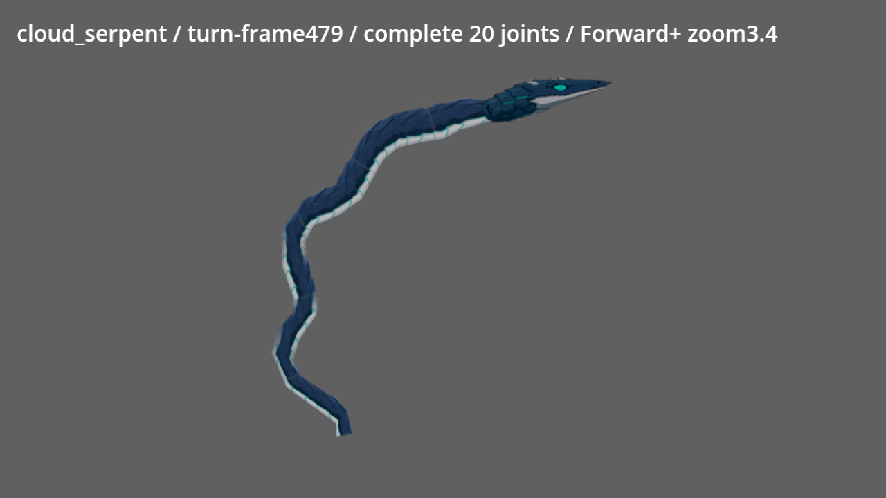

# NE-90 雲蛇腹面與頸部修復

最終基準：`4d3de9d8fd0aebb326f713c85fcad3ea3cecce2e`，2026-10-10。沿用仍在進行中的 NE-90：動作接縫驗收與 Commit-6 已涵蓋本次雲蛇缺陷，交付追加 Commit-7。NE-98 已完成，沒有新增重複票。

## 問題與修正

左向頭的白腹朝下，身體白腹朝上。出生／重置 trail 現在立即設定正確手性，頭角度保持在一圈內。彎曲時可見身體各截面依自己的切線判斷腹面，約 1/6 秒連續轉換；頭跨過 ±90°時，朝舊方向的遠尾不會整條瞬間翻色。

片段著色器混合正反兩份完整貼圖取樣，避免過渡時把鱗片壓成拉伸橫條。只改顏色，保留原 UV 由 Godot 解碼 CanvasTexture 法線；沒有自訂 NORMAL、NORMAL_MAP 或 light，既有法線品質啟停保留。[CanvasItem 介面](https://docs.godotengine.org/en/stable/tutorials/shaders/shader_reference/canvas_item_shader.html)。

身體原寬 9 世界像素，直接終止在頭貼圖左切邊；頭該處實際不透明截面更窄，造成明顯直切口。保持原立繪，在原頭圖 `(12,17)`、高度 19 來源像素的不透明頸段內接合，前兩個間距平順接回原身寬。二十節、間距、尾端與判定點保留。

僅修改 Worm、雲蛇接點設定、相關測試與本次設計／證據。PartCreature、ChainCreature 和其他角色來源未修改。[設計與校準依據](../../../../design/12-cast-redraw/WORM_NECK.md)。

## 驗證分層

| 項目 | 結果與範圍 |
|---|---|
| 真缺陷反例 | 修前 ChainCreatureSuite 219 檢查，12 失敗：左／斜左腹面 UV、四方向不透明頸部接合；見 tests-red.log |
| 有效反例 | 真 Worm 暫時改回全身跟頭翻面：32 檢查、2 失敗，最大單幀 UV 變化 37 像素、遠尾腹面錯側；mutant.log。runner finally 還原原檔 |
| 修後連續轉向 | 兩圈、480 格，最大可見 UV 變化 3.700001 像素／幀，3 個頭尾相反方向樣本；32 檢查通過，unit.log |
| 受影響測試 | 固定 bca11c2f3，SHARDS=2：23 群、34,802 checks、新失敗 0、已知失敗 0，319 秒、exit 0；changed.log、test-shards。完成後 shader 僅移除自訂法線，網格／測試門檻沒有再改 |
| 最新基準局部複驗 | 固定 4d3de9d8f，ChainCreatureSuite、FloodPitSuite、EnvironmentSuite，SHARDS=2：6,282 checks、新失敗 0、已知失敗 0，29 秒；final-related.log。包含最終 diffuse-only shader |
| 定稿保留 | 6 張來源／運行 PNG 與 2 張修前證據 PNG 的 Git blob 與基準相同；evidence.json |
| 最終原生渲染 | 最新 4d3de9d8f；Godot 4.7.2、Vulkan Forward+、Intel Arc B580；97 張 1280×720，exit 0、RAM 17.885 GiB、全部二十節及整頭均在畫面內；render.log、command-render.json |
| 人工外觀複驗 | 六 state × 兩面向與四個轉向截點共16完整圖，81個 ±90°附近逐幀樣本以7張不縮放裁切表檢視，另看原生64／65／66／74／435：白腹方向一致、頸部硬切消失，沒有整尾突翻或鱗片拉伸橫條 |

自動測試使用真 Worm 的網格頂點和 UV，與真 Head 的世界座標腹面方向比較；左右與兩個斜向、出生第一幀和穩定後都驗。頸部驗證是首截面的九個世界取樣轉回原頭圖，要求全部在圖內且 alpha≥0.5。全長保留二十節的原 trail，沒有短尾或放大頭藏缺陷。連續兩圈回歸逐幀確認頭白腹仍在下側；要求頭尾相反方向樣本大於零，反例會真失敗。

以上視覺通過僅涵蓋本次腹面翻轉、過渡與頭身直切口。97 張是預覽舞台原生渲染，7張裁切表另列、不充作完整原圖；不宣稱所有章節外觀通過。雲蛇既有高振幅折線、原尾端平切、其他角色四足／翼片問題維持原票追蹤，NE-90 保持進行中。

## 修前／修後

## 重現

在專案根目錄使用 `C:/ComfyUI/venv/Scripts/python.exe pm/Nest-Egg/attachments/NE-90-worm-repair/run.py render`；相關局部測試用 `related --base 4d3de9d8f`，原受影響選集用 `changed --base bca11c2f3`。runner 在共用鎖內檢查 RAM≥4GiB；原生擷取前確認 Comfy server 已停止，結束釋放鎖，沒有啟停其他應用。
