# [ST-10] 檢查並修正過場舞台的佈景比例與位置

> 狀態：進行中

## 內文

### 需求
宵夜麵攤等過場舞台的佈景比例與位置不合理：燈籠大得像一顆氣球、擋在桌子前面，桌子與麵攤、板凳的地面接觸線對不上，演員站的地面和家具不在同一條地面線上，角色坐的板凳與桌子距離怪異。ST-9 修過一次仍然不對，原因是沒有一套「怎樣才算合理」的標準。需要建立過場舞台的尺寸比例表（以角色身高為尺）與位置規則（共用地面線、前後關係、構圖），逐一檢查修正第一章所有舞台，並讓過場檢查能提早抓到這類錯誤。

### 來源
2026-10-06，使用者試玩第一章後回報（附宵夜麵攤過場截圖）：「這裡的排版也很奇怪，之前不是有開票修正過了嗎？」。

2026-10-10需求補充：先完成序章至第三章，逐章劇本審查、正式主支線與演出、累積單檔發行；詳見[整體設計](../../design/20-campaign-experience/DESIGN.md)。

2026-10-10，正常遊玩閉環審查补充；需求與來源見[序章至第一章檢查](../../design/20-campaign-experience/CH01_PLAYABLE_REVIEW.md)。

### 驗收條件
- [x] 建立尺寸比例表：常見物件（門、椅座、桌面、吧台、麵攤、燈籠、碗、梯子、階梯、欄杆）相對角色身高的建議範圍，有出處
- [x] 第一章每一個過場舞台逐一檢查：物件大小在比例表範圍內、所有物件與演員的腳底落在同一條地面線（或明確的透視線）、前後遮擋合理、燈籠等吊掛物掛在支撐物上
- [x] 宵夜麵攤舞台重排：燈籠大小與位置、桌子、板凳、麵攤、碗的相對位置合理，凜坐在板凳上、碗在她面前的桌上、阿梨在攤位後或旁邊的地面上
- [x] 過場檢查加入：舞台物件尺寸相對演員的範圍、物件底邊與地面線的距離、演員與家具的重疊與接觸，違反時指出場景與物件
- [x] 修前修後截圖並排留存（每個修過的舞台）
- [x] 本票統整出的規則、尺寸比例、位置與檢查方法，寫進 skill `scene-staging`（`.claude/skills/scene-staging/`：關卡與過場的佈景、位置、比例、構圖、圖層），參考多個不同業界實例並附出處；之後做關卡、佈景與過場都必須先讀這份 skill

- [x] 最新新增的序章與第一章演出仍逐場檢查比例、支撐、人物接地与遮擋，真實畫面通過後才完成。

- [ ] 新增關爐、裝水、交盤出紙與吃麵演出逐件核對物件尺寸、支撐、人物接觸與前後狀態，附真實畫面。

### 測試流程
1. 逐一播放第一章全部過場，對照比例表檢查每個舞台
2. 執行過場檢查，確認沒有超標項目
3. 麵攤過場確認坐姿、碗、燈籠與攤位的相對位置

---

# 跟其他票的關係

- Blocks：NE-233
- Blocked by：NE-280
- Related：ST-9、NE-207、NE-210、BG-18

---

# Commit-1

## 內文

已完成：麵攤舞台重排。場景專屬物件的縮放改成「演員縮放 × 邏輯寬 ÷ 貼圖寬」（原本寫死倍率讓燈籠與桌子大 2.5 倍）；坐姿髖高重新量測（坐姿改用 IK 把腳平放在地上）；鏡頭中心 y 自動夾住，演員腳底不被對話框蓋住；過場檢查加入「腳底在畫面上的位置」規則（第一章全部動畫過場通過）。尺寸比例表與位置規則寫進 skill `scene-staging`。
尚待：其他舞台的物件比例逐一檢查（目前只量了腳底位置）、物件底邊與地面線的檢查、前後遮擋的 back／front 拆層。

### 測試結果

| 項目 | 結果 |
|---|---|
| 第一章地圖套件（含構圖檢查） | 通過，新失敗 0 |

### 截圖

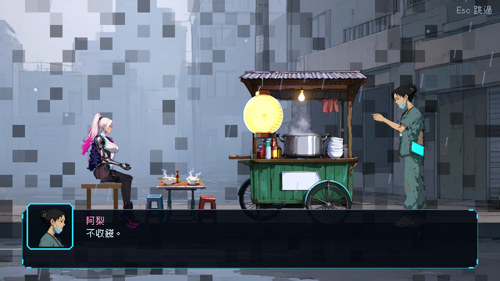
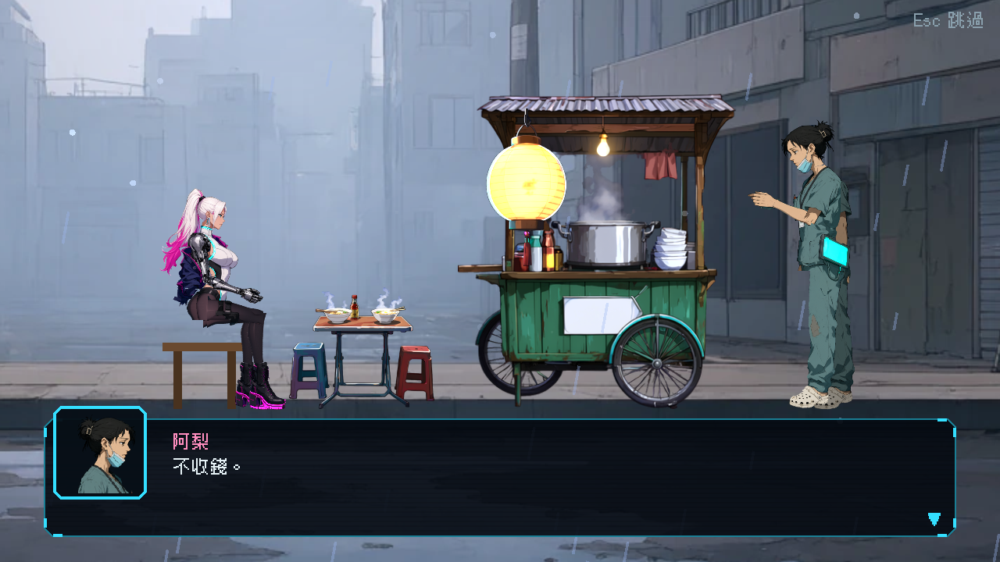

# Commit-2

## 內文

前門與廚房的原背景不足以供鏡頭調整，且重新縮放會改變家具與人物的相對位置。
本次交付兩份保留原畫所有像素與家具座標的外圈延展候選，連同可重現的加工與來源紀錄；失敗的加工不會覆蓋已審候選。素材逐張處理，關閉额外的參考前綴快取。
原生探索畫面仍有裁切，圖片明確標示為未採用候選；本次驗收範圍是素材及加工流程。

### 測試結果

| 項目 | 結果 |
|---|---|
| 受影響的局部回歸 | 3 組、7,557 項，新失敗 0、已知失敗 0，自然退出 0 |
| 加工与快取選項回歸 | 7＋5 項通過 |
| 資源匯入 | 3 個已同步基準皆自然退出 0，無腳本／解析／編譯錯誤 |
| 素材預算與原圖保留 | 0 違規；兩張候選每個原圖像素、家具座標相同 |
| 原始測試紀錄 | 15 行既有故障資料／物理清理測試訊息；無腳本錯誤，完整紀錄保留 |

[來源與完整測試證據](attachments/ST-10-extension-pipeline/manifest.json)

### 截圖

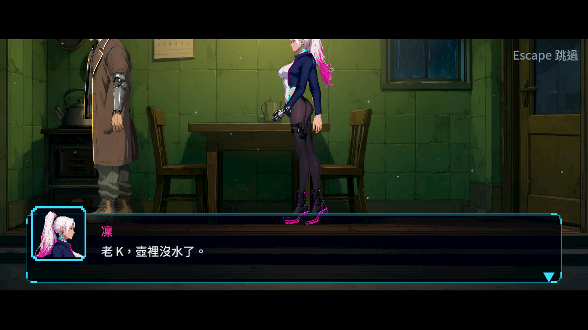

# Commit-3

## 內文

第一章現有的三場動畫過場裡，診間醒來時凜的頭頂被上方黑邊切掉，章末回家的廚房更嚴重：老 K 整顆頭都在畫面外，凜的頭貼著黑邊。原因是鏡頭為了讓腳底不被對話框蓋住而往下壓，而廚房的演員照家具的實際比例放得很高（凜約 221、老 K 約 236 像素），黑邊到對話框之間只有約 219 像素。過場檢查原本只看腳底，抓不到頭被切掉。

診間的凜坐在檢查台邊、腳懸空，鏡頭改用她實際的腳底位置來決定高度；她站起來落回地板時鏡頭跟著往下。廚房的鏡頭拉遠，最後往爐子推近的那一步也只推到兩個人的頭都還在畫面裡。舞台、家具與演員的位置和大小都沒有動，立繪也夠用，不需要先前準備的外圈延展圖。過場檢查新增兩類：演員的頭頂不能進到上方黑邊（依骨架身高、縮放與姿勢計算，在台詞、等待這些畫面停下來的步驟檢查）；舞台上補的擺設，畫出來的大小要等於它的世界尺寸乘上演員縮放，底邊要在地面線上或標明是掛著的。違反時會指出場景、步驟與演員或擺設。另外，重新產生第一章資料時，鷺、燈與阿梨的頭像會被改回借用的舊圖，已把產生器裡這三個頭像改成和現行資料一致。

兩場過場修前修後逐格看過：診間與廚房的頭、頭髮都完整在畫面內，腳沒有被對話框蓋住。第一章三場動畫過場的構圖檢查沒有任何問題；宵夜麵攤舞台的三件擺設（目前沒有過場使用）通過新的大小與落地檢查，把燈籠放大 2.5 倍或把桌子抬高都會被抓到。舊的第二關過場另有 6 筆構圖問題，那幾場等新章節重寫，這次沒有處理。

還沒勾的三條：演員與家具的接觸目前只檢查「有沒有寫明支撐」和腳底高度，沒有幾何上的重疊檢查；序章的演出與「關爐、裝水、交盤出紙、吃麵」這幾段演出還沒有進到 main，沒有東西可以驗。

### 測試結果

| 項目 | 結果 |
|---|---|
| 第一章動畫過場的構圖檢查（3 場） | 修前 3 筆頭頂被切；修後 0 筆 |
| 新檢查的自動測試（頭頂、坐姿、剪影、連續換鏡、擺設大小與落地） | 通過 |
| 原生連續畫面（診間 16 格、廚房 18 格，修前修後各一輪） | 自然結束、0 錯誤 |
| 受影響測試 | 18652 項檢查；新失敗 0、已知失敗 0 |

分支 `feature/scene-lighting`；提交見[遠端 main 上本票的提交](https://github.com/deadline314/Nest-Egg/commits/main/pm/ST/%5BST-10%5D%E6%AA%A2%E6%9F%A5%E4%B8%A6%E4%BF%AE%E6%AD%A3%E9%81%8E%E5%A0%B4%E8%88%9E%E5%8F%B0%E7%9A%84%E4%BD%88%E6%99%AF%E6%AF%94%E4%BE%8B%E8%88%87%E4%BD%8D%E7%BD%AE.md)。

### 截圖

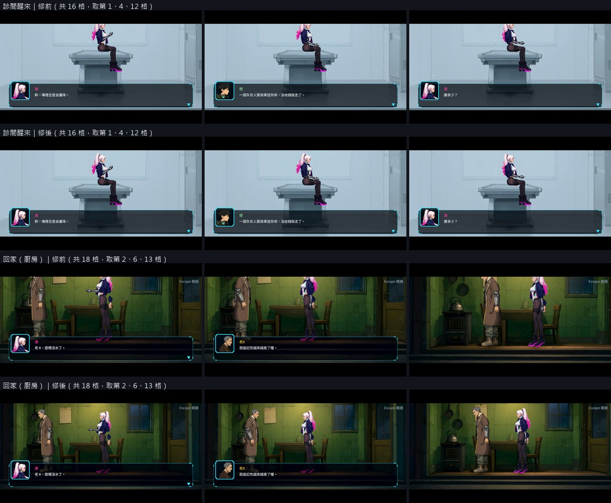

# Commit-4

## 內文

**問題**：過場檢查只看「擺設畫出來的大小是不是照演員縮放」和「有沒有寫明支撐」，不會判斷一件東西相對人的身高合不合理（燈籠比人大、桌子高到胸口都抓不到）；舞台立繪裡畫好的桌椅、檢查台不在資料裡，所以「凜坐在空氣上」「站著的人卡進板凳」這類錯誤完全檢查不到。

**改動**：
- 比例表變成資料（門、椅座、板凳、吧台凳、桌面、櫃檯、貨架、木箱、販賣機、路燈、吊燈籠、手提燈、瓶、杯、治療床），以主角身高 H 為單位，容許約 3 像素的量測誤差；新增種類或擺設只改資料。
- 舞台上補的擺設要登記種類，高度不在範圍內就報；燈籠這類有吊鍊、流蘇的只算本體；刻意誇張的寫明原因後免檢大小。
- 舞台檔可以登記立繪裡的家具（位置、頂面、種類、在不在演員那一層）。檢查會報：家具大小超出比例、家具底邊不在地面線上又沒寫支撐、演員坐著但臀部下方沒有座位（或腳比座面還高）、站著的演員和同一層的家具重疊。每一筆都指出場景、舞台與物件名稱。
- 第一章登記了診間的復原檢查台（量自立繪，約 0.59H）與麵攤的小板凳；規則與做法寫進 skill `scene-staging`。
- 逐場看 Forward+ 畫面時發現：寬銀幕黑邊開著時，對話框會移到下黑邊之上，框頂在畫面 233（共 360），但過場檢查還用沒有黑邊時的 266，所以開場凜的靴子、廚房兩人的小腿都被對話框蓋住卻沒被抓到。檢查改成直接用對話框的版面計算框頂，之後對話框改大小也會跟著變；違規時的訊息會列出是哪一步、哪個演員。依新的限制，開場鏡頭拉遠到 0.88、診間凜站起來後拉遠到 1.25；廚房和店面是同一棟房子，演員縮放改成和店面一致（凜 3.4、老 K 3.7），鏡頭維持 0.86，再拉遠就會拍到立繪外面。

**驗收**：三場動畫過場修前修後用 Forward+ 逐格看過：開場兩人全身都在黑邊與對話框之間、診間凜從檢查台下來後站在地面上、廚房兩人的頭與腳都完整（下圖第一張）。第一章全部動畫過場跑新檢查，沒有任何問題（診間的凜坐在檢查台上、麵攤三件擺設的大小都在範圍內）；自動測試用假舞台逐條驗證會被抓到：比人還高的櫃檯、浮在半空的板凳、坐在空地、腳比座面高、站進同一層的板凳、沒登記種類的擺設、放大 2.5 倍的燈籠、格式錯的家具資料；背景的桌子前站人、蹲姿、沒有地面線的舊舞台不會誤報。下面兩張是家具登記與立繪的對照（黃框＝登記的家具、綠線＝地面線、粉紅＝這個舞台的 H）。
序章與「關爐、裝水、交盤出紙、吃麵」的演出目前只在劇本規劃裡，還沒有成為過場資料，最後兩條等故事組交付後再逐場核對。

分支：[feature/staging](https://github.com/deadline314/Nest-Egg/tree/feature/staging)，已併進 main：[1877b9b2](https://github.com/deadline314/Nest-Egg/commit/1877b9b233d54f6be83b9bc7946c913bf90b3a45)

### 測試結果

| 項目 | 結果 |
|---|---|
| 受影響範圍的測試（17678 項） | 通過，新失敗 0（測試資料裡演員的腳原本放在舊框頂 266 之下，依新的框頂 233 調整位置，檢查的情境不變） |
| 新增檢查：比例表有效、八種違規各一個反例、四種不該誤報的情況、過場步驟真的會跑接觸檢查 | 通過 |
| 第一章動畫過場的舞台檢查 | 0 問題 |

### 截圖

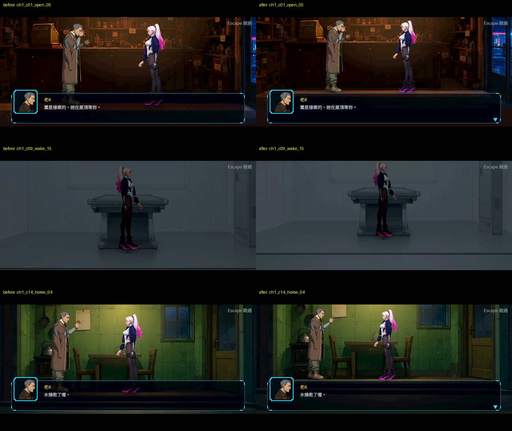
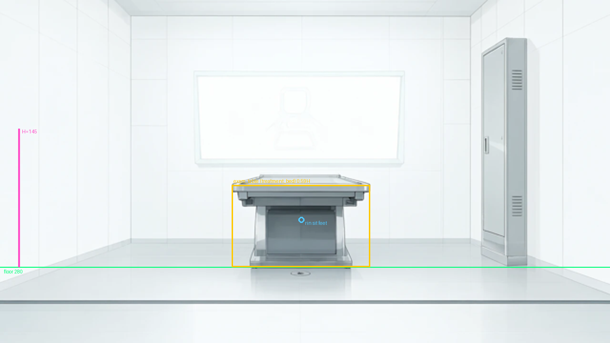
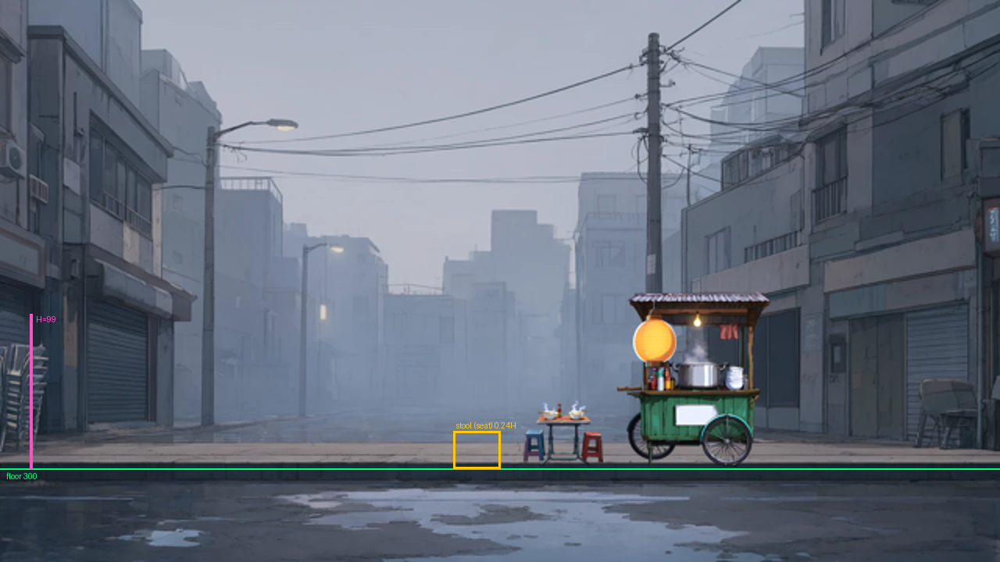

# Commit-5

## 內文

**問題**：上一次交付之後，序章開場、屋頂、復原館吧台、清晨麵攤與診間的談話都搬上了舞台（共 44 段，8 種站位），沒有一段被逐場看過。用原生 Forward+ 逐場拍下來後，接地、遮擋、頭腳位置都沒問題，但有三個舞台的人和家具比例不對，而且檢查抓不到，因為這三張立繪裡的家具沒有登記：
- 店面（序章開場，第三章早飯也用）：演員被縮到 2.9，櫃台高到胸口以上（0.77 個身高）。
- 廚房（回家，第三章晚飯也用）：演員被縮到 3.0，餐桌高到腰以上（0.62 個身高；一般餐桌約 0.43）。
- 復原館吧台（14 段）：演員 2.4，吧台只到大腿（0.51 個身高）、吧台凳只到膝蓋。

前兩個的原因相同：21:9 黑邊與對話框之間只放得下約 3 倍大的人，所以把人縮小了；背景沒有跟著縮，家具就顯得太大。

**改動**：
- 店面與廚房改成「人照家具的比例放、鏡頭拉遠」：人在畫面上的大小不變，家具回到合理的高度。店面 3.4／3.6、鏡頭 0.88，櫃台約 0.65 個身高；廚房 3.9／4.0、鏡頭 0.8，餐桌約 0.48 個身高、椅面 0.28、門 1.28。廚房要拉到 0.8 才放得下，原圖不夠寬，改用先前準備好的外圈延展版立繪（原畫每個像素與家具位置都不變，只是四周多畫一圈）。
- 復原館演員改成 2.0、鏡頭推近到 1.3：人在畫面上一樣大，吧台約 0.62 個身高，吧台凳回到比例表內。
- 三張立繪的家具（店面櫃台；廚房餐桌、椅面、門；復原館吧台與吧台凳）登記進舞台資料，之後縮放再被改掉，檢查會指出是哪個舞台哪件家具。第三章沿用這兩個舞台的九段戲一起改成同樣的數字，否則同一個舞台上的人會一段大一段小。
- 台詞、分支、旗標都沒有動；只改演員縮放、鏡頭與舞台資料。

**驗收**：
- 逐場：8 種站位各挑代表段落共 17 段，用原生 Forward+ 每 1.6 秒拍一格逐格看過。序章開場、屋頂（鷺）、復原館（阿梨，站著的各段）、麵攤（站著、付錢、留下）、麵攤坐著的兩段、診間坐在檢查台邊的各段、回家：演員腳底都在地面線或座面上，沒有站進家具裡，頭沒有進上黑邊、腳沒有被對話框蓋住。下圖是三個改過的舞台修前修後。
- 自動檢查：第一章與第三章的過場構圖、舞台家具比例、圖層順序共 2675 項，0 失敗。只改第一章的時候，同一組檢查指出第三章沿用同舞台的段落和第一章縮放不一（一段 3.0、一段 3.9），一起改完才全過。

**第 29 條還不能勾**，四段演出逐件核對的結果：
- 吃麵：凜坐在攤前的小凳上（座面有登記、腳踩在地上），麵碗在她面前的矮桌上，伸手可及。但沒有「吃」的動作，碗也沒有吃之前、吃完之後的差別（台詞說吃完了，畫面上的碗一樣滿）。需要角色組的進食動作，與一個會換樣子的碗。
- 交盤出紙：不是過場，是地圖上的交接櫃。櫃子現在會跟著進度換樣子：藍燈等收件、交盤後回執逐格送出、拿走後轉綠燈（NE-240 Commit-3，附原生連續畫面）。還缺凜伸手把盤放進去的動作（角色組）。
- 關爐、裝水：回家那一場只有台詞「我先把爐火關掉」、老 K 走到桌邊再走回來，加一聲開關聲。爐火、水壺、水缸都畫死在背景圖裡，畫面上沒有任何東西改變。要做成看得到的動作，需要：水壺與爐火改成舞台上獨立的擺設（圖已經有，關卡裡的廚房在用）、過場步驟能切換擺設的樣子（爐火熄、蒸汽停、水壺被拿起）、老 K 的伸手動作。前兩項是演出框架與故事組，第三項是角色組。

### 測試結果

| 項目 | 結果 |
|---|---|
| 過場構圖、舞台家具、圖層、第一章地圖與第三章劇本套件 | 2675 項，0 失敗 |
| 原生逐場畫面（17 段，修後再拍 5 段） | 都自然結束、0 錯誤 |
| 劇本重新產生 | 第一章 139 段、第三章 170 段；只有舞台步驟的縮放與鏡頭、三份舞台檔有變 |
| 受影響範圍的測試（併入最新 main 後） | 56085 項檢查；新失敗 1、已知失敗 0。那一項是音效套件的計時檢查「壓低後平順恢復」，和這張票無關：乾淨的 origin/main 單獨跑也間歇失敗。併入前那一輪另有人物走近反應 2 項在同時跑 14 個程序時失敗，單獨重跑 3 次都過，這一輪沒有再出現 |

### 截圖

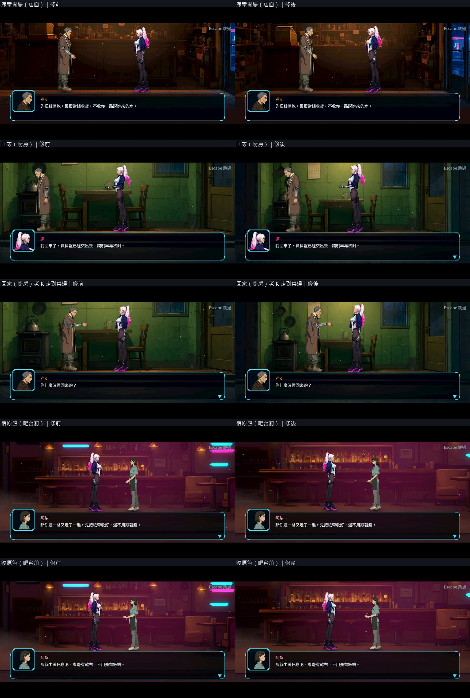
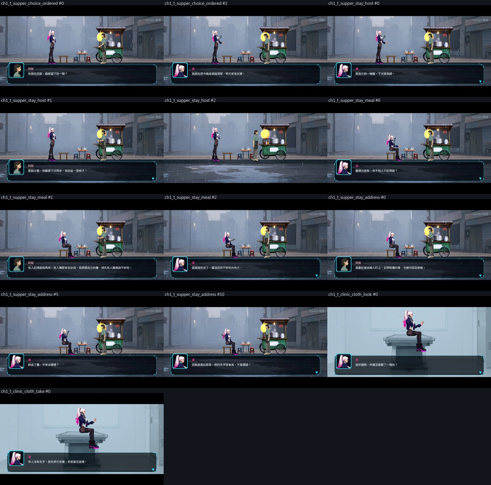
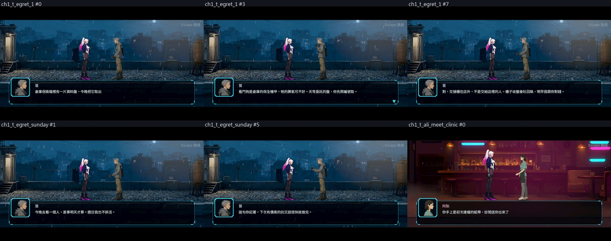

分支 `feature/scene-assets`；提交見[遠端 main 上本票的提交](https://github.com/deadline314/Nest-Egg/commits/main/pm/ST/%5BST-10%5D%E6%AA%A2%E6%9F%A5%E4%B8%A6%E4%BF%AE%E6%AD%A3%E9%81%8E%E5%A0%B4%E8%88%9E%E5%8F%B0%E7%9A%84%E4%BD%88%E6%99%AF%E6%AF%94%E4%BE%8B%E8%88%87%E4%BD%8D%E7%BD%AE.md)。

# Commit-6（吃麵前後的桌面狀態，進行中）

## 內文

凜說吃完之後，碗原本仍裝滿並冒煙。現在只有凜面前的左碗變空、停止冒煙，另一碗仍保留食物與蒸氣；接續報地址的場景及續玩都直接保留餐後樣子。取消重進回到滿碗，跳過不額外發錢、帳單或重複完成。

正式舞台、真正阿梨對話與選項的原生探針：原版13項有3預期失敗，修改版正常15、中斷18、跳過13、寫入12、新程序續玩6項全過；最新main合併後另驗正常、寫入與新程序續玩。原比例／圖層等焦點套件493項全過，最終原受影響選擇器：checks: 65544, new failures: 0, known failures (tests/known_failures.txt): 0  (wall time 988 s)。

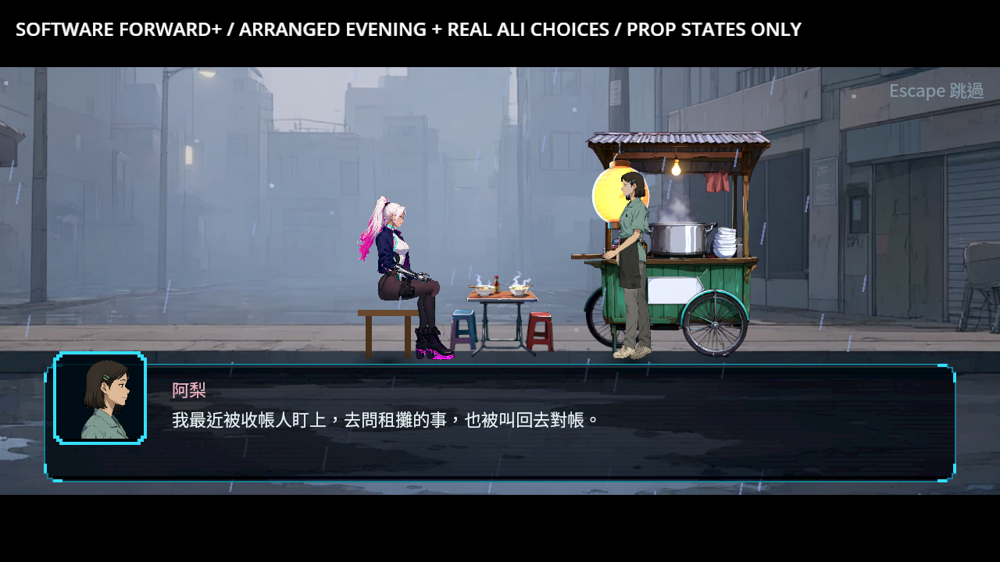
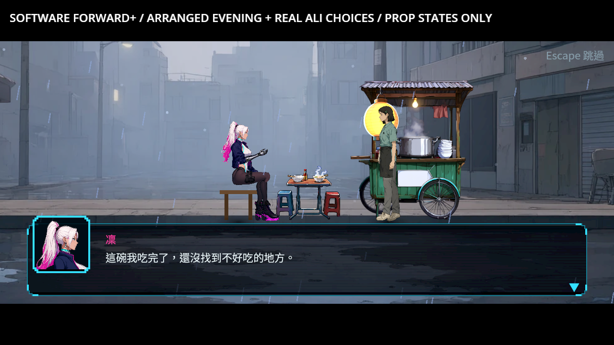
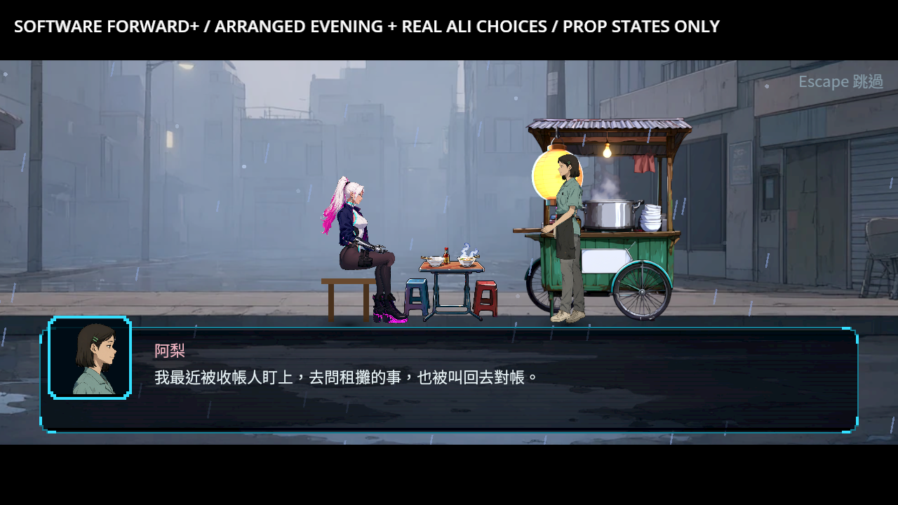

[原圖參考、生成來源、原生圖與全部測試／失敗紀錄](attachments/ST-10-meal-props/README.md)。雲端軟體Forward+與安排前置條件已標示；第29項的完整動作驗收保持原未勾狀態。

# Commit-7（廚房道具拆層素材候選，進行中）

## 內文

返家背景的壺與爐畫在一起，無法真正提起水壺，也沒有可辨的關爐控制。現在保留原圖，另交付帶瓦斯控制鈕的空爐背景與獨立透明壺候選，附五款不同團隊作品的實看圖與完整來源。候選在正式返家的鏡頭、演員倍率與走入後拍了原生比較，沒有替換正式舞台。

第一輪11項有2個preview失敗，畫面也抓到壺底浮起；修正等待及透明邊取樣後第二輪12項全過，兩輪皆0引擎ERROR。這些只驗候選載入與指定擺位，不是四段動作、人物接觸或全角色接點通過。原受影響選擇器0組；本批未更動遊戲邏輯、正式素材或測試。

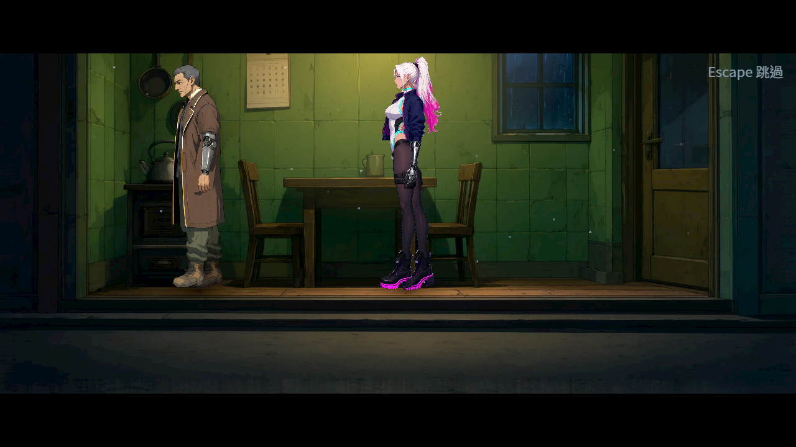
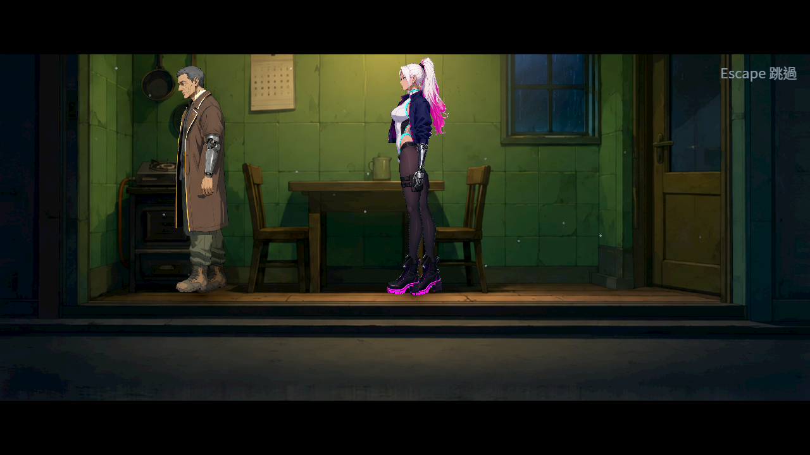
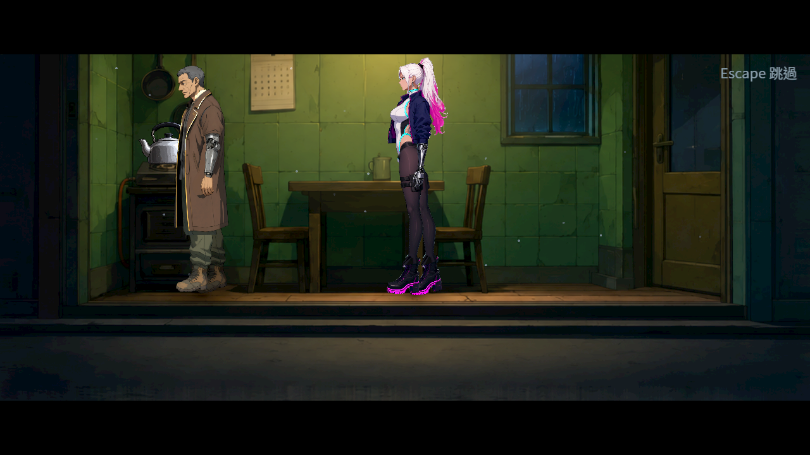

[原始候選、提示詞、研究圖與兩輪原生紀錄](attachments/ST-10-kitchen-candidates/README.md)。本票保持進行中。

# Commit-8（手部接觸指令與裝水候選，進行中）

## 內文

原本過場只能播預設手勢，手無法明確到達控制鈕或把手的位置。現在近側／遠側手可各自到達舞台點、緩入、換目標、隨人物移動並收回，保持兩段骨長；搆不到保留原姿勢並記錄一次警告，壞指令不清掉原接觸。途中收手的初稿會讓目標繼續漂移28.284271像素，修正後為零，反例與原始來源保留。

原受影響76組最終94,561項、0新／0已知失敗、510秒。原生採正式返家舞台、鏡頭與人物定義的獨立診斷，停用新指令17／4→啟用17／0，0ERROR／洩漏；八張最終圖逐張檢視。不是舊正式版有此新功能，也不是完整Main路線。初輪probe淡入參數導致黑幕，數值結果與黑圖保留但不算視覺通過；最終加入可見性斷言。

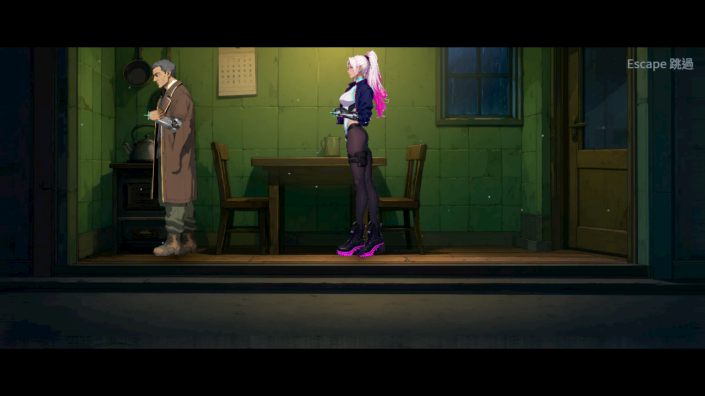
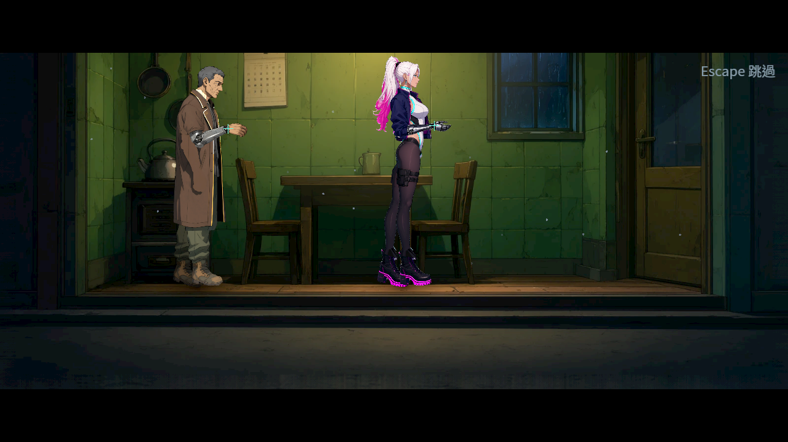
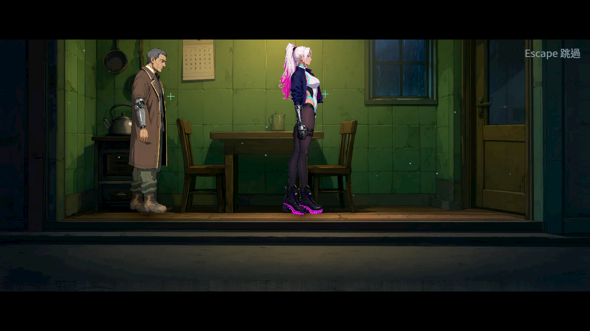

另凍結帶支架與龍頭的甕、空白紙籤修正、開蓋壺及開桿候選，保留完整提示詞與實際尺寸／SHA。首張紙籤文字退件；整甕兩狀態會帶動甕身／支架位移，不能直接交替採用，後續須把控制桿獨立運動。候選未採用至正式art／stage／story。

[研究圖片、原生圖、邊界反例、完整輸出與重跑方法](attachments/ST-10-hand-contact/README.md)。未啟用握持變體時，新指令的目標是手腕，不能代稱掌心已握住道具；正式關爐、裝水、交盤、吃麵與全角色接縫條件仍未勾選。本票維持進行中。

# Commit-9（正式返家關爐、持壺與裝水，進行中）

## 內文

原本凜關爐只有音效、老K走到右邊等候再返回，壺與爐仍烘在背景。現在採用無壺背景與甕／桿、壺／蓋分件：凜實際轉爐鈕熄火，老K握同一把壺、開蓋、操作龍頭裝水、關水關蓋，放回耐熱墊。滿壺不重開火、不倒進乾杯；原台詞、三語、三秒遺忘停頓、任務、物品與經濟結果保留，44.14秒估算仍在原60秒預算內。

接觸追實際道具矩陣與來源像素掌心，圖集支點／鉸鏈跨匯入解析度保持位置；握持只接受已接觸，不瞬移、不倒壺。每舞台最多八件、弱引用清理、隱藏水流停更新；作者透過有限具名指令與資料擴充，不用另寫整段廚房控制器。

首輪完整回歸實際89,774項／3新失敗，另1程序signal11中止，不能算通過。餐桌0.53H是真的比例問題：實際縮背景、重新對齊地面與支撐，沒有放寬比例表；隨後接觸檢查又抓到69px內圈失聯，調整轉鈕站位／角度及先向上提壺後解決。崩潰同組在原始基底與本次各5,500／0未再現，保留未知根因，不宣稱修好。原效能門檻、選擇器及known failures不變。

最終原76組95,292項、0新／0已知失敗、515秒。真正Main自然完成、裝水中取消重入16／0，另程序接受結算及冷壺預設7／0，真Escape跳過11／0，共34／0、三組0引擎ERROR／洩漏；拍到八個實際機械階段。自然流程188個全權重接觸取樣最大0.000126舞台px、握持0.0000853px。素材管線4項unittest及確定性重建通過，原始生成檔／失敗／負控制全部保留。前票d7c50ec3完整CI真job96,974／0、662秒亦附。

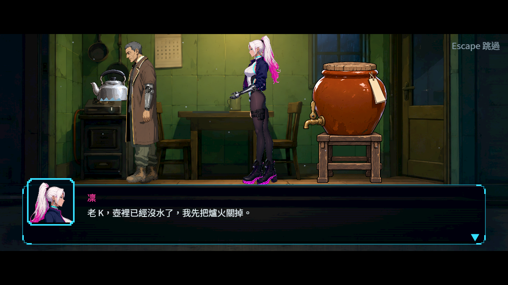
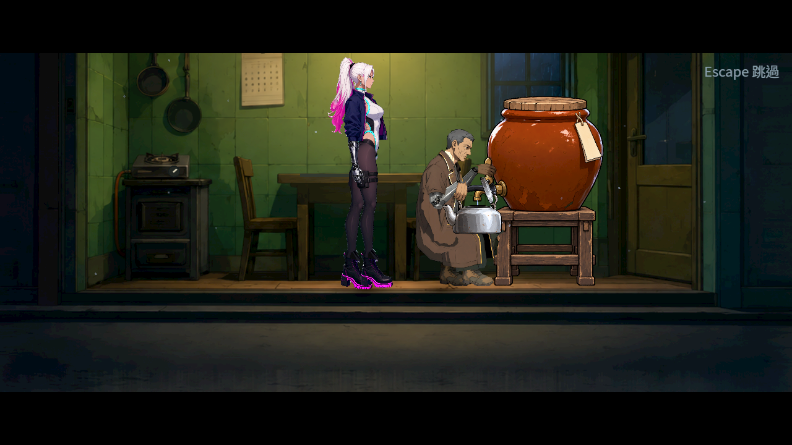
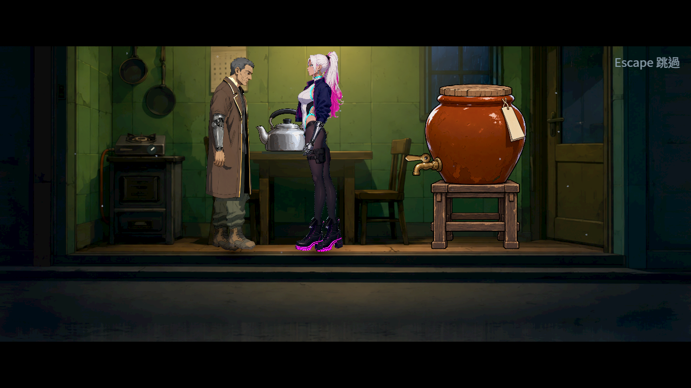

[八階段原圖、同類遊戲圖片、全部失敗／來源雜湊／重跑方法](attachments/ST-10-kitchen-actions/README.md)。冷壺預設圖是接受結算後另建舞台，不冒稱可操作的完成後廚房地圖；安排前置與探針推進台詞，不冒稱真人整章、實體硬體或全角色接縫。吃麵實際動作、地圖交盤伸手仍待後續，本票保持進行中，最後綜合條件不代勾。

# Commit-10（正式持筷進食與餐後地圖，進行中）

## 內文

原本餐後只把左碗變空，凜沒有取食動作。現在握同一雙筷子從左碗取麵、由臉前送入口，筷尖真正碰到呼吸中的嘴唇後食物才消失，再放回餐具並收手。桌面與坐位按實際支撐重新核對，舞台和地圖共用物理尺寸；餐後地圖與另程序續玩也顯示左碗空、右碗有食物，各保留一雙餐具，不重發錢、物品或完成結果。

去掉表面／舊發光圖的固定左筷，避免取起後仍有另一雙或光影殘影。首個水平姿勢雖數值到點但遮臉，退件；新貼圖又被匯入工具覆寫座標而放成大桌，亦以原生圖退件。修後保留作者座標，新增實際桌寬與筷尖在可見碗上的檢查；來源、失敗與退件圖完整保留。

原80組97,241項、0新／0已知失敗、507秒。真Main自然、持物中取消重入、跳過、保存、另程序續玩與餐後地圖共104／0，六程序0引擎ERROR／洩漏。閉手／旋轉／部件與繼承幫手857／0，獨立機械與壞尺寸控制12／0，兩種素材工具各4項通過，14個成品SHA重建一致。不是人類整章或實體輸入／GPU驗收；本票維持進行中。

[原生圖、同類遊戲圖片、退件、原始輸出與重跑方法](attachments/ST-10-meal-actions/README.md)。
