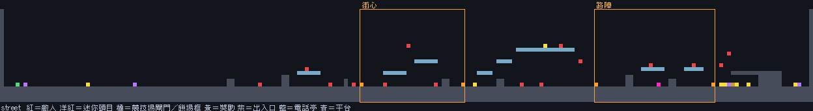
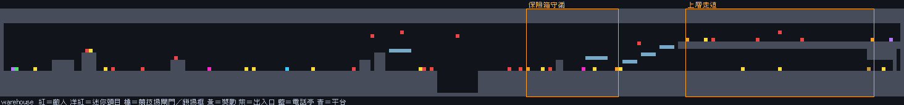
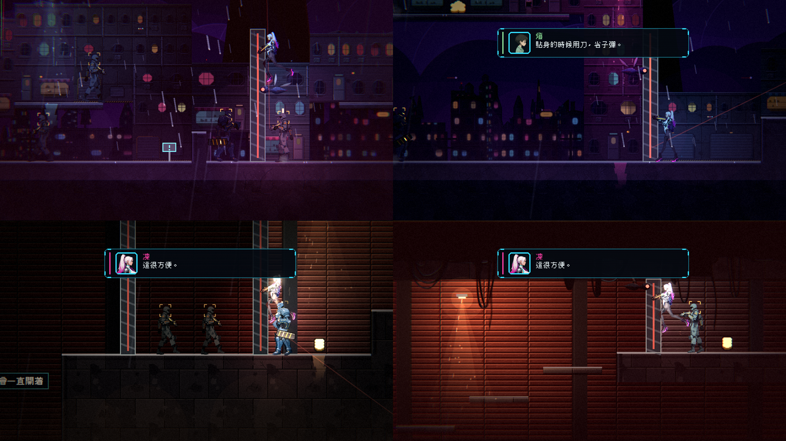

# [ST-11] 重新設計第一章的節奏與地圖

> 狀態：進行中（街道與倉庫重做完成；遊玩時長估計與其餘區域的迴圈、秘密待做）

## 內文

### 需求
第一章現在是「走一段路、看一段過場、再走一段路」，遊戲體驗被切得很碎，戰鬥太少、地圖無聊。需要依業界做法重新設計整章的節奏與八個區域的地圖：玩家大部分時間在戰鬥與探索，有更多敵人與有趣的遭遇（含鎖場高潮與迷你頭目）、有趣的地圖（迴圈、捷徑、秘密、看得到拿不到的獎勵、垂直空間、機關謎題、地標），敵人有分工並限制同時攻擊的數量，教學曲線（引入、練習、組合、考驗）貫穿全章。劇情改成在地圖上直接表達（見 ST-12），過場只留改變世界狀態的大事。

### 來源
2026-10-06，使用者試玩第一章後回報：「目前第一章做的非常無聊，走一段路看一下過場動畫，把整個遊戲體驗切的太碎了，最好是可以打一下架，然後做一個比較好玩的地圖，有多一點敵人，有趣的地圖設計。然後再看過場動畫」。使用者全權交給我決定，以業界最佳實例為主。

### 驗收條件
- [x] 章節設計文件：章節目標、一頁式地圖圖解（區域連線、迴圈、捷徑、鎖與鑰匙、秘密、存檔點、地標）、逐區表（功能、時長、遭遇數、敵人種類與上限、新機制、獎勵、劇情窗口）、教學表、張力曲線，放進設計文件
- [ ] 八個區域的地圖依設計文件重做：每區至少一條迴圈或捷徑、一個看得到拿不到的獎勵、一個秘密、一個遠處可見的地標；有上下兩層的垂直空間與機關謎題
- [x] 遭遇：全章約 22–26 場，每區 1 場鎖場（區域高潮）＋ 3–5 場開放遭遇，兩個迷你頭目與一個章末頭目；遭遇依「預告、接觸、加壓、高點、收尾」安排，敵人有分工（突進、遠程、扛盾、高處）
- [x] 同屏存活敵人 ≤ 6、同時主動近戰 ≤ 2、遠程 ≤ 2（前兩區更少），以資料設定的攻擊令牌控制（令牌已完成，同屏存活數的檢查待地圖重做時加入）
- [ ] 新機制每個走「引入、練習、組合、考驗」，一章只引入 3–4 個新東西
- [ ] 首次通關預估 30–45 分鐘；每分鐘遭遇數 0.5–0.8；任一區連續無遭遇 ≤ 60 秒（以自動遊玩或腳本估算，並用實際遊玩校正）
- [x] 所有地圖通過可達性檢查（出入口、機關、鎖與鑰匙、所有獎勵與敵人在可達處），沒有卡死
- [x] 每個區域截圖（含全圖鳥瞰與遭遇處）存檔
- [x] 本票統整出的規則、數值與檢查方法，寫進 skill `chapter-design`（`.claude/skills/chapter-design/`），參考多個不同業界實例並附出處；之後設計章節都必須先讀這份 skill

### 測試流程
1. 從新遊戲玩到章末，記錄時長、遭遇數、死亡處
2. 逐區檢查迴圈、捷徑、秘密、獎勵與地標
3. 執行地圖與敵人的自動檢查

---

# 跟其他票的關係

- Blocks：ST-12、NE-216
- Blocked by：無
- Related：ST-4、ST-6、ST-7、ST-9

---

---

# Commit-1

## 內文

已完成：攻擊令牌。同時「主動攻擊」的敵人有上限（近戰與衝撞合計 2、遠程與爆炸與光束合計 2，輔助類不受限，頭目不受限），設定放在 data/combat/attack_tokens.json，區域可用 LevelData.attack_caps 調低（前期區域用）；敵人在預兆開始時自動領取、預兆加 1 秒後逾時歸還，死亡與離開場景立刻歸還，所以被擊暈或卡住的敵人不會一直占著；24 種敵人行為的「要不要開始攻擊」判斷都加上令牌檢查；沒有關卡（單獨測試敵人）時不限制。
尚待：鎖場遭遇機制、第一章地圖與遭遇重做、設計文件。

### 測試結果

| 項目 | 結果 |
|---|---|
| AttackTokensSuite（新增：預設上限與類別對應、領取與歸還、逾時歸還、區域覆蓋與壞資料、五個清掃兵同時看到玩家時同時預兆 ≤ 2 且每個都輪得到、死亡歸還、離開關卡清除） | 22 項通過 |
| 完整測試（平行） | 新失敗 0 |

---

# Commit-2

## 內文

已完成：鎖場遭遇機制。新機關種類 ENCOUNTER（區域高潮）：玩家走進範圍就鎖上同頻道的競技場閘門（閘門的 arena_gate 選項，平常打開、不存進世界狀態，所以重生時不會把人關在裡面），範圍內事先放好的敵人就是成員，成員與增援全部倒下才升起閘門並顯示一句話；增援在成員剩 1 個以下時輪流從範圍左右邊緣加入；成員一開始就是空的（持久世界先前殺光）不鎖人；超過 max_lock_seconds 強制解鎖並記錄具體位置；完成狀態存進世界狀態，之後不再觸發；開始時可顯示一句話並播氣泡短句。同時修正我先前三個測試套件（DeathFlow、Continuity、MapBubbles）結束時把「過場自動略過」設成關閉、害後面的套件在有過場暫停的狀態下跑而偶發失敗的問題（現在還原成原本的值），這是前面幾次「偶發計時型失敗」的真正原因。
尚待：第一章地圖與遭遇內容、設計文件、截圖。

### 測試結果

| 項目 | 結果 |
|---|---|
| EncounterSuite（新增：資料規則、鎖上與清完打開、完成後不再觸發、增援、成員已死不鎖人、逾時解鎖、競技場閘門不存檔且一般閘門不變） | 23 項通過 |
| 完整測試（平行，連跑兩次） | 新失敗 0 |

---

# Commit-3

## 內文

已完成：設計文件 [CH01_PACING_V2.md](../../design/13-story-v2/CH01_PACING_V2.md)（章節目標、比例、區域功能與遭遇表、地圖設計規則、遭遇與敵人規則、檢查、風險）。街道與倉庫依設計重做：全章 22 場遭遇（街道 9、倉庫 13），其中 4 場鎖場（街心、路障、保險箱、上層走道），2 位迷你頭目（看門狗、督察）；新增迷你頭目「收帳人·督察」（傷會留著，28 點生命，含圖鑑卡片、特效與音效設定）；街道有高路（階梯平台通往屋頂帶）、秘密房與看得到要繞才拿得到的獎勵，倉庫有貨櫃頂的槍手與醫療針、階梯平台形成的垂直迴圈、下層走道盡頭的裂縫牆；產生器新增 `Area.encounter`（成員數、同屏上限、鎖場範圍內敵人數的檢查）、設計資料輸出（`data/levels/ch1_design.json`）與一頁式地圖圖解（`--render`）；`Chapter1MapSuite` 改成讀設計資料檢查（遭遇數 22–26、鎖場 ≥ 4、閘門成對且頻道對得上、範圍不重疊、每場成員 ≤ 4 且含增援 ≤ 6、戰鬥區都寫明迴圈／獎勵／秘密／地標／垂直空間），並真的把每場鎖場打完（四場都能打到解鎖）；skill `chapter-design` 補上專案內已有的工具對照表與引擎保留字元。
尚待：首次通關 30–45 分鐘、每分鐘遭遇數的估計與實際遊玩校正；屋頂、當舖、電話亭巷的迴圈與秘密（休息區，設計文件已說明不要求）；新機制「引入、練習、組合、考驗」的逐區對照用實際遊玩確認；遭遇之間的地圖氣泡（見 ST-12）。

### 測試結果

| 項目 | 結果 |
|---|---|
| Chapter1MapSuite（改寫成讀設計資料；新增遭遇檢查與四場鎖場打到底） | 818 項通過 |
| Chapter1EnemiesSuite（加入督察） | 通過 |

### 截圖

