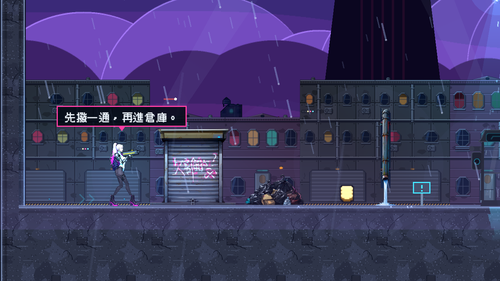
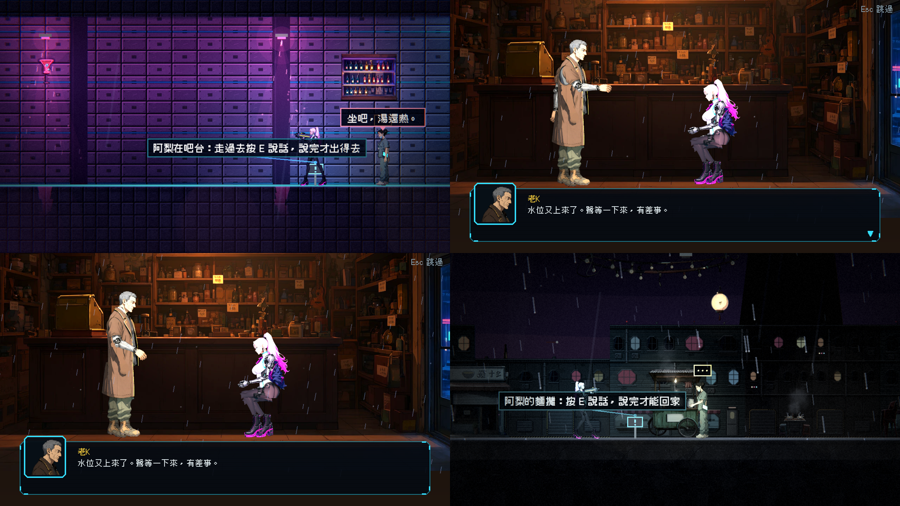

# [ST-12] 重新編排第一章的劇情與過場

> 狀態：完成

## 內文

### 需求
目前過場動畫太多、太瑣碎，看不出在做什麼（推進劇情？），表達的事情又太少。很多事情可以直接在地圖上說（對話氣泡、無線電、環境敘事、戰鬥中的短句），不需要全部做成過場動畫。需要重新設計並重新編排第一章的劇情：判定哪些事真的需要過場（改變世界狀態、角色關係不可逆、新區域或新能力的首次揭露、章末），其餘改成地圖上的表達；過場數量與長度大幅降低但每一段都有明確的敘事目的；新增「地圖上的短對話」功能（不鎖操作、不停遊戲、可自動消失）。

### 來源
2026-10-06，使用者試玩第一章後回報：「目前過場動畫非常不懂在幹嘛，推進劇情嗎？有時候可以直接在地圖上說話，不見得所有東西都要過場動畫。過場動畫表達的事情也太少了，就像我剛剛說的，非常瑣碎。幫我重新設計然後重新編排」。

### 驗收條件
- [x] 劇情窗口表：第一章每個劇情窗口的目的（要讓玩家知道或感受什麼）、手法（環境、氣泡、廣播、過場）、位置、字數；過場清單附判準說明
- [x] 過場全章 ≤ 3 次（開場 ≤ 20 秒、中段大事 ≤ 45 秒、章末 ≤ 60 秒），一律可跳過；兩次過場之間至少 8 分鐘遊玩；過場佔總時長 ≤ 5%
- [x] 地圖上的短對話功能：不鎖操作、不停遊戲；每句 ≤ 18 字、同屏 ≤ 2 個、顯示時間隨字數；戰鬥中只出 ≤ 10 字的短句；死亡重來時不重播
- [x] 原有過場的內容拆成氣泡、廣播與環境物件（文件、海報、塗鴉），重要資訊用氣泡加 HUD 一行重複
- [x] 每個保留的過場都表達更多事情（關係、世界狀態改變、伏筆），並通過 skill `scene-staging` 的構圖與比例檢查
- [x] 劇本資料通過 `StoryLint` 與過場檢查；台詞符合文風規則
- [x] 重新跑完整章：沒有「走一段路就被打斷」的感覺（任兩段地圖對話之間至少 20 秒純遊玩）
- [x] 本票統整出的規則、數值與檢查方法，寫進 skill `chapter-design`（`.claude/skills/chapter-design/`），參考多個不同業界實例並附出處；之後設計章節都必須先讀這份 skill

### 測試流程
1. 從新遊戲玩到章末，計算過場次數與長度
2. 確認地圖上的對話不鎖操作，戰鬥中不出長對話
3. 逐一確認每段過場的敘事目的

---

# 跟其他票的關係

- Blocks：無
- Blocked by：ST-11
- Related：ST-3、ST-9、ST-2

---

---

# Commit-1

## 內文

已完成：地圖上的對話氣泡功能。劇本場景 mode 為 bubbles：講者頭上冒出一行短句，不暫停、不鎖操作、不改鏡頭；每句 ≤18 字、一段 ≤4 句；同屏最多 2 個（新的出現時舊的淡出）；顯示時間 1.2 秒 + 0.1 秒 × 字數（上限 4 秒）；戰鬥短句（場景標 bark）每句 ≤10 字、一段 ≤2 句；一輪只播一次所以死亡重來不重播；講者不在地圖上（廣播裡的聲音）時整段改用通訊面板；關卡結束時還沒播完的場景會結束，等著它的流程不會卡住；測試用的 auto_skip 立即結束並照樣寫旗標。劇本資料檢查會報告超字數與超句數。
尚待：把第一章的過場內容拆成氣泡、廣播與環境物件；過場全章 ≤3 次；劇情窗口表；氣泡規格寫進 skill `chapter-design`。

### 測試結果

| 項目 | 結果 |
|---|---|
| MapBubblesSuite（新增：字數與句數規則、顯示時間、同屏上限、不暫停、通訊備援、一輪一次、關卡結束不卡住、auto_skip） | 22 項通過 |

### 截圖

---

# Commit-2

## 內文

已完成：第一章劇情重編。依判準（改變世界狀態、關係不可逆、首次揭露、章末）只留 3 次過場：開場 `ch1_c01_open`（原序幕與當舖開場合併並砍短，預估 15 秒，預算 20）、診間 `ch1_c09_wake`（預算 45）、章末回家 `ch1_c14_home`（預算 60）；原本的晚飯、屋頂差事、出門、街道提示、倉庫水坑與資料盤、復原館、麵攤都拆成：地圖氣泡（當舖廚房、屋頂、街道出門、復原館、麵攤）、廣播（燈的提示與倉庫段落）、戰鬥短句（四場鎖場開始各一句）與玩家主動按鍵的人物對話（老 K、鷺、阿梨，新增場景人物資料）；所有舊式鎖操作的過場文字全部移除。旗標改成真的有人讀：前門要先聽完鷺的差事、樓梯要先吃晚飯、復原館出口要先和阿梨說話、麵攤回家要先聽完阿梨說的話（出入口鎖住時會提示怎麼做），原本只寫不讀的三個旗標移除。過場檢查器新增預估播放秒數與 budget 預算檢查；劇情窗口表與被拆掉的原過場對照放在 [CH01_NARRATIVE_V2.md](../../design/13-story-v2/CH01_NARRATIVE_V2.md)；`Chapter1MapSuite` 新增劇情編排檢查（過場恰好 3 次且各在預算內、沒有 cinematic、氣泡觸發點間隔 ≥ 18 格、人物的對話場景都存在）。
尚待：實際遊玩校正（氣泡被跳過率、地圖對話之間的間隔）；未重寫的第二章劇情不在本票範圍。

### 測試結果

| 項目 | 結果 |
|---|---|
| Chapter1MapSuite（新增劇情編排檢查；旗標與走查改成新劇情） | 通過 |
| 完整測試（平行） | 見 commit 前最後一次執行：新失敗 0 |

### 截圖

