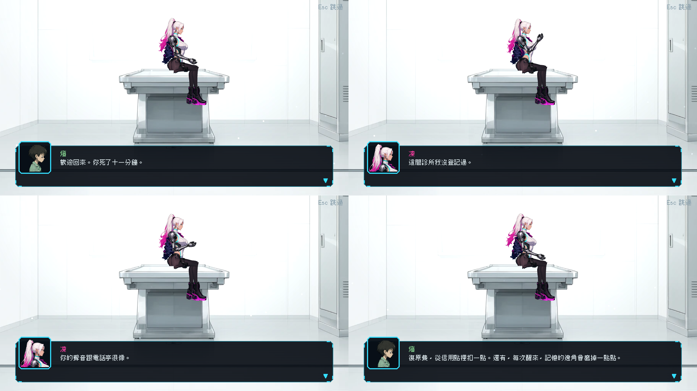

# [ST-13] 修正第一次死亡的復活流程

> 狀態：完成

## 內文

### 需求
第一次「一定要死」才能推進的地方（水坑）死亡後，直接回到電話亭，沒有解釋為什麼；原本設計的診間（復原館）醒來的過場動畫也沒有直接播，而是先回電話亭。這是流程 Bug。需要設計合理的過程與理由：第一次死亡時凜還沒登記復原點，由收屍人把遺體運到復原館做「初次建檔」，診間過場講清楚三件事（為什麼能活、為什麼這次在這裡、之後會在電話亭醒來並扣信用點、記憶磨損），結尾電話亭亮起「已登記」；之後所有死亡回電話亭，用 2–3 秒的短演出（前幾次句子輪播），不再提診間。死亡場景用資料指定，旗標在過場完成才寫入。

### 來源
2026-10-06，使用者試玩第一章後回報：「第一次一定要死才能推進的地方，後面是在診間醒來，我覺得那部分沒問題，但沒有解釋為什麼會直接回到電話亭，坐車子嗎？還是有飛機把主角丟進來，要有一個合理的過程跟理由回到電話亭。然後死掉之後也沒有直接進入診間那部分的過場動畫，會先回到電話亭。這個最好也修正」。

### 驗收條件
- [x] 水坑死亡後直接進入診間過場（不先回電話亭），過場有交代：怎麼被運來（收屍人與車）、為什麼這次在診間、之後怎麼辦
- [x] 過場結尾電話亭亮起「已登記」，玩家學到「電話亭是復原點」；之後所有死亡回電話亭
- [x] 一般死亡的短演出：2–3 秒（暗轉、聲音、一句旁白），前幾次句子輪播，之後縮短；不再提診間；任何情況超過 5 秒要可跳過
- [x] 死亡場景表（資料）：場景 id、觸發條件、可否跳過、結束後復原點、要寫入的旗標；特殊場景優先於一般死亡處理
- [x] 「已看過診間過場」「電話亭已登記」旗標在過場完成時才寫入；過場中途讀檔從過場開頭重來，不跳到電話亭
- [ ] 復原點欄位為空（舊檔、旗標遺失）時退回診間或最近的電話亭並記錄具體位置的錯誤，不崩潰
- [x] 死亡結算（扣款）在畫面轉黑前寫入存檔；劇情必死不扣款
- [x] 回歸測試：模擬水坑死亡，斷言診間過場被觸發、旗標在結束後才寫入、之後第二次死亡走短演出；死亡矩陣測試涵蓋第一次死亡、過場中讀檔、旗標遺失
- [x] 診間過場與短演出截圖，存檔
- [x] 本票統整出的檢查項目與自動檢查方法，寫進 skill `continuity-qa`（`.claude/skills/continuity-qa/`），參考業界做法並附出處；之後涉及流程與狀態的工作都必須先讀這份 skill

### 測試流程
1. 新遊戲玩到水坑，踩下踏板後死亡，確認直接播診間過場
2. 過場結束後走出診間，確認電話亭亮起
3. 再死一次，確認回電話亭並播短演出
4. 在診間過場中存檔再讀

---

# 跟其他票的關係

- Blocks：無
- Blocked by：無
- Related：ST-5、ST-9、NE-121、NE-217

---

---

# Commit-1

## 內文

已完成：第一次死亡改為「死亡後、重生前」先播診間過場，不經過死亡畫面；過場講清楚三件事（灰外套的人開貨車把她運來、第一次死要先建檔所以在診間、之後撥過的電話亭就是醒來的地方並扣復原費與磨損記憶）。過場完整播完（含按 Esc 跳過）才寫入旗標並在最近的電話亭登記復原點，重生時提示一次「電話亭已登記」；中途退出則旗標未寫，下一次死亡會從頭再播。第一次死亡是建檔，不扣復原費。之後的死亡走一般死亡畫面並在電話亭醒來，電話亭的一句通訊依次數縮短（1–3 次完整、4–9 次、10 次以上）。死亡場景改成資料表（劇本 death_scenes：場景、次數範圍、死因、旗標條件、免扣款、登記復原點），資料檢查會報告「沒有被場景自己寫入的旗標」「沒有旗標也沒有 repeat」「場景不存在」。找不到電話亭時記錄具體位置的錯誤並退回區域起點，不崩潰。
尚待：存檔到磁碟與過場中途讀檔（遊戲目前沒有存檔到磁碟，旗標與死亡次數只存在本輪記憶中）；電話亭「亮起」目前以提示文字表達，亮燈演出另案；未改的「死亡結算寫入存檔」因沒有存檔而不適用。

### 測試結果

| 項目 | 結果 |
|---|---|
| DeathFlowSuite（新增：挑選規則、壞資料、資料檢查、第一次死亡整段流程、第二次走死亡畫面、中途退出再播、沒有電話亭容錯） | 通過 |
| 受影響範圍（66 組） | 新失敗 0（第一次跑時有 4 項計時型失敗，是同時在截圖造成的負載，單獨重跑通過） |

### 截圖

