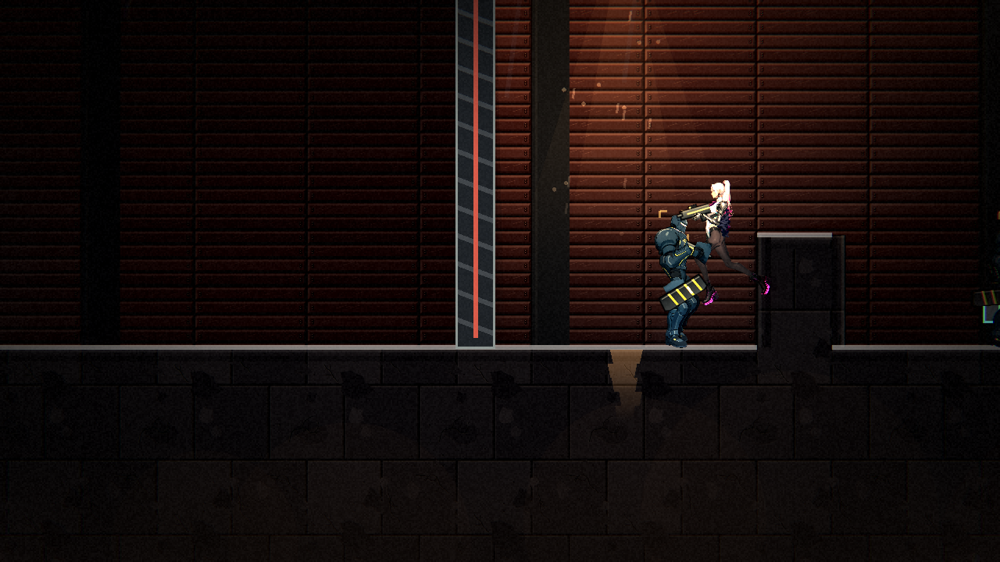
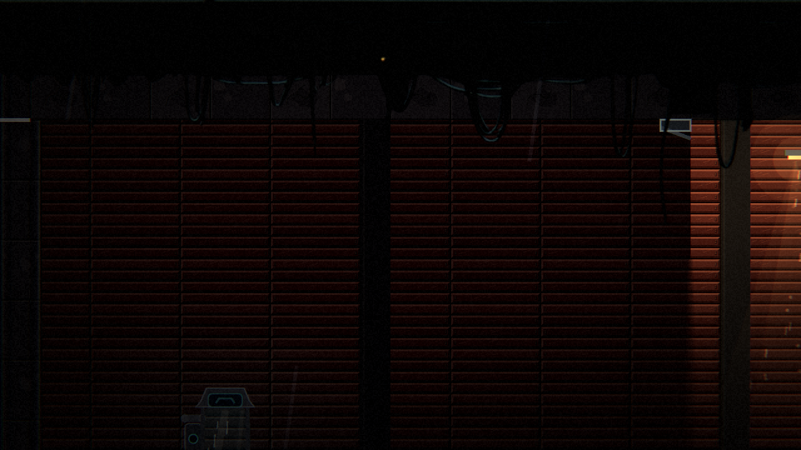

# [ST-14] 拆分過長的倉庫區域

> 狀態：完成

## 內文

### 需求
第一章的節奏估計（ST-11，`tools/pacing_report.tscn`）顯示倉庫是章節的戰鬥高峰，但太長：244 格、13 場遭遇，第一次玩估計約 11 分鐘，超過「任一區停留不超過 8 分鐘」的警訊。需要把倉庫拆成兩個區域（例如前廳與閘門廳／水坑，另一個是保險箱與上層走道），中間用出入口連接，各自有存檔或休息的喘息點，並讓每個區域的停留時間、遭遇數與教學曲線仍符合設計文件。

### 來源
2026-10-06，ST-11 的腳本估計結果（`design/13-story-v2/CH01_PACING_V2.md` §2.1）。

### 驗收條件
- [x] 倉庫拆成兩個區域，出入口與旗標互相對得上，從街道走得到、結束後走得到復原館
- [x] 各區第一次玩估計停留 ≤ 8 分鐘；`PacingSuite` 的已知過長名單移除倉庫
- [x] 兩個區域各有光影與環境主題，水坑的水位與閘門狀態在兩區之間保留
- [x] 地圖可達性、鎖場、教學曲線、連續性（不可達內容）檢查全數通過，附兩區截圖

### 測試流程
1. 從街道走進倉庫，依序走完兩個區域
2. 執行節奏報告，確認每區停留與遭遇數
3. 執行地圖與連續性檢查

---

# 跟其他票的關係

- Blocks：無
- Blocked by：無
- Related：ST-11

---

# Commit-1

## 內文

倉庫切成兩張地圖：「碼頭倉庫」（前廳、閘門廳、水坑與坑對岸，152 格）與「倉庫深處」（保險箱、階梯、上層走道，124 格），切在保險箱鎖場之前，水坑與它的閘門留在同一張（機關頻道不跨區域）。做法是產生器 `slice_area`：把做好的整張地圖切出一段，格子、道具、提示牌（重新編號）、觸發點、遭遇與材質區一起搬；兩側補空地與外牆，用走進就切換的出入口連接（`wh_vault`、`vault_prev`），後半開頭加存檔點，敵人離任何出入口與存檔點 ≥ 18 格。上層走道的出口（往復原館）移到倉庫深處。音樂、環境主題、光影沿用倉庫；教學曲線與設計資料的區域名稱改成新的；戰鬥區的特色（迴圈、獎勵、秘密、地標、垂直空間）改成「同一組合起來要齊」。

節奏估計（`tools/pacing_report.tscn`）：倉庫約 7.2 分鐘、倉庫深處約 4.2 分鐘（原本 11 分鐘），遭遇仍是 22 場；`PacingSuite` 的已知過長名單清空。

### 測試結果

| 項目 | 結果 |
|---|---|
| 完整平行測試（45199 項） | 通過，新失敗 0 |

### 截圖

