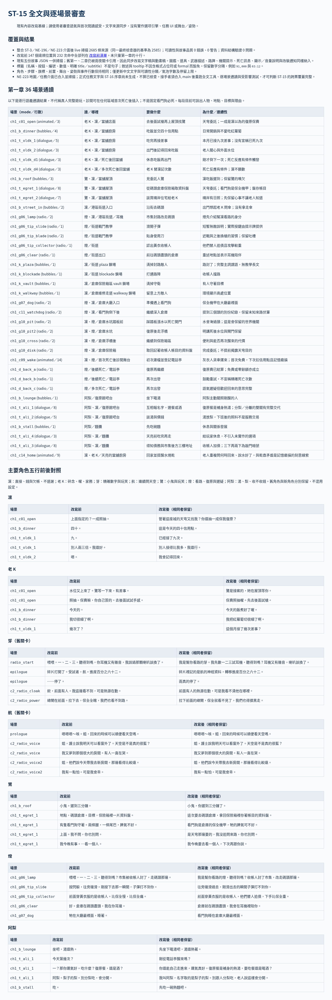
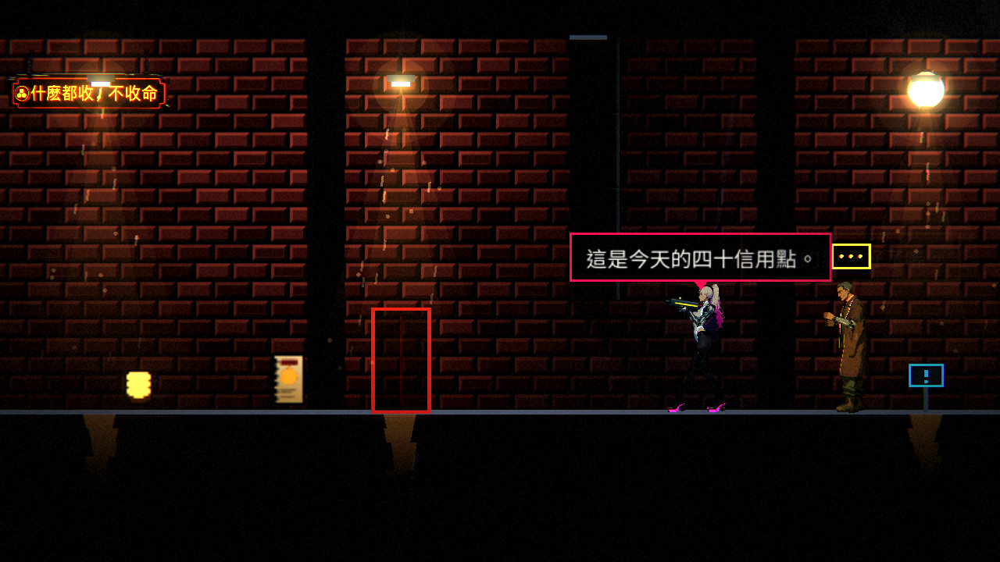
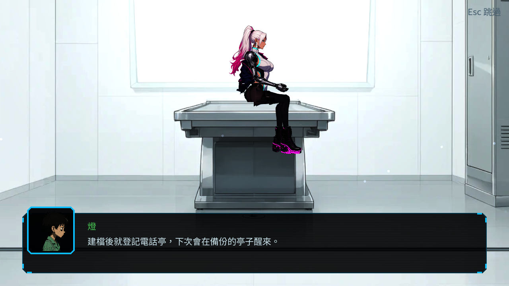

# [ST-15] 改寫對白成完整易懂的句子

> 狀態：審查中

## 內文

### 需求
目前的對白有大量兩三個字就斷一句的寫法，看起來很酷，但玩家看不懂。要把遊戲裡**所有玩家會讀到的文字**改寫成完整、易懂的句子，並加上自動檢查避免之後再出現。規則與量測見 `design/13-story-v2/DIALOGUE_READABILITY.md`。

範圍：過場與場景對白（`data/story/*.json`）、地圖氣泡、廣播、戰鬥短句、NPC 對話、死亡與復活的場景、路牌與提示、道具與文件描述、任務與地圖文字（NE-223）、選單 tooltip。角色的聲音（凜、老 K、芽、航等）要保留，但靠用詞與語氣，不靠斷句。

### 來源
2026-10-07 使用者回報：「不要用一些看起來很酷的 1、2 個字來講話，現在的對話文本有大量兩三個字就一個斷句的，看起來很酷但我覺得會看不懂。」並要求開票、確實修復相關的所有問題、寫清楚驗收目標。

### 驗收條件
- [x] 量測並記錄現況：列出所有違規行（至少含目前已知的 10 行，如「地點，碼頭倉庫。目標，保險箱裡一片資料盤。」），含氣泡、提示、道具描述等其他文字來源
- [x] 依 `DIALOGUE_READABILITY.md` 的規則改寫全部違規文字：一句講完一件事、沒有單獨成句的一兩個字、同一行最多一個三字以內的子句且不連續、首次出現的專有名詞用一句話說明
- [x] 角色聲音仍可分辨：每個主要角色挑五行對照改寫前後，確認口吻（凜直接不道謝、老 K 碎念加「喔」、芽嘴碎愛玩笑、航問題多）仍在，並更新 `CHARACTERS.md` 與 `WRITING.md` 中要求「短句」的段落，改成上述規則
- [x] 放寬並更新氣泡長度規則（每句 ≤ 30 字、戰鬥中 ≤ 16 字且是完整的話），同步修改設計文件與資料檢查的門檻
- [x] StoryLint 新增可讀性檢查（單獨成句的短片段、連續短子句、平均子句字數、名詞並列斷句、氣泡長度），門檻用現有對白校準；改寫完成後全部文字 0 錯誤、0 警告
- [x] 逐場景人工通讀一遍（第一章全部場景、氣泡與廣播），每個場景在票上記錄「第一次玩的人能說出：誰在哪裡、要做什麼、為什麼」，不能的場景改寫到能為止
- [x] 改寫不破壞原有功能：故事資料驗證、連續性檢查（`ContinuityAudit`）、節奏估計、故事相關測試全部通過；台詞行數改變造成的節奏估計變化在票上說明且仍在目標範圍
- [x] 更新 skill `chapter-design` 與 `scene-staging`（以及 `continuity-qa`），寫入「完整句子、不用斷句裝酷」的規則與檢查步驟

### 測試流程
1. 執行 StoryLint 與連續性檢查，確認 0 錯誤、0 警告
2. 遊玩第一章，閱讀所有對白與氣泡，確認好懂
3. 故事、節奏相關測試通過，完整平行測試無新失敗

---

# 跟其他票的關係

- Blocks：無
- Blocked by：無
- Related：ST-9、ST-11、ST-12、ST-16、NE-223、NE-217

---

# Commit-1 — 現有全文改寫與可讀性基線（2026-10-08 UTC）

## 交付

- [完整改寫前清單](../../design/13-story-v2/ST15_BEFORE_VIOLATIONS.md)：2,585 條來源、147 個違規位置、232 次規則命中（107 錯誤、125 警告；最終檢查器統一口徑）。新版檢查器唯讀掃原 checkout 盤點，不重複計 Story 服務。
- [全文／逐場景與角色審查](../../design/13-story-v2/ST15_TEXT_REVIEW.md)：現行第一章 36 場景、117 行，各段人物／地點／目標／理由與七位主要角色各五行前後對照；全文依生成產出列出。已逐行語義通讀，包括舊章節與死亡變體；真人首次閱讀仍待審查。
- 同步故事 Python 台詞來源與產出、地圖生成器與提示資源；現有五份故事 JSON、圖鑑、路牌、機關、道具、文件、武器描述、設定 tooltip 和改裝通知一併改寫。凜不道謝、老 K 碎念、芽與鷺玩笑、航問天空、燈看路、阿梨用湯與梨照顧人。
- 首次出現的天穹、鷺、燈、芽、看門狗、資料盤、晴岸、復原餐都有當場身分／用途／地點；四十明說信用點。首次復原明說運送、建檔、免費及下次扣款；本月九次改成接差事，不在第一次死前聲稱死過九次。
- 記憶異常變體逐條否認是否曾在此停過；收畫、拒絕熱蛋、留飯、站穩與耳機試音各依語境改寫，保留數數、問手、05、技師 K、最淡黃色與補完上傳等伏筆。
- `StoryLint.readability` 與 `PlayerTextAudit` 每次掃現有 JSON（含提示陣列、變體）、資源、場景屬性及中文 UI／遊戲／autoload 來源，回報檔案位置。完整句子規則不因廣播、公文、formal 或 `%` 格式字串而豁免；名稱／按鈕／數值與明確 title／subtitle 是標籤。CLI 的任何錯誤、警告或資料驗證問題均失敗，`--out` 可存全來源；`--source-root` 可唯讀對照既有 checkout。
- 氣泡上限 30、bark 16；同屏仍兩個、不鎖操作，停留上限 4.2 秒。同步 `CHARACTERS`、`WRITING`、敘事／舊分鏡寫作指示，以及 chapter-design／scene-staging／continuity-qa 的 `.agents`、`.claude` 六份 skill。
- 沒有改 NE-222 姿勢／舞台接觸／共用骨架或音樂素材；沒有新增選項引擎、關卡或任務 UI，僅同步文字與顯示門檻；分鏡未實作提案仍清楚標記，不重新啟用舊長過場。

## 驗證

- StoryLint／現有全文：**0 錯誤、0 警告**；Story.validate 結構問題 0。
- ContinuityAudit：旗標錯誤／警告 0、不可達錯誤／警告 0；獨立孤兒清單仍有七個既有舊稿場景，名稱與原因列在審查文件，未刪除或改路由。
- 五份故事 JSON 移除文字欄位後與基準一致；故事重新生成 byte-identical，舞台 JSON 全部不變；八張地圖提示與生成器陣列吻合，天亮當舖共用來源；三組 skill 兩側 byte-identical。
- 三段過場估算：開場 15.52 → 15.44 秒（預算 20）、首次復原 37.14 → 36.82 秒（45）、章末 29.74 → 32.38 秒（60）；合計增加 2.24 秒。行數不變；氣泡累計停留 27.5 → 30.9 秒（重疊顯示，不等於鎖操作時間）。
- 原節奏模型前後皆首次 30.3 分鐘、22 場、0.73 場／分鐘，時間與遭遇目標符合。預算口徑過場占比仍 6.9%，高於設計 5%但低於測試警訊 8%，是原已存在的地圖／預算審查項目；未宣稱所有指標達標。用實際台詞估計則約 29.6 分鐘與 4.8%，兩種口徑均不代稱真人遊測。
- 整合前完整平行測試：`tools/run_tests_parallel.sh`，76 組、45,285 checks、新失敗 0、known failures 0；最新文字／變體回歸另跑 StoryContent、StoryLint、ChapterCutscenes、DeathReaction，1,202 checks、失敗 0。
- 整合前受影響測試：`tools/run_tests_changed.sh 967bf8bd`（固定本票差異基準；65 組、43,839 checks、新失敗 0、known failures 0）。
- 初輪測試曾抓到兩份舊動畫稿未同步、規則名稱與老陳停頓，已修正並重跑通過。負載競爭時曾出現音效 ducking 回復與閃光衰減失敗；未改它們或 known_failures，音效在原版與新版單跑均通過，最終完整測試無失敗。
- 遠端 CI API 查詢遭 403 拒絕，已停止、不重試／不繞過；不能聲稱遠端 CI 已確認。

## 實際畫面與尚待審查

Godot 4.7 Forward+／llvmpipe CPU 軟體渲染、Xvfb 自動播放與定位；已看實際文字完整、沒有截字／溢框。截圖不代稱真人完整遊玩；軟體渲染約 2–4 FPS，不作 GPU 效能／閱讀速度驗收。沒有音訊裝置，未試聽。臨時預覽只在載入時跳過開場後播氣泡，沒有更改遊戲流程。

- [ ] 使用者首次閱讀、角色口氣、氣泡停留速度及真人第一章完整遊玩確認；三語母語審稿仍待 ST-1 使用者審查。
- [x] NE-223 尚未生成的正式任務來源與 ST-16 序章文字，合入 main 後由接手 Session 依新基線生成並重跑全文、語義、節奏與受影響測試；現在不算已覆蓋。

本次現有文字與必要自動驗證交付供審查，狀態依使用者指示為「審查中」。ST-1／ST-4 的使用者確認框仍未代勾。

### 最新 main 整合補驗

整合 `319eaf87`：保留 ST-3 選項／存檔／巢狀分支／死亡序列及 NE-196 音樂交付，不退回舊服務。全文來源增為 2,584（基準 2,572），0 錯誤、0 警告；新增提示與死亡畫面文字已覆蓋。繼續按鈕預設值按第一個按鈕參數明確分類為標籤，tooltip 仍受檢查，沒有修改 Session 3 的核心檔案。復原費回應使用「已結算」以涵蓋首次免費與零餘額，不誤稱每次必有扣款。合併後 65 組受影響測試曾有一次設定焦點失敗；完整平行複驗曾有一次瞬間閃光取樣失敗。停止其他渲染並改為兩程序後，最終完整 76 組（涵蓋全部 65 組受影響套件）45,388 checks、新失敗 0、known failures 0、腳本錯誤 0。沒有改斷言、跳過測試或加入 known_failures。這是最新合併後的交付結果，先前 43,839／45,285 是整合前的驗證紀錄。

### NE-223 介面合入後的全文覆蓋

整合 `5f9e3981`，保留新任務／地圖 UI、導覽接點、NE-222 骨架驗證規範與第二章敵人／音樂交付。全文 live 來源增至 **2,677 條，0 錯誤、0 警告，結構問題 0**；新增 UI tooltip、空任務說明、導覽 HUD 與 core/navigation/quest_map_index.gd 的地圖提示已通讀。任務與地圖畫面沒有正式任務時清楚告知尚無可追蹤任務，不把 UI 樣本當主線。

正式 `quests` 尚未生成；檢查器已按介面契約納入 background／reward／blocked_reason／suggestion、任務／步驟 title，動作目標不能誤當名稱標籤。格式字串只有純代入值的尾段不作短片段，含文字的格式句仍受檢查；固定獎勵欄位標頭明確分類，reward 本身仍受句子規則。新增回歸驗證未來短目標、說明與 tooltip 不得豁免。沒有改導航或任務 UI 實作。

### 最終交付驗證（2026-10-08 UTC）

- `tools/run_tests_changed.sh 967bf8bd`：基準固定、非空集合，選到完整 **77 組／45,344 checks，新失敗 0、known failures 0、腳本錯誤 0**，604 秒；同時满足本票要求的完整平行測試。
- 最後補入四條日英文與四個副標題的來源欄位後，StoryLintSuite 補驗 **158 checks／失敗 0**。全文重掃 **2,685 條來源／0 錯誤／0 警告／結構問題 0**。圖片內容與正式來源一致，產生器未新增舞台或動作。
- 用相同最終檢查器唯讀重掃原基準：2,585 條／147 個違規位置／232 次命中。原先 148／233 有改裝通知純占位符尾段的一次誤判，已排除；通知仍改成有動詞、金額與結果的完整說明。比較不是使用不同欄位的兩份數字。
- 上面 65 組／43,839、76 組／45,285 與 45,388，以及 2,584／2,677，保留為各階段實際驗證紀錄；本段是最後交付結果。沒有把中途停止的未完成測試算作通過。

最後整合 `293fcebb` 的 ST-3 字串旗標／磁碟還原相容性修正，保留其 GameState 與測試成果。受影響合併補驗 Cutscene、QuestMap、Continuity、StoryLint、StoryContent、ChapterCutscenes、DeathReaction、DeathFlow、Progression 共 **9 組／1,803 checks，新失敗 0、known failures 0、腳本錯誤 0**。全文再掃 2,685 條／0 錯誤／0 警告／結構問題 0；五份故事的非文字資料及三組 skill 兩側仍一致。這是 77 組完整測試後新增 main 修正的補驗，沒有把不存在的任務／序章算入。

# Commit-2

## 內文

正式任務（三章的主支線）與序章的文字合進 main 之後，還沒有用同一套規則重掃全文，也沒有人逐句讀過序章。
這次在最新 main 上重跑全文檢查，範圍從 2,685 條增加到 6,946 條，包含三章任務的標題、背景、獎勵、阻擋原因與建議，以及序章全部台詞與紙條；逐句讀過序章，句子都完整，老 K 句尾的「喔」與碎念、凜直接不道謝的說法都在。讀的時候發現「老 K」後面有時空一格、有時沒空（例如「回廚房吃老 K這次免收的晚飯」），第一章 7 處統一成有空格，三語對照同步更新、沒有缺譯。
節奏用同一個估計工具：序章第一次玩約 4.0 分鐘、鎖操作的段落 44%；第一章約 35.5 分鐘、每分鐘 0.62 場遭遇。

### 測試結果

| 項目 | 結果 |
|---|---|
| 全文檢查（story_lint） | 6,946 條 0 錯誤、0 警告 |
| 受影響範圍（原選擇器） | 2,624 項、0 新失敗、0 已知失敗 |
| 劇情與任務套件補驗 | StoryContent、StoryLint、QuestMap、Collectibles 2,094 項 0 失敗 |
| 缺譯 | 第一章 0 處 |

截圖不適用：只改文字間距。

分支：`feature/ecstatic-einstein-gyjqmu`，提交 [37b8acb4](https://github.com/deadline314/Nest-Egg/commit/37b8acb41d3317b591c627063bb80de43982fbef)。使用者首次閱讀與真人遊玩的確認仍在上一項。
