# [ST-16] 加入序章補上遊戲開頭

> 狀態：進行中

## 內文

### 需求
按下「開始」後直接進入第一章，整個遊玩流程沒頭沒尾：玩家不知道世界、主角、為什麼要做、操作怎麼玩、死了會怎樣。要增加一個序章（約 3 到 6 分鐘），交代世界、主角與處境，在可玩的短場景裡教基本操作，說明死亡與復原規則，並在結尾把玩家交到第一章的第一個目標。需求與限制見 `design/13-story-v2/PROLOGUE.md`。

### 來源
2026-10-07 使用者回報：「整個遊玩流程有點沒頭沒尾，就直接進入遊戲了，沒關係，這個感覺可以增加一個序章來填補，開票之後處理。」

2026-10-10需求補充：先完成序章至第三章，逐章劇本審查、正式主支線與演出、累積單檔發行；詳見[整體設計](../../design/20-campaign-experience/DESIGN.md)。

2026-10-10，正常遊玩閉環審查补充；需求與來源見[序章至第一章檢查](../../design/20-campaign-experience/CH01_PLAYABLE_REVIEW.md)。

### 驗收條件
- [x] 序章劇本（依 `PROLOGUE.md` 的六項目標）通過 `OUTLINE.md`、`CHARACTERS.md`、`CH01_NARRATIVE_V2.md` 的事實對照與連續性檢查（`ContinuityAudit`），不使用未出現過的設定；內容先寫進 `design/13-story-v2/`
- [x] 新遊戲從序章開始，結束後無縫接第一章的開場；讀檔、繼續遊戲不重播序章；序章狀態寫入存檔
- [x] 序章在可玩的短場景裡依序教移動、跳、射擊、近戰、格擋、衝刺：每項操作要玩家做一次才進下一項，提示都是完整的一句話並有按鍵圖示（鍵盤與手把各自顯示）
- [x] 序章內有一次安全的「倒下與醒來」或等價說明，講清楚復原、記憶磨損與檢查點規則；序章內不會讓玩家永久失敗或卡死
- [ ] 過場佔序章時間不超過一半，其餘是可玩或地圖上的短對話；長度 3 到 6 分鐘（用節奏估計與實測驗證）
- [x] 可跳過：第一次也可以長按跳過，跳過後仍給第一個目標與基本操作提示；之後可在圖鑑重看
- [x] 序章結束的那一刻，NE-223 的目標列已有第一個主線目標（NE-223 完成前，以遊戲內提示或氣泡完整說明第一個目標）
- [x] 序章所有文字符合 ST-15 的可讀性規則（完整句子，StoryLint 0 錯誤 0 警告）
- [x] 序章的場景與演員姿勢通過場景檢查與姿勢檢查（`scene-staging` skill、NE-222 的姿勢規則），截圖附在票上
- [x] 自動檢查：旗標模擬從新遊戲走完序章到第一章第一個場景沒有死結；序章資料與 `StoryLint`、`SceneAudit` 通過；受影響範圍測試無新失敗

- [x] 序章劇本先依最新人物與世界觀審查，練習倒地不提前消耗第一章首次死亡建檔，完整與略過路線皆銜接正式任務。

- [x] 從正式新遊戲入口完整與長按略過兩條路到達第一章目標，重新繼續各自保留真正操作教學進度，練習倒地不消耗首次真正死亡。

### 測試流程
1. 開新遊戲，完整玩一遍序章，確認每項操作教學與結尾目標
2. 重新開啟遊戲讀檔，確認不重播序章
3. 另開新遊戲，長按跳過序章，確認進入第一章且仍有第一個目標
4. 執行故事與場景檢查、受影響範圍測試

---

# 跟其他票的關係

- Blocks：NE-233、BG-22、NE-223
- Blocked by：NE-279
- Related：ST-9、ST-12、ST-15、NE-222、NE-223、NE-214

---

# Commit-1

## 內文

序章原本只有六項需求，沒有能逐場製作的完整對白、動作與選擇結果。
現在補齊雨港進店、貨架住宅目錄、試槍、近戰與防禦練習、復原說明、收尾聯絡六場原創製作稿；用試貨解釋操作教學，完整與略過都交到「吃完飯後，上屋頂找鷺」。
練習倒地與真正初死分開，未跌倒者不會聽到假定自己跌倒的對話；紙本存款與房價不變成現金。借用工具、暫停、退出、回看與舊進度的處理界線已列清楚。
逐場通讀與修稿複核通過，六場與十二種狀態情境完整；原始設定九份皆留有來源校驗。製作時長估計190～320秒，與實際操作時間分開記錄。

### 測試結果

| 項目 | 結果 |
|---|---|
| 文稿結構與來源核對 | 六場、十二種狀態情境、九份來源校驗通過 |
| 文稿通讀與修稿複核 | 通過；工具歸還、倒地變體與保存時點已裁定 |
| 受影響範圍測試 | 僅文稿與票，選到零套件；依專案規則不啟動引擎 |
| 引擎故事與場景檢查 | 未執行；本次交付為製作稿 |
| 時長與真人手把 | 製作估計與正式實測分開記錄 |

### 截圖

本次只有文稿與審查紀錄，沒有遊戲畫面變更，未製作遊戲截圖。

# 2026-10-11 交接紀錄

## 內文

六段序章、可操作教學、借裝與耐久出口有已凍結來源候選，尚未採用或原生驗證。候選前提早於最新 Main，需重新比對；不能直接覆寫、灌教學旗標或以旧第一章開場代替序章。

使用者要求本 Session 收尾後停止開發。偏好、研究依據、避免重犯事項與精確接手資訊見 [使用者指南](../user_guide.md)及[本次交接](../SESSION_HANDOFF_2026-10-11.md)。此段保存現況，不是新完成紀錄。

# Commit-2

## 內文

按下「開始」原本直接進當舖，玩家不知道凜是誰、為什麼要做、怎麼操作、死了會怎樣；序章只有製作稿，遊戲裡沒有。
現在新遊戲先進「巢蛋當舖・試貨」：雨港進店的開場、工作桌旁聊晴岸的房子、跳上搬貨台拿工具、射擊線打靶、橡膠靶近戰、面向訓練器格擋、衝刺穿線，最後回櫃台聽復原服務說明、接到鷺的聯絡，從旁邊的門回店裡吃晚飯。每項練習都要真的做到才算（例如近戰打靶不算射擊、走過線不算衝刺），提示是一句完整的話並顯示目前的按鍵。訓練器打中只會停機、補回生命，老 K 用一段話說明，不算死亡、不碰第一章的初次建檔。老 K 的站位跟著練習走：拿到工具後到店後白線外看，射擊與近戰時的對話改成邊練邊說的氣泡，試完衝刺回櫃台。暫停選單有「略過序章」：長按一秒直接略過，短按先確認（焦點停在「繼續練習」）；略過只記略過與出口，不把沒做過的練習標成完成。完成或略過都交到「回廚房吃晚飯」，舊第一章的試槍開場已移除；已在第一章的舊存檔不會被塞回序章。
任務列的目標寫「要做什麼」、練習站上的提示寫「按哪個鍵怎麼做」，不再三處重複同一句。人物的出現條件改成旗標一變就更新（`GameState.flag_changed`），不用等某段劇情播完。

### 測試結果

| 項目 | 結果 |
|---|---|
| 受影響範圍（基準 401a30d3，原選擇器） | 78,204 項、0 新失敗、0 已知失敗；無腳本錯誤。煙霧測試「格擋擋子彈」曾在同時跑軟體算圖時失敗一次，單獨重跑兩次與整組重跑皆通過 |
| 真輸入序章探針（從 Main 新遊戲進入） | 軟體 Vulkan 與無頭各 0 失敗：走、跳、射（手把瞄準）、近戰、被訓練器打停、格擋、衝刺、和老 K 對話、出門進當舖；全程 0 死亡、未寫初次建檔；老 K 換位正確；略過取消不改進度 |
| 略過路線（測試） | 短按確認、取消不改、長按一秒直接略過；只記略過與出口；仍交第一章第一個目標 |
| 節奏估計 | 沿實際播出的路徑：第一次玩約 4.0 分鐘、鎖操作的電影與對話約 44%（目標 3～6 分鐘、一半以下） |
| 劇本文字掃描、連續性 | 0 錯誤、0 警告；新遊戲到第一章晚飯沒有死結 |
| 待本機原生驗收 | 真人計時、手把按鍵圖示實機畫面、讀檔與冷續玩不重播、從主選單長按略過的整條路、場景與姿勢的原生畫面 |
| 尚未做 | 圖鑑重看序章（需要隔離的回放環境，不能改正式進度），另開票處理 |

### 截圖

雲端軟體 Vulkan（Forward+）截圖，光影與噪點以本機原生為準。

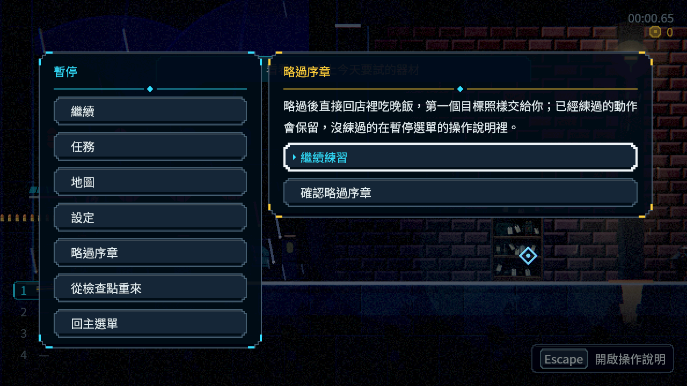
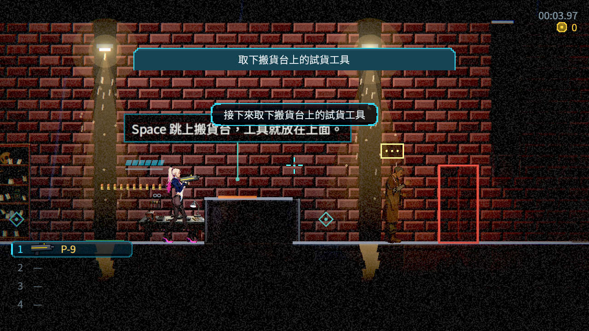
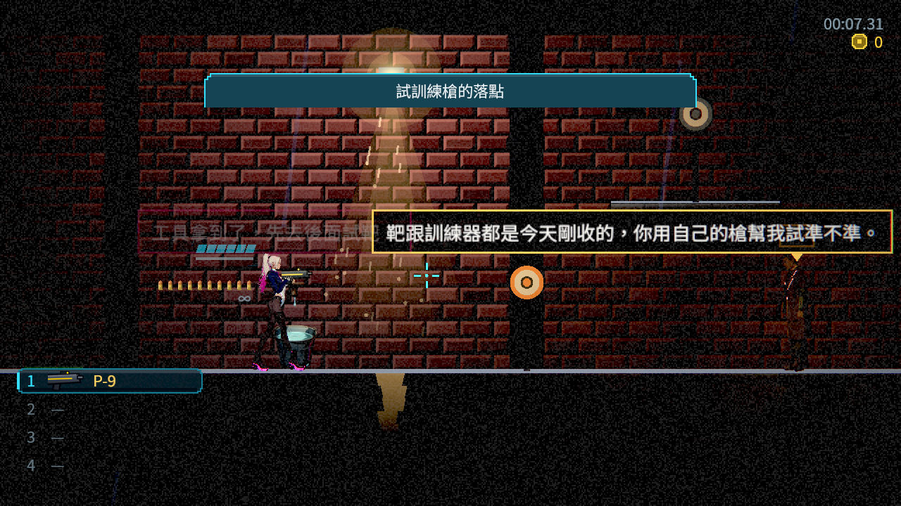
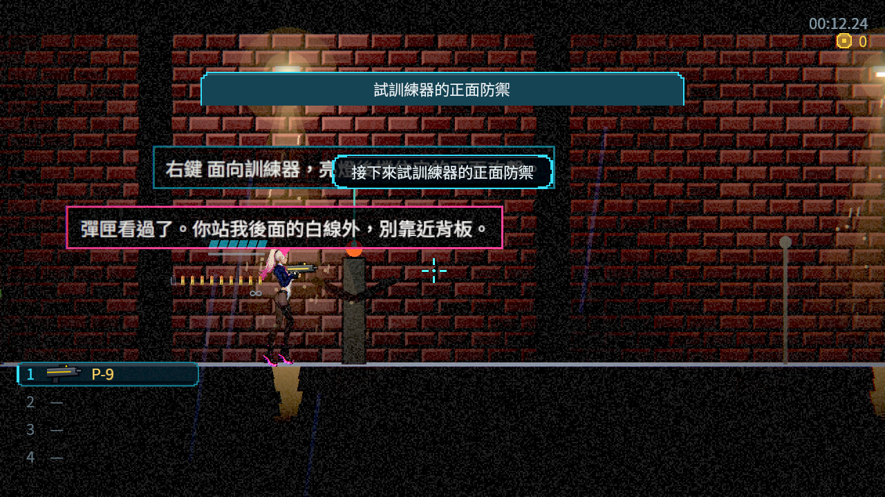
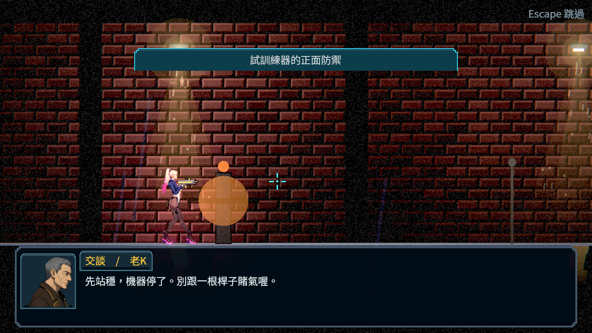
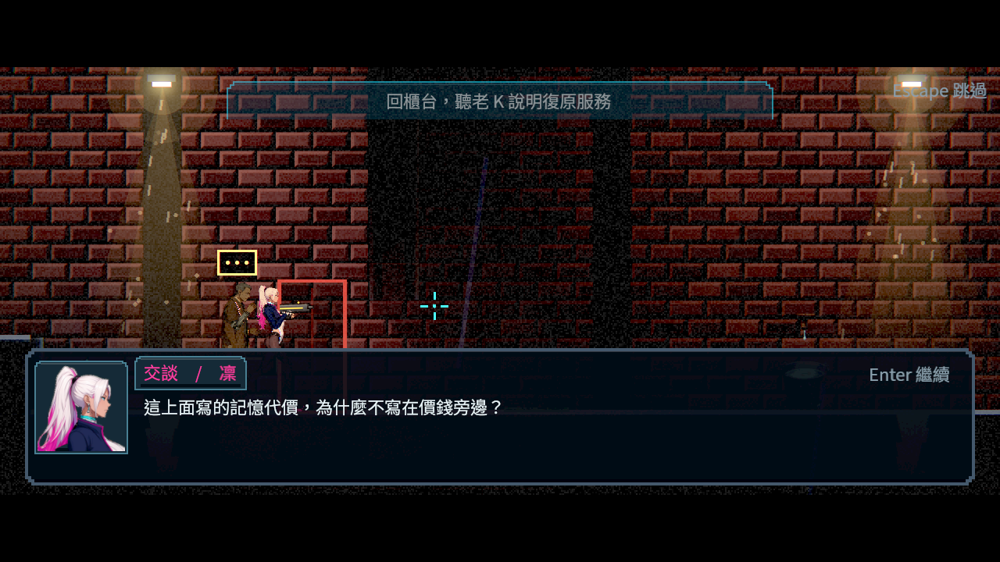
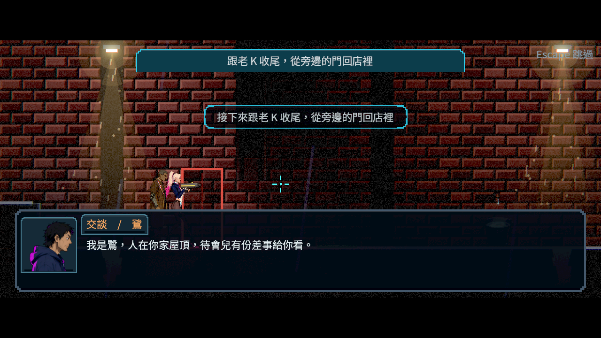
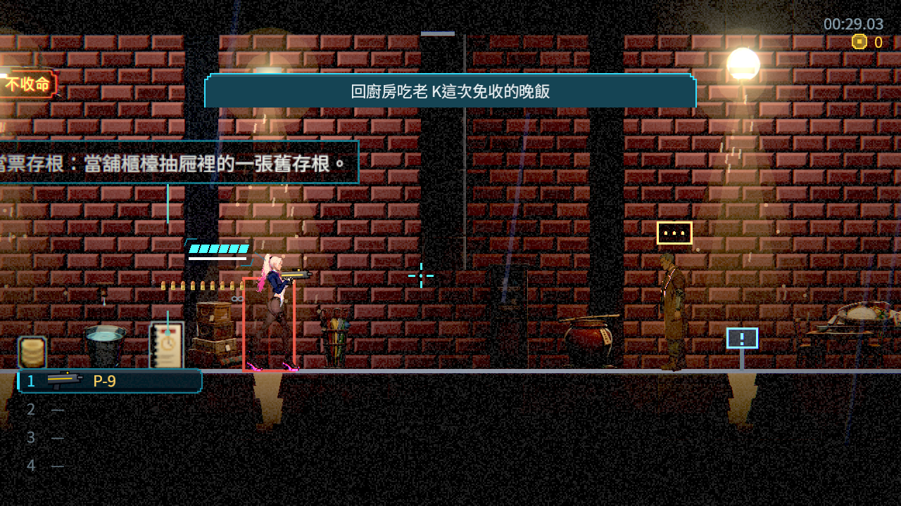

分支：`claude/nest-egg-main-story-flow-ph1dnu`（[分支提交紀錄](https://github.com/deadline314/Nest-Egg/commits/claude/nest-egg-main-story-flow-ph1dnu)）。製作稿與實作差異見 [PROLOGUE_SCRIPT.md 的實作對照](../../design/13-story-v2/PROLOGUE_SCRIPT.md)；序章的存檔旗標列在 [CH1_STORY_RUNTIME.md](../../design/20-campaign-experience/CH1_STORY_RUNTIME.md)，NE-230 請跟進。任務目標換步時的「接下來…」橫幅會蓋到練習站提示（見截圖），屬 HUD 位置，請 NE-228 處理；鷺的頭像仍是暫代立繪。當舖後空地的舊教學提示與序章重複，由 BG-22 整併。

# Commit-3

## 內文

上次留給本機的幾項，其實大多能在雲端用真的遊戲入口驗：讀檔與繼續會不會重播序章、長按略過的整條路、手把按鍵的提示。實際做的時候又找到兩個問題：練習站上的按鍵只是夾在句子裡的一個字，看不出是按鍵；在櫃台和老 K 說話時，凜常常站進老 K 的身體裡，兩個人疊成一團。
現在練習站的按鍵畫成按鍵帽，拿起手把按一下就換成手把的按鍵（例如跳躍由 Space 變成 A（下）、格擋由右鍵變成 LT）。和人物說話時如果站得太近，凜會退開一步到看得清楚兩個人的距離（背後是牆或沒有地面就留在原地）。
驗證都是一個情境一個獨立程序、存檔放在隔離資料夾、從真正的 Main 進入：練到跳上搬貨台就正常退出，另一個程序按「繼續遊戲」回到序章，跳躍與移動的練習還算完成、射擊還沒、開場沒有重播、沒有死亡；玩完序章退出再繼續，直接回當舖、序章一段都不重播、第一章目標在任務清單；新遊戲進序章後用手把按 Start 打開暫停、長按確認鍵一秒多，略過不經過確認視窗直接回當舖，只記略過與出口、沒練過的不算完成、沒有死亡，接著在另一個程序繼續也一樣。

### 測試結果

| 項目 | 結果 |
|---|---|
| 受影響範圍（基準 c739da2e，原選擇器，含本輪其他票的改動） | 54 組、46,601 項；1 項新失敗是同時跑軟體算圖時的鉤爪拉人計時，單獨重跑 0 失敗 |
| 跨程序續玩（無頭與軟體 Vulkan） | 練到一半退出→繼續、玩完退出→繼續、長按略過→繼續：三種情境 0 失敗 |
| 序章真輸入探針（鍵盤、手把各一輪，軟體 Vulkan） | 兩輪都 0 失敗；全程 0 死亡、沒有寫初次建檔 |
| 對話站位 | 新增檢查：站在人物身上開始對話，主角退到 26 像素外 |
| 劇本文字掃描 | 0 錯誤、0 警告 |
| 待本機原生驗收 | 真人計時（3～6 分鐘、過場不超過一半；目前只有節奏估計約 4.0 分鐘、44%）、實體手把畫面 |
| 尚未做 | 圖鑑重看序章（第 25 條後半）：需要不改正式進度的回看環境 |

### 截圖

雲端軟體 Vulkan（Forward+）截圖；手把畫面是送出真的手把按鍵事件後拍的，沒有接實體手把。

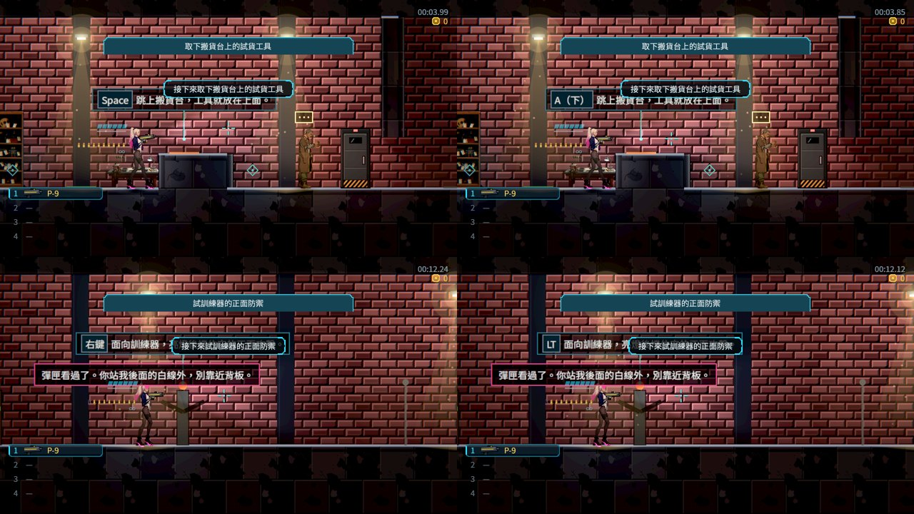
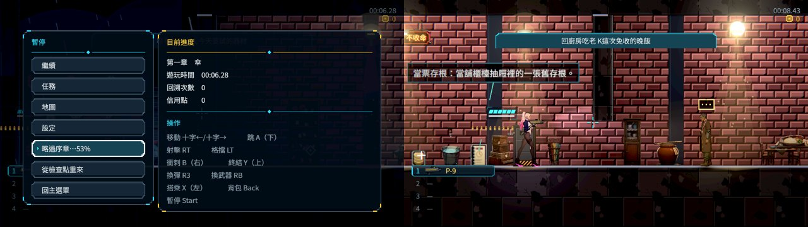
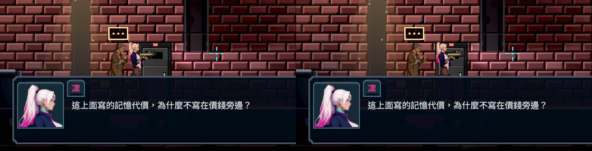

分支：`feature/story`。探針：`tools/prologue_play_probe.tscn`（`--save-dir`、`--stop-after`、`--gamepad`）、`tools/prologue_resume_probe.tscn`。

# Commit-4

## 內文

「之後可在圖鑑重看」一直卡在沒有不改進度的回看方式：直接重播正式過場會再寫一次旗標、接到下一段（例如初次建檔後的托盤選擇），還會把觀看紀錄與存檔一起動到。
現在劇情端有獨立的回看：只播畫面與台詞，不寫旗標、不發結果、不接下一段、不算觀看、不存檔；只有看過、沒有選擇的舞台過場能重看，同一時間只播一段，中途離開會正常收尾、放開操作鎖。第一章先開放三段，名稱有中日英三語：「序章　雨裡的燈」「第一章　初次建檔」「第一章　回家」，依故事先後排列。圖鑑的回顧分頁屬介面組，開 NE-279 交接；分頁接上之前本條不勾。
序章的長度與過場比例仍是節奏估計：第一次玩約 4.0 分鐘、鎖操作的段落 44%，真人計時待使用者遊玩。

### 測試結果

| 項目 | 結果 |
|---|---|
| 受影響範圍（原選擇器） | 62,704 項、0 新失敗、0 已知失敗 |
| 回看（新增檢查） | 看過才列出、依故事先後；有選擇或疊在地圖上的不能重看；重看中途停止只發回看結束，故事開始／結束事件、旗標、觀看紀錄都不變，也不接到托盤選擇；操作鎖放開 |
| 劇本資料檢查 | 有圖鑑名稱的場景若帶選擇或不是舞台過場，載入時會指出場景 |
| 待使用者遊玩 | 序章真人計時（3～6 分鐘、過場不超過一半） |

截圖不適用：回看還沒有介面入口，NE-279 接上後附圖鑑畫面。

分支：`feature/ecstatic-einstein-gyjqmu`，提交 [a7a752b1](https://github.com/deadline314/Nest-Egg/commit/a7a752b1baee124518a10b3ab36ce5e33ac85af5)。

# Commit-5（略過、操作說明與回顧的完整入口）

## 內文

序章回顧已有介面，但本票還沒有從第一次新遊戲、長按略過、冷續玩一路驗到真正圖鑑入口。略過教學後的操作表也只把近戰鍵寫成「終結」，容易讓玩家不知道同一鍵能直接近戰。
現在操作表清楚標示「近戰／終結」，並完成整條真入口驗證：從 Main 新遊戲長按略過，沒做的練習仍是未完成；當舖暫停頁保留目前綁定的移動、跳躍、射擊、格擋、衝刺與近戰提示，任務頁顯示「回廚房吃老 K 這次免收的晚飯」。圖鑑可重看由正常演出完成／略過所收錄的序章開場，返回恢復原選取與暫停；重新開程序繼續，同一份略過紀錄與回顧入口都保留。沒有直接授予觀看紀錄。

開始前重新檢視 Metroid Dread、Hollow Knight、Hades、Dead Cells 與 FFXIV 的記錄／操作介面，採用理由與原圖索引見[整合設計](../../design/13-story-v2/PROLOGUE_SKIP_REPLAY.md)。

### 測試結果

| 項目 | 結果 |
|---|---|
| 原選擇器，固定基準 6db1bc86 | 19 組、6,684 項，0 新失敗、0 已知失敗 |
| 新遊戲長按略過→操作／任務→圖鑑 | 軟體 Forward+、28 項、0 失敗 |
| 獨立程序繼續→操作／任務→圖鑑 | 軟體 Forward+、27 項、0 失敗 |
| 回看隔離 | 故事旗標、物品、錢包、探索與主檔／備份的完整 bytes 都不變；返回恢復焦點與暫停 |
| 驗證工具 | 等實際轉場完成、用介面更新影格處理輸入，等真正角色出現才擷取；原失敗與最終輸出都保留 |

[完整收據與環境](attachments/ST-16-skip-replay/receipt.json)、[原始紀錄](attachments/ST-16-skip-replay/logs.zip)。以下為雲端軟體 Vulkan Forward+，手把為合成事件；沒有把自動執行時間當作真人遊玩時長。

### 截圖

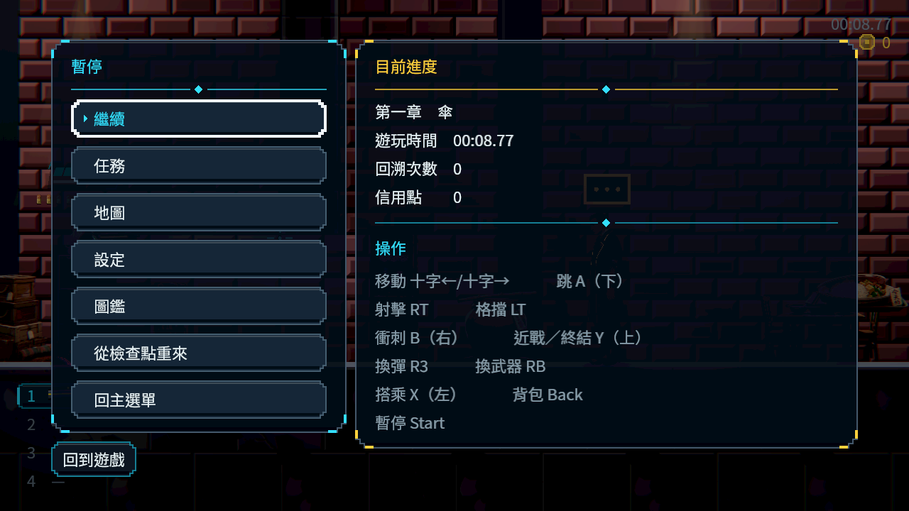
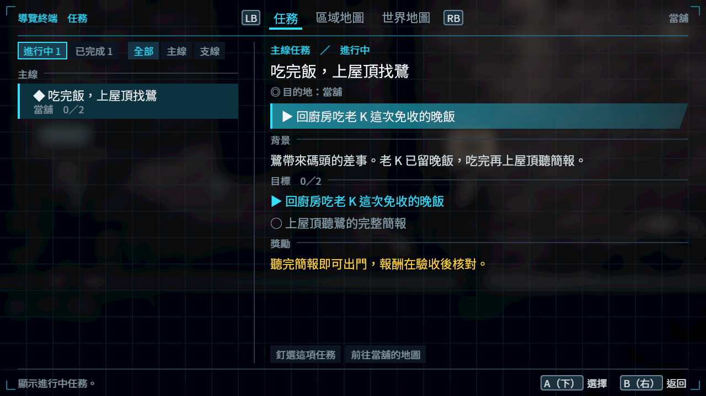
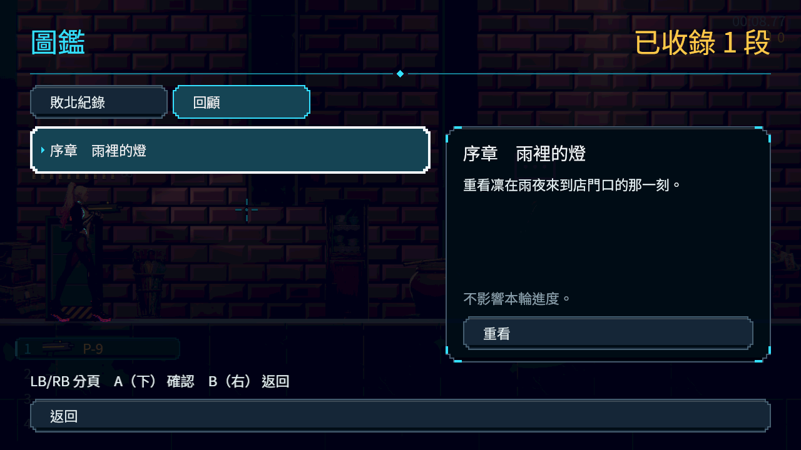

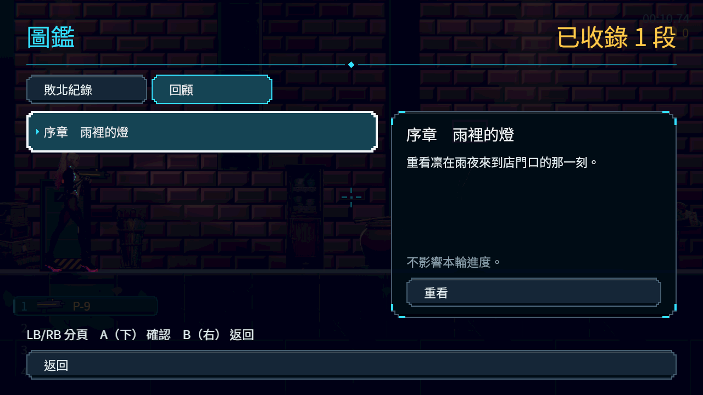
