# [ST-19] 完成第二章故事與關卡

> 狀態：進行中

## 內文

### 需求
將已審查的第二章劇本落成可從第一章接續、完整通關的正式章節，具備任務、不同節奏的關卡、演出、敵人與章末收尾。

### 來源
2026-10-10，使用者要求逐章完成與累積發行、高清像素UI、全流程手把、豐富合理敘事與動畫、場景減雜，並追加武器差異、子彈、方向護盾、可選連段升級與打擊感總驗收；一般設計選擇由實作者決定，持續推進。

詳見[整體設計](../../design/20-campaign-experience/DESIGN.md)與[研究依據](../../design/20-campaign-experience/RESEARCH.md)。

### 驗收條件
- [x] 第一章結束後正確進入新版第二章，各區、事件與章末符合審查通過劇本，未接入舊占位故事。
- [x] 主支線目標、阻塞原因、地圖位置、選擇與獎勵一致，每個可玩主線狀態有可行下一步。
- [ ] 區域具有合理空間連接、捷徑、可選探索與多樣玩法，首次通關長度及張力有實際紀錄。
- [ ] 電影、人物對話、回訪、環境動作與必要音效真正出現，跳過、死亡、重訪不錯置故事與物品。
- [ ] 敵人、武器、機關、補給與檢查點符合章節用途與成長階段，暫代素材已列缺口並在正式驗收前替換。
- [x] 正常路線、可選分支、死亡及讀檔均可推進，章末有明確收尾與下一章交接。

### 測試流程
1. 從第一章結尾完整玩到第二章章末，走主線及各支線分支。
2. 檢查區域可達、任務狀態、獎勵、死亡重試、跳過與讀檔，保存實際畫面與測量。

---

# 跟其他票的關係

- Blocks：ST-21、NE-234
- Blocked by：ST-18、ST-9、NE-178、NE-265、NE-266、NE-267
- Related：NE-223、NE-97、NE-154、NE-54

---

# Commit-1

## 內文

第一章天亮收尾之後沒有下一章：舊的第二章是占位故事，新版劇本（鷺）只有文字稿，沒有區域、任務與入口。
現在第一章結尾直接走進第二章的早上，十個區域（當舖、屋頂、港街、市集入口、公眾攤道、阿梨家、雨棚背面與裝卸間、帳房前室、帳房、復原館外）用真的出入口連起來，有雨棚上下層的環路、橋梯捷徑與可以繞過戰區的上層攤道。劇本 S01～S22 全部落成場景：老 K 結算昨晚的報酬、修收音機、屋頂簡報拿查核證、市集代墊或先問、阿梨家洗碗、對帳桌三張紙對出多收的二十、帳房阿勇的選擇與兩種收尾、電話亭裡鷺的第 214 次、上傳查帳、阿梨自己決定那一頁、客人簿三位客人，最後回屋頂喝茶結束本章。四條主線與六條支線都有地圖位置、擋住時的原因與獎勵；答錯的題目只會讓你再選一次，不會卡住。台詞與任務都有日文與英文。
做的時候找到三個會壞掉的地方，一起修了：存檔讀回時只認第一章的七筆款項，第二章一有收款整個存檔就讀不回來；寬的雨棚會被當成街道地面，前景欄杆整排蓋住下層貨道主角的腳；拼字只差一兩個字的旗標（章末、客人簿）改成各自的名字，免得之後打錯也沒人發現。
戶外的街燈照第一章調過的高度（約 4 公尺），不會比主角高出三倍。
阿勇頭目戰（NE-265）與市集遭遇（NE-266）交給戰鬥組，劇本留好接點：頭目戰在血量門檻播選擇場景，制伏時啟動帳房的機關頻道就會寫入制伏旗標。新登場的配角先用暫代外觀（NE-267）。

### 測試結果

基準：`86aaad2be95d3ca8c79ecae32cc859399bc71e18`（rebase 到最新 main 之後重跑）。

| 項目 | 結果 |
|---|---|
| 受影響範圍（原選擇器，含本分支其他票的改動） | 87,907 項，0 新失敗、0 已知失敗，352 秒 |
| 第二章資料與規則（新套件） | 出入口兩端相通、人物與物件都接到劇本、任務標記落在真的人物或物件上、劇情依進度挑段落、第二章收據存進存檔讀得回來、街道地面線、第一章接第二章、章末旗標結束本章 |
| 整章流程探針（真的區域、互動與選擇） | 斷連路、保留路、先代墊且沒留下吃宵夜：三輪 0 失敗；軟體 Vulkan（Forward+）再跑斷連路 0 失敗 |
| 地圖可達性與旗標檢查 | 23 個關卡從兩個起點都走得到，每個出入口要的旗標都有場景會寫 |
| 暗場可讀性（Forward+，十個區域 20 個取樣點） | 全部通過；原本雨棚背面兩點與市集入口一點太暗，改燈色與街道地面線後通過；街燈降到約 4 公尺後港街、市集入口、公眾攤道重量仍全部通過 |
| 劇本文字掃描 | 0 錯誤、0 警告（含日文與英文） |
| 待本機原生驗收 | 從第一章結尾真人玩到第二章章末的長度與張力、三種難度通關 |
| 尚未做 | 第二章死亡與讀檔續玩的跨程序驗證、重要場景的電影演出與環境音、頭目戰與遭遇（NE-265、NE-266）、配角外觀（NE-267） |

### 截圖

雲端軟體 Vulkan（Forward+），由流程探針送出真的互動與選擇時拍的。巡帳員與阿勇一夥仍用暫代外觀（NE-267）；屋頂章末的任務橫幅會透到選項框後面，屬 HUD 位置（介面組）。

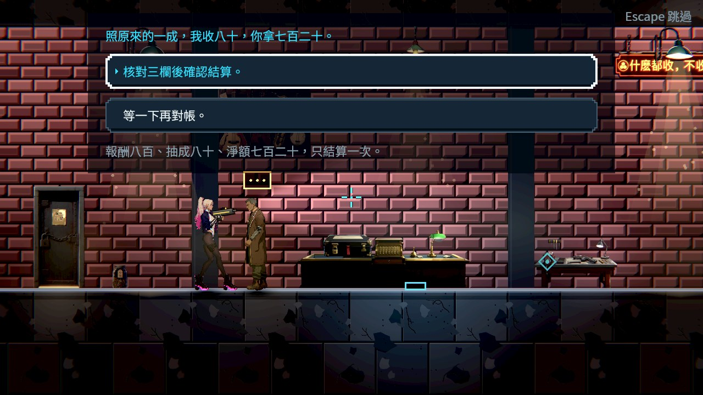
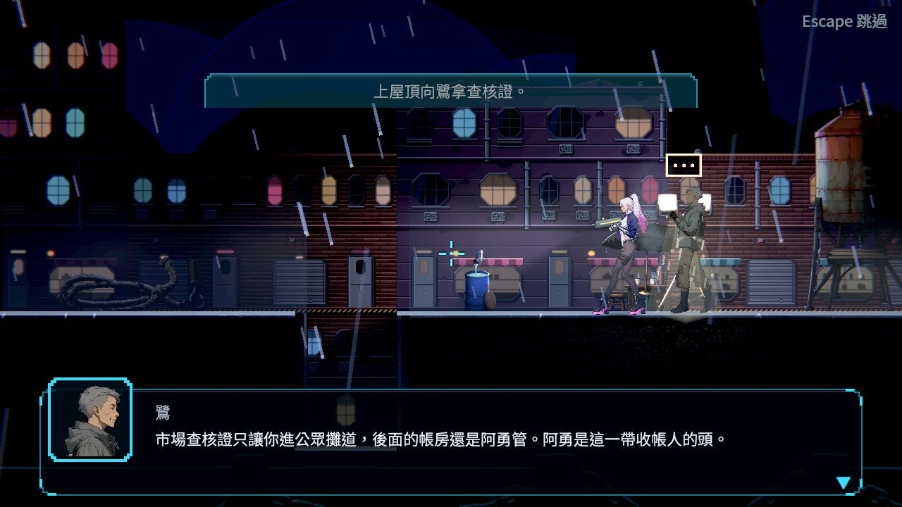
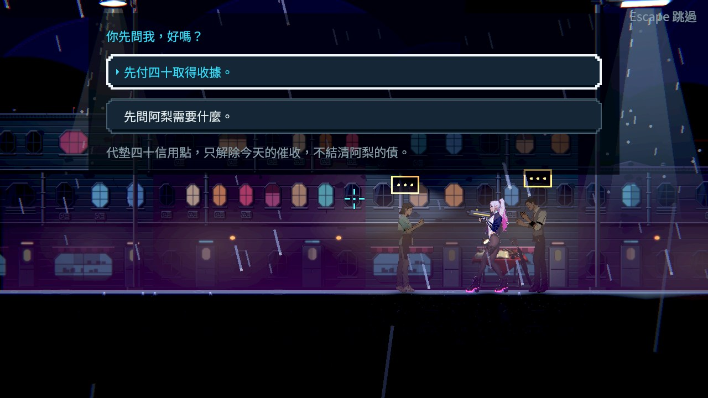
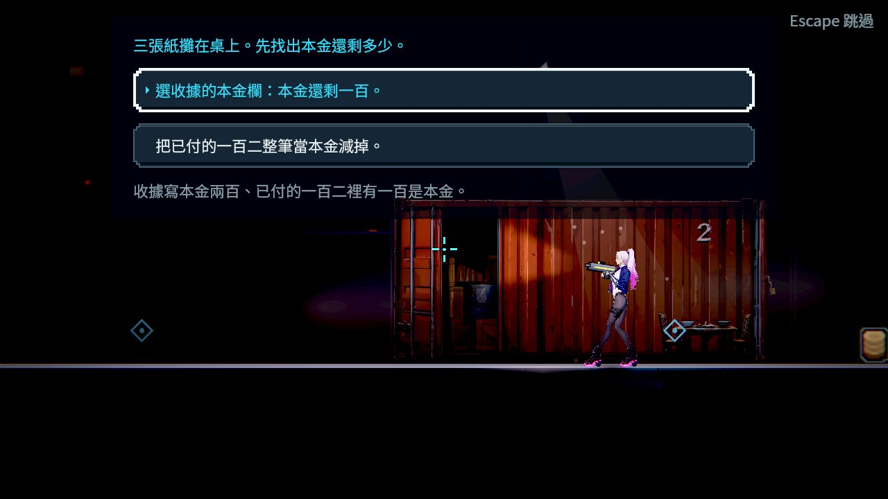
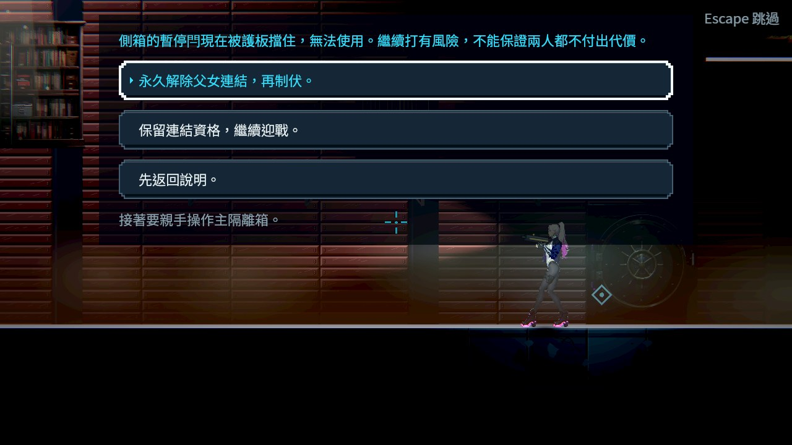
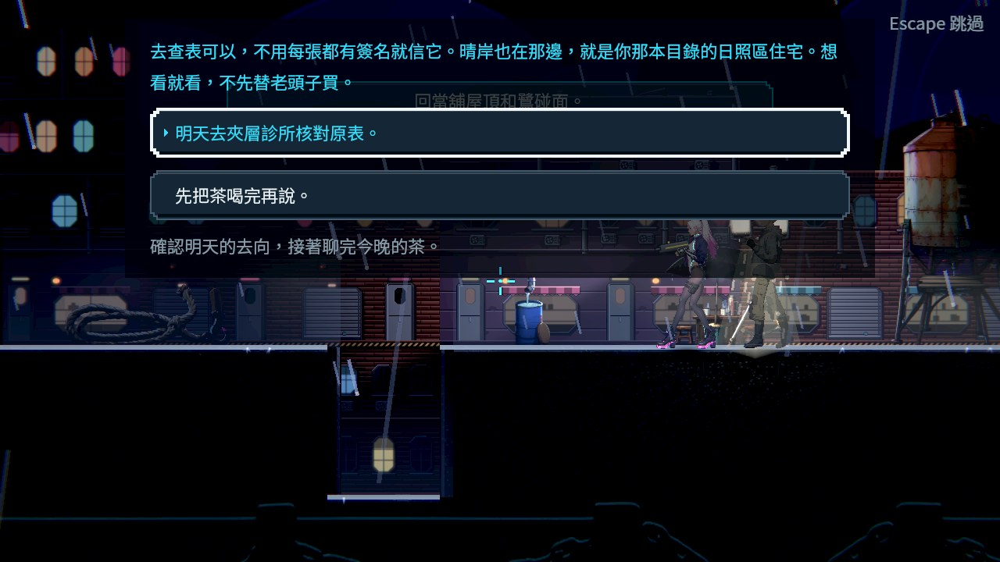
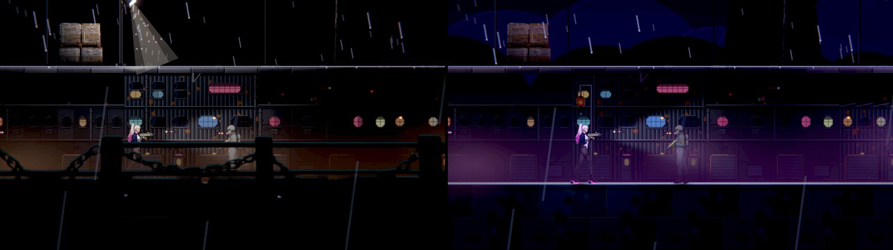

分支：`feature/story`。落地計畫與接點：[CH02_IMPLEMENTATION.md](../../design/13-story-v2/CH02_IMPLEMENTATION.md)。探針：`tools/ch2_flow_probe.tscn`（`--route=cut|keep`、`--supper=stay|leave`、`--pay`）、`tools/ch2_readability_check.tscn`。

# Commit-2

## 內文

上一輪留下兩件事：第二章還沒驗過死亡與讀檔，屋頂兩場最重要的對話（簡報前的茶與章末的茶）只是疊在地圖上的對話框，看不到鷺和凜站在一起。另外第二章的區域都沒有配樂設定，全部播預設的貨運區音樂。
現在屋頂的茶是正式過場：沿用第一章的屋頂舞台，鷺和凜在雨裡面對面，簡報、週日與章末的接續段落接在同一個畫面上。十個區域都接上既有的配樂（當舖與阿梨家用當舖的暖調、市集用市集、貨道與帳房用貨運區、復原館外用診所）。
死亡與讀檔用兩個獨立程序從真正的 Main 驗：第一個程序新遊戲後帶著第一章的結果走進第二章，結算、修收音機、拿查核證、代墊四十，在公眾攤道死一次再從檢查點重來，三筆款項不重算也不消失、文件還在、代收處不會重頭再收一次；退出後第二個程序按「繼續遊戲」，回到公眾攤道，存的金額、三筆款項、死亡次數與文件都對，看過的段落一段都不重播，接著把市集的線索收完，回當舖找老 K 也不會再付一次七百二十。

### 測試結果

基準：本票 Commit-1（rebase 後為 `817861e7`）。

| 項目 | 結果 |
|---|---|
| 受影響範圍（原選擇器，47 組） | 44,964 項，0 新失敗、0 已知失敗，255 秒 |
| 死亡與跨程序讀檔（`tools/ch2_resume_probe.tscn`，write → continue 兩個程序） | 兩個程序都 0 失敗 |
| 整章流程探針 | 斷連路、保留路 0 失敗 |
| 第二章正式過場的構圖檢查（新增） | 8 場都通過：腳底在對話框之上、頭不進黑邊、場景資料有效 |
| 劇本文字掃描 | 0 錯誤、0 警告 |
| 待本機原生驗收 | 真人長度與張力、三種難度、實際聽配樂的感受 |
| 尚未做 | 遞毛巾、洗碗這類環境動作的演出，其他場景（代收處、帳房、電話亭）的正式過場；頭目戰與遭遇（NE-265、NE-266）、配角外觀（NE-267） |

### 截圖

雲端軟體 Vulkan（Forward+），用截圖工具逐段播放正式過場時拍的。

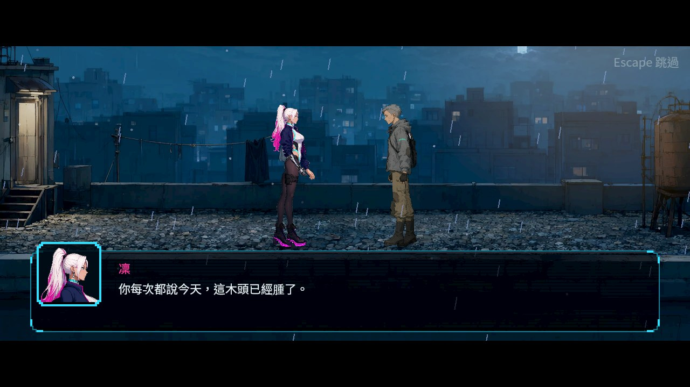
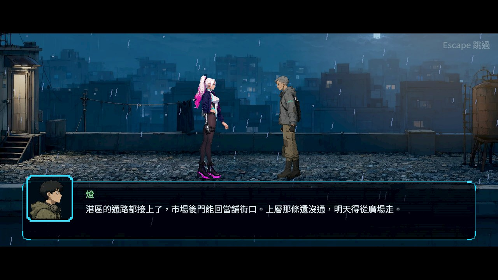

分支：`feature/story`。探針：`tools/ch2_resume_probe.tscn`（`--mode=write|continue --save-dir=<絕對路徑> --out=<資料夾>`）。

# Commit-3（制伏阿勇先保存，再推進故事）

## 內文

拔下阿勇原電池後，原本即使存檔失敗也會公開制伏結果。現在先完整保存互動與故事結果，再推進進度；失敗保持原現場並提供重試。退出保留原進度，死亡或來源已變更則回到原整輪存檔。阿勇依然活著，冷續玩也不再留下已退場頭目的血條。

真正按住原電池的末段樣本、拒絕與重試、退出／死亡／來源替換、假訊號及原主檔冷讀，共7程序64項全過；第一章原17程序150項、受影響72組95,195項亦全過。原生軟體Vulkan另驗拒絕、接受與冷續玩，17項全過、無嚴格錯誤。末段樣本不代稱自然完整戰鬥或整章人工通關。

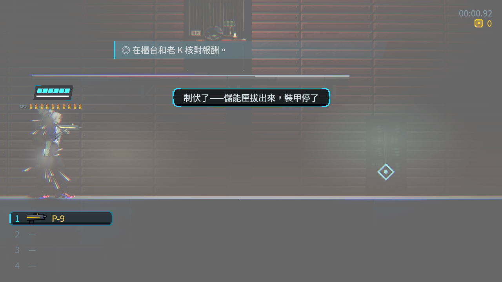
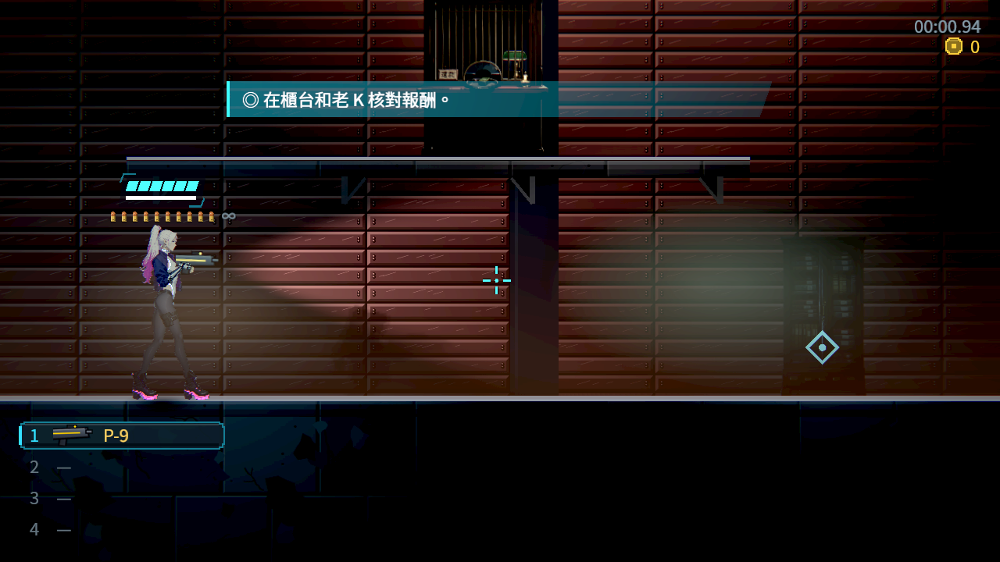

[負控制、原主檔、原生原圖與完整證據](attachments/ST-19-nonlethal-save/README.md)。

# Commit-4（主隔離箱的兩個結果一起保存）

## 內文

原主隔離箱完成後，即使保存失敗仍會公開「已隔離」與「已撤銷連結」。現在兩個結果一起保存，成功後才一起發布；每個通知當下兩個結果都已成立。拒絕可重試，退出保留原主檔，死亡、來源或契約已變更則回原整輪；不接受一半結果，也不把隔離箱當成後續拔電池完成。

原版8項有2項失敗。修後10程序97項、原第一章／阿勇電池／守門人31程序277項，以及受影響71組93,886項全過。原生軟體Vulkan互動與冷讀18項全過。樣本僅安排前置選擇、血量與位置，按住原箱子是真的，不代稱完整自然戰鬥或整章人工通關。

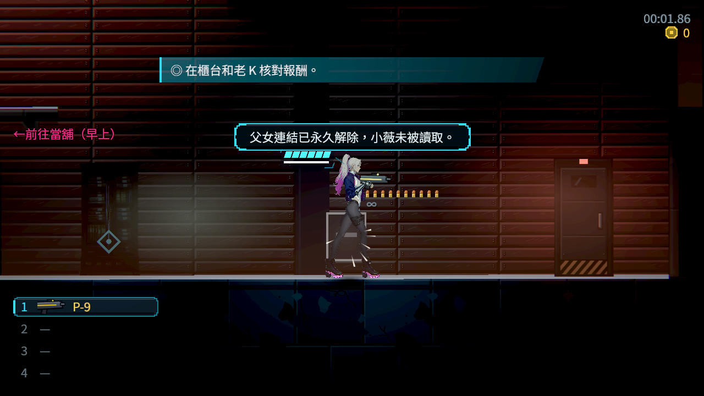

[原始失敗、映射故障、完整主檔、原圖與全部回歸](attachments/ST-19-isolation-save/README.md)。最初退出音訊外洩由NE-282獨立交付後重驗。

# Commit-5（巡帳員通行與對話進度一起保存）

## 內文

巡帳員完成查核時，原本即使保存失敗仍會放行並記為讀過。現在成功保存後才一起接受通行、對話紀錄與人物交談次數；拒絕可以原地重試，外部取消保留原進度。直接呼叫、假冒巡帳員或遭修改的結果都不能取得通行。

原版9項有4失敗；修後8程序83項、第一章交付櫃與付款／留宿選擇8程序271項、作者資料15項，以及受影響68組92,203項全過。原生軟體Vulkan互動及冷讀25項全過。樣本安排先前簡報、查核證與位置，真正讀完原對話；不代稱自然整章通關或人工驗收。

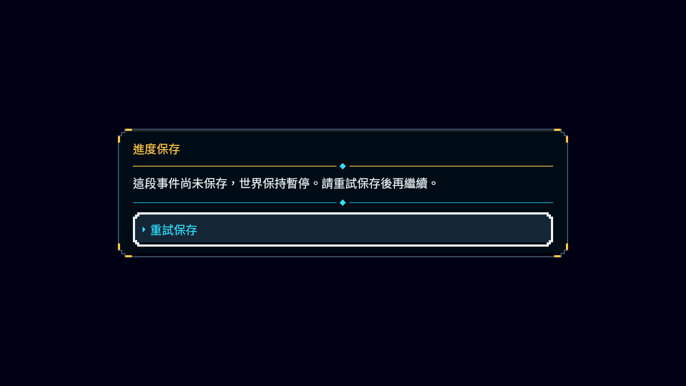
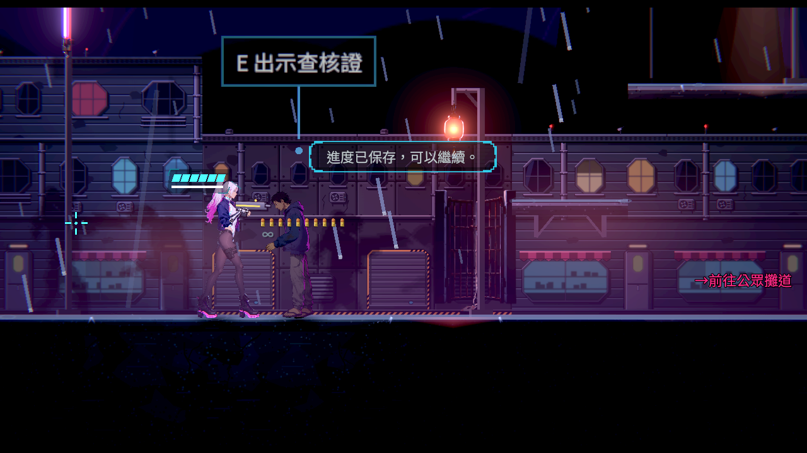
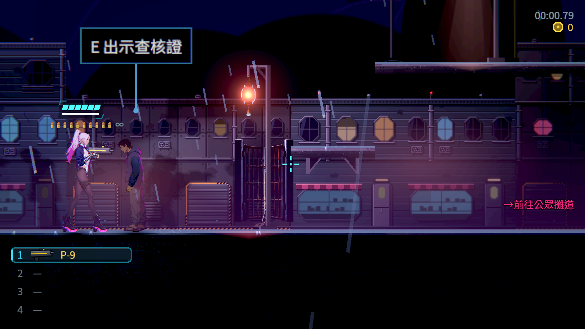

[原始失敗、完整主檔、來源與全部驗證](attachments/ST-19-patroller-save/README.md)。

# Commit-6（查帳證據與閱讀進度一起保存）

## 內文

在租攤視窗看完合約、或讀完裝卸間代收簿後，原本即使保存失敗仍會拿到副本並記為已讀。現在物品與閱讀進度一起保存，成功後才通知取得；拒絕可原地重試，取消保留原進度，來源失效回到原完整存檔。假物件或遭替換的獎勵不能取得證據。

原版兩程序26項有12失敗，相同拒寫樣本修後全過。正式14程序236項、巡帳員83項、作者資料15項、受影響9組4,263項，以及原生軟體Vulkan88項全部通過。通知當下原存檔中的物品與人物進度已一致，閱讀確認及冷續玩也保留。樣本明示進區與位置，不代稱自然整章通關。

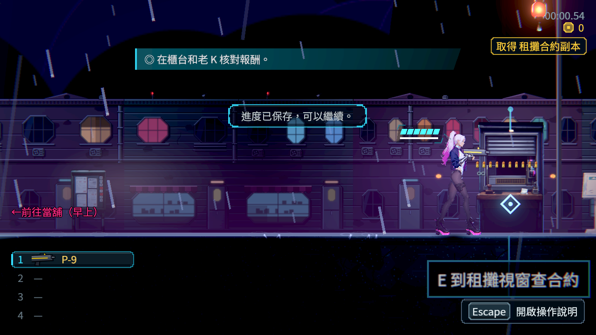
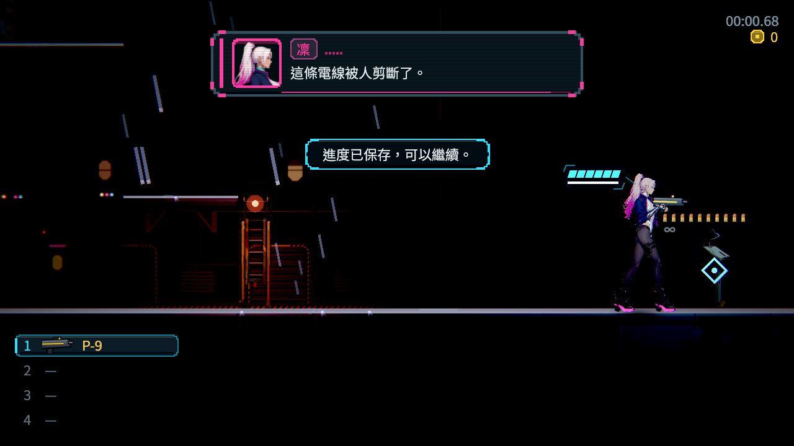

[原始失敗、完整主檔、來源及全部驗證](attachments/ST-19-evidence-save/README.md)。

# Commit-7（人物閱讀與橋梯進度先保存）

## 內文

讀完榕伯往事、小販傳聞、查看守衛或使用橋梯拉桿後，原本即使保存失敗仍會推進進度。現在成功保存後才完成閱讀與回訪進度；拒絕保留原互動可重試，取消保留原進度，來源失效回原完整存檔。橋梯在拒絕時維持關閉，接受及續玩後通行與放下外觀一致。

原版4程序48項有20失敗，相同拒寫樣本修後全過。正式28程序472項、原巡帳員與證據22程序319項、作者資料15項、受影響9組4,263項全部通過。原生軟體Vulkan151項，以及原橋梯存檔近拍冷讀13項全過。樣本明示進區與位置，不代稱自然整章通關；近拍有標示取景用途。

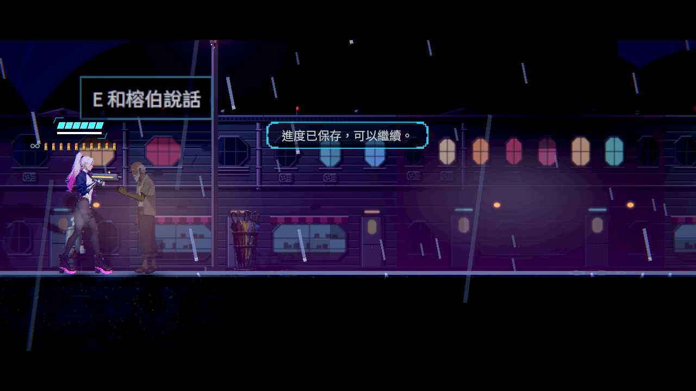
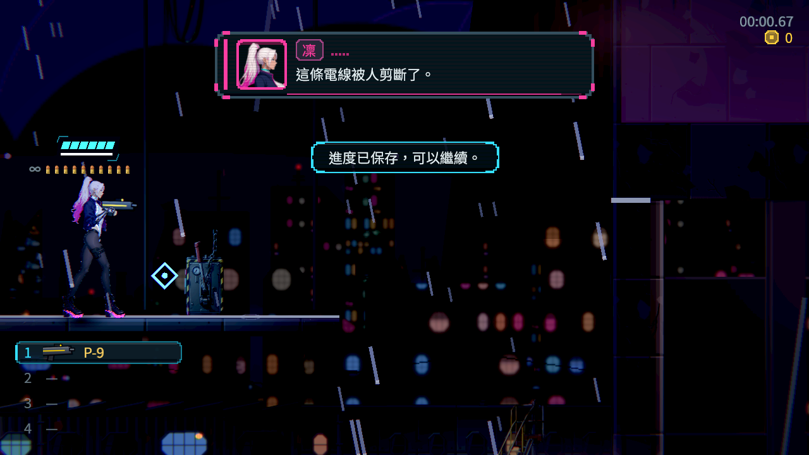
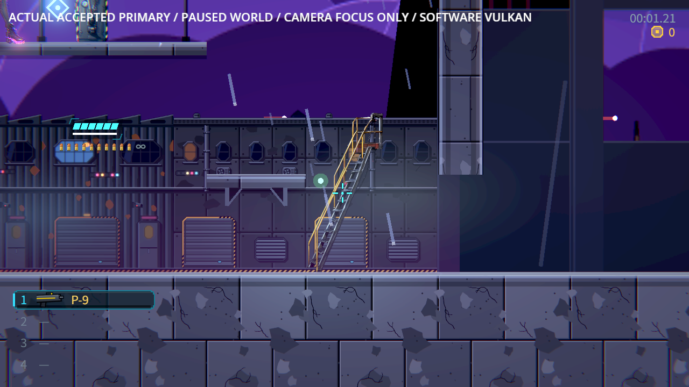

[原始失敗、初次取景、完整主檔及全部驗證](attachments/ST-19-reading-save/README.md)。

# Commit-8（阿梨家洗碗是凜真的動作）

## 內文

阿梨家選「放到左邊／右邊的架子」以後，畫面上只有對話框，凜沒有洗碗。現在凜真的走到洗碗池前，從水槽邊拿起一隻碗，在水龍頭旁沖兩圈，放到碗架左邊乾的那一頭再收手；選錯時放到右邊還在滴水的那一頭，阿梨說一句再讓你重選。碗只是演出外觀，放完交還擺設，不產生物品、不寫旗標，原本的結果與保存不變。
站位與各點用真的凜骨架在 360 種待機姿勢下量過，每一點都搆得到；原本的放碗點落在碗架框外，已移進架內。洗碗池原本在廚房另一頭，凜和阿梨在爐邊說完要穿過整間廚房，現在洗碗池挨著湯爐，桌子和窗移到門口那側（BG-38 的物件不變，只改位置）。演出時鏡頭對準洗碗池。

### 測試結果

| 項目 | 結果 |
|---|---|
| 受影響範圍（51 組） | 59,277 項，0 新失敗、0 已知失敗，556 秒 |
| 洗碗搆得到（新增，`tests/helpers/world_place_reach_checks.gd`） | 放對與放錯兩種、各 10 個點 × 360 種姿勢都搆得到，握點誤差 0.0001 像素以內；壞資料（缺碗圖、寬度、圈數、座標）都會被擋下 |
| 整章流程探針（軟體 Vulkan，Forward+） | 斷連路 0 失敗，放錯一次再放對，兩段動作的每個階段都有出現 |
| 待本機原生驗收 | 實機看洗碗的手感與節奏 |
| 尚未做 | 代收處、帳房、電話亭的正式過場（Commit-9 完成）；遞毛巾 |

### 截圖

雲端軟體 Vulkan（Forward+），由流程探針送出真的選擇時拍的：拿碗、抬起、沖洗、放上碗架、收手。

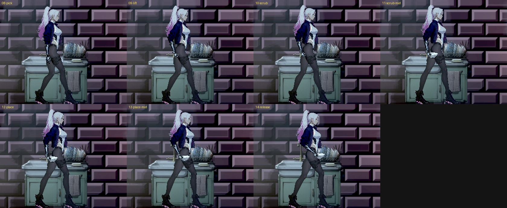

規格：[WORLD_PROP_ACTIONS.md](../../design/13-story-v2/WORLD_PROP_ACTIONS.md) 的「洗碗放架」。

# Commit-9（代收處、帳房、電話亭改成正式過場）

## 內文

代收處追帳、帳房裡阿勇的兩種收尾與鷺倒下、電話亭的第 214 次，原本都是疊在地圖上的對話框，看不到人站在一起。現在三處都是舞台演出：代收處是霓虹市集前，利息站在關卡同一張收款桌後面，阿梨和凜站在桌前，付款或先問的選擇留在同一個畫面上；帳房用阿勇的辦公室，凜和阿勇、小薇面對面，保留路多了救護員，鷺倒下時她跪在地上、凜蹲在旁邊看傷；電話亭是雨夜的街角，鷺從關卡同一座電話亭出來，凜和榕伯在旁邊。回訪的一句話仍留在地圖上，結果、旗標與保存都不變。
舞台上的擺設照關卡同一件擺設的大小，人和桌子、電話亭的比例與地圖一致。

### 測試結果

| 項目 | 結果 |
|---|---|
| 受影響範圍（49 組） | 56,490 項，0 新失敗、0 已知失敗，512 秒 |
| 過場構圖與舞台比例檢查（ChapterCutscenesSuite、SceneSanitySuite） | 通過：腳底在對話框之上、頭不進黑邊、桌子與電話亭的大小在比例表內、蹲跪姿勢有寫原因與支撐 |
| 整章流程探針 | 斷連路、保留路加代墊兩輪都 0 失敗 |
| 待本機原生驗收 | 真人看三場的節奏 |
| 尚未做 | 遞毛巾；配角正式外觀（NE-267） |

### 截圖

雲端軟體 Vulkan（Forward+），用截圖工具逐段播放正式過場時拍的。

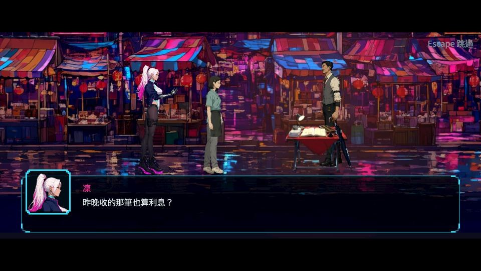
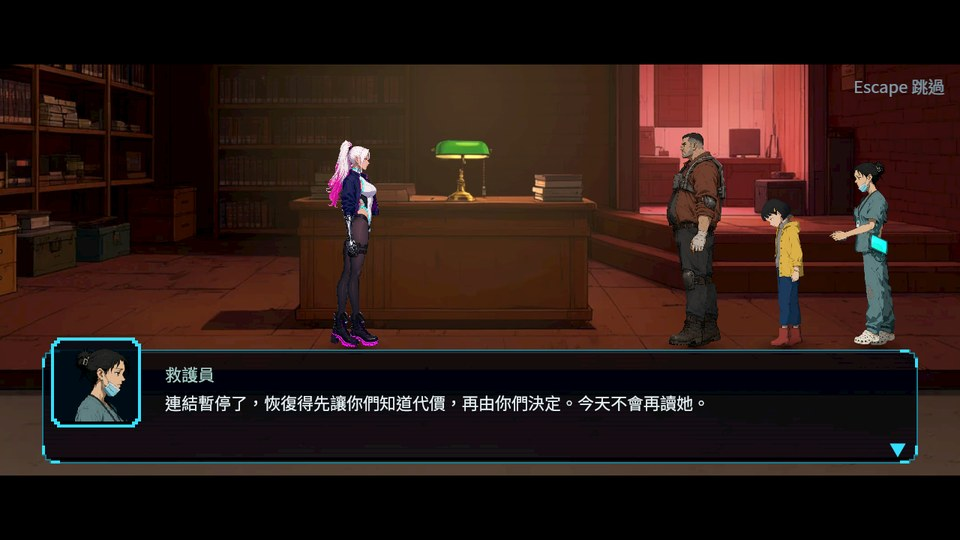
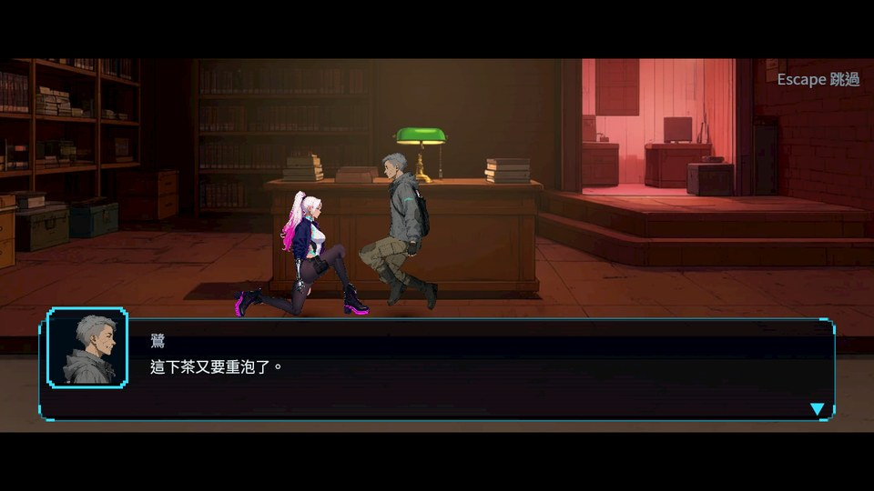
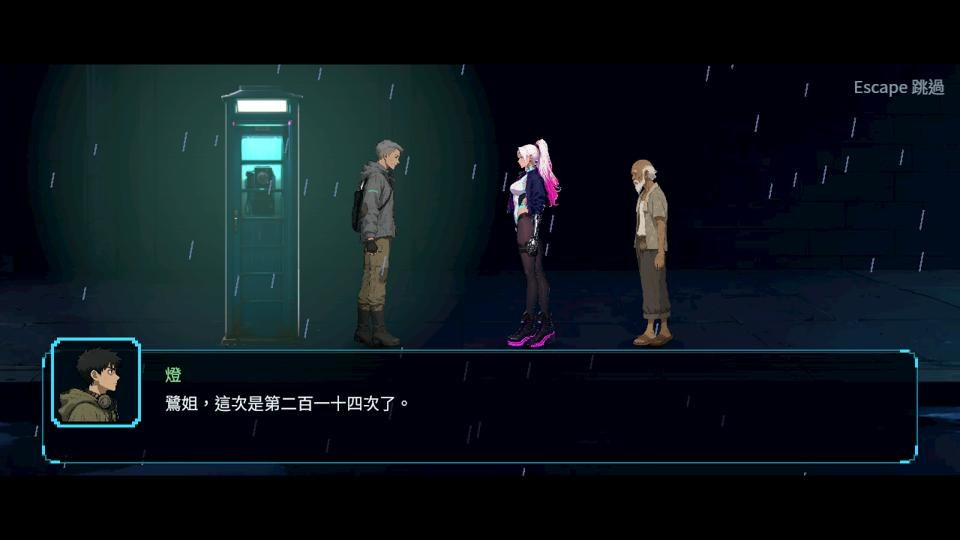

舞台：`tools/story/ch2_stages.py`；說明見 [CH02_IMPLEMENTATION.md](../../design/13-story-v2/CH02_IMPLEMENTATION.md) 的「代收處、帳房、電話亭的正式過場」。

# Commit-10（早上結算時老 K 遞毛巾）

## 內文

劇本寫老 K 把乾毛巾推到櫃臺、叫凜先把頭髮擦乾，畫面上卻只有對話框。現在早上結算是當舖櫃臺的正式過場：老 K 掌心按著毛巾沿櫃臺推過去，說「頭髮先擦乾」，凜拿起毛巾按在頭頂，再放回自己這側，接著回話。結算、旗標與報酬都不變；後面接續的段落裡毛巾留在凜那側，不會跳回去。
現有素材裡沒有能乾淨裁下的毛巾，另外畫了一條摺好的毛巾，畫法和其他擺設一致，可用同一支程式重畫。

### 測試結果

| 項目 | 結果 |
|---|---|
| 受影響範圍（49 組） | 56,863 項，0 新失敗、0 已知失敗，506 秒 |
| 過場構圖與資料檢查 | 通過；推、拿、按頭頂、放回的每一步都碰得到毛巾，演出中沒有錯誤 |
| 整章流程探針 | 斷連路 0 失敗 |
| 待本機原生驗收 | 真人看遞毛巾的節奏 |

### 截圖

雲端軟體 Vulkan（Forward+），用截圖工具逐段播放：老 K 推過來、凜拿起、按在頭頂、放回櫃臺。

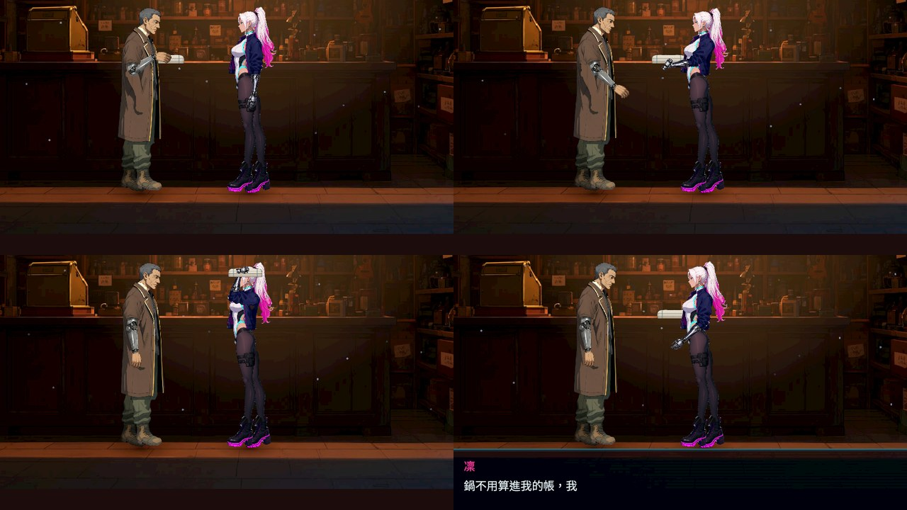

說明見 [CH02_IMPLEMENTATION.md](../../design/13-story-v2/CH02_IMPLEMENTATION.md) 的「S01 遞毛巾」；毛巾貼圖：`tools/assets/draw_folded_towel.py`。

### 驗收條件第 1 項

第一章天亮的當舖（`ch1_pawnshop_dawn`）的下一關是 `ch2_pawnshop`；正式章節只載入 `ch1_kasa`、`ch2_heron`、`ch3_clearwater`，舊第二章（`chapter_02.json`、`cutscenes_ch2.json`、`level_02`）只留在開發版的舊示範關卡，發行版不載入（`autoload/story.gd` 的 `LEGACY_CHAPTER_PATHS`）。劇本 S01～S22 都有對應場景，重要對話已是正式過場（Commit-2、9、10），流程探針從第一章結尾推到第二章章末 0 失敗，所以勾掉。

---

# Commit-11（市集公告可以邊走邊讀）

## 內文

在市集公告屏按互動鍵，沈望的演說和氣象欄會依序出現，玩家可以繼續走路，回到公告屏可重看。字幕上標出關閉鍵，鍵盤用 Escape，預設手把用 Start。關閉本次字幕後，暫停選單恢復原操作；手把閃避鍵仍可使用。公告播放期間，操作說明會讓出同一個按鍵提示。

這個關閉方式只開放給沒有獎勵、沒有故事結果和接續場景的普通通訊。略過公告只結束這一次播放，後續通訊保留。原演說文字、入口、氣象欄和任務照常。

### 測試結果

| 項目 | 結果 |
|---|---|
| Forward+ 市集實機 | 繁中、日文、英文各 23 項通過；21 物理步相同移動輸入，有無公告均移動 44.167 世界像素 |
| 字幕關閉 | 驗證鍵盤 Escape、手把 Start 的輸入事件，以及手把閃避期間公告繼續顯示 |
| 劇本作者工具 | 61 項通過，含拒絕讓重要通訊或有任務結果的場景使用關閉字幕 |
| 受影響範圍（65 組） | 65,235 項，0 新失敗、0 已知失敗、0 腳本錯誤，543 秒 |

首輪出現一項彈匣介面計時檢查失敗。相同遊戲內容下，彈匣套件單獨重跑兩次與正式回歸重跑均通過。

[三語畫面、輸入回放與原始結果](attachments/ST-19-notice-controls-2026-11-19/evidence.zip)

### 截圖

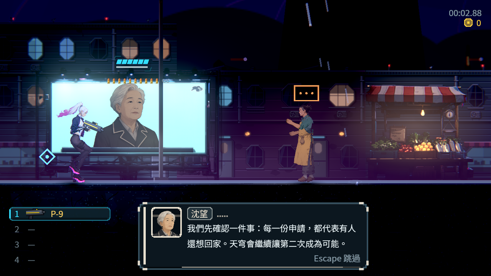

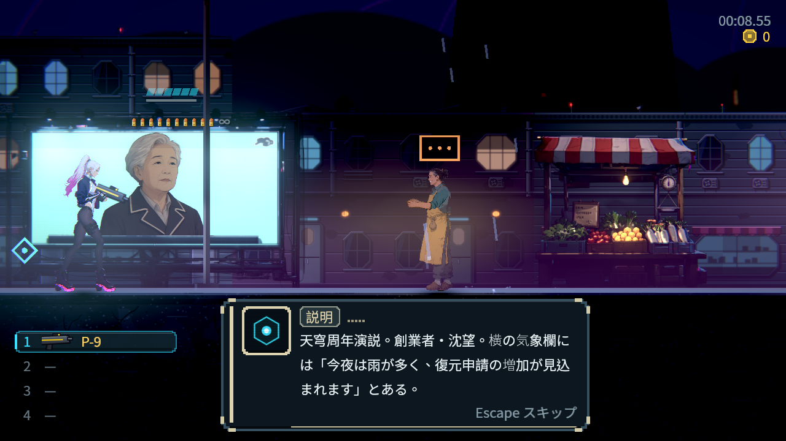

---

# Commit-12（市集押運手的外觀與短棍）

## 內文

押運手改用鏽紅反光背心、護膝、專屬骨架和獨立短棍。蓄力仍亮棍頭並標出判定高度，突進及收招沿用已配置的招式順序。短棍貼圖缺失時保留線段及預兆。

### 測試結果

| 項目 | 結果 |
|---|---|
| 受影響範圍 | 61 組、66,555 項，0 新失敗、0 已知失敗 |
| 市集原生 Forward+ | 遊戲場景前後同一物理步保持敵我位置，三名押運手均可從上層繞過。兩個朝向各驗證蓄力、突進、收招及倒地 |
| 普通難度地面路線 | 原手槍擊倒 3 名押運手及 1 名票據投手，保有 6 格生命，無新增死亡 |
| 骨架接點 | 53,760 個樣本，470 格為輪廓邊緣訊號，無封閉孔或孤立零件 |

### 截圖

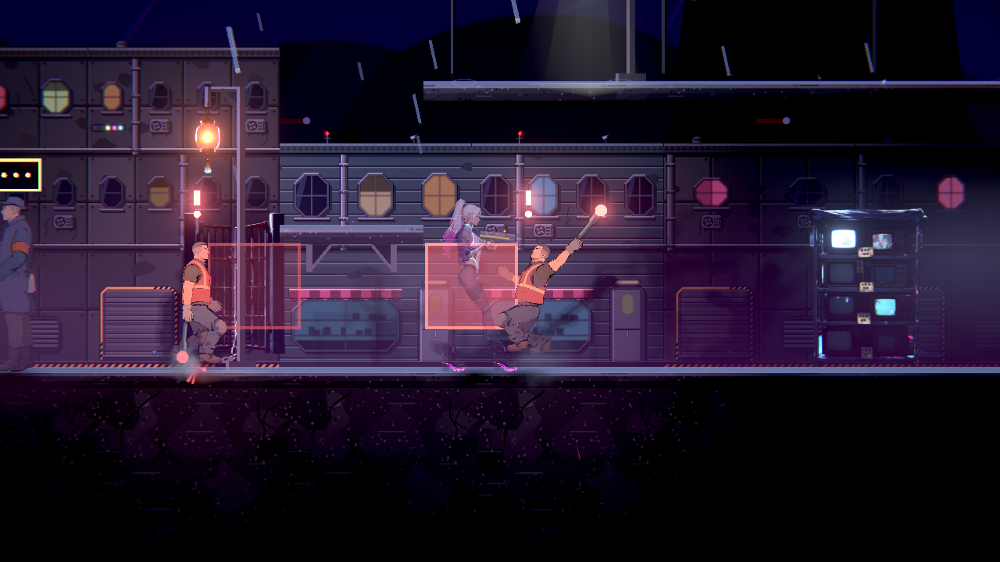

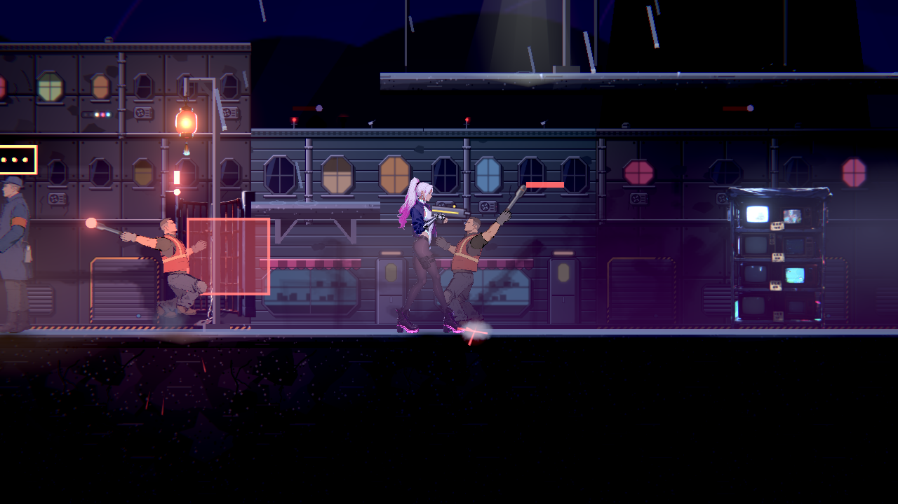

[原生畫面、回放和量測](attachments/ST-19-escort-art-2026-11-19/README.md)

票據投手和整章剩餘美術另行驗收。

---

# Commit-13（市集票據投手的專屬外觀與擲紙動作）

## 內文

票據投手換上眼鏡、背帳板和腰票箱，抬手展示紙疊後才投出五張紙，收招時短暫空手。扇形預兆、原發射點、數量和時間照原招式。兩種新敵人的暫代外觀均已換下。

### 測試結果

| 項目 | 結果 |
|---|---|
| 受影響範圍 | 61 組、66,758 項，0 新失敗、0 已知失敗 |
| Forward+ 市集驗證 | 雙朝向各實射 5 張紙，角度為 −23°、−11.5°、0°、11.5°、23°。捕捉抬手、紙頁分開、收招及倒地 |
| 普通難度實戰 | 原手槍通過市集地面，擊倒 3 名押運手及 1 名票據投手，保有 6 格生命，無新增死亡 |
| 骨架接點 | 53,760 個樣本，10 個輪廓邊緣訊號，無封閉孔或孤立零件 |

### 截圖

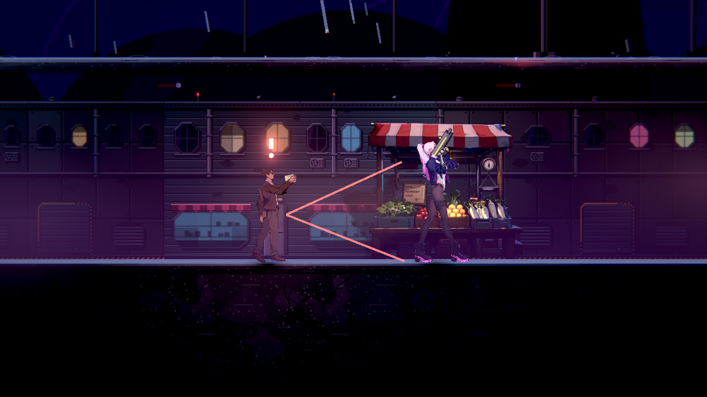

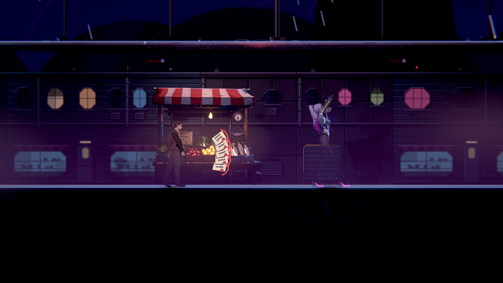

[原生畫面、回放與量測](attachments/ST-19-thrower-art-2026-11-19/README.md)

---

# Commit-14（鷺倒下時停止背景音樂）

## 內文

帳房兩條路的音樂會跟著鷺倒地的過場繼續播放，原生量測在倒下段分別為 -36.0、-39.8 dB。將這一段標記為靜音，沿用 Music 的增益效果。搬運和鎖扣聲仍走原本的音效與環境音匯流排。正常結束、略過、中止或釋放過場後恢復音樂，保留玩家設定及曲目進度。

### 驗收

由真正的 Main、帳房互動和原段落串接走完斷連、保留兩路。兩路倒地及固定束帶時，共取樣 56,320 個 48 kHz 立體聲背景音樂影格，樣本全為零。同期仍有環境音和束帶金屬聲，進場前與結束後都有背景音樂。兩路均保留原帳等三件物品、搬送結果與單次 120 點報酬，回訪無重複付款。

受影響回歸 59 組、63,511 項全過，580 秒。劇本與第二章來源 34 項測試全過。

[原生照片、三匯流排 WAV 與回歸紀錄](attachments/ST-19-s13-music-2026-11-19/evidence.zip)

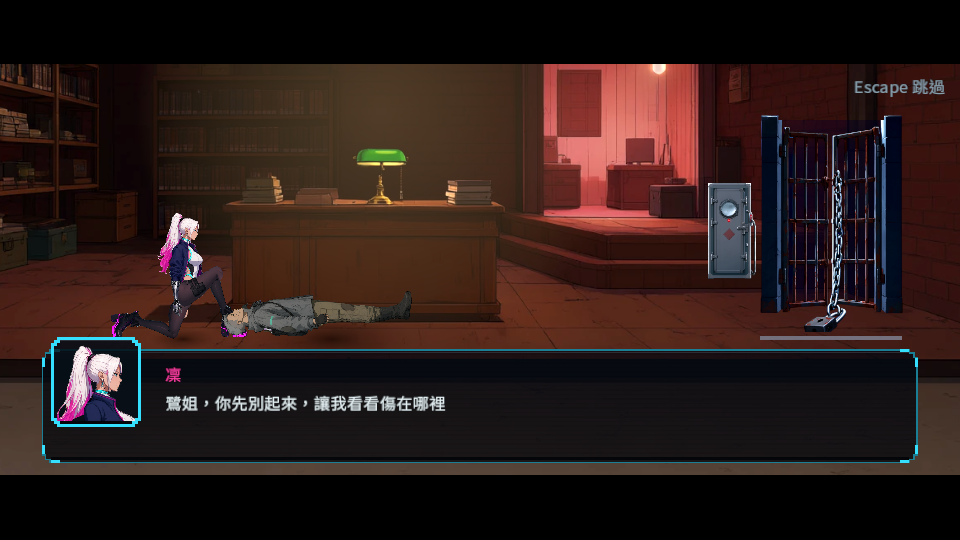

---

# Commit-15（電話亭復原演出與略過進度）

## 內文

鷺先坐在候位椅上，扶著椅側起身，凜把原擔架送過來的破傘交還給她。鷺再收起裝備袋，接續對話中仍拿著同一套物件。兩位成人和榕伯在場，保留原來九句台詞。終端先響一聲，過場期間停止背景音樂。

原版在第一句按 Esc 會回到地圖，但復原次數停在 213，回訪又重播整段。開場現在登記可略過的旗標收尾，按一次 Esc 就完成原有復原結果。收尾只接受同一劇本中沒有選擇、只提交旗標的末段。

### 驗收

由真正的 Main 讀入帳房完成存檔，穿過家屬出口與市集原鷺互動。正常播放與按 Esc 都到第 214 次，另開程序續玩也各自保留 214 和原回訪，沒有再加一次。正常路線核對起身、兩件物品的五個持握畫面、終端聲、背景音樂和操作復原。四個原生程序共 54 項檢查通過。

受影響回歸 65 組、60,954 項全過，570 秒。劇本與第二章作者來源 34 項通過。

[修前重現、原生重播與冷讀](attachments/ST-19-booth-restoration-2026-11-19/evidence.zip)

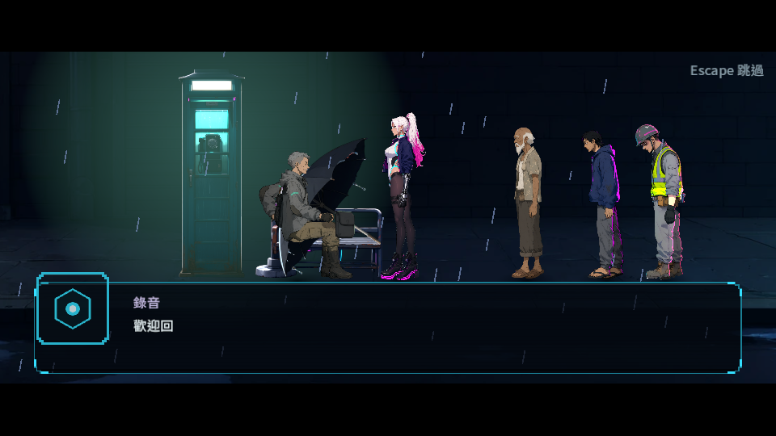

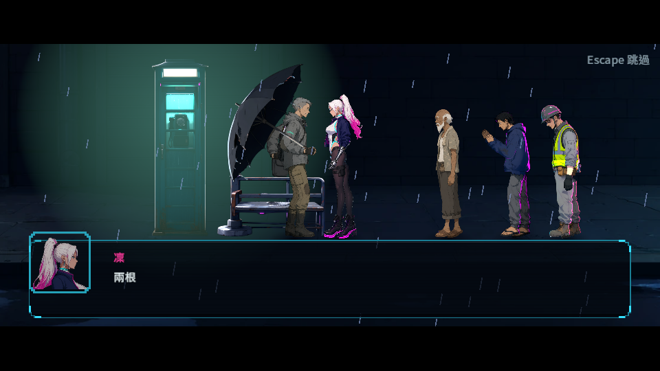

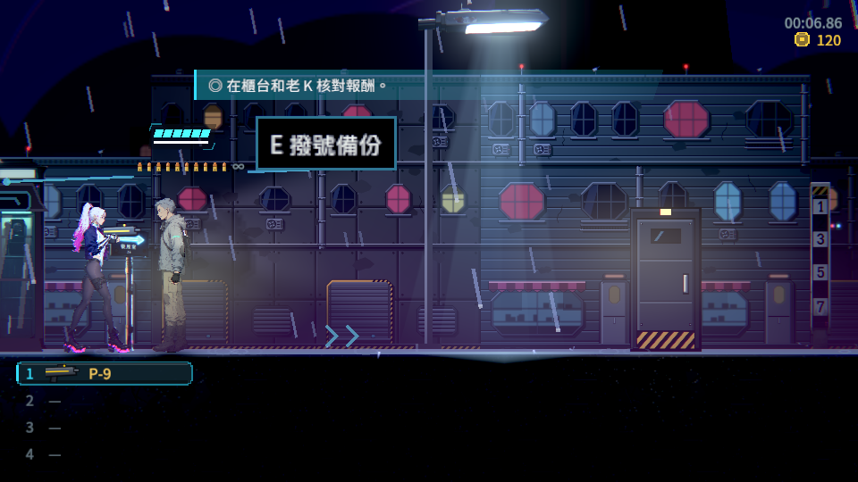

---

# Commit-16（阿梨試湯可回訪）

## 內文

只記地址便離開時，洗碗試湯維持進行中。再次敲門會看到「放到左邊的乾燥架」和「先不洗了，下次再來」兩個選項。乾架沿用原本的移動與操作，試湯後登記原有的四十點報酬。已試過湯的存檔仍接原回訪對話。

### 驗收

原版從只記地址的存檔重開，任務已顯示完成，阿梨只提供原回訪，金額仍是 120 點。修正後同一舊存檔能完成試湯，120 點增至 160 點。另開程序續玩仍是 160 點。先不洗、初訪直接洗碗和初訪先離開都從真正的 Main 和阿梨互動重跑，結算與任務狀態均符合預期。

受影響回歸 44 組、55,418 項全過，632 秒。劇本契約、第二章作者來源與關卡測試共 40 項通過。

[修前存檔重現、原生重播與冷讀](attachments/ST-19-ali-soup-revisit-2026-11-19/evidence.zip)

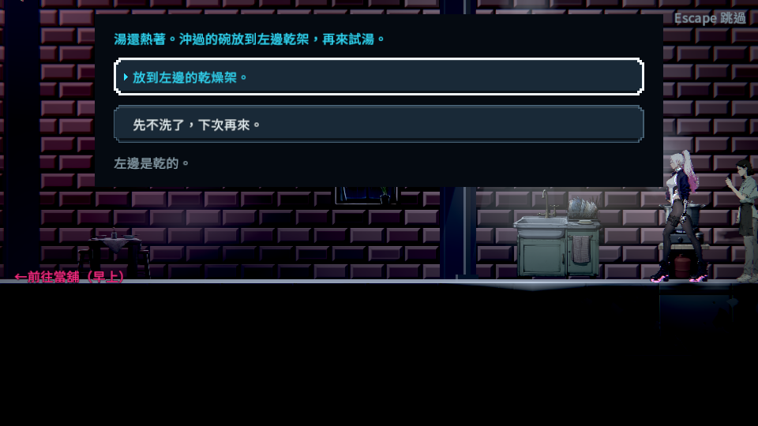

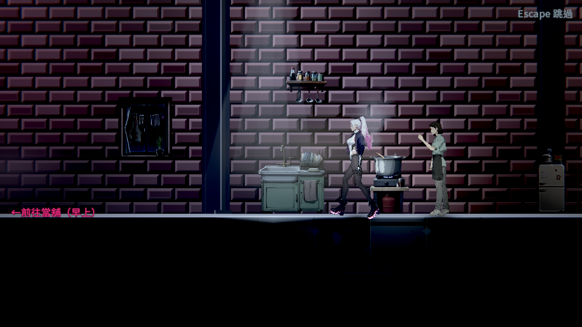

---

# Commit-17（阿梨試湯回復生命）

## 內文

選項說明會標出試湯回復 2 點生命。原有四十點報酬的收據成立時才回復，最多補到生命上限，首次和回訪補做都只有一次。初訪沿用原場景的自動保存，回訪補做將生命、收據、金額與任務結果一同寫入原存檔，再通知 HUD。

### 驗收

原版受傷時試湯只拿到四十點，生命維持 4／6。修正後初訪和舊存檔回訪都是 4→6，5→6 只補一點，滿血只發原報酬。兩份完成後重開遊戲都載回 6／6，重新受傷再敲門不補血也不發錢。強制回訪的暫存寫入失敗後，舊檔仍保有 4／6 和 120 點。按畫面上的重試，正式寫入完成後才發一次回復通知。七個原生程序共 81 項檢查通過。

受影響回歸 70 組、71,912 項全過，727 秒。劇本契約、第二章作者來源與關卡測試共 40 項通過。

[修前重現、回復、冷讀與寫入失敗重試](attachments/ST-19-ali-soup-health-2026-11-20/evidence.zip)

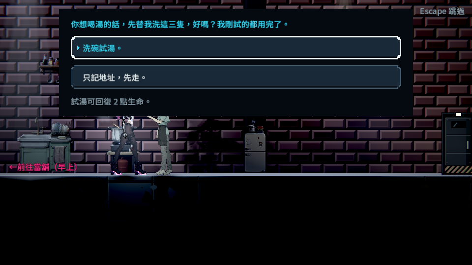

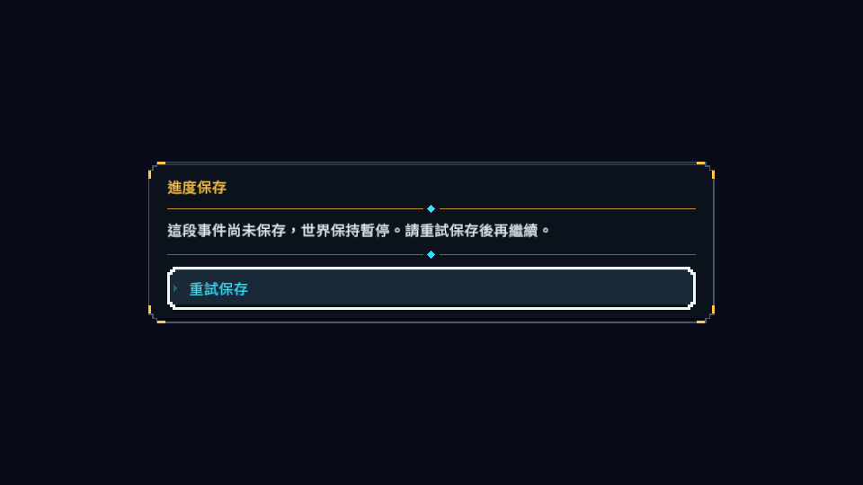

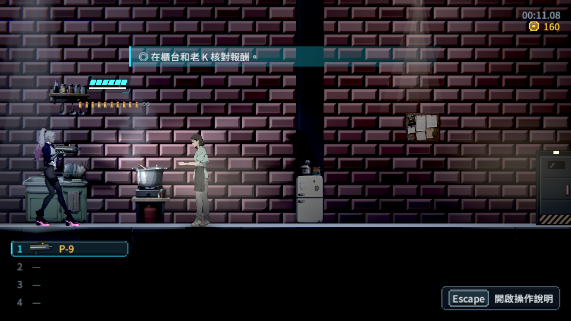

---

# Commit-18（電話亭只保留雨聲與終端提示）

## 內文

原標記只停止配樂，兩段電話亭過場還會混著市集底噪。過場現在保留原市集雨軌和終端提示音。雨軌沿用播放位置，中途切段不重播。結束、按 Esc 略過或取消後，市集底噪按原設定淡入。

### 驗收

透過原帳房出口、在原市集與鷺交談。修前九個對話取樣都同時播放雨聲及市集底噪。修後九個取樣中只有原雨軌在播，配樂仍保持靜音，終端提示音在正常播放時仍出現。按一次 Esc 仍在冷續玩載回第 214 次，取消則維持 213。五個原生程序共 66 項檢查通過，環境音音量仍是原設定。

受影響回歸 59 組、63,539 項全過，593 秒。兩章劇本契約與第二章作者來源共 34 項通過。

[修前與修後的原生混音量測、略過、取消和冷讀](attachments/ST-19-booth-rain-2026-11-20/evidence.zip)

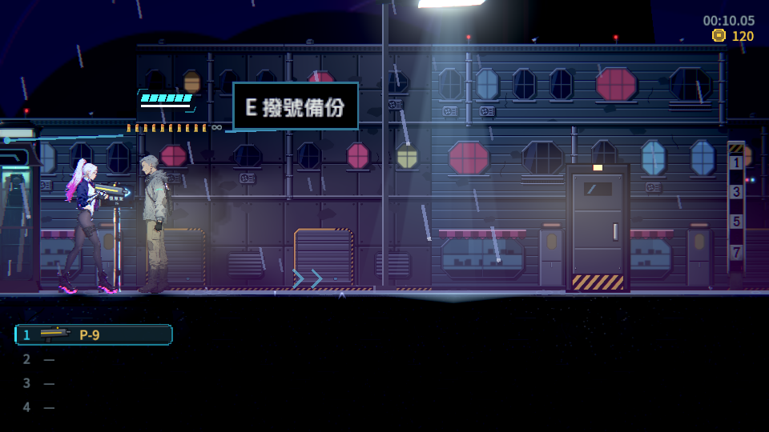

---

# Commit-19（屋頂茶座與章末最後一口）

## 內文

原屋頂對話提到茶，畫面上只有兩個人。早晚過場現在都擺上關卡原有的破傘、茶箱、兩只杯子和矮凳。章末確認去向後，凜彎膝拿杯、站穩喝完，再彎膝放回原位。有一次落桌聲。來源為 rubberduck 的 CC0 碗盤錄音，截取約 0.17 秒的單次接觸。 [OpenGameArt 來源](https://opengameart.org/node/85570)

### 驗收

由真正的 Main 從鷺復原後的存檔讀入，完成原簡報，再在真正的屋頂和鷺交談。已問與未問週日的兩條路都保有原台詞和章末結果，凜持杯到嘴邊再把原杯放回原桌面，落桌時讀到實際 SFX 訊號。選擇稍後再說只回到屋頂，不觸發章末或杯聲。三個原生程序共 58 項檢查通過，另有原版兩次對照。

受影響回歸 71 組、91,698 項全過，751 秒。兩章劇本契約、第二章作者來源及音效增量建置共 45 項通過。

[原生修前、修後、章末兩路與稍後再說](attachments/ST-19-rooftop-tea-2026-11-20/evidence.zip)

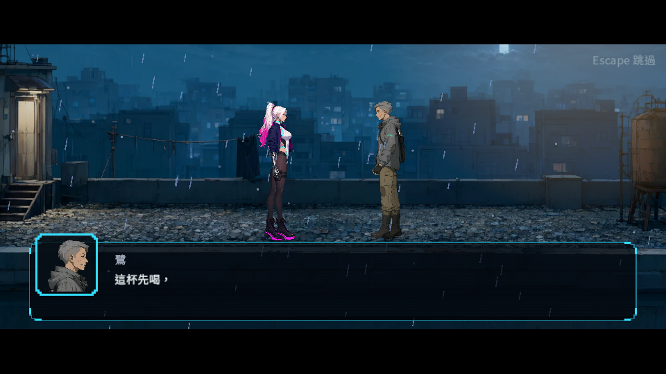

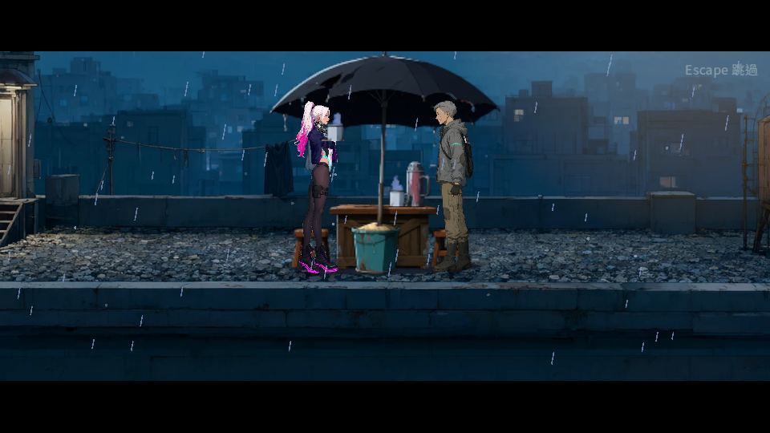

---

# Commit-20（屋頂查核證交付）

## 內文

鷺在早上簡報先出示市集查核證，再交到凜手上。簡報與市集入口使用同一卡面。凜收起卡片後，原簡報末段才發放物品一次。按 Esc 中途離開可再找鷺重聽。尚未結案的舊觀看紀錄也可重新接到簡報末段。

### 驗收

從正式 Main 載入舊進度，使用原屋頂和鷺的對話入口。五個本機 Forward+ 程序共 47 項檢查，包含修前正常流程、修後直接完成、出示卡片時按 Esc 後重試，以及兩個冷讀程序。略過時未發放卡片，重試後只發放一次。兩人的掌心與卡片接點偏差最大 0.042 像素。

受影響回歸 64 組、60,753 項全過，581 秒。劇本契約、翻譯及作者來源共 45 項通過。

[原生重播、略過重試與冷讀](attachments/ST-19-rooftop-check-card-2026-11-20/evidence.zip)

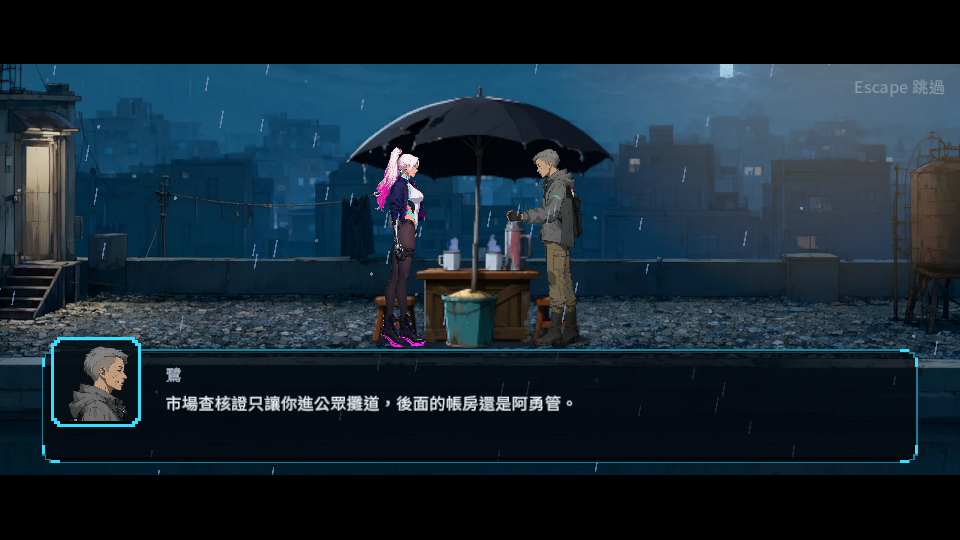

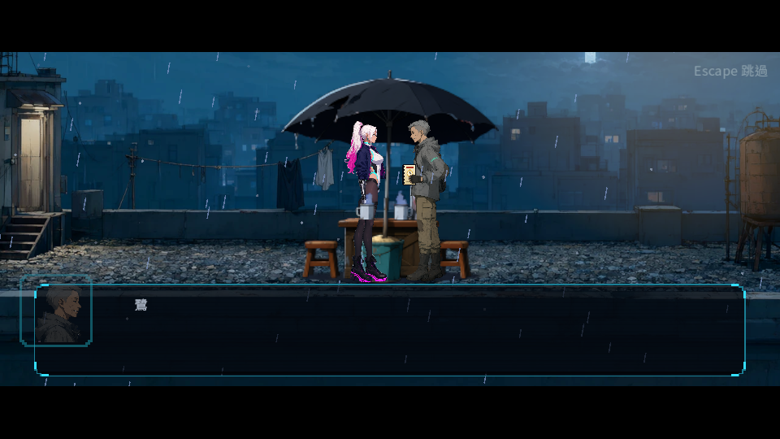

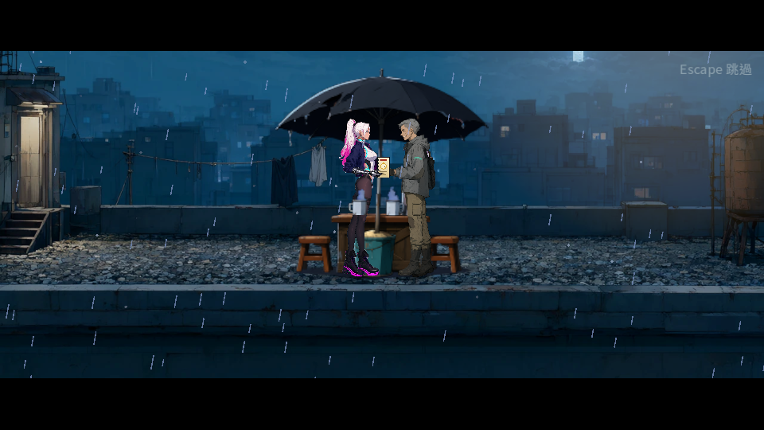

---

# Commit-21（客人簿收本與續玩）

## 內文

三位客人各自的報酬會立即保留。收本進行中按 Esc 只回到凜，收本報酬與完成狀態仍待結算。存檔移除這次播放記錄，重新開遊戲會直接回到凜。再查看客人簿可接著收本。完整演出才發原有 40 信用點並回到已完成的短對話。演出第一幀顯示「離開」，全域略過設定也保留這次決定。

### 驗收

修前在原交誼廳還未收本就按 Esc，已完成的 60 信用點變成 100。修後從正常 Main 讀入安排在對帳完成後的存檔，三位客人都透過原入口完成。五個本機 Forward+ 程序共 126 項通過。明確離開後只保留 60，兩次獨立冷續玩確認先回到凜、再查看才結算，已完成後不會重領。自然播放和全域略過設定開啟時也保留相同結算。

受影響回歸 69 組、66,323 項全過，628 秒。劇本契約及作者來源共 45 項通過。

[修前、修後及兩次冷續玩的原生紀錄](attachments/ST-19-guest-book-closing-2026-11-20/evidence.zip)

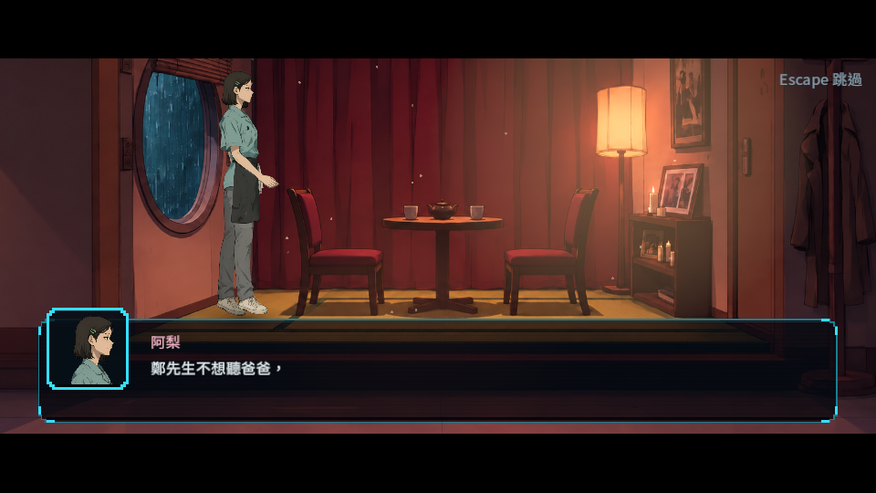

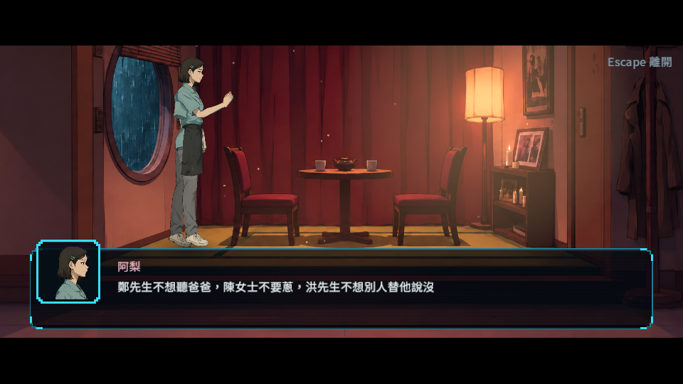

---

# Commit-22（阿梨把梨放入湯鍋）

## 內文

收本時阿梨說完三位客人的話，從圍裙口袋拿出梨，把它舉到鍋口再放下。藍鍋沿用阿梨家廚房的爐台並對齊交誼廳原地板。梨由 CC0 模型用本機 Godot 渲染成彩圖與法線，原模型只供素材建置。 [Innerscene 的 CC0 原件](https://www.innerscene.com/tools/library/3d-parts/pear-50fa4ef7)

### 驗收

從同一份保有三位客人報酬的存檔，在實際客人簿入口進入原收本。使用 RX 9070 XT 的三個 Forward+ 程序共 48 項檢查通過。高與低光影都量到掌心接點最大偏差 0.0001 舞台像素，梨落入鍋沿下方後消失。持梨時按 Esc 結束該演出並清掉存檔的播放記錄，只保留 60 點報酬。自然完成後只結算一次 40 點。

受影響回歸 41 組、61,017 項全過，602 秒。劇本契約及作者來源 46 項通過。兩個受影響的道具目錄匯入規則符合；全庫比對的 10 份既有匯入差異與修前一致。

[高低設定、持梨中斷及原始量測](attachments/ST-19-pear-pot-2026-11-20/evidence.zip)

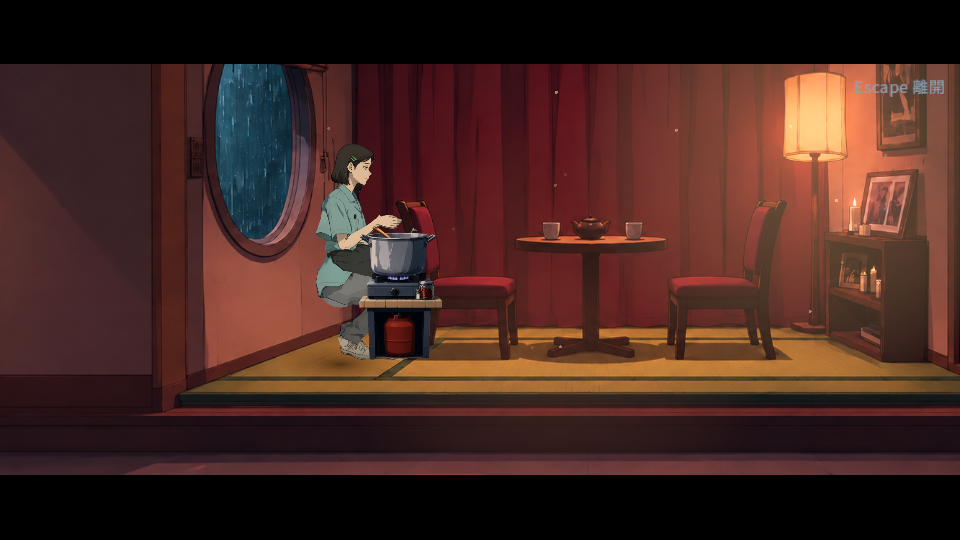

---

# Commit-23（凜按下館外委託終端）

## 內文

凜在原館外終端選擇上傳後，走到左側，蹲下按中央按鈕。掌心碰到按鈕時響一次，收手後接原本葉的審查對話。證據副本、原帳和診所索引留在筆記。站位不足以安全接觸時，原審查對話仍可完成；在空中互動或續玩當下尚未接地都已實驗。

### 驗收

以同一份隔離第二章存檔安排查帳前站位，從 Main 的「繼續」開啟正式復原館外關卡，再用原按鍵操作終端。RX 9070 XT、Forward+ 原生驗證共七輪 130 項通過，包含原版 19 項。左右兩側進入與按鈕途中退出都驗到掌心對齊並只播放一次按鍵聲。正常退出的主存檔保留待續演出，報酬仍為零。另開遊戲，完整確認原對話後才保存 250 點與收據。

原有 Esc 略過仍可結束本段。空中與冷讀未接地時沿用原對話，兩種情況均無接觸聲；完整讀完同樣結算一次，回訪只顯示結案短文。產生器重新生成後只多一個演出步驟，全部三語台詞、選擇、任務、結果與資源保持；作者與契約檢查 39 項通過。

受影響回歸 57 組、63,153 項全過，558 秒。原生樣本的先前章節狀態是隔離測試安排。本次驗證涵蓋 S15 上傳與回訪。

[原生七輪、收據、接地退回與作者／回歸紀錄](attachments/ST-19-audit-terminal-2026-11-20/evidence.zip)

---

# Commit-24（屋頂茶座的雨幕回歸）

## 內文

屋頂茶座沿用原屋頂的露天雨層。茶座加入第二章後漏登在雨幕檢查清單，完整跑劇本作者測試會因此失敗。將茶座加入清單，與遠樓觀望舞台一起檢查。正式舞台、降雨資料與故事演出維持原版。

### 測試結果

劇本作者回歸 63 項全過。Godot 選測判定無受影響的遊戲套件。另從隔離存檔用正式屋頂入口與鷺互動，RX 9070 XT Forward+ 23 項通過。簡報、章末茶座及遠樓觀望合計八次分段畫面，每段皆有一層啟用的原雨幕。凜最後放回茶杯、杯聲播放一次，再開通原章末步行路線。

[修前失敗、修後測試與屋頂原生記錄](attachments/ST-19-roof-weather-2026-11-20/evidence.zip)

---

# Commit-25（鷺把茶杯挪離破傘的滴水處）

## 內文

屋頂簡報開場，鷺在桌前屈膝，伸手把凜那只杯子沿原茶箱桌面推向傘中央，再回原站位。接著出示查核證和談雨時，杯子都留在挪過的位置。動作用原杯、原手與現有的接觸定位。章末的茶杯是當晚另一輪，仍從原位置開始。

### 測試結果

| 項目 | 結果 |
|---|---|
| 實際杯位 | 原接觸點 (292.56, 204.18) 移至 (300.40, 204.18)，兩輪完成都維持桌面高度，掌心與杯子對齊。雙靴底在屋頂地面 0.48 舞台像素內。 |
| 略過與續玩 | 持杯時按 Escape 會撤掉演出，背包仍沒有查核證。重新交談只領一次。獨立程序續玩回到簡報後話題，不會重播挪杯。 |
| 原章末 | 從隔離存檔走原章末確認，凜拿杯、放回與原杯聲均出現，步行路線照常開通。 |
| 驗證 | 四輪 RX 9070 XT Forward+ 共 65 項。劇本作者 63 項。Godot 選測 10 組、7,129 項，全過、0 腳本錯誤。 |

[原生畫面、掌心與靴底量測、略過及續玩等回歸](attachments/ST-19-roof-cup-2026-11-20/evidence.zip)

---

# Commit-26（屋頂樓梯旁的可選重擊練習）

## 內文

凜拿到市場查核證後，可以在屋頂樓梯旁用橡膠靶練習。靠近時顯示一行提示，使用目前綁定的近戰鍵。連段中的重擊命中後，靶亮起勾號、播放確認音並儲存。玩家也可直接下樓去市集。

### 測試結果

- 中文和英文使用鍵盤綁定，日文使用模擬手把按鍵。三語提示在 1280 × 720、預設文字大小均為一行，原有輕、輕、重連段成功，輕擊與子彈無法完成練習。
- 舊存檔讀到新增旗標時沿用安全預設值。正式簡報完成後才啟用練習，離場仍保留查核證。練習完成寫入主存檔，獨立重開後保留勾號，無法重複觸發結果，也沒有新增獎勵或成長解鎖。
- RX 9070 XT Forward+ 76 項，劇本作者 63 項，地圖作者 36 項。受影響的 Godot 測試 53 組、59,189 項全過，0 腳本錯誤。[原生畫面、存檔流程與資料對照](attachments/ST-19-roof-practice-2026-11-20/evidence.zip)

---

# Commit-27（裝卸間橋梯的狀態提示）

## 內文

上層拉桿亮琥珀色時，橋梯還收著。保存成功時拉桿轉綠，橋梯放下並響一次金屬聲。此時兩端依原條件通行。載入存檔時燈和橋梯直接顯示對應狀態，操作結束後狀態燈無須每格更新。

### 測試結果

- 使用原裝卸間拉桿執行真實保存拒絕、重試成功、取消及獨立程序續玩。兩次拒絕期間橋梯仍收起，燈保持琥珀色。成功保存只啟動一次開梯音效，額外確認既有音效池載入音訊並開始播放。重開已完成及已取消的存檔都維持安靜。
- RX 9070 XT Forward+ 五程序共 167 項通過，無引擎錯誤。重開兩種存檔後在同位置各取樣 184 個原生像素，燈罩紅減綠的中位數為 +38 與 −51。地圖作者工具重建同一拉桿反應，橋梯出入口與原結果契約保持一致。
- 受影響的 Godot 測試 53 組、59,210 項全過，0 腳本錯誤。[原生截圖、讀檔流程與測試紀錄](attachments/ST-19-bridge-feedback-2026-11-20/evidence.zip)保留。

---

# Commit-28（裝卸間可看到靠著棧板的守衛）

## 內文

在原本的裝卸間調查位置顯示靠著棧板的守衛。沿用巡帳員外觀，兩腳踩地，只保留胸口起伏，走近時不轉頭、不招手。提示仍從原位置進入原調查。外觀遺失時記錄具體位置，仍可透過原調查標記繼續。

### 測試結果

- RX 9070 XT Forward+、1280×720，在 1.92 倍及 3.4 倍分別從兩側接近。24 個取樣保持原面向，胸部角度變化約 0.039 弧度，姿勢穩定後 20 個取樣的腳踝位置相同。棧板落在原地面。
- 使用原 Main 與原調查來源驗證保存拒絕、重試成功、取消及各自獨立續玩。四個原生程序共 54 項全過，仍只在成功保存後寫入一次原調查狀態。測試安排角色站位並呼叫原互動。
- 聚焦測試修前 307 項有兩項失敗，修後 309 項全過。地圖與劇本作者測試 22 項全過。受影響回歸 63 組、65,743 項全過，0 腳本錯誤。

[原生畫面、姿勢量測、存檔與回歸證據](attachments/ST-19-loading-guard-2026-11-20/evidence.zip)。

---

# Commit-29（凜蹲下查看裝卸間守衛）

## 內文

依第二章 S09 的演出，凜第一次調查時從玩家所在的一側走到守衛身旁，蹲下看呼吸後起身，再進入原三句對話。沿用原本的互動鍵讀完，完成才保存「已查看」。腳下無法安全到位時，直接讀原對話。回訪仍走原段落。

### 測試結果

- RX 9070 XT，Forward+ Vulkan，1280×720。原版對照及修後五種情境共 76 項通過。使用隔離存檔進正式裝卸間，控制站位並送出已綁定的鍵盤事件。左右兩側各取 39 格，定姿後凜與守衛的地面錨點高度差皆為 0，凜面向守衛，守衛胸口保留呼吸。蹲姿途中以遊戲的演出重設入口中止，回到未查看，空中互動仍能讀原對話並正常存檔。
- 冷續玩由主選單讀回一次調查，除退出更新存檔時間外，原存檔資料相同。原對話與裝備、物品、信用點及交易紀錄比對一致。受影響的故事專測 311 項及作者工具 63 項均通過。
- 受影響 Godot 回歸 58 組、63,401 項，0 新失敗、0 已知失敗、0 腳本錯誤，582 秒。

[原生原圖、輸入與姿勢紀錄、隔離存檔與回歸結果](attachments/ST-19-guard-inspection-2026-11-20/evidence.zip)

---

# Commit-30（在對帳桌翻閱三份原始證據）

## 內文

核對本金、利息或批號時，可直接翻閱已取得的租攤合約、代收收據和代收簿。提示採用道具的短摘要，點開可讀原本保存的全文。返回後停在剛才的證據；選完原三步才保存對帳結果。

### 測試結果

- RX 9070 XT，Forward+ Vulkan。由主選單讀取同一份隔離存檔，在裝卸間調查代收簿並使用正式作業桌。有效畫面為中文版 1280×720、英文 960×540 和日文 1280×720，後兩者使用 120% 字級。三語皆用鍵盤方向鍵到達證據，確認全文後按 Escape 回原焦點，再完成原選題。另送出合成的手把方向鍵和 A／B 事件走同一流程，實體手把仍待驗收。原版對照與修後共 189 項通過。
- 每次閱覽均未選答案或變更物品、信用點及完成旗標。原版與三語修正版皆保留同一批物品和 1,274 信用點，存檔確認原完成旗標，回訪仍使用短段落。
- 作者工具檢查 26 項通過。全章重建只替三個選擇加上證據欄位，封存的舊版結果合約維持相同，刻意更換選項目的地仍會被合約比對擋下。
- 首次整批回歸有九項提示與流程檢查失敗，當時前一次取消的測試還有背景程序。停止該批程序後，以相同程式碼隔離重跑。
- 受影響 Godot 回歸 59 組、63,765 項，0 新失敗、0 已知失敗、0 腳本錯誤，727 秒。

[原生畫面、鍵盤與存檔紀錄、作者及回歸檢查](attachments/ST-19-reconcile-documents-2026-11-21/evidence.zip)

---

# Commit-31（在地圖查看證據來源，並可離開作業桌）

## 內文

翻閱對帳文件時，可開區域地圖查看原始取得地點。租攤合約指向視窗，收據指向代收處，代收簿指向裝卸間的簽收檯。地圖返回同一份文件，關閉文件再回原本的選項與焦點。

從本金、利息或批號選擇直接按返回會離開作業桌。再互動從本金開始；以原方式完成三步才保存對帳結果。

### 測試結果

- RX 9070 XT，Forward+ Vulkan。由同一份正式隔離存檔續玩，對照原版按返回會進到利息題。修後可從三個步驟離開，仍保留物品、1,274 信用點與未完成狀態，存檔也清掉待播場景。重新互動並完成三步，原結果照常寫入存檔。
- 中、日、英三語都用鍵盤開啟各份文件的來源地圖。地圖標記讀自兩個原關卡裡三個實際物件的位置，返回恢復同一份文件和按鈕焦點。合成手把方向鍵和 A／B 也走過同一流程。原版對照與修後共 294 項通過。
- 作者工具 26 項通過。全章只替三個原選擇加上返回設定，選擇效果與封存合約一致。八份第二章文件重建後都與遊戲資源相符。
- 受影響 Godot 回歸 69 組、66,599 項，0 新失敗、0 已知失敗、0 腳本錯誤，831 秒。引擎退出仍有既有的 9 個物件及 5 份資源未釋放診斷，原始日誌已附。

[原生畫面、地圖座標、存檔及回歸結果](attachments/ST-19-reconcile-source-map-2026-11-21/evidence.zip)

---

# Commit-32（帳房對質的三份文件）

## 內文

凜進帳房後，把租攤合約、已付收據與代收簿的副本依序放在原辦公桌，再回到桌旁接著對質。以原辦公桌與紙張素材擺拍，凜從身側舉起紙張，再依原桌面高度放平。六句原有對白及中、英、日翻譯維持一致，小薇與隔離箱接續原分段。

### 測試結果

- RX 9070 XT Forward+、HDR 2D。以 S10 原版完成的正式存檔進入貨門，透過前室原互動播放。正常看完、拿著第一張時按 Escape 後重新開演、中途離開及冷讀續玩，共 76 項通過。三份原始物品和 1,274 元一致。完成後仍只開啟原帳房入口，制伏、帳冊取得和解除連結旗標維持未完成。
- 三份紙底邊貼在 y=215 的原桌面，實際座標最大誤差 0.00004 舞台像素。回放三個既有對話編組時，完成旗標都在原最後一段後才寫入。
- 63 項作者測試全過。重建 193 段劇情與 10 個任務，僅變更 S11 第一段的舞台演出；台詞、翻譯、接續與原有條件一致。受影響回歸 34 組、52,545 項全過，576 秒。退出時有既有的清理警告（9 個物件、5 個資源）。

[原生持物畫面、正式存檔、重建差異與回歸紀錄](attachments/ST-19-ledger-dispute-2026-11-21/evidence.zip)

---

# Commit-33（略過帳房登場可直接進場）

## 內文

玩家在凜擺證據或小薇開口時按 Escape，現在會結束演出、保存原登場結果並打開帳房門。看完整段時仍依序播原有三段。略過沿用原有的只寫旗標收尾，對含選擇、世界動作或其他獨立結果的中段拒絕跨過。

### 測試結果

- RX 9070 XT Forward+ 原生四例，48 項全過。持紙時略過、小薇開口後略過、用上一版實際留在小薇段落的存檔冷讀後略過，以及正常看完。三種略過都回到原前室並打開原帳房門，舊存檔從小薇段落開始。
- 四份磁碟存檔對照各自的起點，唯一變更的故事旗標是登場已看。原三份證據、1,274 元和存檔中的原有進度保留。正常觀看繼續照原順序，三份文件都正常放上桌。
- 原版回歸的作者測試與指定 Godot 套件各重現一項失敗。修改後 64 項作者測試通過。重建 193 段與 10 個任務，只在這兩段補上既有的略過政策。受影響回歸 64 組、61,042 項全過，607 秒。退出時有既有的清理警告（9 個物件、5 個資源）。

[原生畫面、磁碟存檔與回歸紀錄](attachments/ST-19-ledger-skip-2026-11-21/evidence.zip)

---

# Commit-34（小薇的高臺安全座位）

## 內文

帳房對質後切到右側高臺。小薇在原椅子上問父親傘該放哪裡。黃傘靠在椅前腳踏旁，兩者都留在原安全隔間內。玻璃反射避開臉部和傘，椅子的支撐位置與比例登記在舞台資料。

### 測試結果

- 從第二章正式存檔進帳房實測中文、英文全段。另用原版停在小薇對話的存檔，冷啟動續玩後以日文顯示第一句並略過。原三語台詞、三份證據與 1,274 元一致，存檔的故事旗標只更新原有的帳房登場。
- RX 9070 XT Forward+、HDR 2D 實機 64 項驗證全過。22 次腳掌採樣距腳踏頂面皆小於 0.28 舞台像素。
- 64 項劇本測試全過。受影響回歸 34 組、52,564 項全過，570 秒。退出時有既有的清理警告（9 個物件、5 個資源）。

[原生畫面、磁碟存檔與回歸紀錄](attachments/ST-19-xiaowei-stage-2026-11-21/evidence.zip)

---

# Commit-35（帳房主箱與維修側箱入鏡）

## 內文

最後一拍讓凜、鷺和阿勇留在臺下，小薇仍坐在玻璃後。帳房的主箱以戰鬥裡的青燈和橫把手辨認，主機在它旁邊。側箱沿用救護段落的原道具，首次登場由護板覆蓋，對應燈的三句說明。

### 測試結果

- 從原第二章存檔播放中文與英文全段，以日文測最後一拍略過，另測原版小薇段落存檔續玩後略過。RX 9070 XT Forward+、HDR 2D 共 106 項通過。正常播放看見三句原文，略過後同樣開啟原帳房門。
- 7 張原生畫面中，主箱青燈、橫把手、主機顯示和護板清楚入鏡。小薇在同一座椅，兩腳維持原腳踏位置。
- 重建 193 段和 10 個任務，僅更新第三段演出。原三語台詞、1,274 元、三份證據與原收尾規則經回歸確認。64 項劇本測試通過，受影響回歸 34 組、52,601 項全過，569 秒。退出時有既有的清理警告（9 個物件、5 個資源）。

[原生畫面、磁碟存檔與回歸紀錄](attachments/ST-19-ledger-controls-2026-11-21/evidence.zip)

---

# Commit-36（舞台檔遺失時保留過場對話）

## 內文

開場舞台檔遺失時，演員和字幕會在空白舞台繼續。中途找不到新舞台時保留當前舞台和演員。若劇本漏了舞台指令，播放器會略過無法放置的演員，繼續播放字幕。診斷會指出段落、步驟與缺少的資產。

### 測試結果

- 原版用 RX 9070 XT 原生重現兩次腳本錯誤，程序退出回傳 0xC0000005。修後三種缺件情境皆完成並釋放暫停和輸入鎖。故意移除資產的測試仍保留三筆對應診斷。
- 正常帳房從正式存檔完整播放三段，三份證據和 1,274 元一致，仍只記錄原有的登場結果。
- 受影響回歸 57 組、63,141 項全過，628 秒。退出時有既有的清理警告（9 個物件、5 個資源）。

[原生缺件案例、正常帳房存檔與回歸紀錄](attachments/ST-19-missing-stage-2026-11-21/evidence.zip)

