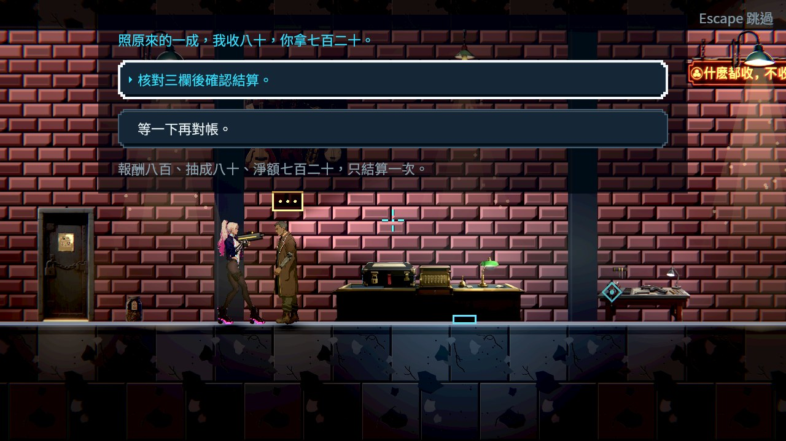
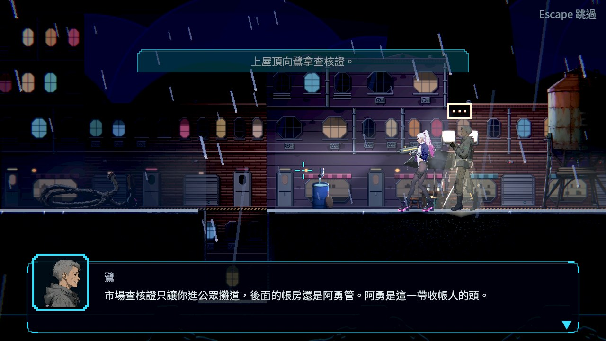
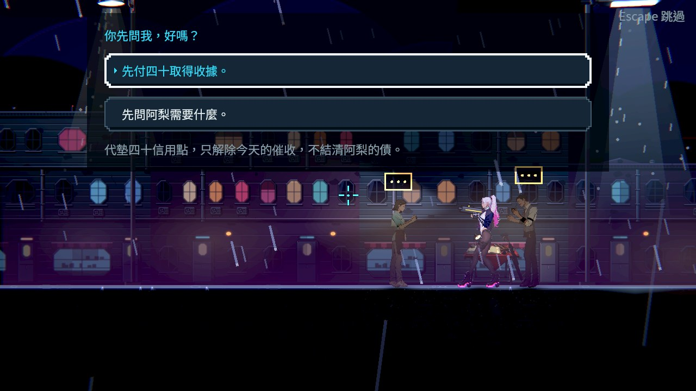
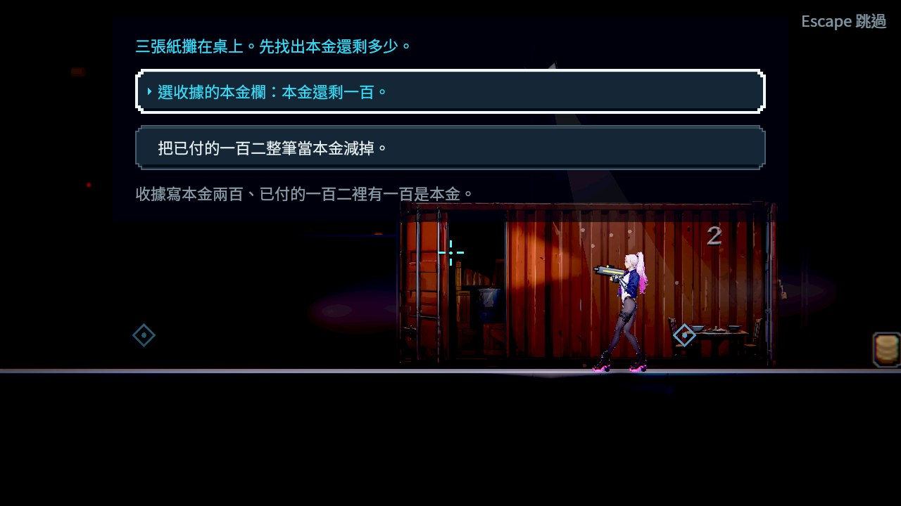
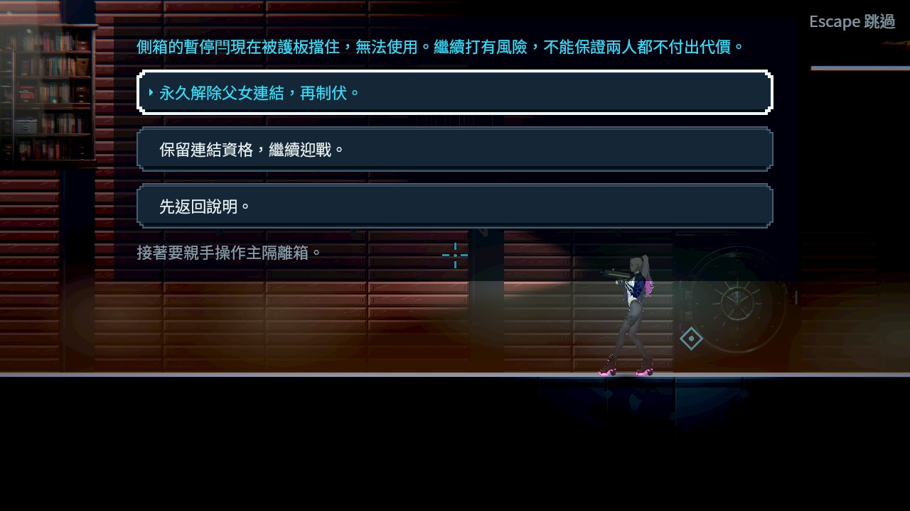
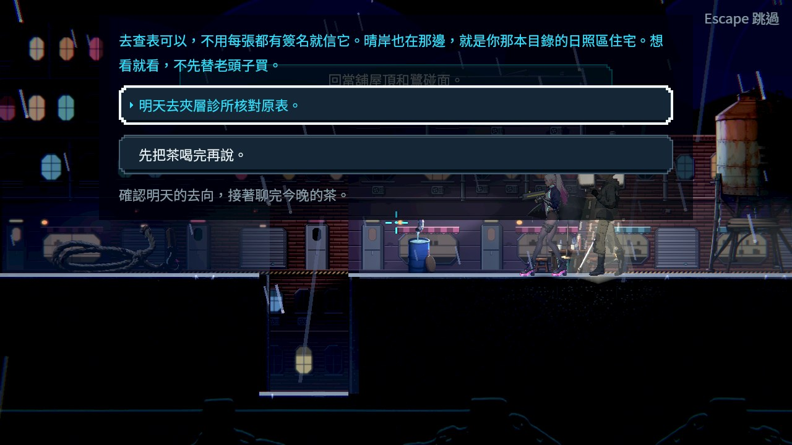
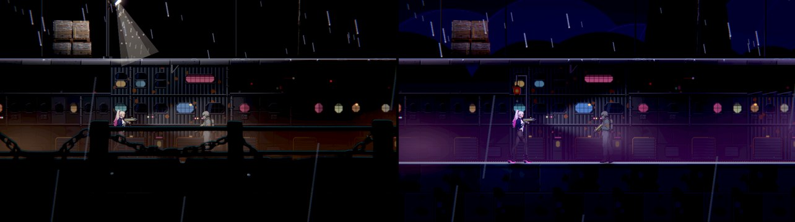

# [ST-19] 完成第二章故事與關卡

> 狀態：進行中

## 內文

### 需求
將已審查的第二章劇本落成可從第一章接續、完整通關的正式章節，具備任務、不同節奏的關卡、演出、敵人與章末收尾。

### 來源
2026-10-10，使用者要求逐章完成與累積發行、高清像素UI、全流程手把、豐富合理敘事與動畫、場景減雜，並追加武器差異、子彈、方向護盾、可選連段升級與打擊感總驗收；一般設計選擇由實作者決定，持續推進。

詳見[整體設計](../../design/20-campaign-experience/DESIGN.md)與[研究依據](../../design/20-campaign-experience/RESEARCH.md)。

### 驗收條件
- [ ] 第一章結束後正確進入新版第二章，各區、事件與章末符合審查通過劇本，未接入舊占位故事。
- [x] 主支線目標、阻塞原因、地圖位置、選擇與獎勵一致，每個可玩主線狀態有可行下一步。
- [ ] 區域具有合理空間連接、捷徑、可選探索與多樣玩法，首次通關長度及張力有實際紀錄。
- [ ] 電影、人物對話、回訪、環境動作與必要音效真正出現，跳過、死亡、重訪不錯置故事與物品。
- [ ] 敵人、武器、機關、補給與檢查點符合章節用途與成長階段，暫代素材已列缺口並在正式驗收前替換。
- [ ] 正常路線、可選分支、死亡及讀檔均可推進，章末有明確收尾與下一章交接。

### 測試流程
1. 從第一章結尾完整玩到第二章章末，走主線及各支線分支。
2. 檢查區域可達、任務狀態、獎勵、死亡重試、跳過與讀檔，保存實際畫面與測量。

---

# 跟其他票的關係

- Blocks：ST-21、NE-234
- Blocked by：ST-18、ST-9、NE-178、NE-265、NE-266、NE-267
- Related：NE-223、NE-97、NE-154、NE-54

---

# Commit-1

## 內文

第一章天亮收尾之後沒有下一章：舊的第二章是占位故事，新版劇本（鷺）只有文字稿，沒有區域、任務與入口。
現在第一章結尾直接走進第二章的早上，十個區域（當舖、屋頂、港街、市集入口、公眾攤道、阿梨家、雨棚背面與裝卸間、帳房前室、帳房、復原館外）用真的出入口連起來，有雨棚上下層的環路、橋梯捷徑與可以繞過戰區的上層攤道。劇本 S01～S22 全部落成場景：老 K 結算昨晚的報酬、修收音機、屋頂簡報拿查核證、市集代墊或先問、阿梨家洗碗、對帳桌三張紙對出多收的二十、帳房阿勇的選擇與兩種收尾、電話亭裡鷺的第 214 次、上傳查帳、阿梨自己決定那一頁、客人簿三位客人，最後回屋頂喝茶結束本章。四條主線與六條支線都有地圖位置、擋住時的原因與獎勵；答錯的題目只會讓你再選一次，不會卡住。台詞與任務都有日文與英文。
做的時候找到三個會壞掉的地方，一起修了：存檔讀回時只認第一章的七筆款項，第二章一有收款整個存檔就讀不回來；寬的雨棚會被當成街道地面，前景欄杆整排蓋住下層貨道主角的腳；拼字只差一兩個字的旗標（章末、客人簿）改成各自的名字，免得之後打錯也沒人發現。
戶外的街燈照第一章調過的高度（約 4 公尺），不會比主角高出三倍。
阿勇頭目戰（NE-265）與市集遭遇（NE-266）交給戰鬥組，劇本留好接點：頭目戰在血量門檻播選擇場景，制伏時啟動帳房的機關頻道就會寫入制伏旗標。新登場的配角先用暫代外觀（NE-267）。

### 測試結果

基準：`86aaad2be95d3ca8c79ecae32cc859399bc71e18`（rebase 到最新 main 之後重跑）。

| 項目 | 結果 |
|---|---|
| 受影響範圍（原選擇器，含本分支其他票的改動） | 87,907 項，0 新失敗、0 已知失敗，352 秒 |
| 第二章資料與規則（新套件） | 出入口兩端相通、人物與物件都接到劇本、任務標記落在真的人物或物件上、劇情依進度挑段落、第二章收據存進存檔讀得回來、街道地面線、第一章接第二章、章末旗標結束本章 |
| 整章流程探針（真的區域、互動與選擇） | 斷連路、保留路、先代墊且沒留下吃宵夜：三輪 0 失敗；軟體 Vulkan（Forward+）再跑斷連路 0 失敗 |
| 地圖可達性與旗標檢查 | 23 個關卡從兩個起點都走得到，每個出入口要的旗標都有場景會寫 |
| 暗場可讀性（Forward+，十個區域 20 個取樣點） | 全部通過；原本雨棚背面兩點與市集入口一點太暗，改燈色與街道地面線後通過；街燈降到約 4 公尺後港街、市集入口、公眾攤道重量仍全部通過 |
| 劇本文字掃描 | 0 錯誤、0 警告（含日文與英文） |
| 待本機原生驗收 | 從第一章結尾真人玩到第二章章末的長度與張力、三種難度通關 |
| 尚未做 | 第二章死亡與讀檔續玩的跨程序驗證、重要場景的電影演出與環境音、頭目戰與遭遇（NE-265、NE-266）、配角外觀（NE-267） |

### 截圖

雲端軟體 Vulkan（Forward+），由流程探針送出真的互動與選擇時拍的。鷺的頭像與外觀、阿勇一夥仍是暫代（NE-267）；屋頂章末的任務橫幅會透到選項框後面，屬 HUD 位置（介面組）。

分支：`feature/story`。落地計畫與接點：[CH02_IMPLEMENTATION.md](../../design/13-story-v2/CH02_IMPLEMENTATION.md)。探針：`tools/ch2_flow_probe.tscn`（`--route=cut|keep`、`--supper=stay|leave`、`--pay`）、`tools/ch2_readability_check.tscn`。
