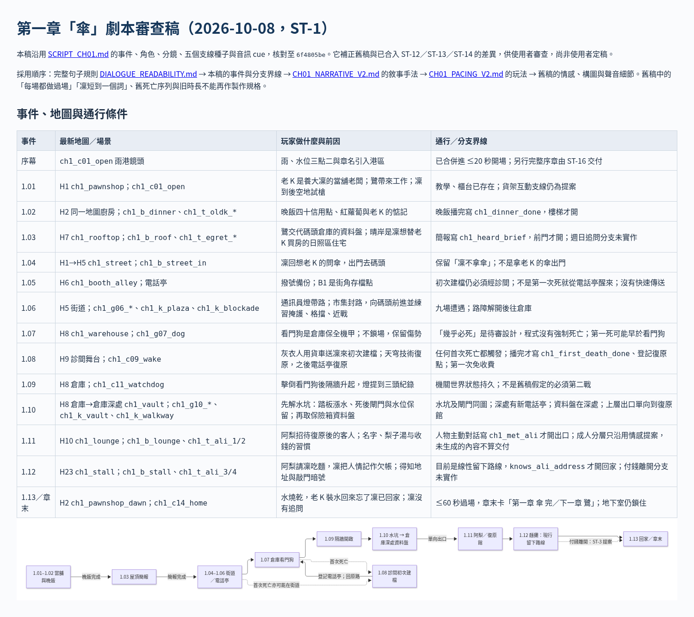

# [ST-1] 撰寫第一章「傘」的劇本

> 狀態：審查中

## 內文

### 需求
新故事（`design/13-story-v2/`）的第一章要有一份**可以直接拿去製作的劇本**：每個場景發生在地圖的哪裡、屬於哪條主線與支線、先後順序與分支、過場與演出、需要的配樂與音效、角色的動作與語氣、每一句台詞（含日文與英文的關鍵句）都寫清楚。台詞的用詞與句型參照《邊緣行者》字幕：完整易懂的句子、一問一答、把感情說成錢與小事、不說「我愛你」。

第一章定名為「傘」（日文「傘（かさ）」、英文 Kasa），傘貫穿整個遊戲，這一章是它的起點。

### 來源
2026-10-04、2026-10-05，使用者要求從第一章開始寫劇本、改名為「傘」、台詞參照《邊緣行者》、腳本要清晰並附地圖對應圖、第一章的主線與支線都要包含。設計見 `design/13-story-v2/SCRIPT_CH01.md`。

### 驗收條件
- [x] 劇本涵蓋第一章全部主線事件（1.01～1.13、序幕、章末卡），順序與分支寫清楚，並有流程圖
- [x] 有地圖對應圖與場景對照表：每個場景對應的地圖位置、場景資料、主線事件、支線節點、電話亭與通行條件都標明
- [x] 第一章出現的支線節點（標籤、週日、病床、灰無常的工錢、麵攤）與傘的線都包含在內，並標明觸發方式、旗標與獎勵等級
- [x] 每個場景有：地點、前置、類型、時長、構圖與光影、BGM、出場角色，並用分鏡表寫清楚鏡頭、動作、音效、台詞與語氣
- [x] 有 BGM 總表（可暫代的現有曲目與新曲需求）與環境音對照，並說明主題旋律的出現位置
- [ ] 台詞符合風格守則（完整易懂的句子、每個角色有自己的聲音），每一句不超過現有過場檢查的長度與連續句數限制
- [x] 關鍵句有中日英三種版本，雙關句各自創譯
- [ ] 使用者確認劇本（待確認項目有結論）

### 測試流程
1. 對照事件表，逐一確認第一章每個事件都有對應的場景
2. 對照支線表，確認第一章的每個支線節點都有觸發場景
3. 檢查所有流程圖與地圖圖都能正常顯示
4. 逐句檢查台詞長度與連續句數

---

# 跟其他票的關係

- Blocks：ST-2
- Blocked by：無
- Related：NE-121

---

# Commit-1

## 內文

第一章只有一份草稿，台詞偏長、沒有地圖對應、支線與配樂沒有整理。
現在是第二版劇本：台詞改成《邊緣行者》式的短句；加入流程圖與地圖對應圖（含路線表與場景對照表）；列出第一章的五個支線節點與傘的線；每個場景用分鏡表寫鏡頭、動作、音效、台詞與語氣；新增 BGM 與環境音總表（對應現有音樂系統的狀態與曲目）。
圖表以工具逐張驗證能正常渲染；台詞已對照現有過場檢查的限制。劇本待使用者確認，所以票維持進行中。

# Commit-2

## 內文

既有劇本與後續三段過場、初次建檔及倉庫拆分有落差。現在保留原分鏡，補成可審查的事件／地圖／場景對照、五個支線種子的製作界線、完整句子的三語關鍵句及配樂需求；原稿短句的全文同步由 ST-15 交付。沒有把未實作選項、未生成序章、試聽或使用者確認算成驗收。

### 測試結果

| 項目 | 結果 |
|---|---|
| 事件／支線／聲音／三語內容核對 | 1.01–1.13、序幕／章末、五個支線與傘皆有對照；音樂暫代 id 存在 |
| 文件與圖表預覽 | 瀏覽器實際渲染，流程圖節點完整 |
| 受影響測試選擇 | 只改設計與票，無遊戲測試；不宣稱遊玩／試聽通過 |

### 截圖

