# [ST-21] 完成第三章故事與關卡

> 狀態：進行中

## 內文

### 需求
把審查完成的第三章落成可從第二章接續、完整遊玩的正式章節，保留前章選擇並帶來不同探索、戰鬥與敘事體驗。

### 來源
2026-10-10，使用者要求逐章完成與累積發行、高清像素UI、全流程手把、豐富合理敘事與動畫、場景減雜，並追加武器差異、子彈、方向護盾、可選連段升級與打擊感總驗收；一般設計選擇由實作者決定，持續推進。

詳見[整體設計](../../design/20-campaign-experience/DESIGN.md)與[研究依據](../../design/20-campaign-experience/RESEARCH.md)。

### 驗收條件
- [ ] 第二章章末到第三章入口、所有主線事件與結尾可連續遊玩，前章物品與選擇正確保留。
- [x] 正式主支線與地圖、事件、阻塞說明及獎勵一致，未以樣本任務替代。
- [ ] 各區用途、空間連接與多樣玩法符合劇本，捷徑、秘密與檢查點合理，未重複套用第一章模板。
- [ ] 電影、交談、回訪及情境動畫與必要音效實際出現，人物與道具不浮空或互相穿插。
- [ ] 敵人、武器與成長配置符合章節曲線，敵人新素材與動作在正式驗收前完成。
- [x] 主路、支路、死亡、跳過、換區與續玩不造成死結；章末有清楚收尾，未進入未完成後章。

### 測試流程
1. 從第二章結尾完整玩第三章，分別走主線與支線。
2. 驗證任務、旗標、獎勵、布局、死亡重試與續玩，保留實際節奏量測與畫面。

---

# 跟其他票的關係

- Blocks：NE-235
- Blocked by：ST-20、ST-19、NE-271、NE-272
- Related：NE-223、NE-97、NE-154

---

# Commit-1

## 內文

第二章章末之後沒有下一章：第三章「晴岸」只有文字稿。
現在第二章屋頂的章末直接接到第三章的週日早上。九個區域照劇本連起來：當舖早飯出門、廣場貨梯被水位聯鎖卡住、到泵室轉排水輪與關掉泡水的支路、叫下貨梯上夾層、在診所拿三份公開資料並核對出公開的百分之三少算了八個人、停下守門人的門禁工作架並扶他坐回櫃檯、第一次在玻璃邊緣看到陽光、在晴岸樣品房量窗記提案、在候梯迴廊看見葉的手背並聽到老 K 交出凜的備份、回家吃留飯被問兩次傘、接鷺的通訊約好下一個週日。排水、隔離與三處核對都是選擇，選錯只會說清楚錯在哪裡再選一次。六條主線、三條支線都有地圖位置、擋住時的原因與獎勵；台詞與任務有日文與英文。早飯與晚飯是正式過場，沿用第一章審過的店面與廚房舞台。
做的時候找到一個所有章節都會卡住的問題：設定裡開了「略過過場動畫」，有選項的劇情也會被直接套預設，玩家永遠選不到「出門」「投遞」這類決定。現在要做決定的場景照常播出，只略過純觀看的演出。
章末卡的「進度已保存」只寫故事內容；這一版收錄到第幾章由存檔與發行端依建置的累積版本決定，不再寫死在各章資料裡。
守門人頭目戰（NE-271）與泵室、夾層的兩種巡檢器（NE-272）交給戰鬥組，劇本留好接點：停機時啟動門禁大廳的機關頻道就會寫入停機旗標。

### 測試結果

基準：rebase 到最新 main 後，以 main 的 `aac0c80e` 前一版為基準重跑。

| 項目 | 結果 |
|---|---|
| 受影響範圍（原選擇器，含略過設定的修正與 main 新進的光影改動） | 88,535 項；1 項新失敗是 main 新進的「轉身後光跟著換到另一邊」（同時跑軟體算圖時的計時），單獨重跑該組 0 失敗 |
| 第三章資料與規則（新套件，地圖與劇本的共同檢查抽成共用） | 出入口兩端相通、26 個人物與物件都接到劇本、22 個任務步驟的標記都落在真的人物或物件上、診所與閱覽桌依進度挑段落、守門人停機頻道、傍晚老 K 換到廚房、正式過場構圖、章末結束本章 |
| 整章流程探針（真的區域、互動與選擇） | 完整路線（先犯錯再改、借錄音、提案、讀手背、告訴鷺）與只走主線兩種、阿勇兩路各一次：0 失敗；開著「略過過場動畫」整章再推一次：0 失敗；軟體 Vulkan（Forward+）再跑完整路線：0 失敗 |
| 死亡與跨程序讀檔（`tools/ch3_resume_probe.tscn`） | 兩個程序都 0 失敗：一百八十只記一次、文件與水電開關都在、看過的段落不重播、讀檔後還能掃夾層證 |
| 報酬 | 完整路線 340、只走主線 280，與劇本第 5 節相同 |
| 暗場可讀性（Forward+） | 九個區域全部通過；玻璃邊緣以上改成晴天的天空與玻璃帷幕，雨只在玻璃外 |
| 劇本文字掃描 | 0 錯誤、0 警告（含日文與英文）；凜的日文統一成她平常的口吻 |
| 待本機原生驗收 | 真人長度與張力、三種難度、實際聽配樂 |
| 尚未做 | 守門人戰與巡檢器（NE-271、NE-272）、診所與辦公廊的正式過場、轉輪與扶椅這類情境動作、劇情文件的日英文、交通版的回家路線 |

### 截圖

雲端軟體 Vulkan（Forward+），由流程探針送出真的互動與選擇、或由可讀性工具取樣時拍的。辦公廊的交易目前是疊在地圖上的對話（老 K 與葉沒有上舞台），列在尚未做。

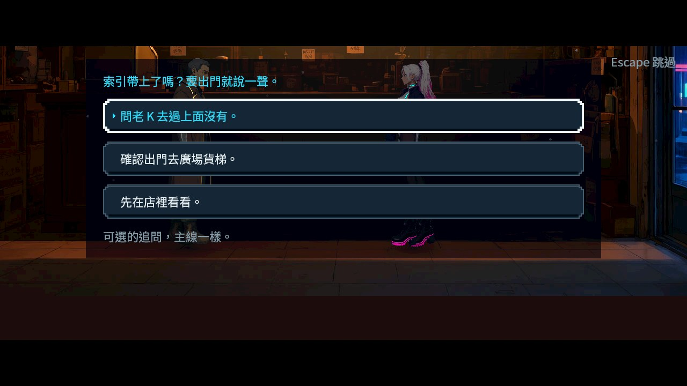
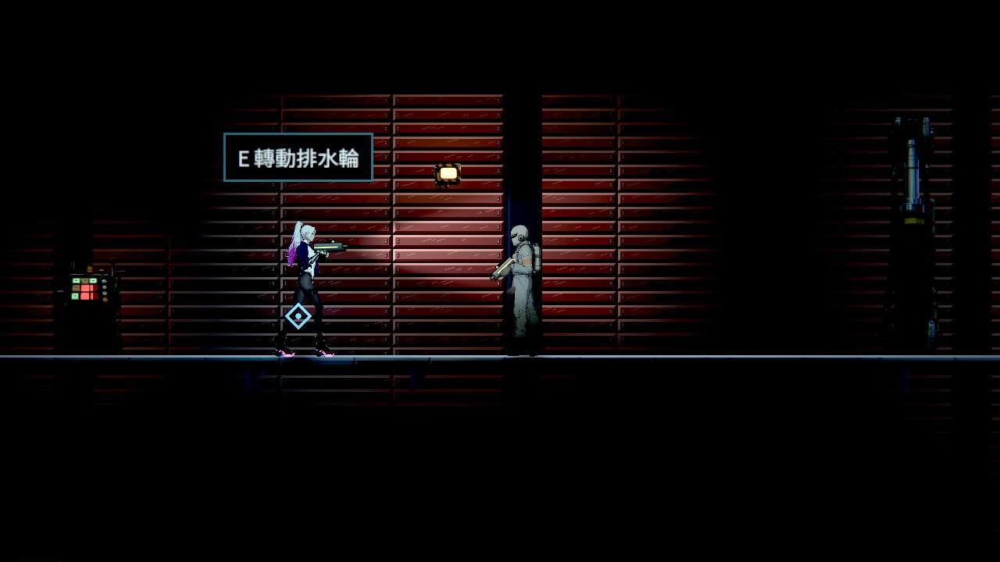
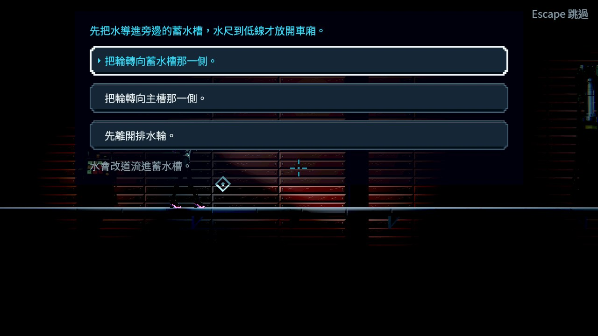
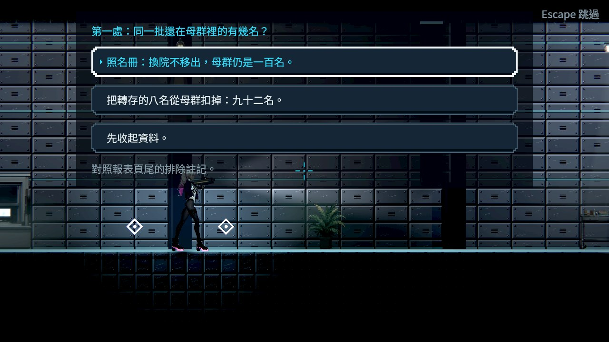
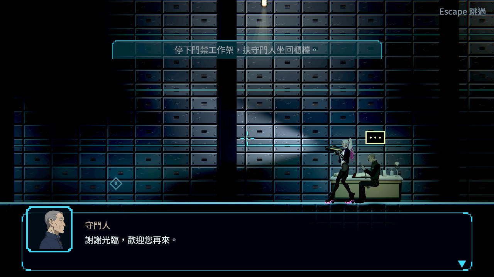
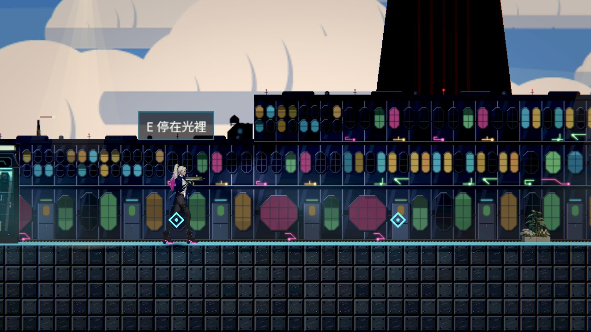
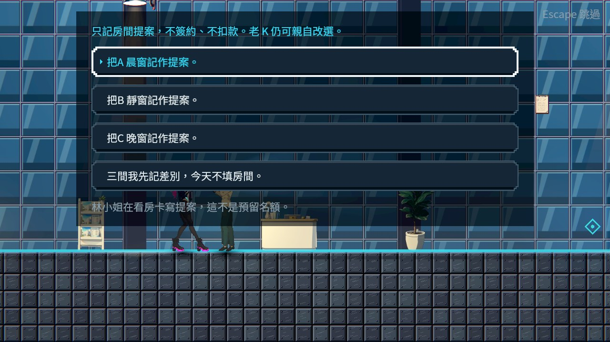
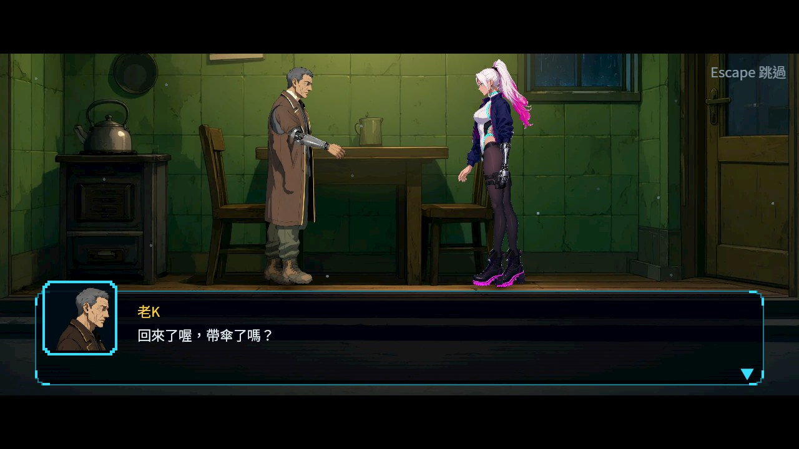
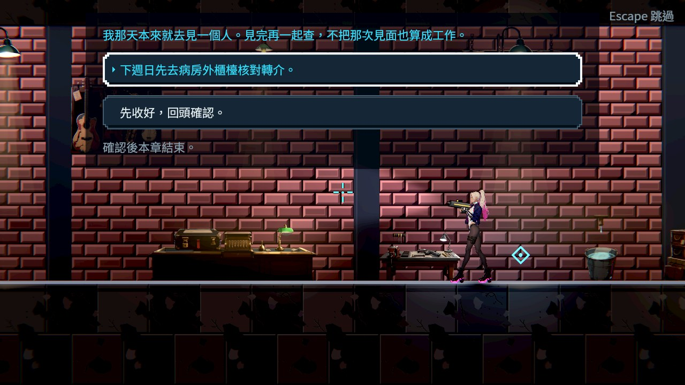

分支：`feature/story`。落地紀錄：[CH03_IMPLEMENTATION.md](../../design/13-story-v2/CH03_IMPLEMENTATION.md)。探針：`tools/ch3_flow_probe.tscn`（`--route=full|minimal`、`--yong=cut|keep`、`--skip-cutscenes`）、`tools/ch3_resume_probe.tscn`、`tools/ch3_readability_check.tscn`。

# Commit-2（劇情文件的日文與英文）

## 內文

**問題**：台詞與任務已經有日文和英文，但背包裡的劇情道具、文件與錄音（第三章的看房卡、交易摘要等，第一、二章也一樣）切到日文或英文仍是中文。

**改動**
- 三章全部 49 份劇情道具、文件與錄音的名稱、說明與內文補上日文與英文，人名與地名沿用台詞譯文（凛／Rin、老K／Old K、鷺／Egret、梨／Pear、葉／Folio、晴岸／Far Shore、天穹／Skydome）。譯文另放一份檔案，不改劇本產生器的輸出。
- 背包劇情道具頁、地上的撿取提示、取得訊息與補回道具的通知都依劇本語言顯示；缺譯時退回英文、再退回中文，並記下道具、欄位與語言；譯文檔壞掉時整份用中文，不讓遊戲壞掉。
- 背包卡片上較長的英文名稱原本會壓到右上角的「NEW」，現在標題讓出徽章的位置，放不下時用省略號結尾。

**驗收**
- 每份道具的每個中文欄位都有日文與英文；切到英文、日文、中文時背包、撿取提示與取得訊息都換成對應語言。
- 背包詳情面板不會捲動：每份譯文放進同一個面板的高度，不超過已上架中文內文裡最高的那一份（原本有 8 份超出 1～3 行，已縮短）。
- 譯文通過全遊戲玩家文字的可讀性掃描（日文一份短句、英文一份編號清單原本被擋，已改寫）。
- 背包介面本身的按鈕與分頁名稱仍是中文，和任務頁一致；這張票只處理劇情內容。

### 測試結果

| 項目 | 結果 |
|---|---|
| 受影響範圍（原選擇器） | 65,608 項；唯一的新失敗是英文 P17 改寫後多一行，縮短後重跑收集品、文字掃描與劇本內容三組 1,863 項 0 失敗 |
| 平行負載下一次「提示留在原處」失敗 | 和本次改動無關的時序抖動，單獨重跑任務地圖套件兩次 354 項 0 失敗 |

### 截圖

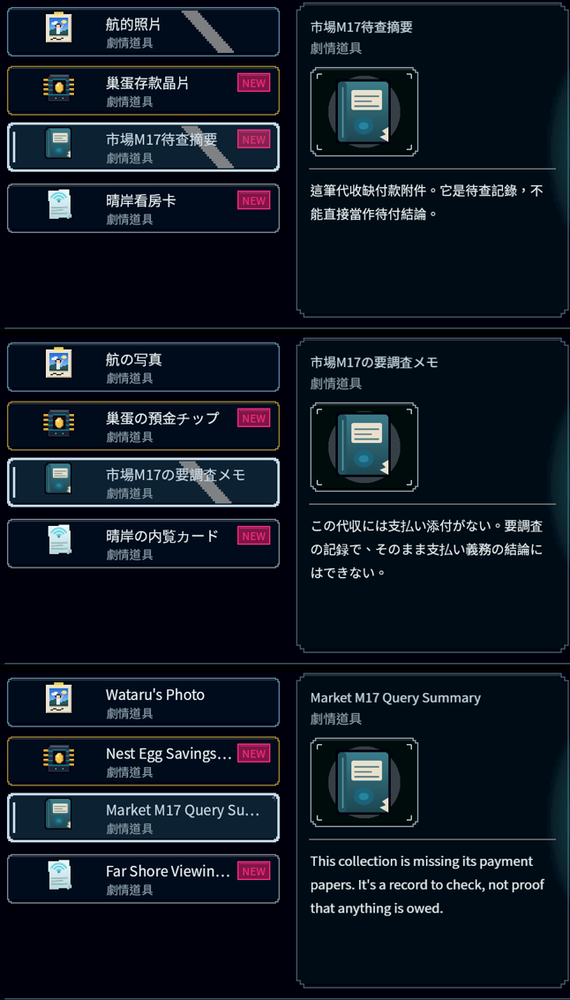

# Commit-3

## 內文

M17英文摘要原本漏掉「本頁不能證明已付金額」，也把次晨說明查核安排及額外報酬縮成籠統的明天。現在補回資訊，保留原本金200、當期利息20、帳簿待收120及三份同批查核資料；閱讀不會支付、領報酬或改故事進度。

原Collectibles加兩項缺漏控制305／2失敗→305／0；最終原選擇器三組756項、0新／已知失敗。兩個中途譯稿被原高度限制拒絕，最終稿通過，原斷言及字級保持。Forward+同配置修前／修後各64／0，0引擎ERROR／退出洩漏；本輪逐張檢視以下兩張英文120%全文圖。[設計、全部原始失敗及驗證界線](attachments/ST-21-market-notices/README.md)。

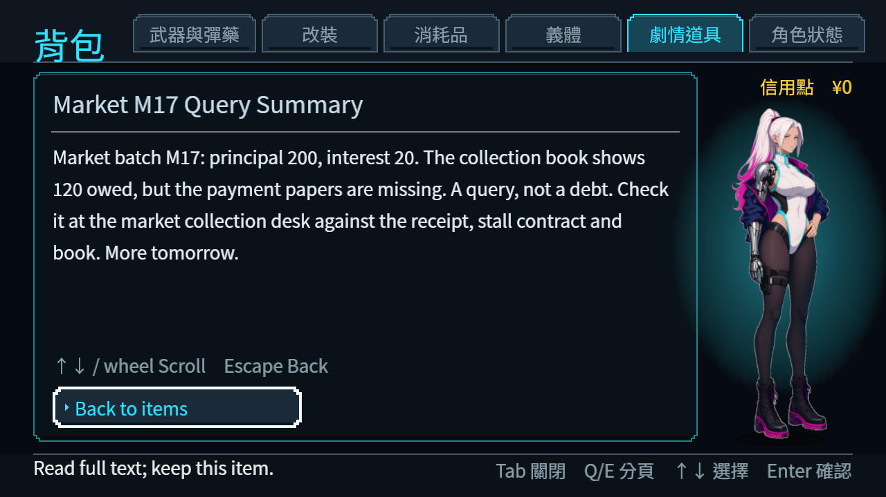

# Commit-4

## 內文

交盤受領書英文原本漏了「閱覽權不是原盤持有權」。現在補回限制，仍由委託方保管原盤，M17與付款附件只有閱覽授權；800報酬、10%既約抽成及凜預計720尚未入帳都保留。閱讀不領錢、不改原盤或收據的持有狀態。

原Collectibles加一項限制控制306／1失敗→306／0，原選擇器三組757項、0新／已知失敗，原高度限制通過。原生修前／修後各64／0，皆0引擎ERROR／退出洩漏；原生修前只驗舊文正確顯示，不代表舊文語義完整。本輪逐張檢視以下兩張英文120%全文圖。[完整原檔、來源與驗證界線](attachments/ST-21-disk-rights/README.md)。

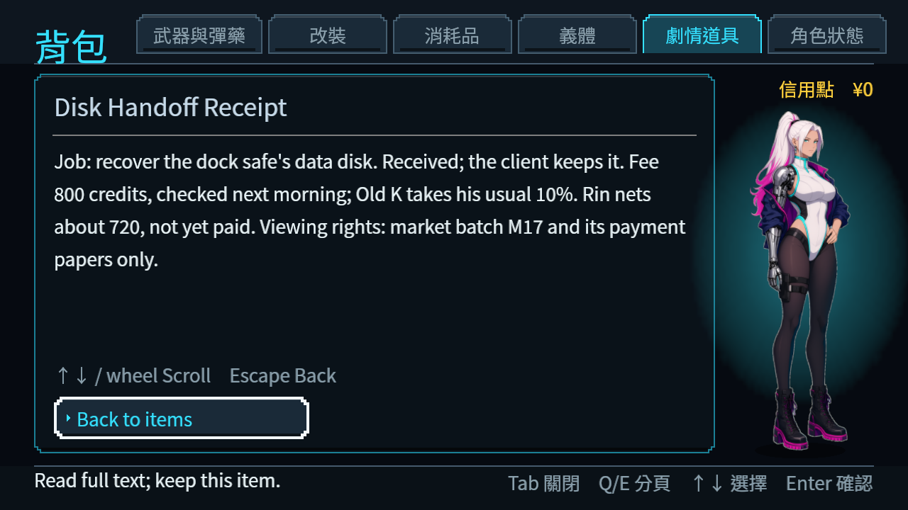

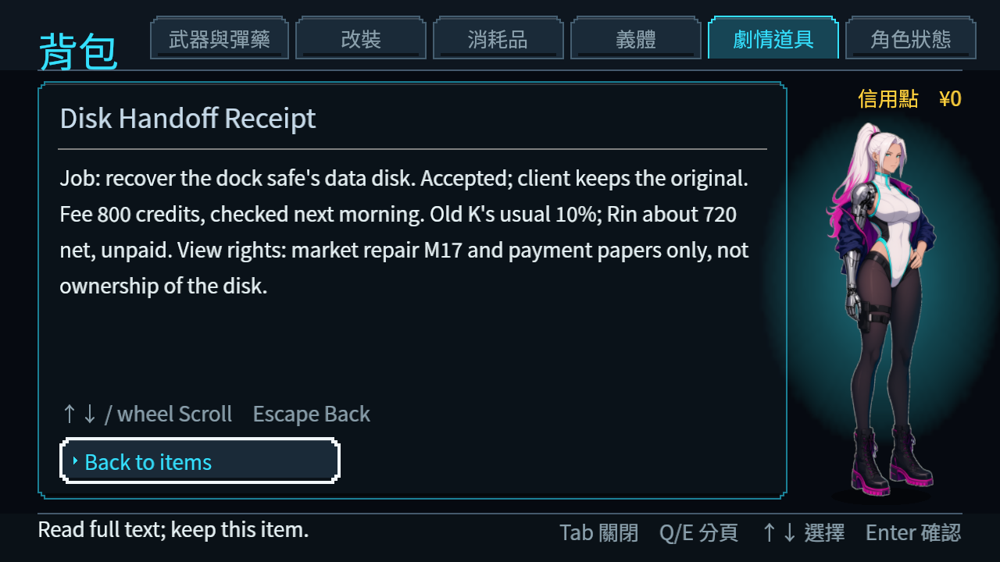
