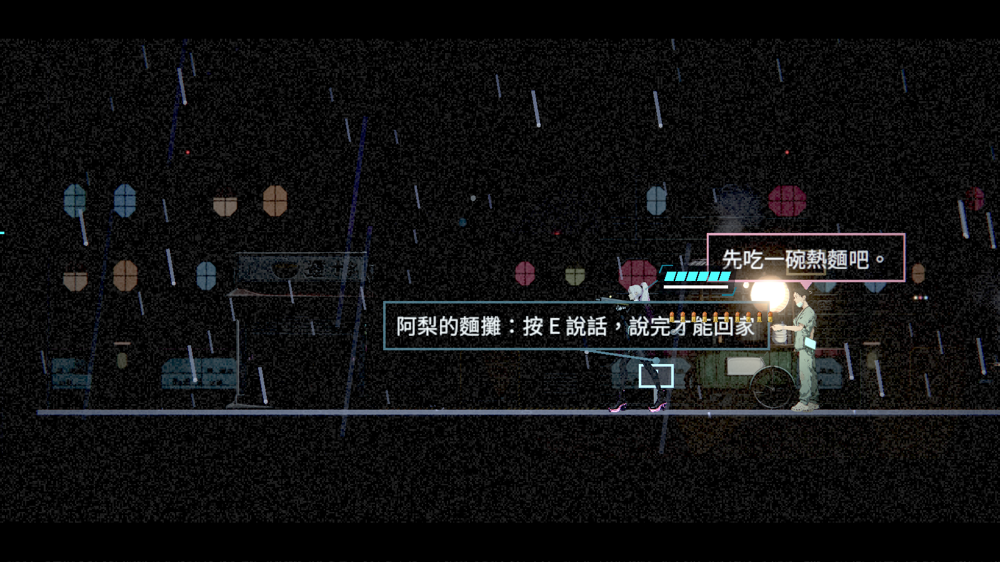
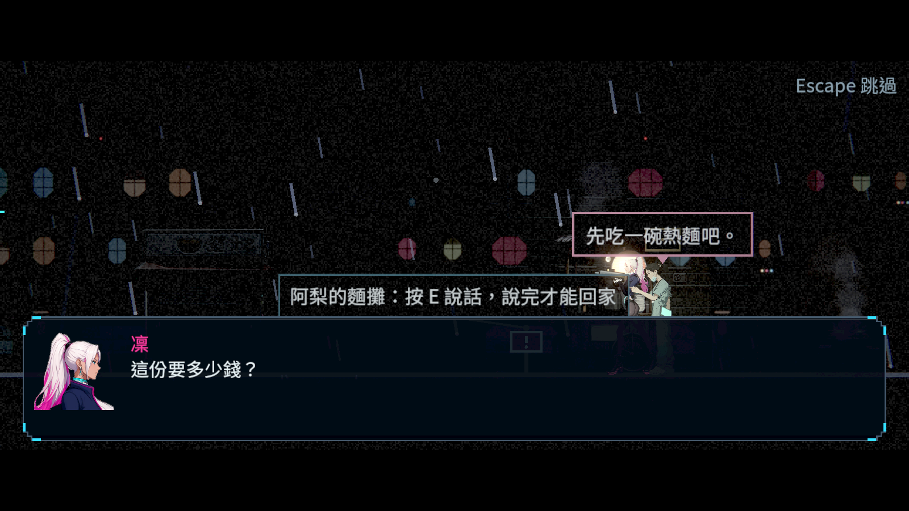
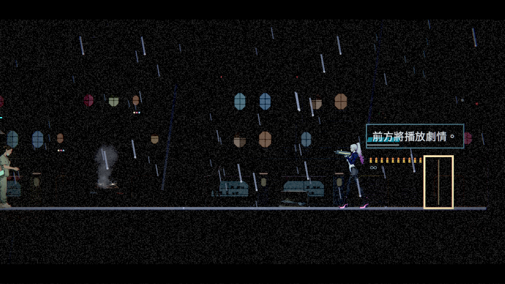
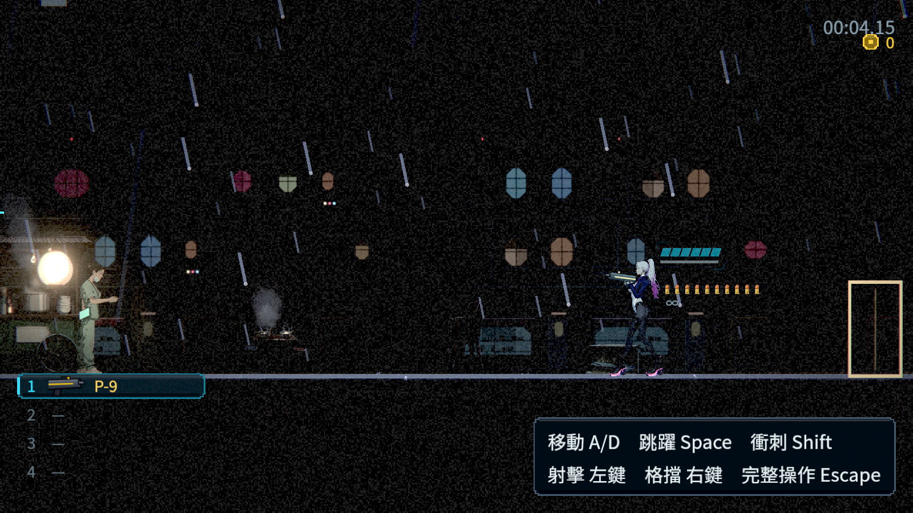
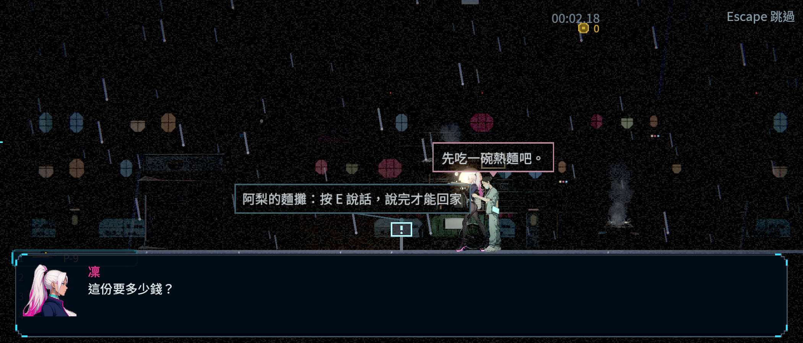
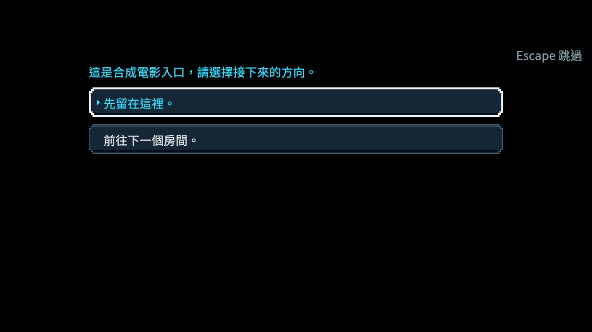
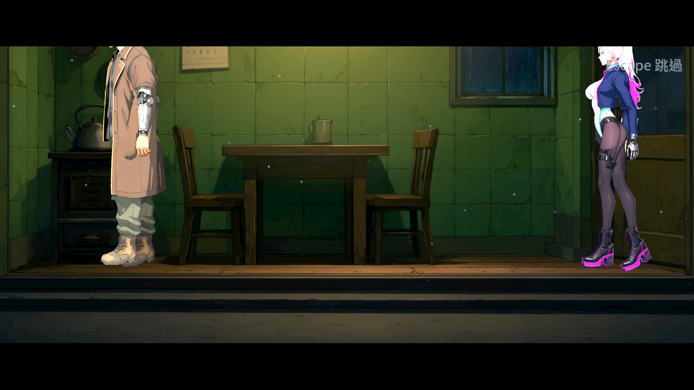
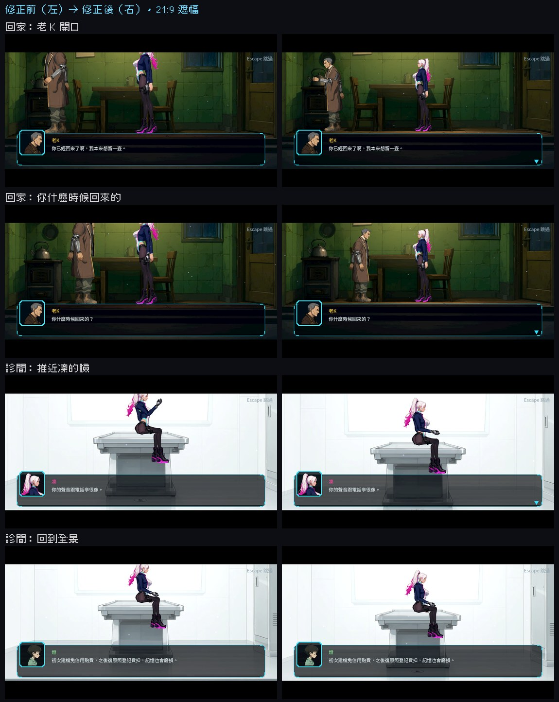
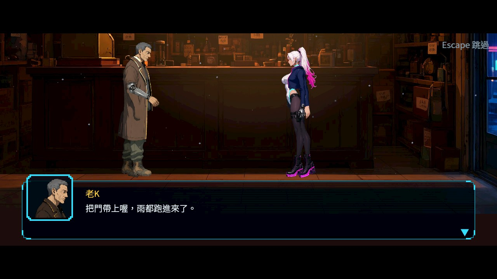

# [ST-22] 加入接近預告與寬銀幕轉場

> 狀態：進行中

## 內文

### 需求
接近可聊天人物或電影演出入口時，畫面平滑預告21:9構圖，讓玩家理解前方有演出並可決定繼續；正式人物對話及電影使用一致遮幅。

### 來源
2026-10-10，使用者要求逐章完成與累積發行、高清像素UI、全流程手把、豐富合理敘事與動畫、場景減雜，並追加武器差異、子彈、方向護盾、可選連段升級與打擊感總驗收；一般設計選擇由實作者決定，持續推進。

詳見[整體設計](../../design/20-campaign-experience/DESIGN.md)、[研究依據](../../design/20-campaign-experience/RESEARCH.md)與[畫幅設計及驗證矩陣](../../design/20-campaign-experience/CINEMATIC_FRAMING.md)。

### 驗收條件
- [x] 16:9到21:9及返回有連續過渡，比例按實際視口正確，未拉伸世界或改變物理。
- [x] 只為可交談人物與指定電影入口預告；告示牌、閱讀物件、廣播與普通氣泡不觸發。
- [x] 靠近階段仍可移動與退回，不改故事或獎勵；正式開始有明確互動或已提示入口，必然事件另行標示。
- [x] 離開恢復構圖；相鄰入口和反覆進出邊界不抖動、不錯切人物。
- [x] 正式對話／電影維持21:9，字幕、關鍵動作與必要提示在安全區，預告不遮住戰鬥危險。
- [x] 結束、跳過、死亡、換區、讀檔及減少動態設定均恢復正確構圖與操作。

### 測試流程
1. 以鍵鼠及手把靠近、停留、退回、確認人物與電影入口，對照告示牌排除。
2. 在不同視口、邊界、相鄰入口、跳過與死亡等情境檢查過渡和安全區。

---

# 跟其他票的關係

- Blocks：NE-233
- Blocked by：無
- Related：ST-3、ST-9、ST-16、NE-137、NE-229

---

# Commit-1

## 內文

原本靠近人物沒有演出預告，人物對話與電影的遮幅各自固定，閱讀物件也無法區分來源。現在可聊天人物與明確電影入口會依距離逐步預告，退回恢復；閱讀物件、廣播與普通氣泡不觸發。正式對話與電影依實際視口使用21:9安全區，預告期間邊緣資訊完整收起，退回後恢復，正在聊天的同一人物不再重複顯示互動提示。

合成輸入及受控路由驗證了正式回家入口、人物與閱讀物件區別、相鄰候選、戰鬥抑制、減少動態、略過、死亡、離場及跨程序續玩。中斷then續段時已完成前段款項保留，未完成選項撤回，人物最終獎勵只發一次；相同故事排隊不提前結算下一位人物。

正式回家電影圖中老K與凜頭部仍超出上緣／被黑邊遮擋；介面安全區結果沒有代替演員與關鍵動作構圖驗收，[舞台比例與位置](./[ST-10]檢查並修正過場舞台的佈景比例與位置.md)對應第五條未勾選。以下圖片為合成輸入／受控路由；選項及閱讀物件樣本另標合成，並非人工手把通關。

### 測試結果

基準：`5366453717f9488d16b661a67299a7ad6360f242`。

| 項目 | 結果 |
|---|---|
| 原選擇器66組受影響測試，兩程序 | 47,088 checks，0新失敗／0已知失敗，797秒，EXIT0 |
| 人物、電影、存檔、轉場局部回歸 | 799 checks，0新失敗／0已知失敗，EXIT0 |
| 跨程序／取消／非法來源合成探針 | 12情境、83項不同檢查通過；重複檢查不加總 |
| 原生Forward+圖證，120%文字 | 16:9及寬視口各37項通過，共74；16張PNG |
| 重新匯入及腳本錯誤 | EXIT0，無Script／Parse／Compile Error |
| 原始輸出 | 原預期容錯ERROR及關閉診斷完整保留 |

[最終console](../Nest-Egg/attachments/ST-22-final-console.log)、[shard 0](../Nest-Egg/attachments/ST-22-final-shard-0.log)、[shard 1](../Nest-Egg/attachments/ST-22-final-shard-1.log)、[原選擇範圍](../Nest-Egg/attachments/ST-22-selector.txt)、[驗證報表與日誌SHA](../Nest-Egg/attachments/ST-22-verification.json)。

[局部console](../Nest-Egg/attachments/ST-22-targeted-console.log)、[真正人物續玩](../Nest-Egg/attachments/ST-22-resume-person_read.log)、[then續段續玩](../Nest-Egg/attachments/ST-22-resume-chain_read.log)、[真正死亡](../Nest-Egg/attachments/ST-22-resume-death.log)、[真正離樹](../Nest-Egg/attachments/ST-22-resume-leave.log)、[相同故事排隊](../Nest-Egg/attachments/ST-22-resume-sameid.log)、[非法索引](../Nest-Egg/attachments/ST-22-resume-badindex_read.log)、[非法續段](../Nest-Egg/attachments/ST-22-resume-badchain_read.log)。

### 截圖

正式阿梨接近預告（1600×900、120%文字，受控路由）：

人物對話安全區及重複互動提示排除：

正式回家入口預告及退回：

2100×900寬視口；工具使用840×360 EXPAND，零額外遮幅，未改正式顯示設定：

合成電影選項安全區：

正式入口原電影；保留角色頭部構圖限制：

# Commit-2

## 內文

上次剩下的一條是演員構圖：回家過場裡老 K 與凜的頭超出上黑邊，診間醒來推近時凜的頭與馬尾也被切掉；另外改成 21:9 之後對話框頂約在畫面 233／360，但構圖檢查還用舊的 266，序章開場的腳因此藏在對話框後面也沒被抓到。
這次把三場的鏡頭與演員縮放調到黑邊與對話框之間：回家過場鏡頭下移、演員縮放 3.0～3.1（門高約 1.2 倍身高，比例也比原本合理）；診間凜坐在檢查台上，鏡頭改以她的實際腳底限制，推近與拉回都留出頭與馬尾；序章開場同樣處理。構圖檢查同步更新：腳底上限改成 232，並新增「站著的演員頭頂不能進上黑邊」（用骨架身高計算，坐蹲等姿勢看截圖）；產生器的鏡頭限制與場景構圖規範一起改。

### 測試結果

| 項目 | 結果 |
|---|---|
| 受影響範圍（基準 16998bff，原選擇器） | 11,995 項、0 新失敗、0 已知失敗；另跑過場、地圖、劇本掃描、節奏套件 2,299 項 0 失敗 |
| 構圖檢查 | 第一章全部動畫過場的腳底與站姿頭頂都在安全區；新規則抓得到頭頂進黑邊的演員，坐姿不誤報 |
| 實際畫面（軟體 Vulkan） | 回家兩個鏡頭、診間三個鏡頭、序章開場：頭、腳與字幕都在 21:9 畫面內 |
| 待本機原生驗收 | 原生畫面與寬螢幕視口重看同一組鏡頭 |

### 截圖

雲端軟體 Vulkan（Forward+）截圖，以本機原生為準。

分支：`claude/nest-egg-main-story-flow-ph1dnu`（[分支提交紀錄](https://github.com/deadline314/Nest-Egg/commits/claude/nest-egg-main-story-flow-ph1dnu)）。截圖工具 `tools/cinematic_safe_area_capture.tscn`。舞台佈景本身的比例仍由 [ST-10](./[ST-10]檢查並修正過場舞台的佈景比例與位置.md) 處理；本票只調鏡頭與演員。
