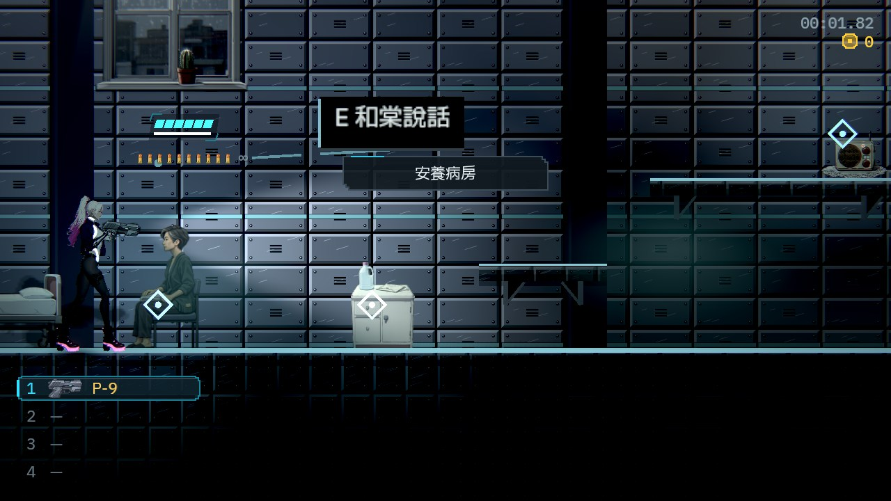

# [ST-24] 建立第四章病房入口

> 狀態：完成

## 內文

### 需求

建立第四章〈空殼〉的第一段。凜應能在夾層接待核對回執，照約探訪棠，自由找出兩段示範並取出公用取件聯。

### 來源

2026-11-26，使用者要求往後製作章節。依[第四章劇本](../../design/13-story-v2/SCRIPT_CH04.md)場 01–06 驗收。

### 驗收條件

- [x] 開發版可從第三章結尾前往第四章，維持正式第三章發行版的原結算。
- [x] 病房有可重走的兩處線索、清楚的缺項和錯序提示，線索順序不影響結果。
- [x] 取件聯能合法保存與重讀，任務同步更新，前章可選狀態仍保留。

### 測試流程

1. 以已完成的第三章存檔續玩，在第四章完成探視。
2. 反向查看示範、錯序再選、開櫃與重新載入後重訪，核對持有物與任務。
3. 在第三章累積版確認沒有第四章入口。

---

# 跟其他票的關係

- Blocks：ST-25
- Blocked by：ST-23
- Related：ST-21

---

# Commit-1

## 內文

開發版從第三章結尾接到第四章當舖、病房外櫃檯和安養病房。玩家去探訪棠，找出桌緣與收音的兩段示範，再輸入正確順序取走公用取件聯。試錯可以立即重選，內廊門從病房解開後也能走回來。取件聯、調查步驟及原有選房與借閱狀態保留於續玩。

### 測試結果

| 項目 | 結果 |
| --- | --- |
| 受影響的遊戲套件 | 89 組。補正測試資料及三項回歸後重跑對應分組，全部通過。 |
| 任務與地圖 | 三區可達、兩項任務、零稽核問題。35 區地圖與預載索引相符。 |
| 劇本文字及合約 | 8,936 條文字，零錯誤及警告。30 項原互動來源與持久結果檢查通過。 |
| 續玩 | 以隔離第三章章末存檔走正式入口。兩種錯序、正式寫入、冷讀重訪、前章選擇與文件均符合預期。 |
| 實機影像 | RX 9070 XT、Vulkan Forward+，只保留一張病房畫面。 |

### 截圖

