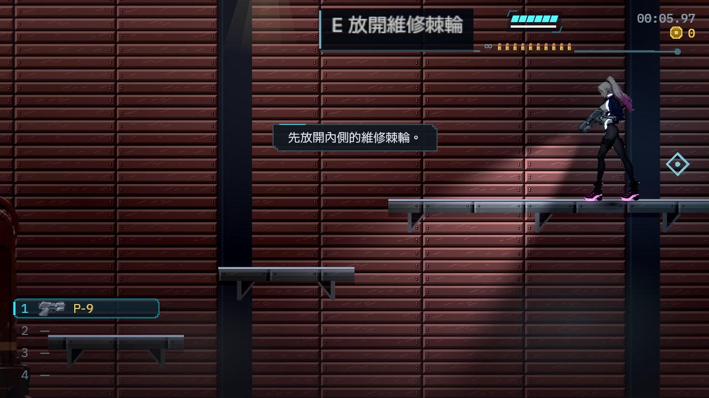

# [ST-25] 接上復原館與舊廠房

> 狀態：完成

## 內文

### 需求

讓凜帶著病房的取件聯走到復原館，再調查舊廠換班紀錄，循兩層路線查到裝卸帶的安全工作區。

### 來源

2026-11-26，使用者要求繼續完成後續章節。依[第四章劇本](../../design/13-story-v2/SCRIPT_CH04.md)場 07–08 和[廠房入口設計](../../design/13-story-v2/CH04_FACTORY_APPROACH.md)驗收。

### 驗收條件

- [x] 病房取件聯帶出找阿梨的新任務，走吧台、外廊到舊廠貨門。
- [x] 可讀原取件聯並比對班表。錯序可重試，正確核對後才開貨門。
- [x] 主線定位到裝卸帶固定地面，並能從廠內解鎖上層捷徑再折返。
- [x] 重新啟動可保留核對紀錄、工作區定位、取件聯和已開捷徑。

### 測試流程

1. 從原病房流程取得取件聯，找阿梨問清楚舊廠入口。
2. 對一次錯批次並離開，再選正確批次。進廠調查安全工作區。
3. 解鎖內側棘輪，從高架來回走，重新啟動確認讀檔狀態。

---

# 跟其他票的關係

- Blocks：無
- Blocked by：ST-24
- Related：ST-23

---

# Commit-1

- 驗收：實際門路與班表探針測過錯批次、正確批次、上層捷徑雙向通行、進門落地與另一程序讀主存檔。取件聯保留。
- 測試：受影響的 56 個套件重測後通過。燈光範圍 9,482 項、地圖及音效回歸 29,874 項均無失敗。劇本 9,045 條無錯誤或警告，章節審核 6 處可達區域與 3 項任務，關卡索引共 38 區。
- 實機：RX 9070 XT，Forward+。裝卸帶的固定地板與上層維修通道。

