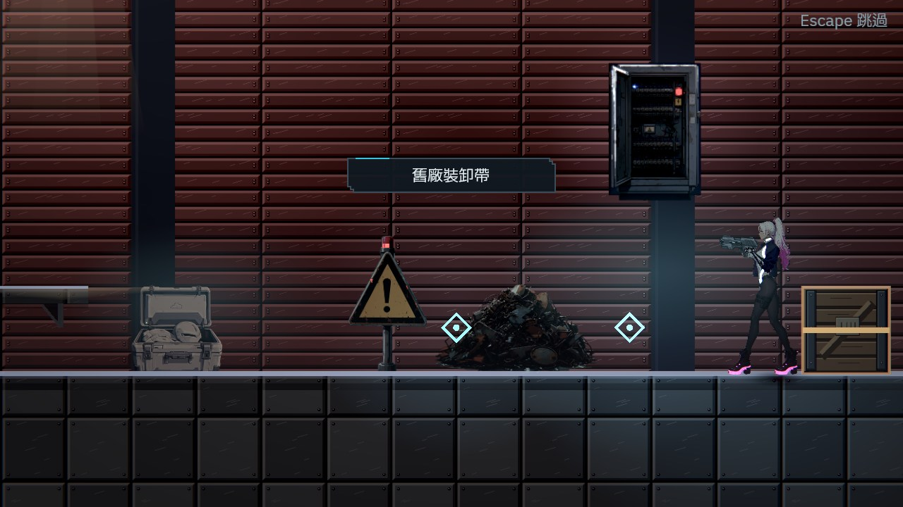

# [ST-26] 做出舊廠清掃示範

> 狀態：完成

## 內文

### 需求

讓玩家在安全的裝卸帶認出會被清掃的箱子與不受清掃影響的路面。

### 來源

2026-11-26，使用者要求完成後續章節。依[第四章劇本](../../design/13-story-v2/SCRIPT_CH04.md)場 08 和[清掃示範設計](../../design/13-story-v2/CH04_SWEEP_REHEARSAL.md)驗收。

### 驗收條件

- [x] 確認固定地面後，任務指向清掃控制箱。
- [x] 目標先顯示範圍和警示線。減少動態效果時，固定線仍清楚可辨。取消可重試。
- [x] 只有測試箱失去碰撞，固定地板和上層來回路線可用。
- [x] 清理紀錄寫進正常存檔。重啟後碰撞不回來，控制箱可重讀。

### 測試流程

1. 進入裝卸帶，未調查工作臺時先試控制箱。
2. 調查工作臺，觀察正常和減少動態效果的警示，取消一次再完成。
3. 走過原本被箱子擋住的位置，重啟讀檔後再確認。

---

# 跟其他票的關係

- Blocks：ST-27
- Blocked by：ST-25
- Related：ST-23、ST-24

---

# Commit-1

- 受影響的 62 個測試套件共 63,261 項全部通過，無新增或已知失敗。劇本文字 9,061 條無錯誤或警告，關卡索引 38 區，第四章審核 6 區與 4 項任務。
- RX 9070 XT 的 Forward+ 實機驗證減少動態效果、取消重試、測試箱碰撞消失及固定地板留存。另一程序從主存檔讀回旗標，箱子碰撞維持停用。

