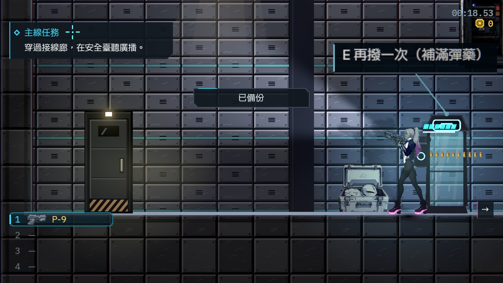

# [ST-27] 接通廠房的安全臺

> 狀態：完成

## 內文

### 需求

讓玩家在清掃示範後進接線廊。沿下層或維修架通過巡查，抵達後能先備份，也能打開折返用的捷徑。

### 來源

2026-11-26，使用者要求完成後續章節。依[劇本](../../design/13-story-v2/SCRIPT_CH04.md)場 08–09 與[路線設計](../../design/13-story-v2/CH04_FACTORY_SERVICE_WALK.md)驗收。

### 驗收條件

- [x] 完成示範後能進接線廊。上下路線各有巡查可繞，不需要清場才開下一扇門。
- [x] 能用原有電話亭備份，讀取廣播後更新主線。
- [x] 從安全臺打開員工門栓才能雙向走上層捷徑。
- [x] 重新啟動保留安全臺位置、廣播和捷徑。

### 測試流程

1. 從裝卸帶走接線廊固定地板，確認守衛仍在時可抵達安全臺。
2. 撥號並聽廣播，放開門栓。經捷徑回裝卸帶，再返回安全臺。
3. 退出遊戲重新讀檔，核對上層出入口和廣播。

---

# 跟其他票的關係

- Blocks：ST-28、ST-29
- Blocked by：ST-26
- Related：ST-23、ST-25

---

# Commit-1

- 56 個受影響套件跑完。補足裝卸帶門框淨空後，關卡健全性、第一章地圖／預載、第四章劇情與任務地圖重測共 3,630 項無失敗。
- 四章地圖審核有 8 區可達，5 項任務無問題，關卡索引共 40 區。劇本文字 9,119 條無錯誤或警告。
- RX 9070 XT，Forward+。實際通過下層、撥號備份、讀廣播及雙向走上層員工門。冷程序續玩應保留安全臺、廣播與門栓，探針皆通過。通路測試用暫時無敵隔離敵人傷害與地形可走性。

