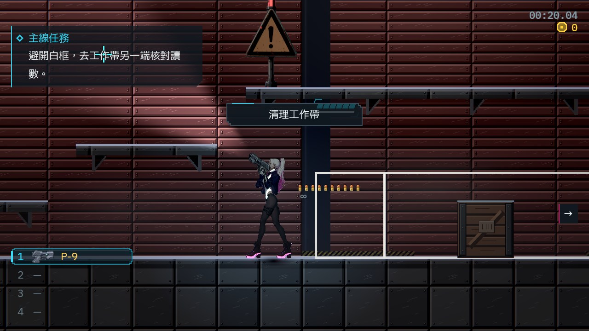

# [ST-28] 做出能換層通過的清理工作帶

> 狀態：完成

## 內文

### 需求

把安全臺後方做成可選時機、也能換層繞過的清掃區。保留可以等待的固定地面，以及通往下一場的指引。

### 來源

2026-11-26，使用者要求完成後續章節。依[第四章劇本](../../design/13-story-v2/SCRIPT_CH04.md)場 09 與[工作帶設計](../../design/13-story-v2/CH04_WORK_LANE.md)驗收。

### 驗收條件

- [x] 聽完廣播可進工作帶，仍能退回安全臺。
- [x] 白框預告位置與傷害範圍一致，警示期間可切換高低路線。
- [x] 下層清掃移除指定貨箱，固定支撐保持通行。上層清掃下方仍有安全路。
- [x] 終端更新主線，清掃與主線進度可持久讀回。

### 測試流程

1. 從安全臺跟著新目標進入工作帶，先在白框外觀察。
2. 檢查實際傷害、貨箱和地板。換到另一層走過上層的掃除區，用終端完成。
3. 退出並重新讀檔，確認工作帶仍可用，貨箱不恢復碰撞。

---

# 跟其他票的關係

- Blocks：無
- Blocked by：ST-27
- Related：ST-25、ST-26

---

# Commit-1

- 受影響的 71 個測試套件共 94,199 項通過。劇本文字 9,158 條無錯誤或警告，關卡索引 41 區，第四章審核 9 區可達及 6 項任務。
- RX 9070 XT，Forward+。從前一版的安全臺存檔進工作帶，驗證先警示、再實際受傷與移除指定貨箱。另一層可通過。終端進度與貨箱維持清除，另開程序讀回相同結果。

