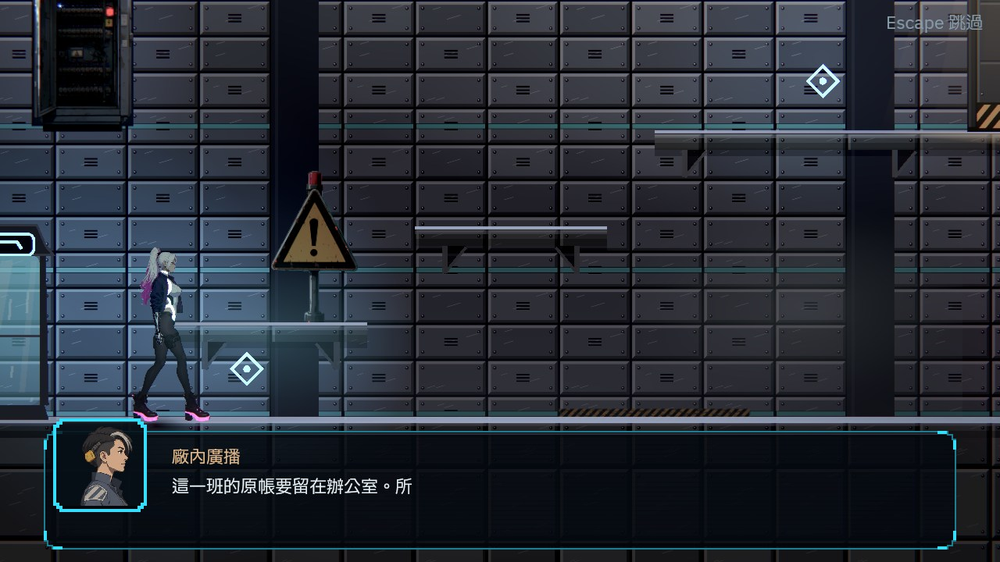

# [ST-29] 統一裁的廣播頭像與角色美術

> 狀態：完成

## 內文

### 需求

依現有角色的美術重畫裁，讓玩家第一次在安全臺聽廣播時看到合適的頭像。

### 來源

2026-11-26，使用者指出裁的初始立繪過於寫實，與現有遊戲角色畫風不一致。依[頭像設計](../../design/13-story-v2/ATROPOS_PORTRAIT.md)驗收。

### 驗收條件

- [x] 裁採藍灰制服、硬邊色面和節制輪廓。遊戲尺寸辨識得到灰綹和茶金色耳機。
- [x] 第一段廠內廣播顯示裁的頭像，文字、任務結果與回訪都正常。
- [x] 保存原尺寸透明來源、參照和雜湊，方便後續做動畫和場景。

### 測試流程

1. 把裁與阿梨、鷺及清掃兵並排縮到 64 像素檢視。
2. 從正常章節路線到安全臺，互動聽廣播，檢查人物頭像、對話與進度。

---

# 跟其他票的關係

- Blocks：無
- Blocked by：ST-27
- Related：ST-28

---

# Commit-1

## 內文

裁的制服改用藍灰色面，保留灰綹、茶金色耳機和肩章。和阿梨、鷺、清掃兵縮到 64 像素並排檢視這些辨識特徵。原尺寸透明檔和美術參考已留存，已核對來源雜湊。

從正常章節路線前往安全臺，首次廣播顯示裁的頭像。廣播後可操作內側門閂並從員工捷徑往返。另起程序讀取存檔，確認廣播、門閂和捷徑狀態會保留，再次互動可讀到回訪內容。

### 測試結果

| 項目 | 結果 |
|---|---|
| 受影響的回歸測試 | 首輪 89 組、104,849 項檢查。坐姿測試的 4 項計時失敗由 NE-371 修正 |
| 套用 NE-371 後 | NPC 動畫和第四章故事通過。並行的舊頭目測試曾因等待逾時失敗，過場套件改用獨立程序重跑通過。兩次通過合計 3,433 項 |
| 劇本掃描 | 9,158 項玩家文字，0 錯誤、0 警告 |
| 角色來源與頭像驗證 | 來源雜湊、尺寸、透明及三份參考皆符合，來源工具 9 項測試與頭像測試通過 |
| 安全臺廣播及回訪 | RX 9070 XT 的 Vulkan Forward+ 路線驗證通過，另起程序讀檔通過 |

### 截圖

