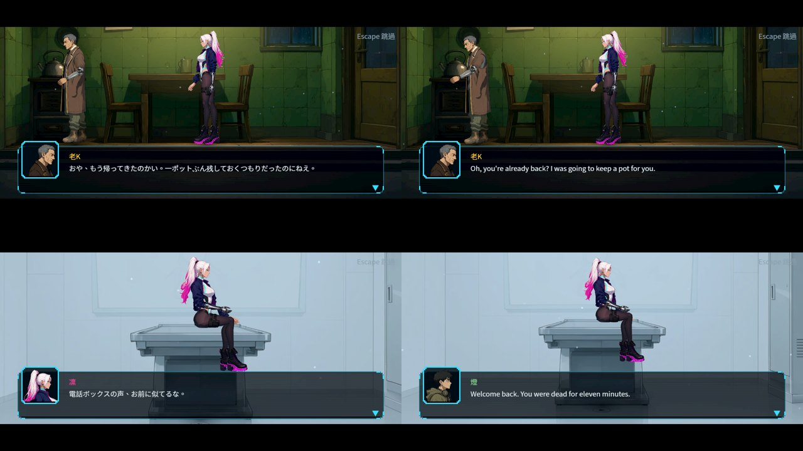
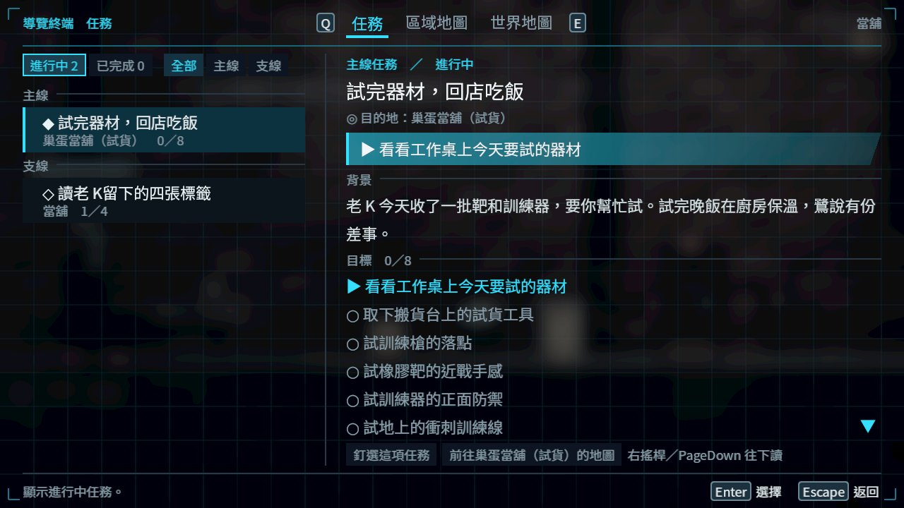

# [ST-2] 把第一章劇本轉成腳本資料

> 狀態：審查中

## 內文

### 需求
第一章劇本（ST-1）定稿後，要變成遊戲能播放的資料：每個過場與通訊、每一句台詞的三種語言、旗標與獎勵。舊的第一、二章腳本（已作廢的舊故事）要被取代。資料要能被啟動時的檢查抓出缺漏，缺語言或缺旗標時退回安全預設並指出具體位置，不讓遊戲崩潰。

### 來源
2026-10-05，使用者要求把故事獨立出來開票；第一章劇本定稿後需要資料化。

2026-10-10需求補充：先完成序章至第三章，逐章劇本審查、正式主支線與演出、累積單檔發行；詳見[整體設計](../../design/20-campaign-experience/DESIGN.md)。

### 驗收條件
- [x] 第一章所有過場、通訊與玩法段的台詞都以資料描述，每句有中、日、英三個欄位，雙關句有標記
- [x] 啟動時檢查：缺語言欄位、缺講者、超過長度或連續句數限制時回報具體檔案與位置，並退回英文或安全預設
- [x] 旗標（認識阿梨住處、經過傘桶次數、第一次死亡、取得資料盤等）有預設值，存檔缺漏或損毀時退回預設並記錄
- [x] 舊的第一、二章腳本不再被遊戲使用，既有功能與測試不變
- [x] 完整測試套件全數通過

- [x] 正式第一章主支線隨故事來源產出，目標、前置、完成條件、真實地點與獎勵符合已審查劇本，不以介面樣本補缺。

### 測試流程
1. 從新遊戲開始，依序跑完第一章，確認每個場景的台詞與演出和劇本一致
2. 切換三種語言，確認台詞與雙關句都顯示正確
3. 故意移除一個語言欄位，確認啟動檢查回報具體位置且遊戲不崩潰
4. 執行受影響範圍測試

---

# 跟其他票的關係

- Blocks：NE-233、NE-223
- Blocked by：ST-1、ST-3
- Related：無

---

# Commit-1

## 內文

第一章劇本（SCRIPT_CH01.md）轉成資料：`tools/story/build_ch1_story.py` 產生 `data/story/ch1_kasa.json`（21 個場景：序幕、當舖開場、晚飯、屋頂兩段、出門、街道的燈與戰鬥提示、倉庫的看門狗、水位謎的對話、復原室、復原館、天亮的麵攤、回家）與六張以 BG-11 場景立繪當舞台的 `data/cutscene/stages/ch1_*.json`。新的章節「傘」加進故事載入清單，章節標題卡與章末卡取自它；新講者鷺、燈、阿梨、錄音（頭像暫借現有的圖）。

- 場景結束時可以設旗標（`set_flags`），出入口的 `requires_flag` 看它：吃完晚飯才能上樓、聽完屋頂的差事才能出門。
- 台詞全部通過劇本品質檢查（句型、標點、教學詞）與過場檢查（句數、連續台詞）；★關鍵句帶 `ja`、`en`、`transcreate`。
- **還沒做**：每句三種語言與缺語言時的退回（目前只有★關鍵句有日文與英文，引擎也還沒有語言切換）、對話選項與旗標分支、舊的第一章與第二章腳本仍在使用（舊關卡還在），所以票維持進行中。

# Commit-2

## 內文

第一章收尾的正式劇本只存在作者稿，轉成遊戲資料的步驟一直被擋住，遊戲讀的還是舊稿。
現在作者稿可以直接轉成遊戲劇本：120 個場景、分派入口、段尾結果、正式交易引用、衍生旗標與 9 個任務一次產生；每個旗標都有預設值，舊存檔缺值時退回預設。重跑原本的劇本產生器也會輸出正式稿，不會再把舊的 36 場蓋回去。任務只發布玩家走得到的真實地點；次晨核對（第二章入口）與診間灰布（只在初次建檔出現）保留在作者稿，沒有發布成地圖任務。三種語言目前只有伏筆句帶日文與英文，遊戲也還沒有語言切換，所以票維持進行中。

### 測試結果

| 項目 | 結果 |
|---|---|
| 受影響範圍（與 ST-9 同一次交付，69 組） | 78,163 項、0 新失敗、0 已知失敗 |
| 劇本文字掃描 | 0 錯誤、0 警告 |
| 截圖 | 見 ST-9 Commit-5 |

分支：`claude/nest-egg-main-story-flow-ph1dnu`。

# Commit-3

## 內文

第一章只有兩句伏筆帶日文與英文，遊戲也沒有語言切換，缺譯時不會告訴任何人。
現在第一章（含序章）464 句台詞、選項、選擇說明、章節標題、任務文字與講者名牌，全部有日文與英文；名字照命名表（凛／Rin、老K／Old K、鷺／Egret、灯／Wick、梨／Pear），兩句「梨」的雙關標成創譯、各語言自己重寫。譯文寫在一份以中文原句對照的表，中文改了就會被列成缺譯。遊戲可以切換劇本語言，切換時進度與看過的場景不變；缺日文退回英文、再缺退回中文，並記下是哪一份檔案、哪一個場景的第幾句。劇本檔宣告三語之後，載入時會列出還沒有譯文的地方。
檢查同步調整：中文的短句規則只套用在中文（「凛だ。」在日文是完整的一句），譯文只檢查氣泡長度，上限換算成同樣的閱讀量。超過的八句譯文改短，仍是完整句子。

### 測試結果

| 項目 | 結果 |
|---|---|
| 劇本文字掃描 | 4,002 條玩家文字 0 錯誤、0 警告（含日文與英文） |
| 缺譯 | 第一章 0 處 |
| 語言切換 | 新增檢查：日文取代中文、缺日文退回英文再退回中文且記下位置、條件與旗標不被翻譯、名牌跟著換、切回中文復原 |
| 劇本與過場套件 | 1,953 項、0 失敗 |
| 實際畫面（軟體 Vulkan） | 日文與英文的回家、診間醒來鏡頭，字型與換行正常 |
| 尚未做 | 母語審稿；「Escape 跳過」「繼續」這類介面字由介面組處理；舊的第一、二章腳本仍在載入（隨第二章 ST-19 移除） |

### 截圖

雲端軟體 Vulkan（Forward+）截圖。

分支：`feature/story`。譯文表 `tools/story/i18n/ch1_kasa.json`；寫作規則見 [DIALOGUE_READABILITY.md 第 6 節](../../design/13-story-v2/DIALOGUE_READABILITY.md)。

# Commit-4

## 內文

舊的第一、二章劇本（已作廢的舊故事）一直跟正式劇本一起載入：發行版也讀它，讀檔時還替這兩章建地圖索引。另外第一章任務在地圖上的標記是手寫的格子，和真正的人物、物件對不上：吉他標籤差 13 格、電話亭的燈差 4 格、看門狗與水閘指在空地上，照地圖走過去沒有東西可以互動。
現在發行版只載入序章、第一、二、三章的正式劇本；開發版另外讀舊稿，只給舊示範關卡與歷史格式測試用，正式章節與正式關卡不引用舊稿的任何場景或講者。第一章與序章 31 個任務步驟的標記都改成指在完成那一步的人物、物件、機關或出入口上（例如吉他標籤、阿梨、交接櫃、看門狗、坑底水閘踏板），並加上和第二、三章一樣的逐步核對。
驗收：模擬發行版載入劇本，舊稿的 47 個場景都播不到、正式章節的結構檢查 0 問題；四條路線（完整序章、略過序章、留下吃麵、付清回家）逐狀態都有主線目標、章末完成；任務稽核 0 問題。

### 測試結果

| 項目 | 結果 |
|---|---|
| 受影響範圍（原選擇器，56 組） | 56,615 項、0 新失敗、0 已知失敗 |
| 第一章地圖與任務（重產劇本後） | Chapter1Map、QuestMap 1,968 項、0 失敗；31 步全部指到實物 |
| 發行版劇本隔離（新增檢查） | 舊稿場景 0 可播、正式章節結構問題 0、正式關卡與資源 0 引用舊稿 |
| 主線逐狀態模擬 | prologue／skip／stay／leave 四條路線 0 空檔；stay、leave 走到章末 |
| 任務稽核（ch1_kasa） | 0 問題，10 個任務、12 個可到達區域 |

### 截圖

雲端軟體 Vulkan（Forward+）截圖：正式任務資料（序章主線與四張標籤支線）。

分支：`feature/ecstatic-einstein-gyjqmu`，提交 [c326b2dc](https://github.com/deadline314/Nest-Egg/commit/c326b2dc5b403ebef062d689ea02d62919fcc824)。劇本的使用者確認仍在 ST-1；確認後改作者稿再重產，任務與標記會一起更新。
