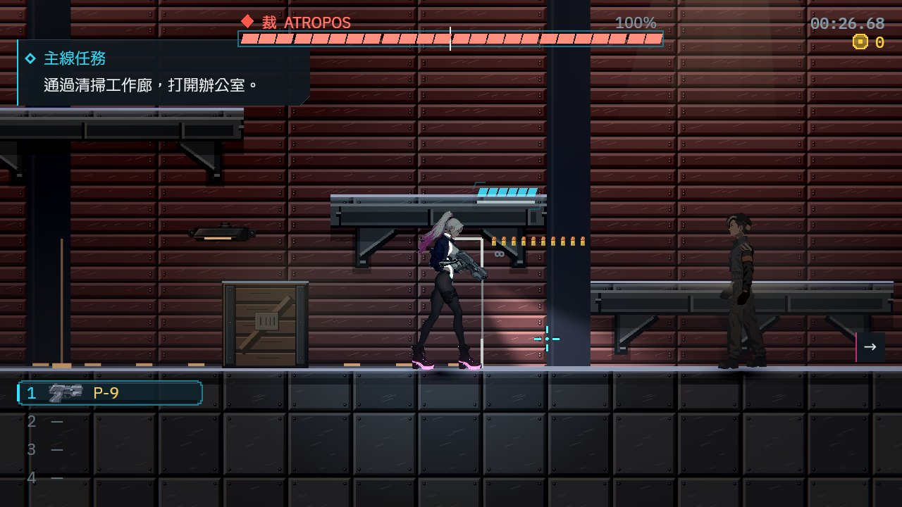

# [ST-30] 打通清掃工作廊與原帳室

> 狀態：完成

## 內文

### 需求

延續清理工作帶的白線教學，玩家要能與隊長裁交戰、見證鷺的離隊，最後打開原帳辦公室。戰鬥中斷可以從安全臺重進，已確認的故事結果與清掃損失會留在本輪。

### 來源

2026-11-26，第四章第 10–11 場與後續章節製作。

### 驗收條件

- [x] 低處與高架的白線先警告才生效，標記掩體可消失、固定通道仍能走。
- [x] 到半血暫停戰鬥，離隊與拒絕復原一起保存，取消後可從原人物重試。
- [x] 普通敗北與重開可從安全臺重進。交接後重進保留第二階段及先前的掩體損失。
- [x] 隊長從實際的門後撤走，原帳辦公室經終端確認才開放。回訪可正常通行。

### 測試流程

1. 從安全臺穿過工作帶，在其末端核對讀數再進工作廊。
2. 先試下方的白線與掩體，再將裁打到半血。取消一次後找高架上的鷺繼續。
3. 在前後兩個階段分別敗北，另從中段的正式存檔重新開啟遊戲。
4. 看裁撤到右端，再叫出終端，從辦公室上下樓各一次。

---

# 跟其他票的關係

- Blocks：無
- Blocked by：ST-28、ST-29
- Related：ST-23

---

# Commit-1

## 內文

清掃工作廊前後兩層的警示和真實掩體可一起遊玩。半血交接由欄杆上的鷺確認，取消保持兩筆結果未成立。完成後保存拒絕復原和離隊，普通敗北與續玩都能從安全臺回到第二階段。

隊長往右端撤出後，玩家才能在工作廊終端打開辦公室。進去後可走原路返回，裁與消失的掩體仍保留正確狀態。

### 測試結果

| 項目 | 結果 |
| --- | --- |
| 章節、佈景、存檔、特效相關測試 | 2,094 項通過 |
| 章節、玩家文字、敗因與角色特效檢查 | 603 項通過 |
| 音訊與劇情資料最終重測 | 29,137 項通過 |
| 正式劇情與區域資料 | 66 段、7 個任務、11 個可達區域 |
| Godot 4.7.2 Forward+／RX 9070 XT | 兩次普通重試、清除掩體、半血取消與重新完成均通過 |
| 獨立程序續玩 | 20 項通過，含隊長到達右端閘門的實際位置及回訪 |

### 截圖

