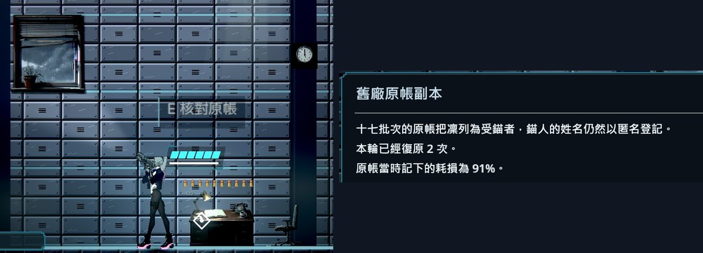

# [ST-31] 讓玩家核對並保存原帳

> 狀態：完成

## 內文

### 需求

凜到原帳室後，可以拿病房取件聯核對第十七批次，並在同一張工作臺保留原頁副本。閱讀時能分辨本輪復原次數、歷史耗損及仍被遮住的簽名。

### 來源

第四章劇本第 12 場，以及 Stanley 在 2026-11-26 要求繼續交付後續章節。

### 驗收條件

- [x] 原帳桌和互動提示對得上。在地圖上可以辨認取證位置。
- [x] 可以先看資料、關閉後回來再存。取件聯與原頁副本都能保留。
- [x] 三語的文件內文呈現現行復原次數、91% 歷史耗損及匿名付款欄。
- [x] 重新進遊戲可以讀到原來的副本，回桌前可確認內容。

### 測試流程

1. 經清掃工作廊進原帳室，打開並關閉工作臺的提示。
2. 用取件聯核對，先選擇離開，再回來保存副本。
3. 打開文件在三語各讀一次。改用另一個程序從原房間繼續，確認文件和地圖來源。

---

# 跟其他票的關係

- Blocks：無
- Blocked by：ST-30
- Related：無

---

# Commit-1

## 內文

玩家可在原帳工作臺核對病房取件聯，先閱讀紀錄再決定是否留下副本。副本保留匿名欄位和當時 91% 的耗損，並顯示本輪累計的復原次數。現地配置保留返回工作廊的入口，工作臺、檔案櫃與雨窗使用不同的光源。

### 測試結果

| 項目 | 結果 |
| --- | --- |
| Main 原帳路徑與冷讀檔 | 核對、離開、保存、回訪與獨立續玩共 53 項通過 |
| 區域與本地化索引 | 43 區域通過，41 個正式關卡的名稱符合英日文來源 |
| 受影響測試 | 57 組整合回歸，重新驗證提示、任務地圖、稽核和原有計時邊界 |
| RX 9070 XT Forward+ | 取得副本後可在工作臺回讀，文件內容和實際復原次數一致 |

### 截圖

