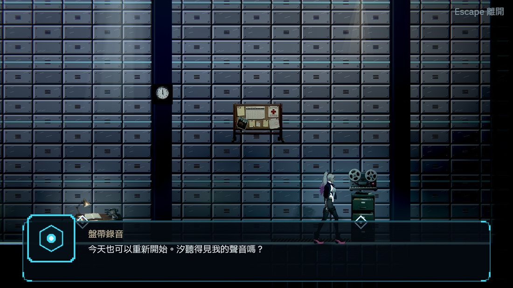

# [ST-32] 讓玩家重聽舊廠第 31 版盤帶

> 狀態：完成

## 內文

### 需求

原帳室要有一臺可辨識的盤帶機。玩家可以播放或只記版號，也能回病房用床邊電台補聽。盤帶與阿翰借出的錄音各自保留。

### 來源

第四章劇本第 13 場。Stanley 在 2026-11-26 要求繼續完成後續章節。

### 驗收條件

- [x] 原帳室盤帶有獨立位置與提示。打開後可以先離開。
- [x] 選擇只記版號可保存登錄卡，完整播放才收錄逐字稿。
- [x] 可回病房補聽並隨時退出。電台保留原本的收音示範。
- [x] 冷讀檔可補聽與重看，逐字稿跟借閱的阿翰錄音各自保管。

### 測試流程

1. 在辦公室打開選單，離開一次；播放途中取消一次。
2. 只記版號再重進。分別從辦公室與病房補聽。
3. 重新讀檔，從電台重看並再做原來的收音示範。

---

# 跟其他票的關係

- Blocks：無
- Blocked by：ST-31
- Related：無

---

# Commit-1

## 內文

原帳桌與盤帶機分開。玩家可先記版號，或在辦公室播放字幕。病房的床邊電台可補聽並保留收音示範，完整播放才保存逐字稿。第三章的借閱錄音維持獨立保管。

### 測試結果

| 項目 | 結果 |
| --- | --- |
| 選擇、取消、重試與冷讀檔 | 5 個 Main 程序共 84 項通過，包含從辦公室返回病房 |
| 較舊道具與原本示範 | 借閱錄音、原帳和床邊收音在續玩時皆可使用 |
| 區域及本地化索引 | 43 區域通過，原帳辦公室與回程提示保留英日文 |
| 受影響範圍 | 57 組。初跑 63,204 項，舊倉庫提示只在一次未及淡入。相同內容單獨重跑該套件，2,126 項全過。 |
| RX 9070 XT Forward+ | 完整字幕與現場盤帶機位置已對照 |

### 截圖

