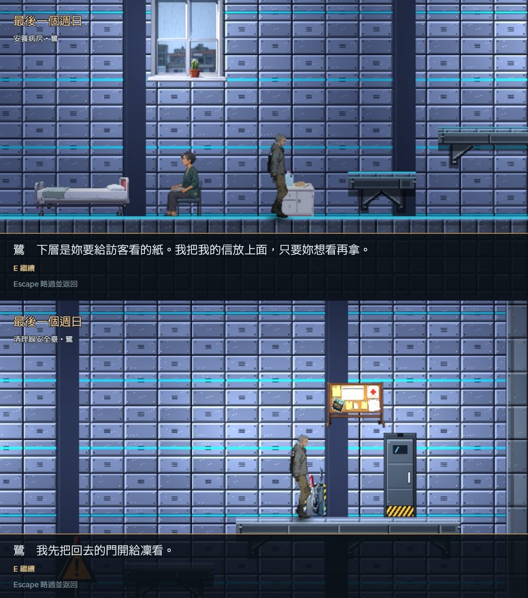

# [ST-33] 重現鷺的病房回放

> 狀態：完成

## 內文

### 需求

原帳核對完成後，讓玩家從辦公室側門回到鷺的最後一個週日。回放應讓玩家親自走到棠床邊放短箋，再從廠側打開員工門，認得現實裡的回程。

### 來源

《第四章 空殼》第 14 場〈最後一個週日〉。

### 驗收條件

- [x] 走到棠床頭櫃旁才能放短箋，棠會在原地回應。
- [x] 能沿病房內廊到安全臺，從上方落腳處拉開 SC7。
- [x] 完成或略過都回到同一個辦公室位置，重開會從病房起點開始。
- [x] 回放保留原有文件、裝備、復原、信用點與現實 SC7 狀態。

### 測試流程

1. 用已核對原帳的存檔進辦公室，從側門進入回放。
2. 走到床邊放短箋後略過，確認回到側門，再開一次並走到安全臺打開員工門。
3. 回到辦公室後核對原帳和現實路線。另以已開啟現實 SC7 的存檔冷啟動，再走進並略過回放。

---

# 跟其他票的關係

- Blocks：ST-34
- Blocked by：ST-31
- Related：ST-32

---

# Commit-1

## 內文

回放可以步行與互動，保留病房床頭櫃和安全臺上層的原有地標。放短箋、開門與略過都回到原辦公室，現實存檔裡的文件、裝備與路線不會被回放寫入。

### 測試結果

| 項目 | 結果 |
|---|---|
| 受影響範圍 | 59 組、62,571 項全過，無新增失敗 |
| RX 9070 XT Forward+ 實機回放 | 36 項通過 |
| 既有 SC7 已開存檔冷啟動 | 7 項通過 |
| 關卡、地圖與鄰區預載索引 | 43 區域通過 |
| 第四章地圖再生比對 | 53 個輸出中，只有辦公室關卡與配置改變 |

### 截圖

