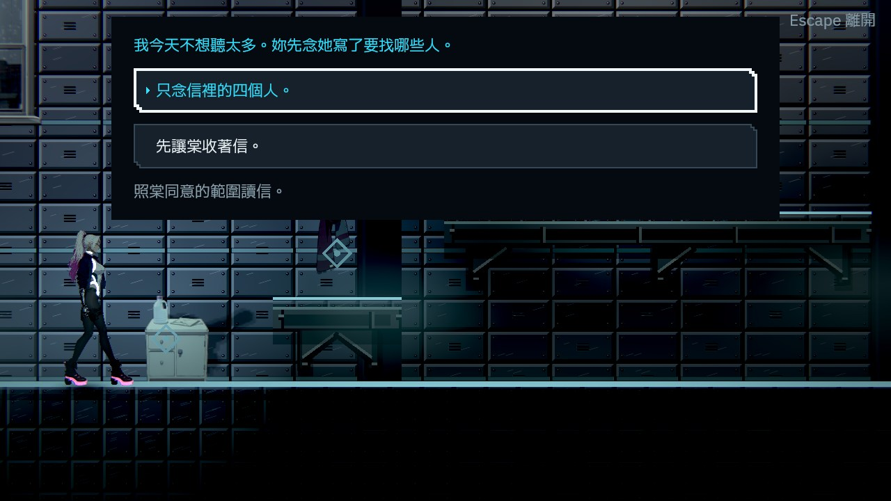

# [ST-34] 她留下的信

> 狀態：完成

## 內文

### 需求

玩家可自願回到病房，在棠同意後讀出信上的四名聯絡人，選擇將地點抄入筆記。原信留在棠身邊。床旁另有一條舊圍巾可調查。

### 來源

2026-11-26，第四章第 15 場。

### 驗收條件

- [x] 經棠同意的公用取件聯仍照原流程取得。回訪床頭櫃時才提供詢問讀信的選擇。
- [x] 可在詢問、聽完或抄寫途中離開並重試。完成抄寫才會存入筆記，冷啟動後仍能回訪。
- [x] 原信留在原處，回訪不影響原帳、任務進度或信用點。
- [x] 圍巾可單獨查看，標籤只記床位，調查不會授予道具或推進進度。

### 測試流程

1. 完成病房訪客動線與床頭櫃順序，回頭詢問讀信。先離開，再只聽名字後離開。
2. 選擇抄寫途中取消。再抄完一次並從正式存檔續玩，核對只有一份筆記。
3. 調查上層低走道的舊圍巾，確認能離開繼續原本路線。

---

# 跟其他票的關係

- Blocks：無
- Blocked by：ST-33
- Related：ST-24

---

# Commit-1

## 內文

病房床頭櫃新增經棠同意才會讀出的四個名字，可抄下地點再把原信留給她。三種語言均有選擇、簡短說明與筆記內容。圍巾與床號是可獨立查看的環境線索。

### 測試結果

| 項目 | 結果 |
| --- | --- |
| Godot 4.7.2 Forward+／RX 9070 XT | 81 項通過，1280 × 720 選項與提示完整 |
| 獨立程序續玩 | 20 項通過，原本取件聯與筆記俱在並可再次讀信 |
| 整合版本流程 | 80 項通過，涵蓋退出、取消抄寫與完整保存 |
| 受影響測試 | 14 組，13,849 項通過 |
| 劇本文字及索引 | 9,478 條文字零錯誤警告，43 區索引校驗通過，第四章 11 區及 8 個任務可達 |

### 截圖

