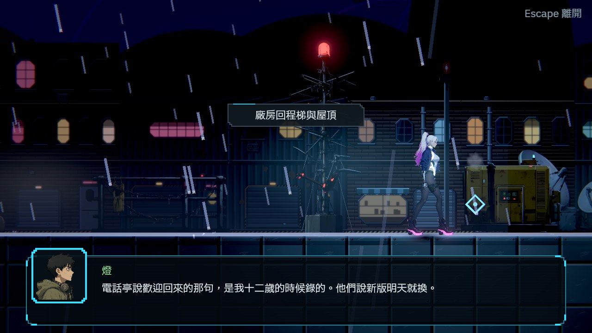

# [ST-35] 第四章屋頂通訊與床邊留言

> 狀態：完成

## 內文

### 需求

原帳辦公室接上舊廠屋頂。玩家能從另一座梯間回清理線安全臺。完成屋頂通訊後可繼續正文，也可回安養病房替燈留下留言。

### 來源

第四章第 16 場「每次都是明天」。

### 驗收條件

- [x] 原帳核對後可從辦公室上屋頂，再由另一座梯間回清理線安全臺。
- [x] 中斷屋頂通訊可重聽。讀完通訊後可直接回當舖。
- [x] 先延後、再接受請求可取得便攜話筒。選擇稍後和取消都保持道具狀態。
- [x] 側窗床位保留原病房的床與收音示範。凜手部接觸實際按鍵，取消後仍能重試。
- [x] 留言完成與話筒移交同一次保存，重開後不重複提交。地圖和任務指引可達，三語通過劇情檢查。

### 測試流程

1. 從有原帳的辦公室存檔進屋頂。通訊取消一次，再讀至結束。
2. 試一次稍後，再接話筒走屋頂下樓，從原路回病房。
3. 進東側床位，觀察按鍵接觸，取消後再讀完留言。
4. 關閉並從新程序續玩。再次確認床位只能播放短提示。

---

# 跟其他票的關係

- Blocks：ST-36
- Blocked by：ST-31
- Related：ST-34

---

# Commit-1

## 內文

屋頂的兩座梯間加入第四章的回程動線。讀完通訊就可繼續正文，病房留言需另外同意。在側窗床位按鍵並讀完留言，才將話筒移交到床邊。

### 測試結果

| 項目 | 結果 |
|---|---|
| 第四章故事與出入口檢查 | 107 項通過 |
| 受影響套件 | 首輪 57 組共 63,297 項。校正既有語系與可關閉通知後，NPC 1,643 項全過 |
| 導覽校驗 | 重建 45 區域指紋後，任務地圖 823 項全過 |
| 辦公室、屋頂到床邊交接 | 47 項通過 |
| 已完成留言的存檔冷啟動 | 9 項通過 |
| 導覽索引與第四章任務 | 45 區域索引、第四章 13 區域及 10 項任務通過 |
| RX 9070 XT Forward+ 屋頂通訊 | 已取得實機畫面 |

### 截圖

