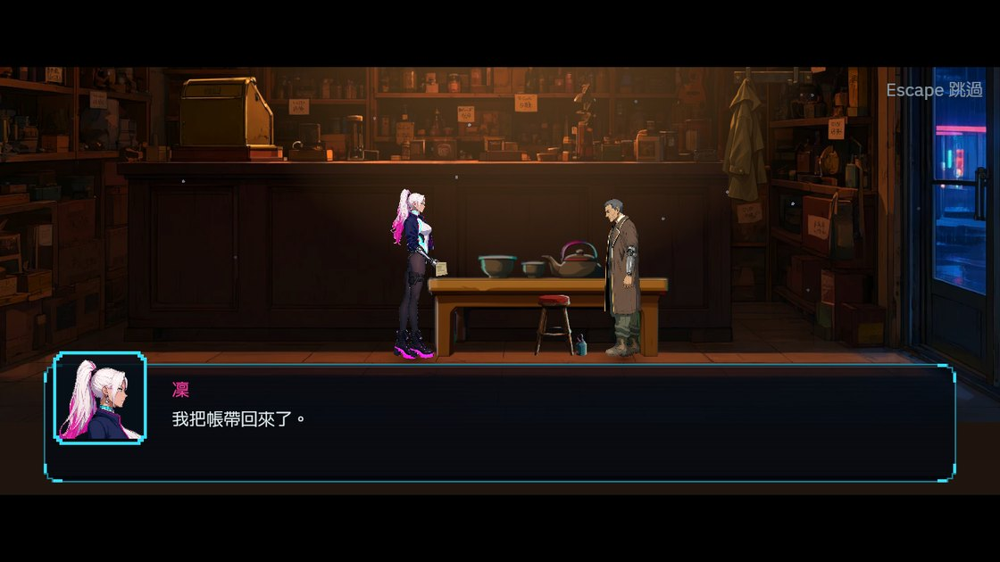

# [ST-36] 將原帳帶回當舖

> 狀態：完成

## 內文

### 需求

凜聽過屋頂通訊並持有原帳後，可以回當舖找老 K。場景要看得出他讓位、凜把副本放上桌，以及另一個衣掛是空的。

### 來源

第四章劇本第 17 場與 Stanley 的後續章節製作需求。

### 驗收條件

- [x] 可用普通路線從舊廠返回當舖，再向老 K 確認。
- [x] 可以先離開。確認後實播或略過都保存原帳與同一個返店結果。
- [x] 拿取副本的手與桌面對齊，暖燈和門外冷光能看清演員。
- [x] 冷讀檔可以回到店內，保留副本與後續目標。

### 測試流程

1. 從已存好的原帳室進屋頂，聽完通訊後循普通回程。
2. 和老 K 說話並選擇稍後，再確認。分別看完和略過。
3. 開啟另一個程序，檢查所在區域、持有文件與回訪對話。

---

# 跟其他票的關係

- Blocks：ST-38
- Blocked by：ST-35
- Related：無

---

# Commit-1

## 內文

凜可繞回當舖，把帶回的原帳副本放上櫃台，和老 K 確認下一步。店內的暖燈照到桌面；門邊的冷光照到兩個衣掛，少了一件濕外套。完成、略過或冷讀檔都保留原帳。

### 測試結果

| 項目 | 結果 |
|---|---|
| 受影響套件 | 11 組、7,955 項通過，無失敗 |
| 完整返店／冷讀 | 完整觀看 37 項、獨立續玩 8 項 |
| 略過返店／冷讀 | 略過路線 40 項、整合版冷讀 8 項 |
| 第四章地圖與劇本 | 13 區域可達、11 個任務，9,595 條文字零錯誤 |
| 實機舞台 | 核對暖燈、雙手與副本接觸、空衣掛 |

### 截圖

