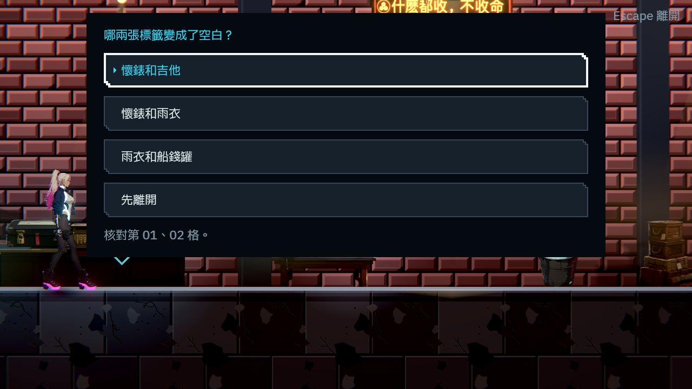

# [ST-38] 實作當舖空白標籤

> 狀態：完成

## 內文

### 需求

實作第五章第 5.01 場。凜在老 K 下樓查滲水時，比對四件架上舊物與櫃台抽屜的格號。找出擦掉的兩張標籤後，開啟盤點板第一道滑扣。

### 來源

第五章劇本 5.01，以及第四章回當舖與老 K 談原帳的章末進度。

### 驗收條件

- [x] 開發版在第四章章末完成後，可由當舖自選進入第五章。讀取章末存檔仍先回到第四章當舖。
- [x] 四件物品可依任意順序檢查，只有真實讀過的第一章標籤會出現舊筆記。玩家可用現場證據完成，且不改動 SQ8。
- [x] 只有「懷錶和雨衣」開啟第一道滑扣。選錯、離開或取消時可重試，正確結果保留在存檔。
- [x] 玩家可在任務和地圖先找到抽屜，再前往盤點板。

### 測試流程

1. 讀取完成章末對話的第四章存檔。先留在原區，再用廚房門旁的入口進入第五章。
2. 看抽屜與四張標籤，分別試錯選、離開和正確選項。確認未讀過的舊筆記不顯示。
3. 重開並繼續，核對對話、第一道滑扣和任務進度。確認累積版沒有開通此入口。

---

# 跟其他票的關係

- Blocks：ST-39
- Blocked by：ST-36
- Related：ST-37

---

# Commit-1

## 內文

從第四章當舖的隔天入口進入第五章。抽屜和四件舊物提供完整線索，讀過的舊便條也會跟著角色留下。盤點板可試錯和取消，配對正確才會打開第一道滑扣。完成後可以回讀，任務地圖跟著實際結果更新。交接門在關卡測試中明確驗證為日次推進，第四章的區域門仍須檢查回路。

### 測試結果

| 項目 | 結果 |
|---|---|
| 第四章原存檔、真實讀取舊信與第五章重試 | 通過 91 / 91 |
| 另一個程序重開、地圖與門路 | 通過 18 / 18 |
| 受影響測試 | 68 套件已執行；原輪索引、匯入資源及比例問題已依原套件重新驗證 |
| 完整音效與來源資料 | 28,166 項通過 |
| 直接重測兩章門路與場景比例 | 840 項通過 |
| 最終故事入口、角色與任務地圖 | 2,751 項通過 |
| 關卡、地圖與預載索引 | 46 區域通過 |

### 截圖

