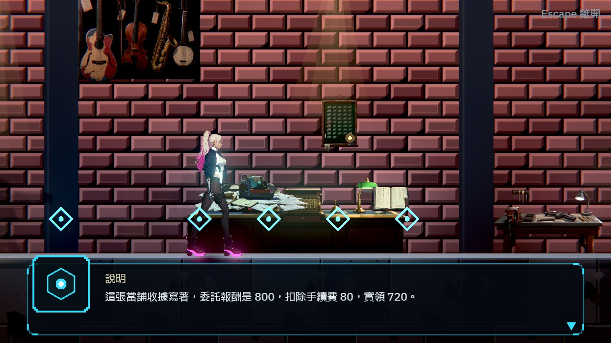

# [ST-39] 核對當舖的手續費帳

> 狀態：完成

## 內文

### 需求

在盤點板找出兩張空白標籤後，繼續翻看當舖櫃台的舊收據和總帳。玩家可以比對每單的一成怎麼存入總帳。

### 來源

第五章第 5.02 幕「抽走的一成」。

### 驗收條件

- [x] 第一滑扣確認後可依任意順序查看櫃台兩份單據。
- [x] 收據顯示報酬 800、手續費 80、實領 720。總帳顯示各單撥入一成、歷史累計 52,000。
- [x] 兩種錯選各提示對錯的欄位。放棄或中斷後可重新比對，信用點與持有物維持原值。
- [x] 比對保存成功後才亮起第二道滑扣的指示燈，任務紀錄保存結果並引向下一幕。
- [x] 繁中、日文、英文的單據、選項提示和指引都可讀。

### 測試流程

1. 完成空白標籤盤點，依任意順序閱讀收據與總帳。
2. 在盤點板各錯選一次，檢查提示，離開再回來選正確說法。
3. 讀完後確認指示燈、任務紀錄和原有信用點。關閉重開，再回盤點板核對結果。

---

# 跟其他票的關係

- Blocks：ST-40
- Blocked by：ST-38
- Related：ST-37

---

# Commit-1

## 內文

櫃台兩份單據在第一道滑扣開啟後可讀。比對錯誤會提示要重讀的欄位。確認並保存後，盤點板亮起綠燈，凜接著要向阿梨查證。信用點和道具保持原值。

### 測試結果

| 項目 | 結果 |
| --- | --- |
| 完成、錯選、離開與取消 | 真實存檔續玩 52 項通過 |
| 重開後回顧與重新閱覽 | 15 項通過 |
| 地圖與任務 | 46 區域索引，當舖 2 項任務，3 個核對位置 |
| 三語文字 | 劇情文字檢查通過 |
| RX 9070 XT Forward+ | 櫃台文件已拍攝 |

### 截圖

---

# Commit-2

## 內文

將收據與總帳放回櫃台兩端的工作面。翻讀時可以看見兩份文件和它們的實際位置。在盤點板連續選錯同一項，也能再次看到提示後重新比對。

### 測試結果

| 項目 | 結果 |
| --- | --- |
| 重開及重新翻查 | 通過 15 項 |
| 當舖佈景及出口 | 0 個錯誤、0 個警告 |
| 關卡索引 | 46 區域通過 |
| RX 9070 XT Forward+ | 驗證兩份文件的桌面接觸 |
| 受影響測試 | 56 套件、63,167 項。最終門路、場景、地圖與啟動重測 4,055 項通過 |
