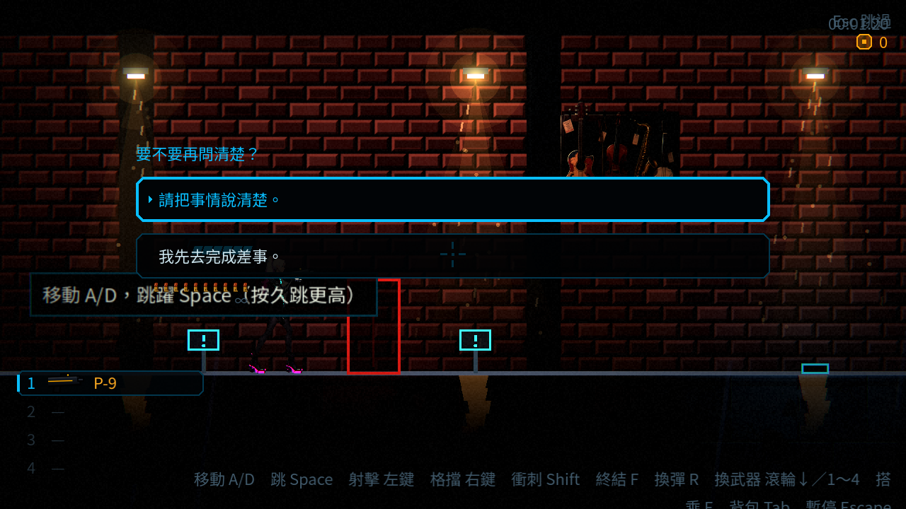
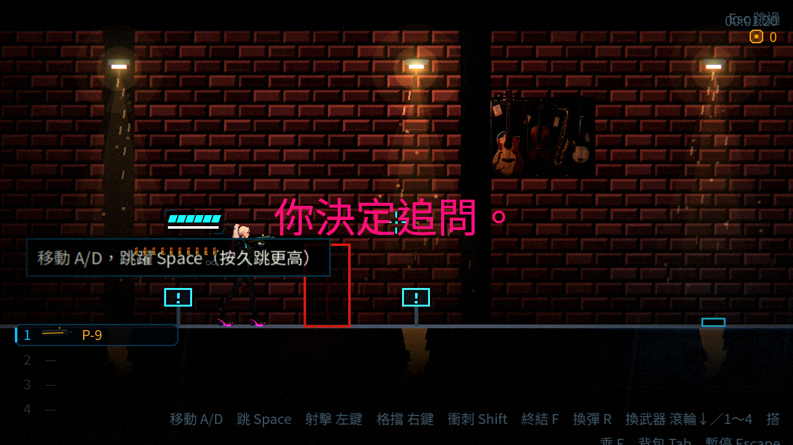
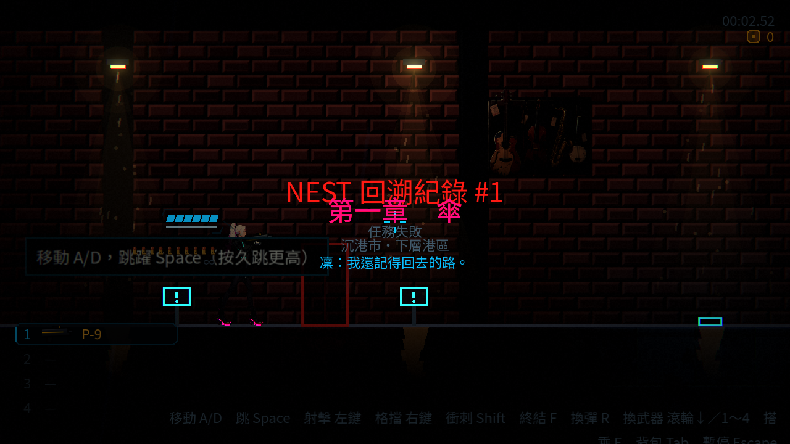
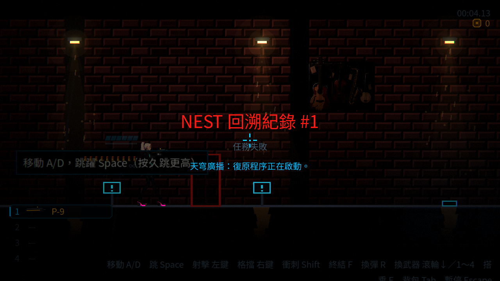
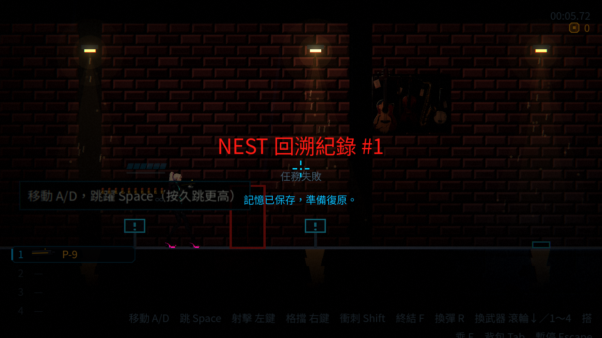
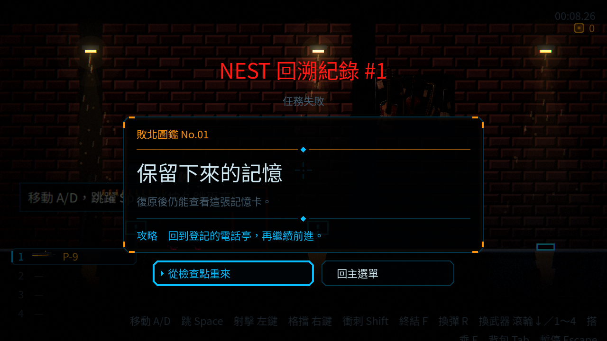
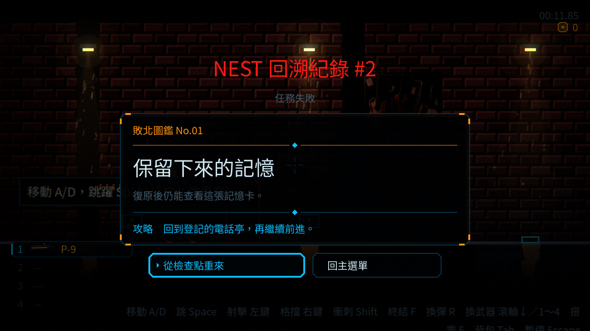
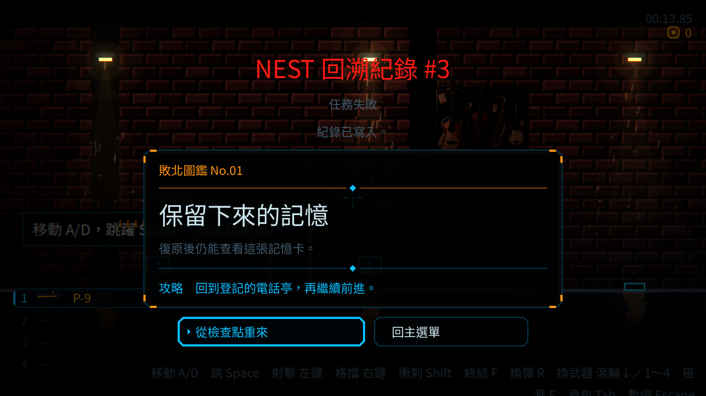
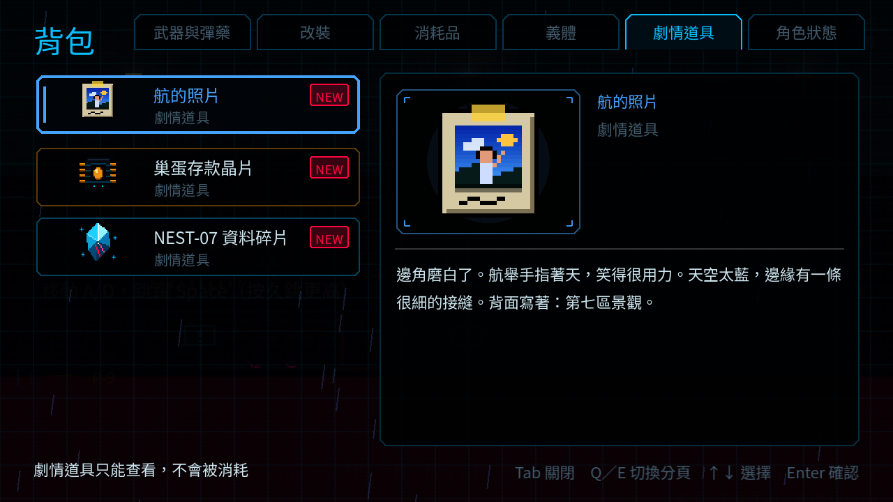
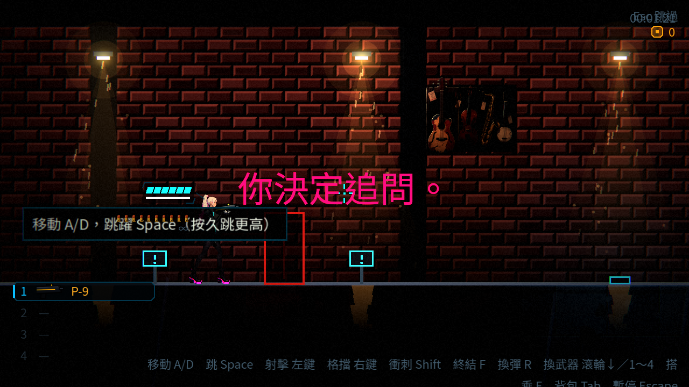

# [ST-3] 加入故事需要的對話選項旗標與演出功能

> 狀態：進行中

## 內文

### 需求
第一章劇本需要現在的過場系統做不到的事：過場裡讓玩家選一個選項並改變後續、記下旗標、站在物件前按鍵聽一句短台詞、死亡時依序播出的畫面序列、可收進道具欄的故事道具。沒有這些，第一章的分支（問或不問、留下或離開）、貨架的標籤、傘桶與死亡畫面無法演出。

### 來源
2026-10-05，第一章劇本（ST-1）整理出的需求，使用者決定故事相關的票開在 ST。

### 驗收條件
- [x] 過場可以在某一步出現選項，玩家選擇後走不同的後續，選擇會記成旗標
- [x] 旗標存進存檔；缺漏或損毀時退回預設值並記錄具體位置，不讓遊戲崩潰
- [x] 玩家站在可互動物件前按鍵，會說出一句短台詞（可有多句、依狀態不同）；已聽過的可以記錄
- [x] 死亡畫面可以依序播出：一句話、另一個聲音、狀態列、一張記憶卡；第一次完整、之後簡化、更後面可略過
- [x] 故事道具可以收進道具欄並被後續劇情檢查
- [x] 以上都有資料描述，新增內容不需要改程式
- [x] 既有的過場、死亡畫面、道具欄與測試不變，完整測試套件全數通過

- [x] 廣播接續、重播或重設後，首句立即且持續可見，不被上一段退場隱藏。
- [ ] 故事可區分曾取得與目前持有原件；已交出的原件不因重播、死亡或續玩重新出現，未完成交付可取消。

### 測試流程
1. 在第一章的屋頂過場選擇「問」與「不問」，確認後續與旗標不同
2. 對貨架上的物件按鍵，確認聽到對應的短台詞，重複互動不會重複計數
3. 連續死亡三次，確認死亡畫面第一次完整、第二次簡化、第三次可略過
4. 對復原室的茶杯互動，確認道具進入道具欄
5. 存檔後重開，確認旗標還在；刪掉旗標資料，確認退回預設值且遊戲不崩潰

---

# 跟其他票的關係

- Blocks：ST-2
- Blocked by：無
- Related：ST-1

---

# Commit-1

## 內文

過場現在能提供兩至四個選項，選擇後立即記下旗標並播放對應後續；鍵盤與手把可用焦點確認，滑鼠可點擊，跳過時採用資料指定的預設選項。故事進度可保存與重讀，缺漏、錯型或損毀的旗標會指出欄位／檔案位置並退回安全預設。尚未播完的場景不記成完成。

沿用現有物件互動與背包，補上只調查一次、依旗標／持有道具挑選短台詞，以及一般故事道具的取得。一般死亡畫面可依次數播完整／縮短／可略過的台詞、另一個聲音、狀態與記憶卡；特殊首次診間流程仍優先。

驗收使用獨立的故事功能資料，實際建立播放器、物件與死亡畫面，檢查兩條選項路線、原生確認輸入、磁碟往返、損毀退回、調查不重複、道具條件及三次死亡序列。第一章正式屋頂、標籤與茶杯的接點由 ST-9 承接；本次沒有覆蓋其他 Session 的故事／舞台產生器。完整遊戲存檔與續玩能力不在這份故事進度區塊內，介面與邊界見故事功能交接文件。

### 測試結果

| 項目 | 結果 |
|---|---|
| 受影響範圍（明確基準 6f4805be，63 組、4 程序） | 41,218 項，0 新失敗、0 已知失敗 |
| 完整套件 | 45,286 項，0 新失敗、0 已知失敗（76 組、4 程序） |
| 先前同時批次的時序／效能失敗 | 停止並行批次後單一程序 665 項全過；未修改已知失敗清單 |
| rebase 後合併複驗（故事、NPC、音效與曲目） | 26,289 項全過；原生輸入測試明確刷新緩衝並等待畫面影格，修正只等待物理影格造成的測試時序失敗 |
| 劇本檢查 | 0 錯誤、0 警告 |
| 連續性報告 | 無不可達內容；既有舊腳本孤兒警告保持可見 |
| 截圖 | Godot 4.7 Forward+，Vulkan llvmpipe 軟體渲染；無 GPU／音訊裝置，未聲稱硬體效能或試聽驗收 |

### 截圖

# Commit-2

## 內文

NE-223 交接指出 Godot 4.7 沒有 `bool(String)` 建構子。ST-3 的旗標格式允許字串，原條件讀取會在字串分支報錯；改用原生條件判定，空字串／零為未滿足，非空字串／非零為滿足，與任務導覽語意一致。

驗收資料的兩個選項現在同時保存布林決定及字串路線，後續分支實際讀取字串。新增八種純量條件、字串磁碟往返與缺值退回檢查；既有連續性斷言隨分支旗標更名更新，未放寬檢查。

### 測試結果

| 項目 | 結果 |
|---|---|
| 受影響測試（固定基準 5f9e3981） | 64 組，41,261 項、0 新失敗、0 已知失敗，288 秒 |
| 完整平行測試 | 77 組，45,317 項、0 新失敗、0 已知失敗，293 秒 |
| 真實畫面 | Forward+ llvmpipe 軟體 Vulkan；選擇後的字串分支繼續演出，沒有 GPU／實體手把／試聽宣稱 |

### 截圖

# Commit-3

## 內文

上一段廣播退場尚未結束時，接續或重播的新首句會被短暫藏起來。新句與取消現在會先終止舊退場，正常顯示與延遲台詞規則保持。

在乾淨原版重現問題，再驗證接下一段、重設及重播三條路線的一般／減少動態設定。首句同步出現，連續18個影格不受舊退場影響；取消後也不會被舊效果重新顯示。原本首句立即顯示的檢查保持。

### 測試結果

| 項目 | 結果 |
|---|---|
| 修前負向回歸 | 154項、4項失敗；乾淨原版亦重現 |
| 修後局部回歸 | 154項、0新失敗、0已知失敗 |
| 原受影響測試選取 | 2組、180項、0新失敗、0已知失敗，51秒 |
| 同步最新main後複驗 | 62c6cb30角色素材更新後重新匯入；同2組180項、0新失敗、0已知失敗，41秒 |
| 執行紀錄 | 上述修後測試無SCRIPT ERROR、ERROR、WARNING或出口資源診斷 |
| 原生畫面 | Godot 4.7.2／Arc B580／Forward+／HDR 2D；真廣播、中性工具背景 |
| 前後捕捉 | 修前84ms隱藏；修後下一可讀渲染影格99ms可見，連續18影格無遮擋；時間分別記錄 |

[調查與驗證界線](../../design/20-campaign-experience/RADIO_LIFECYCLE.md)／[完整原始紀錄與雜湊](attachments/ST-3-radio-verification.json)。測試基線3c053d31；同步62c6cb30的角色素材更新後重新匯入與複驗，兩份修復來源內容完全一致。

### 截圖

# Commit-4

## 內文

前一筆進度提交保存了廣播修前／修後的驗收紀錄；本次把同一份已驗證的播放修復與回歸檢查正式納入遊戲。接續、重播及取消廣播時，舊退場不再隱藏新的首句。

### 測試結果

| 項目 | 結果 |
|---|---|
| 交付來源核對 | 兩份來源與上一階段實際測試內容SHA完全一致 |
| 最新main受影響回歸 | 62c6cb30基線，2組180項、0新失敗、0已知失敗，41秒；其後僅驗收文件更新 |
| 原生前後畫面 | 沿用Commit-3同份已目視的Forward+畫面與連續影格紀錄 |

[來源與原始驗證紀錄](attachments/ST-3-radio-verification.json)。
