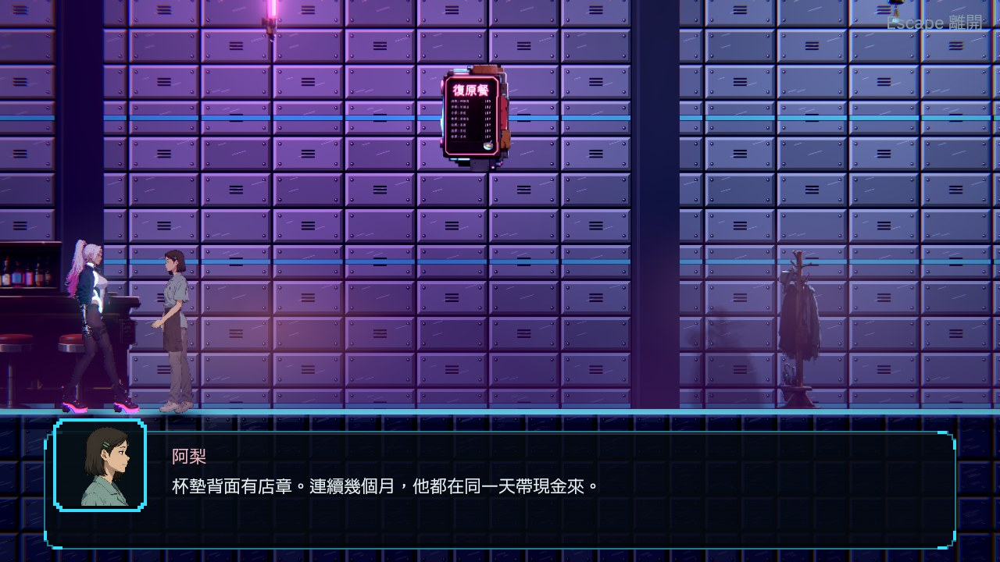

# [ST-40] 在復原館核對交班日期

> 狀態：完成

## 內文

### 需求

當舖核對手續費後，凜走到復原館問阿梨灰衣人的交班日期。玩家能把日期抄進帳冊、返回當舖並重看三份線索。

### 來源

第五章劇本第 5.03 幕「同一天，付現金」。

### 驗收條件

- [x] 當舖核對手續費後才開放街道入口。玩家可從當舖走到復原館並沿原路返回。
- [x] 任務地圖指到復原館吧台的阿梨，入口提示能指出盤點板的前置條件。
- [x] 離開或中斷對話後可重問。完整確認後，交班日期與任務進度一同保存，重開可查看。
- [x] 三份線索可以重看，付帳人仍匿名，原有帳冊與信用點維持原值。
- [x] 繁中、日文、英文皆有對白、提示與可讀的交班日期。

### 測試流程

1. 在盤點板比對手續費，查看開門前後的提示與任務位置。
2. 從街道進復原館，向阿梨詢問兩次並測試中斷。再完整確認日期。
3. 重開存檔，重看三份線索，沿街道回到當舖。

---

# 跟其他票的關係

- Blocks：ST-41
- Blocked by：ST-39
- Related：ST-37

---

# Commit-1

## 內文

核對手續費後，玩家可從當舖沿港區街道往返復原館，依任務地圖在吧台找阿梨。中途離開能再問。聽完證詞後，帳冊保存交班日期，重開後可重看三份線索。原帳的付帳人維持匿名。

### 測試結果

| 項目 | 結果 |
|---|---|
| 受影響的回歸 | 57 組、63,530 項通過，0 新失敗、0 已知失敗 |
| 實際路線、取消與寫入 | 通過 62 / 62 |
| 重開、線索重讀與回程 | 通過 30 / 30 |
| 任務地圖 | 3 區域及 3 項任務可達 |
| 劇本文字 | 9,795 條，0 個錯誤、0 個警告 |

### 截圖

