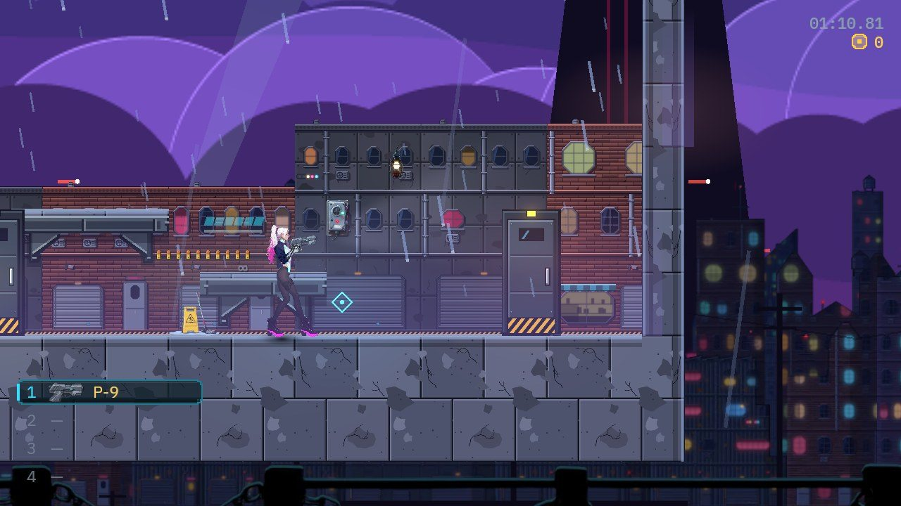

# [ST-41] 打開後巷的聲音鎖

> 狀態：完成

## 內文

### 需求

把第五章的聲音鎖接到當舖後巷。讓玩家能用以前聽過的原句開門，也能在門邊把原句找回來。

### 來源

第五章劇本 5.04。Stanley 在 2026-11-26 要求持續交付後續章節。

### 驗收條件

- [x] 從當舖和港區街道都能走進後巷，直接辨認門鎖與回程出口。
- [x] 對帳並拿到阿梨的日期後，可作答、先離開或取得逐步提示。答錯及重聽均維持門鎖。
- [x] 選擇門廊的原句才寫入進度。樓梯口可去、可回，跨程序讀檔仍然開放。
- [x] 任務地圖定位實際門鎖。繁體中文、英文和日文都有完整提示，通過後可回來聽燈的通訊。

### 測試流程

1. 帶著阿梨的日期由港區街道進後巷，選錯一次再重聽錄音。
2. 答對後先從當舖後門回來，再前往地下室樓梯口。
3. 退出並重開遊戲，從樓梯口回後巷並重聽通訊。

---

# 跟其他票的關係

- Blocks：ST-42
- Blocked by：ST-40、NE-376
- Related：ST-37

---

# Commit-1

當舖後門和港區街頭都接到後巷。籠燈下的聲音鎖能重聽原句。重試與參考提示不開門，答對才保存通路。玩家可以從樓梯原路回來。

### 測試結果

| 項目 | 結果 |
| --- | --- |
| 受影響的回歸 | 56 組、63,223 項通過，0 新失敗、0 已知失敗 |
| 實際走完與獨立冷讀檔 | 59 項實機、18 項冷讀檔通過，核對答錯、提示、開門、捷徑與回程 |
| 任務地圖與字幕 | 50 區域索引與本章 4 個目標，9,918 條文字無錯誤及警告 |
| RX 9070 XT Forward+ | 看過實際答題以及開門後的牆面、籠燈與支撐 |

