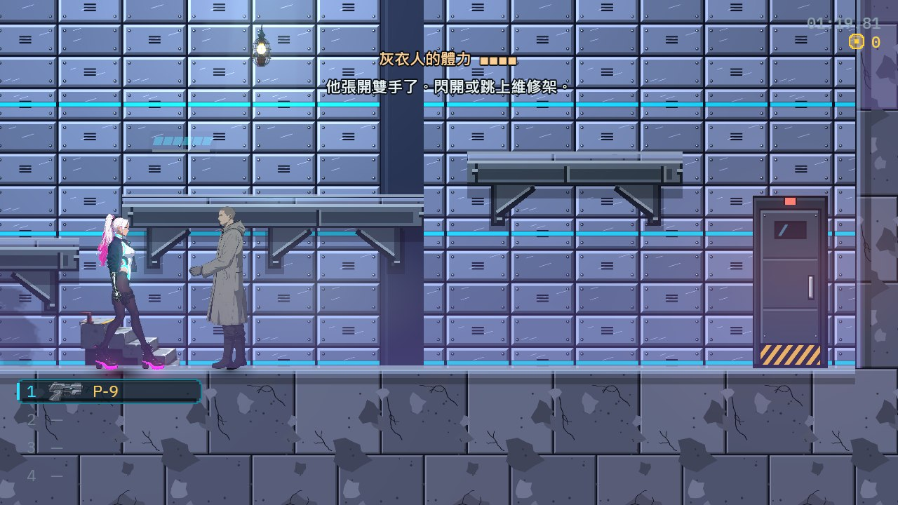

# [ST-42] 完成地下室樓梯口的搬運遭遇

> 狀態：完成

## 內文

### 需求

聲音鎖後安排一段避開灰衣人搬運的遭遇。玩家可走下層或利用上層維修架，等灰衣人退開後再查看外套。

### 來源

第五章第 5.05 幕「他要把妳搬出去」。

### 驗收條件

- [x] 張臂擒抱、繩圈、薄霧與下層圍堵都有可辨認的預兆及安全路線。
- [x] 按住或連按互動鍵都能掙脫。失敗可從有地面的安全位置重來，生命、裝備、信用點與既有線索保持原值。
- [x] 進到後段再退回後巷，重進可續玩該段。
- [x] 灰衣人退開後才可翻看衣領，取消保留原狀，確認保存後才記下名字並打開地下室。
- [x] 中、英、日都能看到目前的動作提示與掙脫按鍵。

### 測試流程

1. 用開了聲音鎖的存檔進樓梯口，躲過繩圈並試兩種掙脫操作。
2. 測一次被帶回巷口。到後段後退回後巷再進樓梯口，確認復原狀態與物品都在。
3. 等灰衣人退開，取消檢查一次再讀完衣領。確認實際入口從鎖住變成可進，重開後仍可進出。

---

# 跟其他票的關係

- Blocks：ST-43
- Blocked by：ST-41
- Related：ST-37

---

# Commit-1

## 內文

樓梯口有上下兩條路。玩家可沿維修架跨過低處的圍堵，也可在下層讀懂動作後閃開。被攔住時可按住或連按互動鍵。躲過前半段後可退回巷口，重進會從後半段繼續。讀完衣領並保存後才開啟地下室。

### 測試結果

| 項目 | 結果 |
| --- | --- |
| 受影響的回歸 | 77 組、95,668 項通過，0 新失敗、0 已知失敗 |
| 實際關卡與存檔、上下層、掙脫、衣領 | 38 項通過 |
| 重開、外套回顧與地下室雙向出入口 | 13 項通過 |
| 導覽與劇情文字 | 51 區域索引，第五章 6 區域及 5 項任務，文字 0 錯誤與 0 警告 |
| RX 9070 XT Forward+ | 已取得張臂前的提示與灰衣人實機畫面 |

### 截圖

# Commit-2

## 內文

將「地下室檔案間」的英日地名登錄到共用翻譯表，由第五章編譯器直接讀取。原有地名與進出路線維持一致。

### 測試結果

- 27 項關卡編譯工具測試通過。
- 第一至三章的 29 個關卡通過生成與已發布通道定義比對。
- 第五章重新生成後，地下室檔案間的關卡資源與地圖和已發布檔案逐位元相同。
