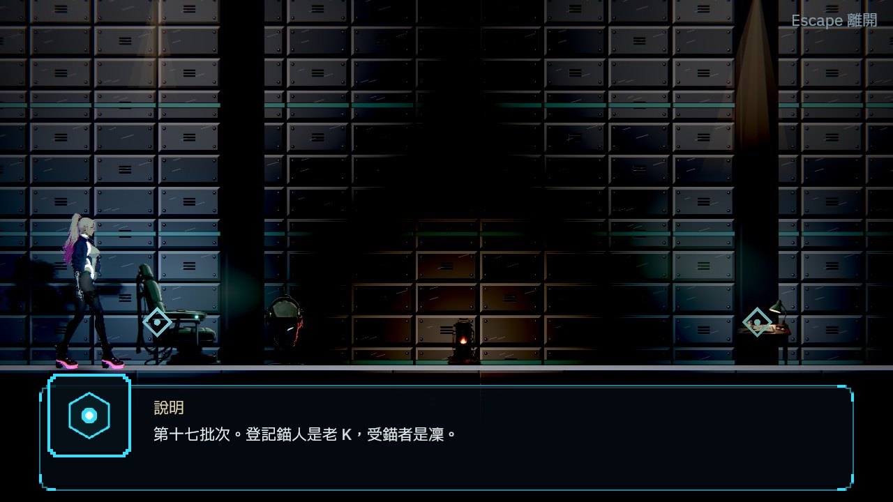

# [ST-43] 核對地下室的錨椅登記

> 狀態：完成

## 內文

### 需求

翻看必安的衣領後，凜前往地下室比對第十七批的座椅登記。玩家可以自願翻讀老 K 留在桌上的三頁生活筆記。

### 來源

第五章劇本第 5.06 幕「椅子是給誰的」。

### 驗收條件

- [x] 任務指到地下室的錨椅。已確認衣領後可從樓梯往返。
- [x] 持有原帳副本或在舊廠讀過原頁的玩家，可以用自己的證據核對。缺少舊證據的玩家可先親自查矮桌的同批搬運回單。
- [x] 完整核對確認後才保存錨椅登記。放棄或中斷後可重試，重開後能讀回確認結果。
- [x] 三頁生活筆記可依任意順序反覆翻讀。原帳、持有物、信用點與復原次數照原狀保留。
- [x] 繁中、日文、英文都有比對解說、選項提示和帳冊文字。

### 測試流程

1. 翻看衣領後進地下室。帶有原帳副本時，先取消一次，再完成核對。
2. 讀取有閱讀紀錄但無副本的存檔。再試兩種紀錄皆無的存檔，依提示先核對回單。
3. 重開存檔，閱讀三頁生活筆記並返回樓梯。核對持有物、信用點和復原次數。

---

# 跟其他票的關係

- Blocks：ST-44
- Blocked by：ST-42
- Related：ST-32、ST-37

---

# Commit-1

## 內文

可由樓梯進地下室核對錨椅。帶著原帳副本或讀過原頁時，凜能沿用自己的證據。其他存檔可以先到矮桌查同批次的搬運回單。確認後，帳冊保存老 K 與凜的座椅登記。生活筆記可反覆翻讀。

### 測試結果

| 項目 | 結果 |
|---|---|
| 持有原帳副本 | 通過 33 / 33 |
| 只有舊廠閱讀紀錄 | 通過 30 / 30 |
| 缺少舊證據，實地查回單 | 通過 42 / 42 |
| 重開、重讀同頁及返回樓梯 | 通過 34 / 34 |
| 本章路線 | 6 區域與 6 項任務可達 |
| 劇本文字 | 10,107 條，0 個錯誤、0 個警告 |
| 受影響的回歸 | 57 組。首次有 56 組通過，唯一失敗是合成投擲事件尚未送達。修正共用測試後，投擲與可讀性 2 組重跑共 723 項通過。 |
| 最新組合重新寫檔及冷讀 | 實際承接樓梯存檔 33 項，獨立程序讀回新存檔 34 項，全數通過。 |

### 截圖

