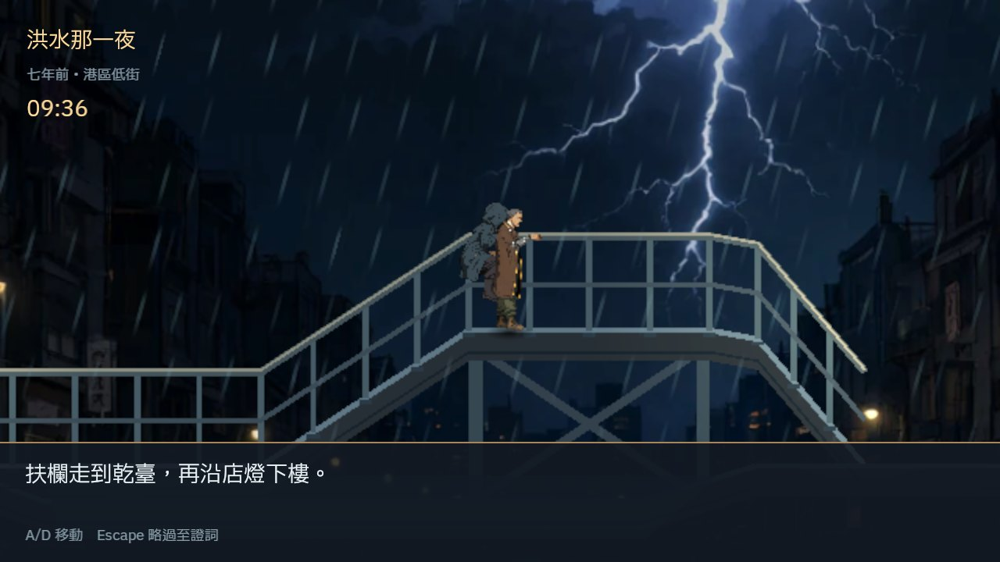

# [ST-44] 重現洪水那一夜

> 狀態：完成

## 內文

### 需求

核對錨椅後，玩家可讀取地下室的記憶片。由老 K 背著凜穿過淹水街區，回到當舖操作椅旁的讀取面板。

### 來源

第五章劇本 5.07 與後續章節實作需求。

### 驗收條件

- [x] 低街可以抄近路。水漲過踏面後，可扶外梯的欄杆到乾臺，沿店燈找到入口。
- [x] 十分鐘用完時會從上一處乾臺重來，回放內的倒數重新開始。
- [x] 老 K 把凜放上椅座後操作面板。護欄、踏面、角色接觸與室內外照明可辨識。
- [x] 播完和略過都可閱讀同一段證詞，返回原地下室。現實位置、物品、故事旗標與存檔維持原值。

### 測試流程

1. 核對椅旁記錄，操作記憶片並選低街。等水漲後改走外梯。
2. 到乾臺後讓倒數用完，從乾臺走到當舖，在讀取面板前確認。
3. 回到地下室，再從同一處開啟回放。略過後核對現實物品、旗標、位置與存檔。

---

# 跟其他票的關係

- Blocks：無
- Blocked by：ST-43
- Related：ST-33

---

# Commit-1

## 內文

讀取記憶片會進入可步行的七年前港區。低街水漲後要改走外梯，回到當舖可操作座椅旁的面板。離開會回到原地下室。

### 測試結果

| 項目 | 結果 |
|---|---|
| RX 9070 XT Forward+ | 24 項實際操作與保存比對通過，涵蓋雨中扶欄與椅旁讀取 |
| 回放路徑 | 低街、乾臺、短路淹水、到時與略過通過 |
| 地圖索引 | 51 區域通過 |
| 受影響的回歸 | 55 組、62,409 項，0 新失敗、0 已知失敗 |

### 截圖

