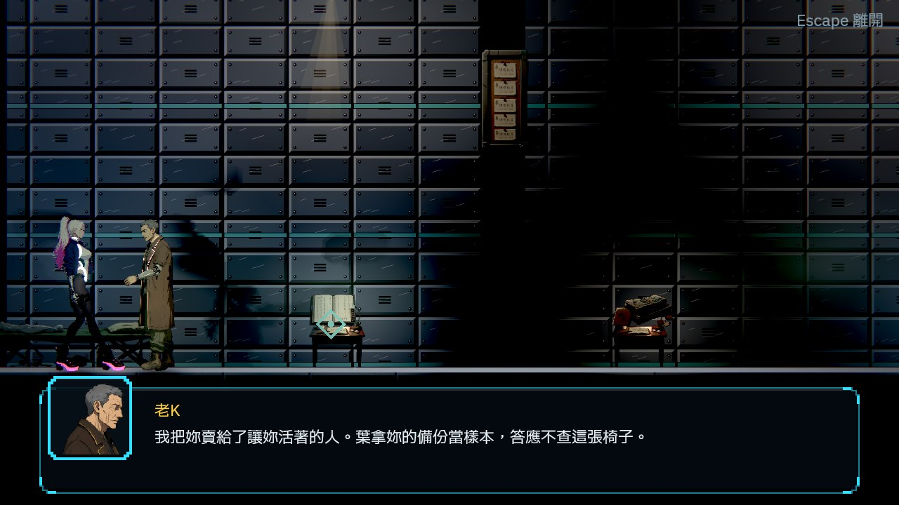

# [ST-45] 問清備份交換與贖回條款

> 狀態：完成

## 內文

### 需求

在地下室問老 K 為什麼交出備份，再到另一處翻讀記憶贖回附頁。附頁列出費用和雙方同意的條件，狀態保持等待本人同意。

### 來源

第五章第 5.08 幕「那句不用寫」。

### 驗收條件

- [x] 核對錨人後可到樓梯旁找老 K。完整說明、簡述和離開都有明確的選項。
- [x] 老 K 的說明與附頁各自確認、各自保存。取消並回來仍可重試，中途離開保留已完成的內容。
- [x] 附頁載明雙方同意與 480,000 信用點。讀完只記下等待本人同意，既有錢包、收據、生命、復原與證據保持原值。
- [x] 四十次專指舊椅在當時的紀錄。地下室既有線索、筆記與洪水回放都可照常重訪。
- [x] 繁中、日文和英文有對應的對白、提示及地圖指引。

### 測試流程

1. 從核對過錨椅的存檔讀取。先翻附頁，確認能知道下一步，再到樓梯旁找老 K。
2. 分別離開和中斷，再聽完說明。離開地下室後重進並閱讀附頁，確認獨立保存。
3. 重開遊戲並再次交談和閱讀。檢查條款狀態、錢包、任務指引和既有線索。

---

# 跟其他票的關係

- Blocks：ST-46
- Blocked by：ST-43
- Related：ST-44

---

# Commit-1

## 內文

凜可到樓梯邊向老 K 問備份交換，再到桌上翻讀附頁。兩段分開保存。讀完只會記下等待本人同意，玩家可以離開地下室、回來再讀。四十次是椅子的舊紀錄，480,000 信用點是條款列出的費用。

### 測試結果

| 項目 | 結果 |
|---|---|
| 完整說明、離開、取消、回到地下室與獨立附頁 | 通過 50 / 50 |
| 重開、重讀、既有資料與房間支撐 | 通過 14 / 14 |
| Forward+ 真實簡述與對話畫面 | 通過 12 / 12 |
| 本章能抵達的區域與任務 | 6 區域、7 項任務 |
| 關卡、地圖及預載索引 | 51 區域通過 |
| 劇本文字 | 10,283 條，0 個錯誤、0 個警告 |
| 受影響的回歸 | 56 組、63,390 項，0 新失敗、0 已知失敗 |

### 截圖

