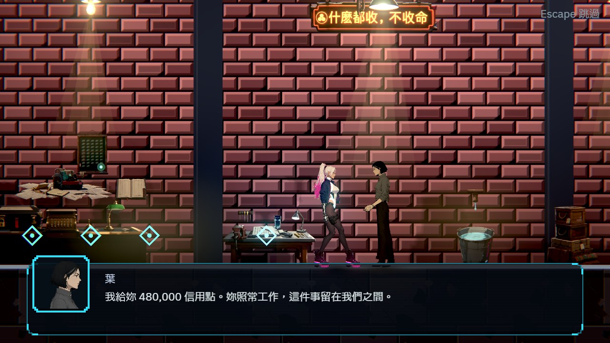

# [ST-46] 回當舖與葉談保密要約

> 狀態：完成

## 內文

### 需求

看過贖回條文後，凜回當舖聽葉的條件。玩家可查看 480,000 信用點的保密要約，先離開、回來再談或正式拒簽。過去收集到阿翰的線索時，可以另外問葉手背上的名字。

### 來源

第五章劇本第 5.09 幕「同一個價錢」。

### 驗收條件

- [x] 看過條文後，任務指向當舖的葉。可經原樓梯和後巷走回去。
- [x] 葉與桌上文件都顯示 480,000 信用點。先離開或中斷後可再談，完整拒簽才保存。
- [x] 親眼讀過手背的名字或仍持有錄音才可追問阿翰。問過的紀錄與拒簽各自保存。
- [x] 帳本、錄音、信用點與房間提案保留原值。已有提案時，桌上可讀回其房間。
- [x] 繁中、日文、英文都有對白、要約文件和選項提示。

### 測試流程

1. 從地下室讀完條文，原路回當舖。查看報價，先離開，再回來選拒簽。
2. 讀取有或無阿翰證據的存檔，分別檢查選項、取消和拒簽後追問。
3. 重開存檔，查閱葉的回覆與文件，核對錄音、帳本、信用點和房間提案。

---

# 跟其他票的關係

- Blocks：ST-47
- Blocked by：ST-45
- Related：ST-43

---

# Commit-1

## 內文

玩家看過贖回條文後，能沿樓梯與後巷回當舖，在工作檯旁查看葉提出的 480,000 信用點。中途離開可以再談，完整拒簽才存入進度。讀過名字或仍持有錄音的玩家可以追問阿翰，這段話也有自己的保存紀錄。

### 測試結果

| 項目 | 結果 |
|---|---|
| 實際往返、持有錄音、取消及拒簽 | 通過 55 / 55 |
| 未讀條文的舊存檔 | 通過 12 / 12 |
| 錄音已轉交的存檔樣本 | 通過 42 / 42 |
| 已看到名字的存檔樣本與舊房間提案 | 通過 45 / 45 |
| 重開、回看文件與房間檢查 | 通過 14 / 14 |
| 本章任務地圖 | 6 區域及 8 項任務可達 |
| 劇本文字 | 10,378 條，0 個錯誤、0 個警告 |
| 受影響的回歸 | 56 組、63,440 項，0 新失敗、0 已知失敗 |

### 截圖

