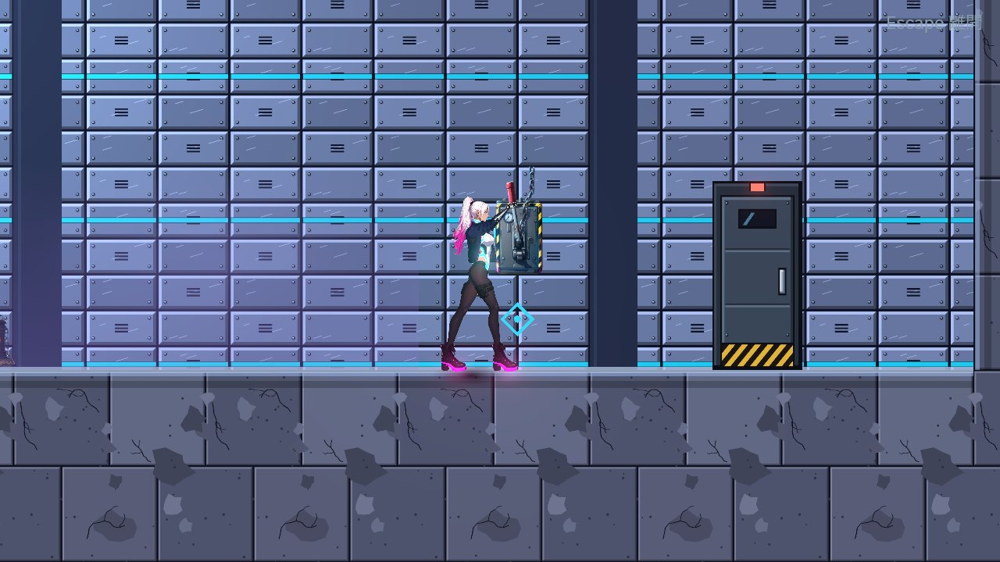

# [ST-47] 打通灰道與電話亭回路

> 狀態：完成

## 內文

### 需求

葉的要約談完後，可從街道直接去電話亭。地下室的交班單可自願支付 800 信用點，取得收據並開啟灰道。從廊內操作回口滑扣後，電話亭也能返回灰道。

### 來源

第五章劇本 5.10。

### 驗收條件

- [x] 地面路線與灰道都可抵達同一座電話亭。
- [x] 餘額不足、取消和拒寫可重試。費用、收據和第一道通行同步保存。
- [x] 手確實觸及廊內的滑扣，開啟回程。獨立程序續玩原路可回，金額維持。

### 測試流程

1. 依序用低餘額試兩次，補足後取消一次並模擬寫入拒絕。重試保存後從廊內開回口，回電話亭後獨立續玩，再走反向回程。

---

# 跟其他票的關係

- Blocks：ST-48
- Blocked by：ST-46、NE-377
- Related：無

---

# Commit-1

## 內文

葉的要約談完後，可從街道直接去電話亭。地下室的交班單可自願支付 800 信用點，取得收據並開啟灰道。從廊內操作回口滑扣後，電話亭也能返回灰道。

### 測試結果

| 項目 | 結果 |
|---|---|
| 原生 Forward+／RX 9070 XT | 58 個實際流程檢查通過 |
| 載入索引 | 53 區域重建及比對通過 |
| 獨立續玩及反向回路 | 16 項通過 |
| 受影響的回歸 | 57 組、63,829 項。首次檢出收據的日英顯示欄缺漏，另有 18 個既有貼圖匯入檔缺漏 |
| 校正驗收匯入後 | 7 組、32,788 項，0 新失敗、0 已知失敗、0 非預期診斷 |
| 補上收據日英資料後 | 4 組、1,042 項，0 新失敗、0 已知失敗、0 非預期診斷 |

### 截圖

