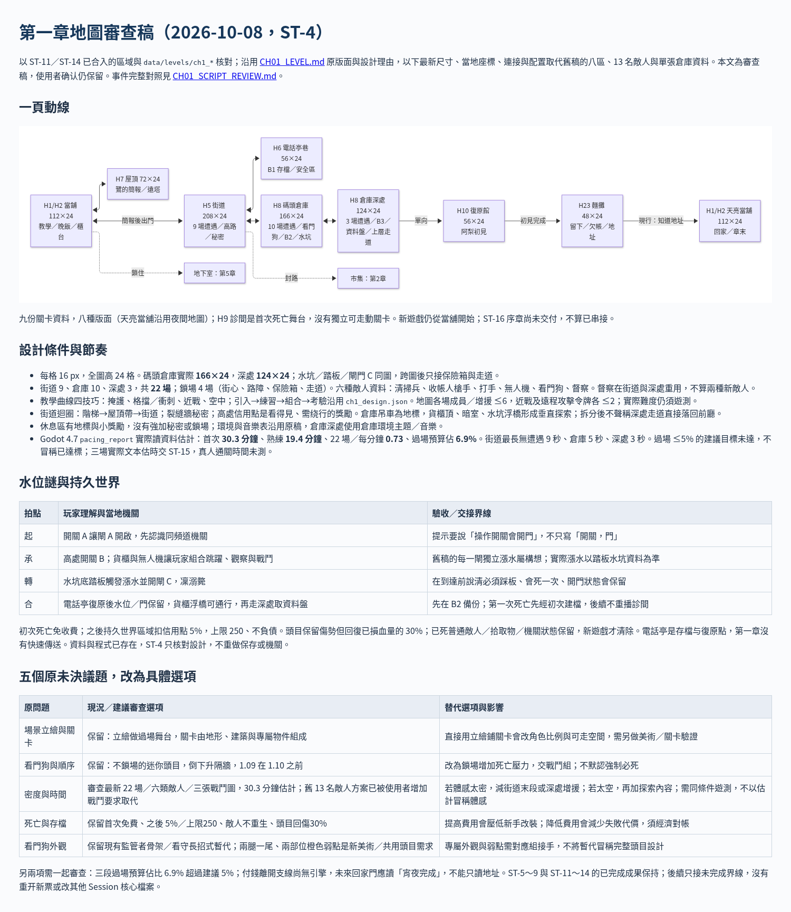

# [ST-4] 設計第一章「傘」的地圖與關卡

> 狀態：審查中

## 內文

### 需求
第一章要有一份完整的**地圖與關卡設計**：整個地圖的框架與大小依故事框架與地圖設計重新設計；每個區域的尺寸、版面、出入口、敵人與道具分佈、教學順序、水位謎的機關、存檔與世界狀態規則、需要的引擎功能與測試都寫清楚，讓後續的實作票有明確的依據。

### 來源
2026-10-05，使用者要求把第一章的遊戲做出來，包含地圖的完整設計；場景立繪已經有了，但地圖的框架與大小要重新設計；敵人要合理分佈、不要一次放出所有種類，道具只放該放的。設計見 `design/13-story-v2/CH01_LEVEL.md`。

### 驗收條件
- [x] 每個區域有尺寸、版面圖、出入口、內容、燈光與音樂
- [x] 區域之間的連接圖與玩家走的順序，與事件 1.01～1.13 一一對應
- [x] 第一章敵人名單、出場順序與數量、擺放規則
- [x] 道具清單與位置，只含該放的東西
- [x] 水位謎的機關設計（起承轉合）
- [x] 世界狀態與存檔規則
- [x] 列出需要的引擎功能並開票
- [ ] 使用者確認設計

### 測試流程
1. 對照事件表，確認每個事件都有對應的區域
2. 對照劇本，確認每個支線節點都有觸發位置
3. 檢查圖表都能正常顯示

---

# 跟其他票的關係

- Blocks：ST-5、ST-6、ST-7、ST-8、ST-9
- Blocked by：無
- Related：ST-1、NE-178、NE-97

---

# Commit-2

## 內文

依設計實作時發現幾處需要調整，已寫回 CH01_LEVEL.md（§3.1、§3.3、§3.5、§4、§12）：當舖改成由左到右（後空地、店面、廚房），讓劇情觸發點能依序觸發；倉庫地面抬高，水坑才夠深；街道尾段加一台無人機。使用者尚未確認 §11 的五題，先照建議實作，所以票維持進行中。

# Commit-3

## 內文

原地圖稿仍用單張倉庫與較早敵人數，跟後续拆分與增加戰鬥的成果不同。現在沿用已完成版面，補一頁式動線、全部區域尺寸與當地配置、存檔和水坑規則，並把五個未決議題整理成具體選項供審查；使用者確認框保留。

### 測試結果

| 項目 | 結果 |
|---|---|
| 最新地圖／配置核對 | 九份關卡，倉庫 166×24／深處124×24；22場／4鎖場；事件及支線位置與 ST-1 對齊 |
| 節奏資料估計 | Godot 4.7：首次30.3分鐘、每分鐘0.73場、過場預算6.9%；5%建議目標尚未達，真人遊測未執行 |
| 圖表／文件預覽 | 原版面圖與新動線實際渲染，已查看截圖 |
| 受影響測試選擇 | 只改文件與票，無遊戲測試；本次沒有重做關卡或試聽 |

### 截圖

