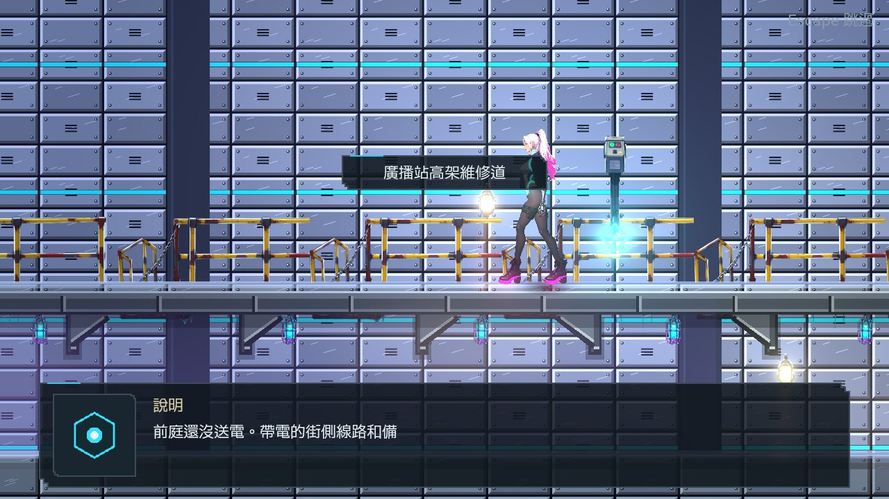

# [ST-50] 開通港區到廣播站的維修路

> 狀態：完成

## 內文

### 需求

接續第五章電話亭的通話，讓凜走到廣播站前庭。維修高架有兩層路可走，進出都有回程。

### 來源

[第六章〈斷錨〉場景順序](../../design/13-story-v2/EVENTS.md)和[廣播站前路](../../design/13-story-v2/CH06_BROADCAST_APPROACH.md)。

### 驗收條件

- [x] 完成第五章通話才能從電話亭巷進港區廣場。
- [x] 聽完蘇的回覆後，貨梯亮起白燈並開放。離開或中途取消時仍可再問。
- [x] 可走下層直接抵達前庭，也可上高架查閱線況。前庭水位尺有自己的閱讀結果。
- [x] 續玩後可原路回到電話亭巷，再前往港區街道或已開通的灰道，原帳和收據隨存檔保留。

### 測試流程

1. 在電話亭巷先檢查當前門檻，再完成通話，走東側維修階。
2. 在廣場喇叭分別選擇離開、中斷和聽完回覆，查看貨梯的通行狀態。
3. 從高架讀線況，進前庭讀水位。存檔續玩後走下層回廣場，再從電話亭巷走兩個既有出口。

---

# 跟其他票的關係

- Blocks：ST-51
- Blocked by：ST-48、ST-49
- Related：無

---

# Commit-1

## 內文

廣場的喇叭接通蘇。回覆完成後可搭貨梯進高架，前庭水位尺提供下一段調查的起點。橋下可直接通行，橋上可另查線況。棚下改用較小的補光，露天段仍看得到雨。

### 測試結果

| 項目 | 結果 |
|---|---|
| 帶著正式通話和灰道收據走過高架、閱讀前庭水位 | 55／55 |
| 冷讀檔、下層步行和兩個舊出口 | 27／27 |
| RX 9070 XT Forward+，1280 × 720 | 高架支撐、棚下補光、交流動作與露天雨幕 |
| 四區的場景支撐及 56 區的地圖與預載索引 | 0 錯誤 |
| 受影響的回歸 | 初跑 68 組、65,023 項，查出高架的裁切貼圖缺法線配對。補上配對，讓場景檢查沿用載入器的副檔名規則，並驗證裁切區域。重跑依賴與原失敗範圍 9 組、12,732 項，0 新失敗、0 已知失敗、0 非預期診斷 |
| 檔案與美術 | 原貼圖與法線裁切區域一致，三個官方索引逐位元一致 |

### 截圖

