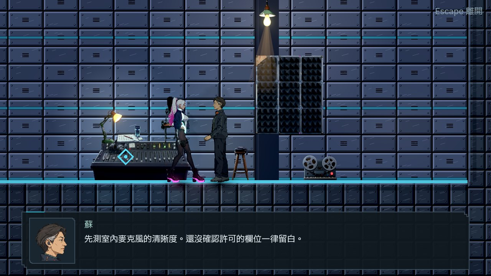

# [ST-52] 帶蘇走進錄音室試音

> 狀態：完成

## 內文

### 需求

前庭復電之後，玩家能先和蘇會合，再進錄音室試音。讓蘇、麥克風、稿紙和控音台組成一個看得出用途的空間。玩家能掌握試音和對外播送的進度。

### 來源

第六章劇本 6.03。Stanley 要求後續章節延續既有美術，並讓場景的光源、動態和互動物件有明確用途。

### 驗收條件

- [x] 蘇在前庭遮雨棚有可辨識的外觀及穩定站位。完整介紹後才移到錄音室，從前庭與錄音室都能沿門返回。
- [x] 試音桌的麥克風、稿和局部光能在實際遊戲中辨識，蘇在兩個位置都踩在實際地面。
- [x] 玩家到達太早、途中取消、略過及舊檔無帳本時，可繼續目前路線並看到合適說明。
- [x] 真正完成試音後，跨程序重開可回聽試音稿；原帳、信用點、裝備、死亡次數及公開播送狀態都讀回原值。
- [x] 繁中、英文、日文選項和地圖指引與實際地點相合。

### 測試流程

1. 載入完成前庭檢修的存檔，先看錄音室，回前庭中斷一次談話，再完成介紹。
2. 往返錄音室並操作監聽台。測試離開、略過和實際試音，查看蘇的站位和桌面的用品。
3. 關閉程序再讀原存檔，核對供回聽的試音稿和帳本狀況。

---

# 跟其他票的關係

- Blocks：ST-53
- Blocked by：ST-51
- Related：ST-49

---

# Commit-1

蘇先在前庭等玩家，會合後自己站到麥克風旁。玩家能看見監聽台、桌燈和試音稿的位置，確認試音後在螢幕上回看內容。播送和原帳仍由後續節點處理。

### 測試結果

| 項目 | 結果 |
| --- | --- |
| 原生實際路線 | RX 9070 XT Forward+，81 項通過，包含中斷、略過、舊檔無原帳與場景支撐 |
| 獨立程序讀檔 | 10 項通過，回到錄音室並可回看試音稿 |
| 任務地圖 | 57 個區域索引通過 |
| 錄音室環境音 | 從實際試音存檔冷載時，自動使用低音量的通風循環 |
| 完整回歸 | 89 組、106,761 項，檢查出錄音室缺少環境音登記與第二款燈具。補上後重跑 27 組、48,724 項，0 新失敗、0 已知失敗、0 非預期診斷 |

### 截圖

