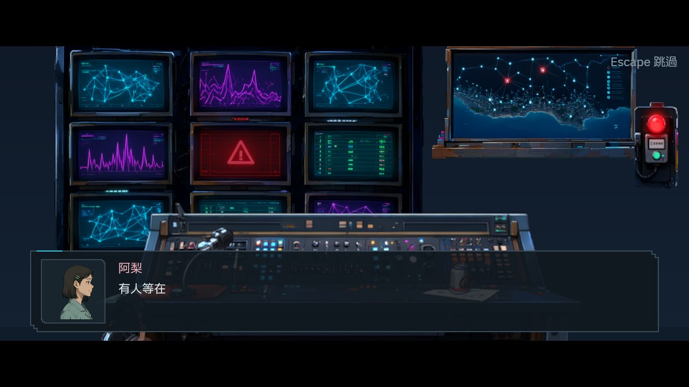

# [ST-53] 讓玩家接手燈的控制台

> 狀態：完成

## 內文

### 需求

蘇試音之後，可進入燈的控制畫面檢查線路。從訊號、濾波和重聽辨認阿梨的來電，再親自選擇轉接或保留播送線。回到錄音室接著遊玩。

### 來源

第六章劇本 6.04。Stanley 要求後續章節多一些不同的可玩操作及場景回饋。

### 驗收條件

- [x] 真正試音完成後才開放控制台。玩家可逐步核對三項指示並辨認來電。
- [x] 可離開、回聽或略過。轉接及保留線路各自顯示結果，由明確選擇及成功保存決定。
- [x] 暫存寫入遭拒時回報可重試。原本線路、帳本、裝備、信用點與復原次數維持原值。
- [x] 兩種結果可跨程序續玩，回錄音室原站位，讀回原決定及尚未公開播送的狀態。
- [x] 繁中、日文和英文能辨識每一項指示。原生畫面的警示、線路圖和監視器狀態清楚。

### 測試流程

1. 載入完成試音的存檔。在控制台先離開一次，再照提示整理線路和重聽。
2. 分別保存轉接或留線。測一次保存遭拒及重試，核對回錄音室後的資料。
3. 在另一個程序續玩並回到同一台控制台。核對終端機可重讀相同的決定。

---

# 跟其他票的關係

- Blocks：ST-54、ST-55
- Blocked by：ST-52
- Related：ST-49

---

# Commit-1

凜從錄音室的控制台查看遠端訊號。監視器、線路圖與紅色來電警示依實際診斷改變。玩家可取消、重聽或明確選擇轉接。結果保存後可回同一台終端機查閱。

### 測試結果

| 項目 | 結果 |
| --- | --- |
| RX 9070 XT Forward+ 轉接、拒絕保存及重試 | 67 項通過 |
| 同一前序存檔的留線 | 21 項通過 |
| 關卡、任務地圖與鄰區預載 | 57 區域索引通過 |
| 兩種結果各自冷讀檔 | 轉接與留線分別 10 項通過 |
| 受影響的回歸 | 56 組、63,835 項，0 新失敗、0 已知失敗、0 非預期診斷 |

### 截圖

