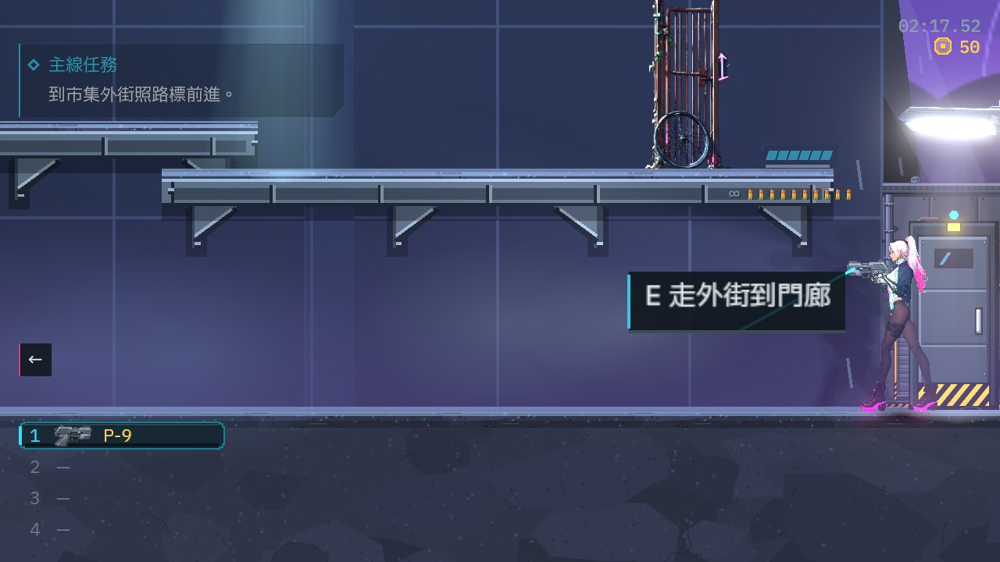

# [ST-54] 沿雨巷找到阿梨的門廊

> 狀態：完成

## 內文

### 需求

選擇轉接後，可從廣播站前庭走到市集外街與門廊。第一次到街上時依路標和街燈辨認方向。已有地址的續玩檔可繼續原本的限時路線，遲到也能返回。保留線路時維持錄音室的原進度。

### 來源

[外街與門廊的關卡設計](../../design/13-story-v2/CH06_RAIN_ROUTE.md)

### 驗收條件

- [x] 真正轉接後可從前庭進雨巷，依照街上的公開提示抵達門廊。
- [x] 可從門廊原路回去。留線存檔、一度中斷的存檔和已進門廊的存檔能各自續玩。
- [x] 支援既有已知地址檔案的限時通過和逾時處理。路徑、任務指引、裝備、帳本、信用點與復原紀錄符合原進度。
- [x] 路燈、雨幕、下層通道與平台支撐在實機畫面可見。

### 測試流程

1. 從實際轉接後的錄音室檔案走到前庭，再進雨巷。閱讀街上的提示並前往門廊。
2. 另從實際留線檔案重開。對照兩個分支的入口、任務和裝備。
3. 使用已有地址的相容存檔驗證限時路線、逾時和獨立讀檔。

---

# 跟其他票的關係

- Blocks：後續門廊事件
- Blocked by：ST-53
- Related：ST-50、ST-51

---

# Commit-1

依照玩家已取得的線索開放雨巷和門廊路線。街上的路標、燈與踏台各有作用，保留往返廣播站的路徑。

### 測試結果

| 項目 | 結果 |
|---|---|
| 實際轉接後出發，RX 9070 XT Forward+ | 37 項通過 |
| 實際留線和兩種獨立冷讀檔 | 8／14／5 項通過 |
| 已有地址的相容流程、逾時與中斷後冷讀檔 | 67／14／12 項通過 |
| 官方關卡、地圖與預載索引 | 59 區域通過 |
| 受影響的測試 | 75 組、96,100 項通過 |

### 截圖

