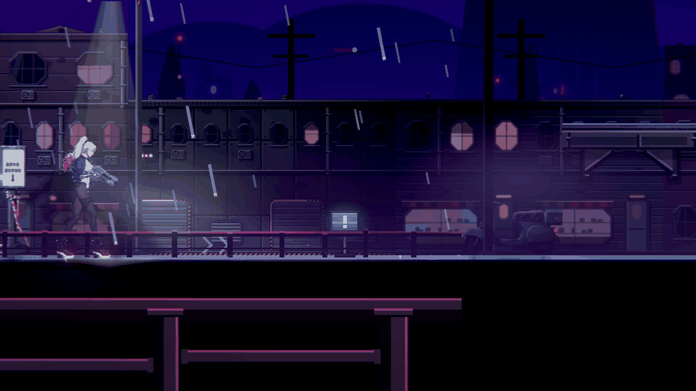

# [ST-55] 盤點故事票、區域敘事與台詞

> 狀態：完成

## 內文

### 需求
故事線要讓城市像有人住、每個區域都有話可說，同時把還沒完成的舊故事票往前推。動手之前先知道缺在哪裡：哪些舊票還差哪些條件、哪些不需要真人確認就能推進；每個區域有沒有人、有沒有地圖上的短對話、有沒有讓人知道「這裡是什麼地方、發生過什麼」的東西；全部台詞裡還有哪些是一兩個字的片段、一行太長或同一個人前後口氣不一致。盤點寫成一份文件，最後排出修改順序，後面的故事票照這個順序開。

### 來源
2026-11-28，使用者指示五條線同時進行、持續精進遊戲內容；故事線的第一項是盤點舊票並推進不需要真人確認的條件（`design/22-living-scenes/BACKLOG.md` 的「故事」表第 1 項）。

### 驗收條件
- [x] `pm/ST/` 裡狀態不是完成的票逐張列出還缺哪些驗收條件，標明哪些需要真人確認、哪些可以直接推進
- [x] 序章與第一到三章（正式版收錄的章節）每個區域列出：場景人物、可讀的物件與文件、地圖短對話、回訪時內容會不會變，以及玩家經過時知不知道這裡是什麼地方、發生過什麼；第四到六章附簡表
- [x] 有一支掃描對話資料的工具，列出一兩個字的片段、太長的一行與角色口氣不一致的地方，結果附檔案與位置
- [x] 文件最後排出故事線的修改順序

### 測試流程
1. 執行掃描工具，對照文件裡的數字與位置
2. 從文件的區域表挑三個區域進遊戲看，確認描述和實際一致

---

# 跟其他票的關係

- Blocks：無
- Blocked by：無
- Related：ST-1、ST-4、ST-15、ST-16、ST-19

---

# Commit-1

## 內文

故事線開工前不知道缺在哪裡：舊票還差什麼、哪些區域沒有人也沒有話、正式檢查通過之後還有哪些台詞讀起來卡。
現在有一份盤點（`design/22-living-scenes/STORY_COVERAGE.md`）和一支掃描工具。五張還開著的舊票逐條列出缺的條件：ST-1、ST-4 只差使用者確認；ST-15 的真人閱讀之外，還有掃出來的片段與過長句子可以先改；ST-16 的節奏估計已在目標內，熟手路線的鎖定比例還能再壓；ST-19 的故事部分剩下第二章港區街道。序章與第一到三章 30 個區域逐一判斷「知不知道這是哪裡、發生過什麼、回訪會不會變」：第一章只有港區街道是空的（提示牌說街上有人發傳單、聊天，實際一個人都沒有）；第二章的人與物件幾乎只為任務說話，白天的港區街道什麼都沒有；第三章的廣場貨梯與泵室只有操作說明。台詞掃出 10 處短片段、20 處過長、3 處凜說了設定裡不會說的話，另外老 K 句尾的「喔」在第五章完全消失。文件最後排出八項修改順序。
從遊戲裡拍了三個區域對照，和表上的描述一致。

### 測試結果

| 項目 | 結果 |
|---|---|
| 正式文字檢查（StoryLint） | 10,995 條來源，0 錯誤、0 警告 |
| 對話掃描 | 2,029 條對話與文件，33 項待讀（片段 10、過長 20、口氣 3） |
| 掃描工具自我檢查 | 通過 |
| 受影響的 Godot 測試 | 無（只改文件與工具，選擇器沒有選出套件） |

### 截圖

