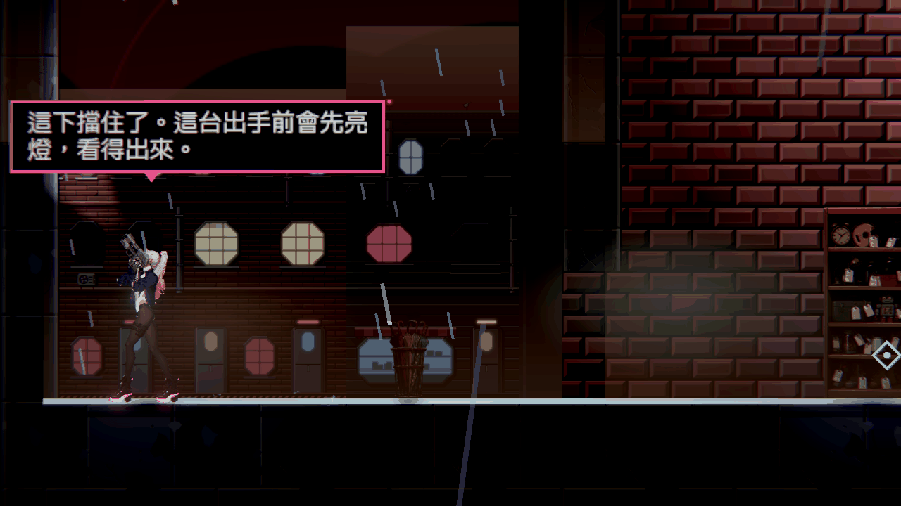
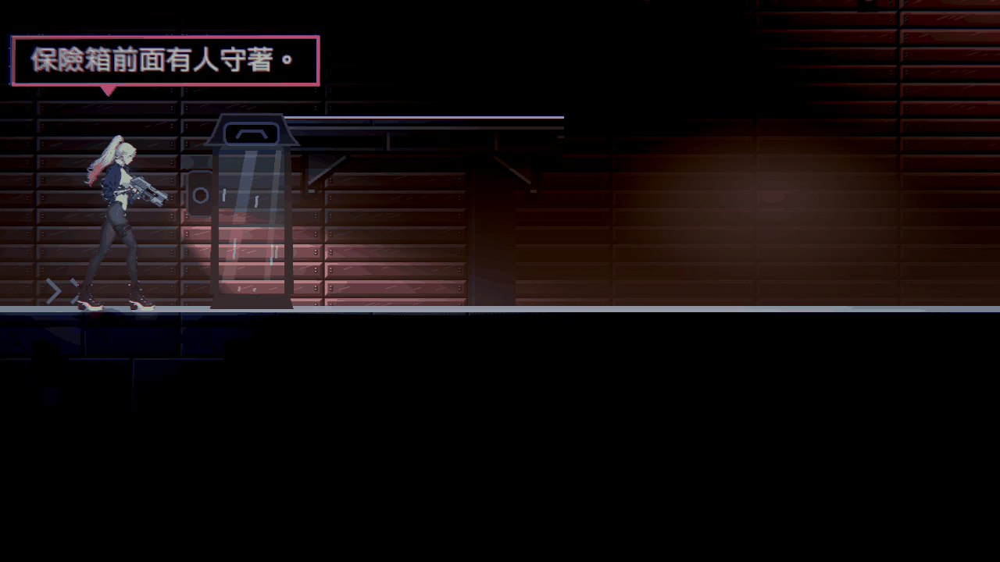

# [ST-56] 改寫序章與第一章不好懂的句子

> 狀態：完成

## 內文

### 需求
正式文字檢查已經全部通過，但序章與第一章仍有讀起來要自己拼的句子：句首單獨一句「擋住了。」「拉好了。」、戰鬥中只有三四個字的喊話、選項說明寫成「不點餐、不扣款」這種條列，還有「節點」「回放」這類開發用語跑進玩家看到的選項說明。把這些改成完整、好懂的句子，意思不變、角色口氣保留，並附改前改後對照表，讓使用者確認劇本（ST-1）與首次閱讀（ST-15）時讀到的是改好的版本。

### 來源
2026-11-28 盤點（ST-55，`design/22-living-scenes/STORY_COVERAGE.md` §3）；使用者反覆要求的「文字要好懂：一句話講完一件事、完整句子」。

### 驗收條件
- [x] 盤點掃出的序章與第一章片段全部改寫，並逐句通讀第一章全部台詞與選項說明，補上掃描抓不到的電報式句子與開發用語
- [x] 附改前改後對照表；意思、說話的人、演出、旗標與獎勵都不變，只有文字不同
- [x] 日文與英文跟著中文更新，沒有缺譯
- [x] 正式文字檢查 0 錯誤、0 警告；受影響的測試全部通過
- [x] 改過的句子在實機畫面上看過，不溢出、不被遮住

### 測試流程
1. 執行對話掃描與正式文字檢查
2. 在遊戲裡觸發改過的句子，截圖確認顯示完整

---

# 跟其他票的關係

- Blocks：無
- Blocked by：無
- Related：ST-1、ST-15、ST-16、ST-55

---

# Commit-1

## 內文

序章與第一章的台詞已經通過正式文字檢查，但仍有要自己拼的地方：凜在試盾時只說「擋住了。」，倉庫裡的喊話只有「有人守著。」「上面有人。」，選項說明寫成「不點餐、不扣款」「報酬800次晨核對」，還有「取布節點」「復原回放」這類開發用語寫在玩家看得到的選項說明裡。
逐句讀完第一章 380 句台詞與選項說明，改寫 35 句：每句補上主詞、對象或連接詞，喊話說清楚是哪裡有人，選項說明改成一般人講話的句子；說話的人、口氣（老 K 的「喔」、凜不道謝、阿梨的「那就欠著」）與意思都不變。日文與英文跟著中文改了 6 句的譯文，其餘譯文本來就是完整句子，原樣保留。
重新產生第一章資料後，和改前比對：除了文字以外的內容（演員、姿勢、步驟、旗標、獎勵、任務）完全相同。

| 場景 | 講者 | 改前 | 改後 |
|---|---|---|---|
| ch1_g06_lamp | 凜 | 聽得到。 | 我聽得到，你繼續說。 |
| ch1_k_plaza | 凜 | 廣場有人巡邏，小心。 | 廣場上有人在巡邏，小心一點。 |
| ch1_k_vault | 凜 | 有人守著。 | 保險箱前面有人守著。 |
| ch1_k_walkway | 凜 | 上面有人。 | 上面的走道有人。 |
| ch1_t_oldk_d1 | 老K | 水燒好了。吃完再去。 | 水燒好了，先吃完再去喔。 |
| ch1_t_egret_brief_revisit | 鷺 | 上層出口接交接櫃，回執別留在櫃裡，明早還要對。 | 從倉庫上層出口走，就會接到交接櫃。回執別留在櫃子裡，明早還要對帳。 |
| ch1_t_handoff_confirm | 選項說明 | 報酬800次晨核對；原盤交委託方保管。 | 報酬800，隔天早上核對；原盤交給委託方保管。 |
| ch1_t_handoff_summary_prompt | 燈 | 紙已拿到，還有缺附件那頁可以留。 | 回執拿到了。盤裡還有一頁缺附件的帳，可以留一份摘要。 |
| ch1_t_handoff_summary_prompt | 選項說明 | 保留批號M17與待查欄位，不代表已付或待付的判決。 | 留下批號M17和待查的欄位；這不代表已經判定付了還是欠著。 |
| ch1_t_handoff_revisit | 交接櫃 | 驗收紀錄已保存，次晨到當舖核對報酬。 | 驗收紀錄已保存，請於明天早上到當舖核對報酬。 |
| ch1_t_handoff_revisit | 鷺 | 今晚交的盤不會再算第二片，剩下的是明天的紙。 | 今晚交的盤只算一片，剩下要對的紙明天再說。 |
| ch1_t_ali_1 | 選項說明 | 不點餐、不扣款，可以再問。 | 不點餐也不扣款，之後還可以再問。 |
| ch1_t_supper_leave_options | 選項說明 | 現在不扣款、不加息；之後主動付清。 | 現在不扣款，也不加利息，之後再自己付清。 |
| ch1_t_supper_tab_confirm | 阿梨 | 餐酒兩百，現在不扣款、不加息，之後你可以主動付清。 | 餐酒兩百，現在不扣款，也不加利息，之後你可以自己付清。 |
| ch1_t_supper_insufficient | 選項說明 | 現在不扣款、不加息。 | 現在不扣款，也不加利息。 |
| ch1_t_supper_choice_ordered | 選項說明 | 確認支付200；不足可保留欠條。 | 確認支付200；錢不夠可以先留欠條。 |
| ch1_t_supper_leave_options | 選項說明 | 結清今晚餐酒並回家；不足額不扣款。 | 結清今晚的餐酒再回家；錢不夠就不會扣款。 |
| ch1_t_supper_tab_confirm | 選項說明 | 不建立欠條、不扣款。 | 不寫欠條，也不扣款。 |
| ch1_t_supper_insufficient | 選項說明 | 維持未結帳，可再選。 | 帳先不結，之後可以再選。 |
| ch1_t_supper_host_none_prompt | 選項說明 | 只接受麵，不生成餐酒帳。 | 只吃這碗麵，不會產生餐酒帳。 |
| ch1_t_supper_host_prompt | 選項說明 | 餐酒由阿梨招待，不返現金；麵免費。 | 今晚的餐酒由阿梨招待，不能換成現金；麵也不收錢。 |
| ch1_t_supper_host_prompt | 凜 | 我留下。麵是妳請，今晚那份也算妳請？ | 那我留下來吃。麵是妳請的，今晚那份也算妳請？ |
| ch1_t_supper_stay_revisit | 阿梨 | 我住市集後樓三樓，外梯上去，兩下再一下；路你記著，今晚先回家。 | 我住市集後樓三樓，從外梯上去，敲兩下再一下。路你記著，今晚先回家。 |
| ch1_t_lamp_voice_prompt | 選項說明 | 記錄相似，不替錄音者填姓名。 | 只記下聲音很像，不替錄音的人填名字。 |
| ch1_t_lamp_voice_second_prompt | 選項說明 | 保留第一次問過的線索，不算第二次答完。 | 第一次問到的線索會留著，這次不算問完。 |
| ch1_t_lamp_voice_second | 凜 | 那我記相似，不替你寫答案。 | 那我只記下聲音很像，不替你寫答案。 |
| ch1_t_lamp_voice_revisit | 燈 | 那段舊聲音我還沒想講，你記相似就好。 | 那段舊聲音我還不想講，你記著聲音很像就好。 |
| ch1_t_clinic_tray_prompt | 選項說明 | 查看真托盤，不在復原回放中取物。 | 走到臺邊看托盤上的杯子和布角。 |
| ch1_t_clinic_tray_prompt | 選項說明 | 復原點的規則，不影響建檔。 | 問復原點怎麼算，不影響這次建檔。 |
| ch1_t_clinic_cloth_decide | 選項說明 | 實際挪杯收布；茶不拿走。 | 把杯子挪開，收起布角；茶留在原處。 |
| ch1_t_clinic_cloth_decide | 選項說明 | 不取得物品，也不完成取布節點。 | 不拿走布角，托盤保持原樣。 |
| ch1_t_egret_sunday_prompt | 選項說明 | 週日不接案不會鎖住主線。 | 不問週日的事，也不會擋住主線。 |
| ch1_p04_fall | 老K | 拉好了。要再試就靠近它，燈亮的時候面向它舉盾。 | 墊子我拉平了。要再試就靠近它，燈亮的時候面向它舉盾。 |
| ch1_p04_guard | 凜 | 擋住了。這台出手前會亮燈，看得出來。 | 這下擋住了。這台出手前會先亮燈，看得出來。 |
| ch1_p02_talk | 凜 | 四十八萬，下午有太陽。我想讓你搬過去。 | 那間要四十八萬，下午有太陽。我想讓你搬過去。 |

### 測試結果

| 項目 | 結果 |
|---|---|
| 正式文字檢查（StoryLint） | 11,003 條來源，0 錯誤、0 警告 |
| 對話掃描（第一章） | 片段 5 → 1（剩下的是日誌體，不改）；口氣不符 0 |
| 改前改後資料比對 | 只有文字欄位不同 |
| 缺譯 | 0 |
| 受影響的 Godot 測試（11 組） | 10,082 項，0 新失敗、0 已知失敗 |
| 故事產生器的 Python 測試 | 9 支全過 |

### 截圖

