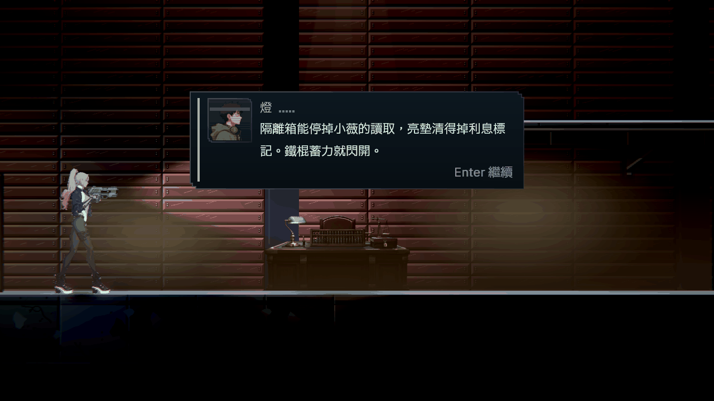

# [ST-57] 改寫第二章不好懂的句子

> 狀態：完成

## 內文

### 需求
第二章的台詞通過正式文字檢查，但還有名詞串成的句子（「陌生廣播、帽沿補線、港區電臺」）、條列式的選項說明、一行超過四十字讀不完的對白，以及戰鬥中超過通訊長度上限的頭目提示。把這些改成完整、好懂、一眼讀得完的句子，意思不變、角色口氣保留，並附改前改後對照表。

### 來源
2026-11-28 盤點（ST-55，`design/22-living-scenes/STORY_COVERAGE.md` §3）；使用者反覆要求的「文字要好懂」。

### 驗收條件
- [x] 盤點列出的第二章片段與過長句子全部改寫，並逐句通讀第二章全部台詞與選項說明，補上掃描抓不到的地方
- [x] 戰鬥中出現的頭目提示收短到一眼讀得完（公告螢幕的通訊兩行放得下，保留原文）
- [x] 附改前改後對照表；意思、講者、演出、旗標與獎勵都不變
- [x] 日文與英文跟著更新，沒有缺譯
- [x] 正式文字檢查 0 錯誤、0 警告；受影響的測試全部通過
- [x] 改過的句子在實機畫面上看過，不溢出、不被遮住

### 測試流程
1. 執行對話掃描與正式文字檢查
2. 在遊戲裡觸發改過的句子，截圖確認顯示完整

---

# 跟其他票的關係

- Blocks：無
- Blocked by：無
- Related：ST-15、ST-19、ST-55、ST-56

---

# Commit-1

## 內文

第二章的台詞通過正式文字檢查，但還有凜記筆記時說的「陌生廣播、帽沿補線、港區電臺」這種名詞串、選項說明的「收音機修好、廣播聽完」條列、阿梨說「我是市場後樓三樓」這種少了動詞的句子、凜對阿梨說話時同一句裡「妳」「你」混用，以及鷺章末茶座一句 52 字讀不完的話。阿勇頭目戰的提示有 32 字，戰鬥中來不及讀。
逐句讀完第二章 419 句，改寫 19 句：名詞串補成完整句子，條列改成一般說話的句子，過長的句子在不刪意思的前提下收短（鷺章末那句 52 → 44 字），頭目提示收到 30 字內、一眼讀完。日文與英文同步，其中查核結算那句的譯文跟著改成「已結算」。
公告螢幕上沈望的演說原本想拆成四句，但通訊框一段最多兩句，拆開會讓故事檢查失敗；兩行的通訊框放得下 39 字，所以保留原文。

| 場景 | 講者 | 改前 | 改後 |
|---|---|---|---|
| ch2_t_s02_saved | 凜 | 陌生廣播、帽沿補線、港區電臺，我先記下來。 | 那段陌生的廣播、帽沿的補線，還有港區電臺，我先記下來。 |
| ch2_t_s02_save_late | 凜 | 陌生廣播、帽沿補線、港區電臺，這次我記下來了。 | 那段陌生的廣播、帽沿的補線，還有港區電臺，這次我記下來了。 |
| ch2_t_s02_broadcast | 選項說明 | 收音機修好、廣播聽完，片段記進筆記。 | 收音機修好了，廣播也聽完；這段會記進筆記。 |
| ch2_t_s02_broadcast | 選項說明 | 收音機修好、廣播聽完，之後可以回來重聽。 | 收音機修好了，廣播也聽完；之後可以回來重聽。 |
| ch2_t_s02_broadcast | 老K | 名字不記得，東西還在，也是個開頭啦。 | 名字記不得了，東西還在，也算是個開頭啦。 |
| ch2_t_s07_address_new | 阿梨 | 我是市場後樓三樓，走外梯，敲兩下再敲一下，我就知道是你。 | 我住市場後樓三樓，從外梯上去，敲兩下再敲一下，我就知道是你。 |
| ch2_t_s13_cut | 凜 | 你活著就能對，別拿她再付。 | 你活著就能對帳，別再拿她來付。 |
| ch2_t_s12_choice | 選項說明 | 繼續打，風險如上。 | 繼續打，風險就是上面說的那些。 |
| ch2_t_s16_correct | 委託終端 | 附加60已暫停，待核對；本金200保留。 | 附加的60已暫停催收，等待核對；本金200照舊保留。 |
| ch2_t_s16_advance | 凜 | 妳決定怎麼用，我不再替你塞進去。 | 妳決定怎麼用，我不再替妳塞進去。 |
| ch2_t_s03_brief | 鷺 | 天穹要找誰多收了錢，我只要他們別拿攤商的錢墊掉。你看見不對的地方就寫，不用替誰挑好看的。 | 天穹要找誰多收了錢，我只要他們別拿攤商的錢墊。看到不對就寫，不用替誰挑好看的。 |
| ch2_t_s22_tea | 鷺 | 去查表可以，不用每張都有簽名就信它。晴岸也在那邊，就是你那本目錄的日照區住宅。想看就看，不先替老頭子買。 | 去查表可以，有簽名也別就信。晴岸就在那邊，你目錄上的那片住宅。想看就看，別先替老頭子買。 |
| ch2_t_s08_collection | 說明 | 批號M17，收款120，其中本金100、利息20，轉送北棟二樓。待收欄寫著120。 | 批號M17：收款120，本金100、利息20，轉送北棟二樓。待收欄仍寫120。 |
| ch2_t_s12_choice | 說明 | 永久解除會切掉動力與讀取。阿勇將失去靠小薇復原的資格，小薇不再承擔這段連結的損耗。 | 永久解除會切掉動力和讀取。阿勇不能再靠小薇復原，小薇也不再替他承擔損耗。 |
| ch2_t_s12_choice | 說明 | 保留資格就繼續迎戰。儲能匣仍帶電，攻擊它可能使阿勇過載死亡；復原會讓小薇失去記憶。 | 保留資格就繼續打。儲能匣還帶電，打它可能讓阿勇過載死亡；他復原會讓小薇失去記憶。 |
| ch2_s12_defeat_hint | 燈 | 隔離箱能阻止小薇的讀取，亮墊能清除利息標記。看見鐵棍蓄力再閃避。 | 隔離箱能停掉小薇的讀取，亮墊清得掉利息標記。鐵棍蓄力就閃開。 |
| ch2_t_s15_upload | 葉 | 我是天穹的葉，負責這次帳務抽查。你提出的同批號副本已核對，這一期附加的二十不成立。 | 我是天穹的葉，負責這次帳務抽查。你給的同批號副本核對過了，這期多加的二十不成立。 |
| ch2_t_s15_upload | 委託終端 | 市場查核報酬二百五十信用點，第一次結算。夾層是港區與日照區之間的工作層，診所從廣場貨梯過去。 | 市場查核報酬二百五十信用點已結算。夾層是港區和日照區之間的工作層，診所從廣場貨梯上去。 |
| ch2_t_s21_close | 阿梨 | 梨嬸教我，湯裡放一顆梨，煮到最後也不容易澀。她在梨攤邊把我抱回去，我能留下的做法就這幾樣。 | 梨嬸教我在湯裡放一顆梨，煮到最後也不澀。她在梨攤邊把我抱回去，留給我的做法就這幾樣。 |

### 測試結果

| 項目 | 結果 |
|---|---|
| 正式文字檢查（StoryLint） | 11,006 條來源，0 錯誤、0 警告 |
| 改前改後資料比對 | 除了 文字以外，演員、步驟、旗標、獎勵、任務都相同 |
| 缺譯 | 0 |
| 受影響的 Godot 測試（第二、三章一起跑，12 組） | 10,155 項，0 新失敗、0 已知失敗 |
| 故事產生器的 Python 測試 | 全過 |

### 截圖

