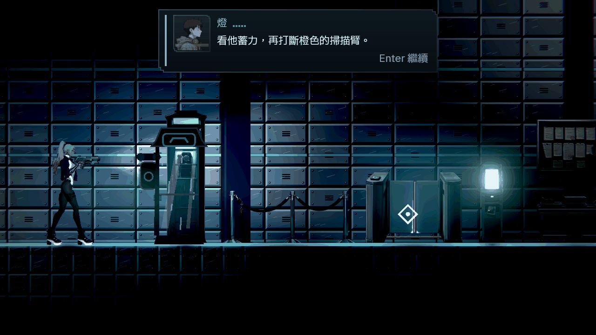

# [ST-58] 改寫第三章不好懂的句子

> 狀態：完成

## 內文

### 需求
第三章的台詞通過正式文字檢查，但還有「今天的，字怎麼抖得這麼厲害？」這種斷開的句子、「安全的過場」「可選」這類開發用語寫在選項說明裡、一行超過四十字讀不完的對白、凜說了設定裡不會說的「幫我」，以及老 K 對葉說話時「妳」「你」混用。把這些改成完整、好懂、一眼讀得完的句子，意思不變、角色口氣保留，並附改前改後對照表。

### 來源
2026-11-28 盤點（ST-55，`design/22-living-scenes/STORY_COVERAGE.md` §3）；使用者反覆要求的「文字要好懂」。

### 驗收條件
- [x] 盤點列出的第三章片段與過長句子全部改寫，並逐句通讀第三章全部台詞與選項說明，補上掃描抓不到的地方
- [x] 守門機頭目戰的提示一句講一件事，戰鬥中讀得完
- [x] 附改前改後對照表；意思、講者、演出、旗標與獎勵都不變
- [x] 日文與英文跟著更新，沒有缺譯
- [x] 正式文字檢查 0 錯誤、0 警告；受影響的測試全部通過
- [x] 改過的句子在實機畫面上看過，不溢出、不被遮住

### 測試流程
1. 執行對話掃描與正式文字檢查
2. 在遊戲裡觸發改過的句子，截圖確認顯示完整

---

# 跟其他票的關係

- Blocks：無
- Blocked by：無
- Related：ST-15、ST-21、ST-55、ST-56、ST-57

---

# Commit-1

## 內文

第三章的台詞通過正式文字檢查，但還有凜問老 K 的「今天的，字怎麼抖得這麼厲害？」這種斷開的句子；選項說明寫著「安全的過場」「可選」這類開發用語；凜對林小姐說「先幫我投到……」，和她不說「幫我」的設定不合；老 K 對葉說話時同一段「妳」「你」混用；「老 K 收起來客卡」讀起來像「收起來」加「客卡」。守門機頭目戰的提示 38 字擠在一句，戰鬥中讀不完。
逐句讀完第三章 384 句，改寫 21 句：補上主詞與受詞，開發用語改成玩家看得懂的說法（「躲在等候臺，他們不會發現你」），凜的請託改成她自己的說法（「這張我要先投到相鄰的天穹接待廊」），老 K 對葉統一用「妳」。守門機的提示拆成兩句，一句講打哪裡、一句講怎麼斷增援。日文與英文同步。

| 場景 | 講者 | 改前 | 改後 |
|---|---|---|---|
| ch3_t_c00_choice | 選項說明 | 可選的追問，主線一樣。 | 可以不問，主線照樣進行。 |
| ch3_t_c01_box | 燈 | 先看水尺，紅線下面才可送電。 | 先看水尺，水位降到紅線下面才能送電。 |
| ch3_c11_bark_repeat | 凜 | 他會重複，先看蓄力。 | 他會一直重複，先看他蓄力。 |
| ch3_t_c04_counter | 芷姐 | 公開報表在桌上，輪班表在工作廊，追蹤名冊在門邊的閱覽櫃。三份都用編號，日期要一起看。 | 公開報表在桌上，輪班表在工作廊，追蹤名冊在門邊閱覽櫃。三份都用編號，要一起對日期。 |
| ch3_t_c08_result | 芷姐 | 你對的是這一批的比例。別拿它當每次死一次就少十一，也別拿我的護理表替你個人的帳簽名。 | 你對出的是這一批的比例。別當成每死一次就少十一，也別拿我的護理表替你自己的帳簽名。 |
| ch3_t_c05_report | 說明 | 月報十七，觀察期一日到三十日，同批錨人一百名，編號R17-001到R17-100。 | 月報十七：觀察期一到三十日，同批錨人一百名，編號R17-001到R17-100。 |
| ch3_t_c15_posted | 林小姐 | 三間總價都是四十八萬，差朝向、光照時間和安靜程度。入住要本人看過，我今天不請您簽。 | 三間都是四十八萬，差在朝向、日照時間和安不安靜。入住要本人看過，今天我不請您簽。 |
| ch3_t_c21_route | 燈 | 貨梯與護理外廊都通了，沿邊緣電梯下去，從廣場回家。交通終端還沒啟用，我先把步行路標接好。 | 貨梯和護理外廊都通了，搭邊緣電梯下去，從廣場回家。交通終端還沒開，我先接好步行路標。 |
| ch3_t_c23_call | 鷺 | 這張夠證明少算人，不夠知道每次的讀取記在哪裡。中央帳本不在公開櫃，我想拿真正的那一本。 | 這張證明他們少算了人，卻看不出讀取記在哪。中央帳本不在公開櫃，我要真正那本。 |
| ch3_t_c15_welcome | 凜 | 先幫我投到相鄰的天穹接待廊。 | 這張我要先投到相鄰的天穹接待廊。 |
| ch3_t_c22_door | 凜 | 今天的，字怎麼抖得這麼厲害？ | 今天這張的字，怎麼抖得這麼厲害？ |
| ch3_t_c19_choice | 選項說明 | 安全的過場，聽完要自己確認記錄。 | 他們不會發現你；聽完要自己確認記錄。 |
| ch3_t_c20_middle | 選項說明 | 安全的過場，他們不會發現你。 | 躲在等候臺，他們不會發現你。 |
| ch3_t_c19_choice | 選項說明 | 可選，看清就記下這個名字。 | 可以不看；看清了就記下這個名字。 |
| ch3_t_c20_revisit | 選項說明 | 可選，剛才沒看清的話。 | 剛才沒看清的話，可以再看一次。 |
| ch3_t_c15_hub | 選項說明 | 可選的細問。 | 想多知道再問，不影響主線。 |
| ch3_t_c04_after | 選項說明 | 可選的追問。 | 可以不問，不影響主線。 |
| ch3_t_c20_trade | 老K | 妳上次答應的條件，不是讓她一直去換命。我今天要你把危險的派案停掉。 | 妳上次答應的條件，不是讓她一直去換命。我今天要妳把危險的派案停掉。 |
| ch3_t_c20_rest | 老K | 這張你回你的，我回去跟她說。 | 這張妳回妳的，我回去跟她說。 |
| ch3_t_c18_box | 說明 | 側門開了一道縫，老 K 收起來客卡，走到葉的桌前。 | 側門開了一道縫，老 K 把來客卡收起來，走到葉的桌前。 |
| ch3_c11_defeat_hint | 燈 | 看他蓄力，再打斷橙色的掃描臂。盾擊撲空三次會裂盾，繞背停通訊器就能阻止增援。 | 看他蓄力，再打斷橙色的掃描臂。／盾擊撲空三次會裂盾，繞到背後停掉通訊器就沒有增援。（拆成兩句） |
| ch3_t_c15_hub | 選項說明 | 只記提案，不簽約、不扣款。 | 只記下提案，不簽約，也不扣款。 |

### 測試結果

| 項目 | 結果 |
|---|---|
| 正式文字檢查（StoryLint） | 11,006 條來源，0 錯誤、0 警告 |
| 改前改後資料比對 | 除了守門機提示多一句，演員、步驟、旗標、獎勵、任務都相同 |
| 缺譯 | 0 |
| 受影響的 Godot 測試（和第二章一起跑，12 組） | 10,155 項，0 新失敗、0 已知失敗 |
| 補改最後一句後重跑（第三章故事、文字檢查、連續性） | 565 項，0 新失敗 |

### 截圖

