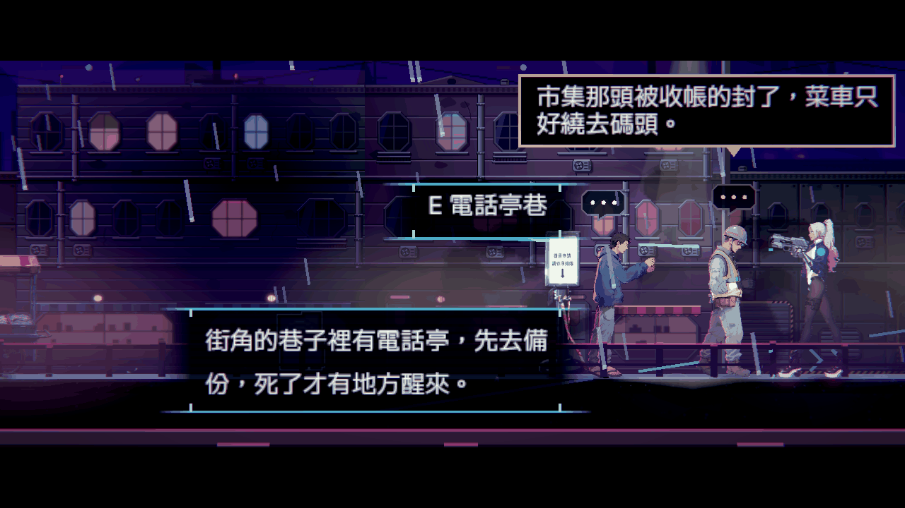
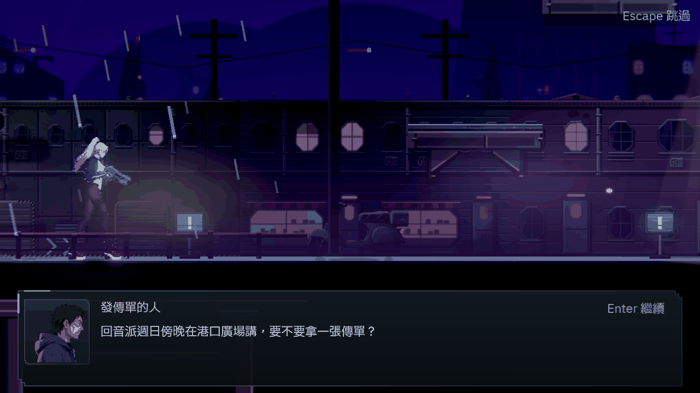

# [ST-59] 讓第一章港區街道有人住

> 狀態：完成

## 內文

### 需求
第一章港區街道是凜出門後走的第一條街，提示牌寫著「街上有人發傳單、有人聊天，不是每個人都想打你」，實際上整條街一個人都沒有；地上那張回音派傳單與收帳通知也沒有人提起。在市集口的安全段放上會聊天的街坊：玩家走過時不用停下就聽得到這條街今晚怎麼了，想多知道可以上前說話；回訪、凜死過一次、打通收帳人的路障之後，他們說的話會跟著變。

### 來源
2026-11-28 盤點（ST-55，`design/22-living-scenes/STORY_COVERAGE.md` §2 第一章、§4 第 3 項）；使用者指示「讓城市像有人住、每個區域都有話可說」。

### 驗收條件
- [x] 市集口有兩位街坊站在一起聊天，玩家走近時頭上出現短對話，不鎖操作、不擋路，內容和地上的收帳通知與回音派傳單呼應
- [x] 兩人都可以上前說話；第二次說話、凜死過之後、打通路障之後各有不同的一句
- [x] 走近時兩人有不開口的小動作，打通路障後換成不同的反應
- [x] 新台詞是完整句子，中日英三語齊全；正式文字檢查 0 錯誤、0 警告
- [x] 旗標與存檔：新對話不寫任何主線旗標、不給物品，讀檔後不會重播已聽過的街頭對話；故事契約、連續性與章節檢查全過
- [x] 實機截圖確認人物站位、氣泡與提示不互相遮住

### 測試流程
1. 新遊戲從當舖出門，沿街走到電話亭巷口，看街坊的氣泡
2. 分別和兩人說話，再說一次；死一次後回來說話；打通路障後回來說話
3. 執行受影響的測試、文字檢查與連續性報告

---

# 跟其他票的關係

- Blocks：無
- Blocked by：無
- Related：ST-55、NE-240

---

# Commit-1

## 內文

港區街道的提示牌寫著「街上有人發傳單、有人聊天」，整條街卻一個人都沒有；地上的收帳通知與回音派傳單也沒有人提起。
現在市集口站著兩位街坊：發回音派傳單的人，和靠著欄杆等市集解封的夜班工人。凜走近時，兩人頭上會冒出聊天的短句（「十四號店面又被貼單了，這個月是第三張。」），對上地上那張收帳通知；整段不鎖操作，邊走邊讀。上前說話會聽到更多：傳單背面那句「我爸說的不一樣」是發傳單的人兒子寫的，孩子的爸爸復原過兩次，他覺得爸爸還是同一個人；發傳單只是為了換一碗熱湯。工人說收帳人「收到錢就開」，整條街都在等別人先付。第二次說話、凜死過之後、打通路障之後，兩人各換一句新的，這一句用通訊框顯示、不停下遊戲；走近時有不開口的小動作，打通路障後動作也會不同。新對話不寫任何旗標、不給物品。
兩人原本站在傳單旁邊，跟傳單的說明框疊在一起；街頭對話又離凜出門的獨白太近，兩段氣泡會擠在一起。最後把他們挪到電話亭巷口前，兩人面對面站，對話的觸發點和出門獨白隔開十八格。第一次跑完整測試時抓到四件事並修正：一句話的回訪不符合人物對話三到八句的規則（改成通訊框）；這一區第一次遊玩的估計時間碰到八分鐘上限（把發傳單的人第一次的對話從六句收成四句，意思不變）；地圖字元和別區重複（換成本章沒用過的字元）；一句英文氣泡超過長度上限（收短）。截圖工具多了一個「等前面的氣泡講完再拍」的參數，方便之後拍排在後面的氣泡。

### 測試結果

| 項目 | 結果 |
|---|---|
| 正式文字檢查（StoryLint） | 11,060 條來源，0 錯誤、0 警告 |
| 連續性報告 | 錯誤 0；警告都是原本就有的旗標 |
| 受影響的 Godot 測試（57 組，含新加的街坊回歸） | 完整一輪 65,213 項抓到 12 項（上述四件事），修正後重跑出問題的 5 組 4,452 項，0 新失敗 |
| 新回歸檢查 | 兩人都在、四種情況各說不同的話、反應會變、對話不寫旗標、聊天的每一句都有人站在旁邊、聽過的聊天存檔讀回後不重播 |
| 缺譯 | 0 |

### 截圖

