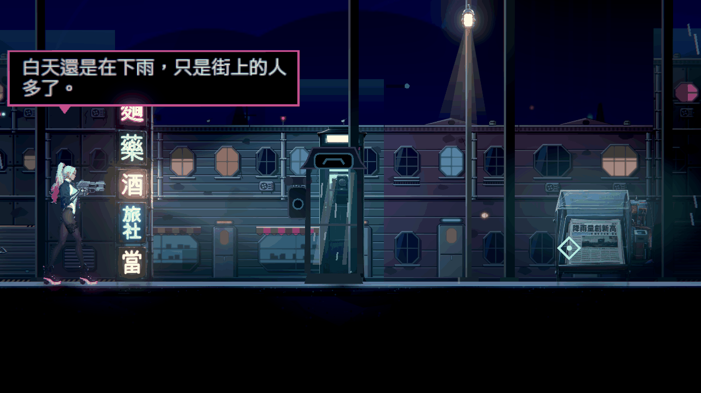
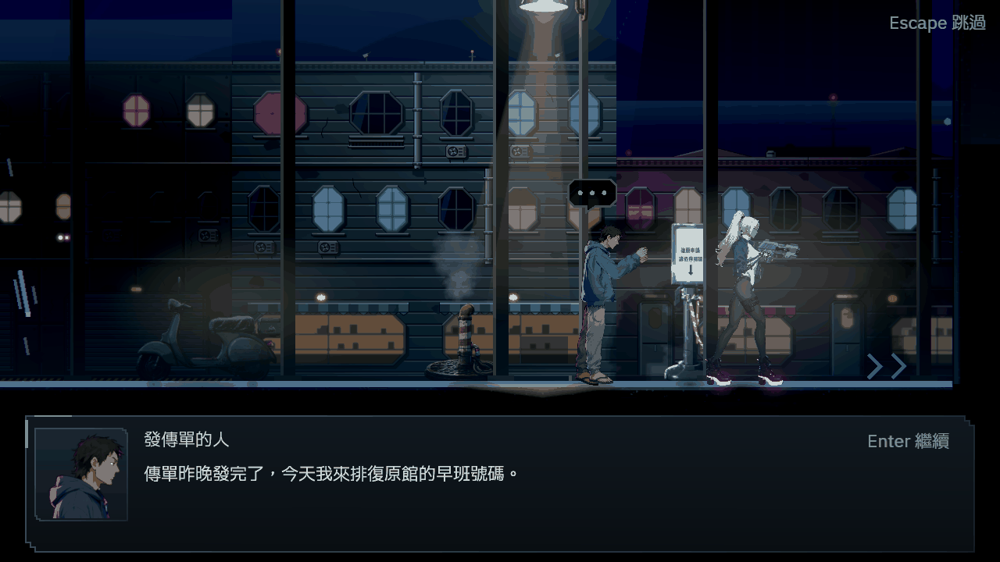
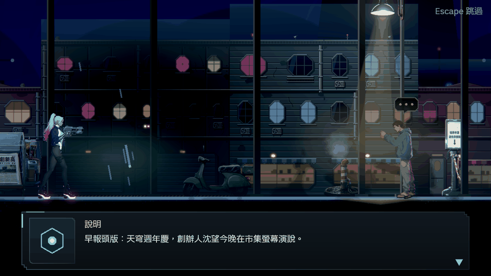
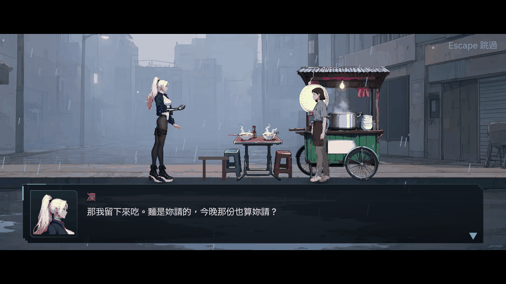
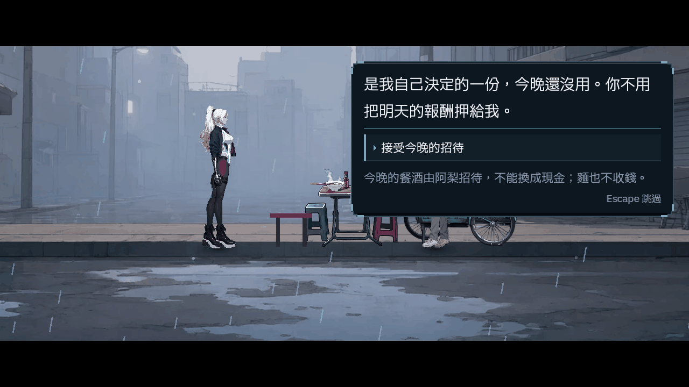
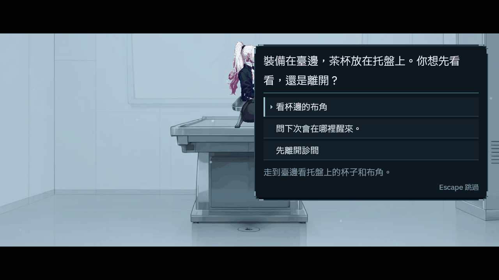

# [ST-60] 讓第二章白天的港區街道有人說話

> 狀態：完成

## 內文

### 需求
第二章早上凜從當舖出門，走的是第一章晚上那條港區街道，現在叫「港區街道（白天）」。這一區沒有人、沒有告示、沒有一句話，玩家不知道昨晚封路、打起來之後這條街變成什麼樣子。補上看得到前因的街景：第一章認識的兩位街坊早上又在這裡，說他們看到的現況；報架上的早報交代今天的大事；回訪與查帳上傳之後，他們說的話會跟著變。只講凜看得到的現況，不交代是誰收拾了街道。

### 來源
2026-11-28 盤點（ST-55，`design/22-living-scenes/STORY_COVERAGE.md` §2 第二章，「整章最大的空洞」）。

### 驗收條件
- [x] 進到這一區時有一段不鎖操作的短對話，讓人知道這是昨晚那條街、現在怎麼了
- [x] 第一章的兩位街坊在這裡出現，可以說話；第二次說話與查帳上傳之後各有新的一句，走近時有不開口的小動作
- [x] 報架可以讀，早報交代今晚沈望的週年演說與復原館排隊的人變多，和市集公告螢幕、第一章的剪報呼應
- [x] 新台詞是完整句子，中日英三語齊全；正式文字檢查 0 錯誤、0 警告
- [x] 新對話不寫主線旗標、不給物品，不擋路；故事、連續性與章節檢查全過
- [x] 實機截圖確認人物站位、氣泡與提示不互相遮住

### 測試流程
1. 第二章早上從當舖出門，走過港區街道，看氣泡並和兩人說話、讀報架
2. 查帳上傳後回到這條街，再和兩人說話
3. 執行受影響的測試、文字檢查與連續性報告

---

# 跟其他票的關係

- Blocks：無
- Blocked by：無
- Related：ST-19、ST-55、ST-59

---

# Commit-1

## 內文

第二章早上凜從當舖出門，走的是第一章晚上封路、打起來的那條港區街道，現在卻沒有人、沒有告示、沒有一句話。
現在一進來，凜說「白天還是在下雨，只是街上的人多了」，魚攤旁第一章的夜班工人接一句「早，昨晚那陣槍聲之後，菜車半夜就過去了」；整段不鎖操作。工人剛下夜班，說路口的收帳人半夜散了、市集今天只開攤道（和市集入口巡帳員說的一致）。第一章發傳單的人在復原館排隊告示旁排早班號碼：「孩子他爸。昨晚下工就沒回來，這已經是第三次了。」報架可以讀，早報頭版是今晚沈望在市集螢幕的週年演說，社會版一小格寫復原館今早排隊的人變多，對上市集公告螢幕的氣象欄。第二次說話、查帳上傳之後，兩人各換一句（疊在地圖上的對話框）（工人轉述「市場那筆多收的二十被人查出來了」；發傳單的人說「他爸醒了，第一句還是問晚飯吃什麼」），走近時的小動作也會變。台詞只講凜看得到的現況，不交代是誰收拾了街道；不寫旗標、不給物品。
同一張票依主 session 審 ST-56 的意見修正第一章兩句：燈問「聽得到嗎」時凜回「我聽得到。」（原改寫多了「你繼續說」，加了原本沒有的意思）；廣場的戰鬥喊話改回「廣場有人巡邏，小心。」（喊話要十個字以內）。也補拍第一章動畫過場裡改過的句子，換行與長度都沒有溢出。
這張票順便修正 ST-59 推上去後才發現的問題：第一章街坊回訪的一句話當時改成通訊框，但人物互動規定要用對話或過場（只有物件可以用通訊），完整測試抓到後改成和第一章其他回訪一樣的疊圖對話框；第二章的回訪一開始也錯用成氣泡，一起改掉。

### 測試結果

| 項目 | 結果 |
|---|---|
| 正式文字檢查（StoryLint） | 11,092 條來源，0 錯誤、0 警告 |
| 連續性報告 | 錯誤 0 |
| 受影響的 Godot 測試（56 組） | 完整一輪 65,025 項抓到 16 項：14 項是上述回訪的呈現方式（含第一章已推上的那 6 句），1 項是兩句譯文氣泡過長（改成對話框後不再適用），1 項是倉庫閘門提示 0.2 秒淡入的計時檢查（三個程序同跑時的負載，與這張票無關）；修正後重跑人物、故事內容、文字檢查、第一二章與過場 8 組 9,083 項，0 新失敗 |
| 缺譯 | 0 |

第一章有幾段改過的對話是疊在地圖上的對話框（鷺的回程提醒、交接櫃的摘要、燈的錄音話題），只能從人物互動觸發，截圖工具拍不到；它們用的是和下面截圖同一種對話框，最長一句 33 字，比截圖裡換成兩行的 34 字那句短。

### 截圖

